# 선형회귀: 이론부터 WM-811K 웨이퍼 맵 회귀분석까지

충남대학교 수학과 딥러닝 특강 · 1회차 강의 노트

## 이 문서에 대하여

이 문서는 실습 노트북 [선형회귀_WM811K.ipynb](선형회귀_WM811K.ipynb) 의 강의 노트예요. 노트북은 코드를 실행하고 결과를 확인하는 곳이고, 이 문서는 **왜 그렇게 하는지, 식이 어떻게 나오는지, 결과를 어떻게 읽는지**를 노트북보다 자세히 풀어 쓴 곳이에요. 수업에서는 이 문서를 화면에 띄워 설명하면서 노트북을 함께 실행해요.

<a href="https://colab.research.google.com/github/Jungsu-Yun/CNUML/blob/main/%EC%84%A0%ED%98%95%ED%9A%8C%EA%B7%80_WM811K.ipynb" target="_parent"></a>

- **절 번호와 제목은 노트북과 같아요.** 노트북의 3-6을 실행하고 있다면 이 문서의 3-6을 보면 돼요. 다만 노트북의 PART 5에는 절 번호가 없어서, 이 문서에서 5-1 ~ 5-4로 번호를 붙였어요.
- 그림과 숫자는 모두 노트북을 처음부터 끝까지 한 번 실행한 결과(CPU, 0-2에 출력된 버전)에서 가져왔어요. 버전이나 하드웨어(특히 GPU)가 다르면 마지막 자릿수가 조금 다를 수 있어요.
- 그림 번호(그림 1–21)는 노트북에서 그림이 나오는 순서와 같아요.

| 표시 | 뜻 |
|---|---|
| 💻 **노트북** | 이 절에 해당하는 노트북 셀. 90분 · 60분 진행에서 건너뛰는 셀도 여기에 적어요 |
| 💡 **핵심** | 꼭 가져가야 할 내용 |
| ⚠️ **주의** | 자주 하는 실수, 해석의 함정 |
| ⏱ | 진행 시간과 수업 운영 팁 |
| **(심화)** | 90분 진행에서도 건너뛰는 내용이에요. 시간이 남거나 복습할 때 보세요 |
| **생각해 볼 질문** | 수업 중에 던질 질문이에요. 답은 접혀 있어서 '답'을 눌러야 보여요. 노트북의 💬 표시도 같은 역할이에요 |

## 목차

- [PART 0. 환경 설정 (90분: 5분 · 60분: 3분)](#part-0-환경-설정-90분-5분--60분-3분)
  - [0-1. 의존성 설치](#0-1-의존성-설치)
  - [0-2. 라이브러리 불러오기](#0-2-라이브러리-불러오기)
  - [0-3. WM-811K 데이터 내려받기](#0-3-wm-811k-데이터-내려받기)
- [PART 1. 선형회귀의 수학과 PyTorch 구현 (90분: 25분 · 60분: 15분)](#part-1-선형회귀의-수학과-pytorch-구현-90분-25분--60분-15분)
  - [1-1. 문제 설정](#1-1-문제-설정)
  - [1-2. 예제 데이터](#1-2-예제-데이터)
  - [1-3. 최소제곱 추정과 정규방정식](#1-3-최소제곱-추정과-정규방정식)
  - [1-4. 기하학적 해석: 열공간으로의 직교사영](#1-4-기하학적-해석-열공간으로의-직교사영)
  - [1-5. 확률적 관점: 최대우도와 추정량의 분포](#1-5-확률적-관점-최대우도와-추정량의-분포)
  - [1-6. 경사하강법과 조건수](#1-6-경사하강법과-조건수)
  - [1-7. 기저함수 확장 · 과적합 · 릿지](#1-7-기저함수-확장--과적합--릿지)
- [PART 2. WM-811K 데이터 탐색 (90분: 15분 · 60분: 10분)](#part-2-wm-811k-데이터-탐색-90분-15분--60분-10분)
  - [2-1. 데이터셋 소개](#2-1-데이터셋-소개)
  - [2-2. 안전하게 불러오기](#2-2-안전하게-불러오기)
  - [2-3. 정리하기](#2-3-정리하기)
  - [2-4. 웨이퍼 맵 시각화](#2-4-웨이퍼-맵-시각화)
  - [2-5. 웨이퍼 단위 특징 계산 (PyTorch)](#2-5-웨이퍼-단위-특징-계산-pytorch)
  - [2-6. 수율 분포](#2-6-수율-분포)
  - [2-7. 데이터 분석 사례: 다이 크기와 수율 (Poisson 수율 모형)](#2-7-데이터-분석-사례-다이-크기와-수율-poisson-수율-모형)
  - [2-8. 로트 효과: 같은 로트의 웨이퍼는 닮았다](#2-8-로트-효과-같은-로트의-웨이퍼는-닮았다)
  - [2-9. 반지름에 따른 불량률 (불량 패턴별)](#2-9-반지름에-따른-불량률-불량-패턴별)
- [PART 3. 사례 ① 로트 조기 수율 예측 — 다중회귀 (90분: 20분 · 60분: 15분)](#part-3-사례--로트-조기-수율-예측--다중회귀-90분-20분--60분-15분)
  - [3-1. 시나리오](#3-1-시나리오)
  - [3-2. 데이터셋 만들기](#3-2-데이터셋-만들기)
  - [3-3. 학습/테스트 분할은 로트 단위로](#3-3-학습테스트-분할은-로트-단위로)
  - [3-4. 닫힌 해로 기준 모델 만들기](#3-4-닫힌-해로-기준-모델-만들기)
  - [3-5. PyTorch로 학습하기](#3-5-pytorch로-학습하기)
  - [3-6. 평가와 잔차 분석](#3-6-평가와-잔차-분석)
  - [3-7. 계수 해석과 통계적 추론](#3-7-계수-해석과-통계적-추론)
  - [3-8. 몇 장을 검사해야 할까? — 검사 매수 K와 예측 성능](#3-8-몇-장을-검사해야-할까--검사-매수-k와-예측-성능)
- [PART 4. 사례 ② 웨이퍼 맵 공간 회귀 — 기저함수 · 과적합 · 릿지 (90분: 20분 · 60분: 12분)](#part-4-사례--웨이퍼-맵-공간-회귀--기저함수--과적합--릿지-90분-20분--60분-12분)
  - [4-1. 모형](#4-1-모형)
  - [4-2. 패턴별 반경 프로파일: 1.8억 개 다이에 대한 정확한 OLS](#4-2-패턴별-반경-프로파일-18억-개-다이에-대한-정확한-ols)
  - [4-3. 웨이퍼 한 장의 불량 확률 곡면과 차수 선택 (교차검증)](#4-3-웨이퍼-한-장의-불량-확률-곡면과-차수-선택-교차검증)
  - [4-4. 릿지 정규화: 차수 대신 벌점으로 복잡도 조절](#4-4-릿지-정규화-차수-대신-벌점으로-복잡도-조절)
  - [4-5. 패턴별 공간 회귀 갤러리](#4-5-패턴별-공간-회귀-갤러리)
- [PART 5. 정리 (90분: 5분 · 60분: 5분)](#part-5-정리-90분-5분--60분-5분)
  - [5-1. 개념 정리](#5-1-개념-정리)
  - [5-2. 이번 분석에서 드러난 선형회귀의 한계](#5-2-이번-분석에서-드러난-선형회귀의-한계)
  - [5-3. 과제](#5-3-과제)
  - [5-4. 참고 자료](#5-4-참고-자료)
- [부록. 수업 준비 체크리스트](#부록-수업-준비-체크리스트)
  - [수업 전](#수업-전)
  - [수업 시작 직후](#수업-시작-직후)
  - [셀별 진행](#셀별-진행)
  - [실행 시간과 메모리](#실행-시간과-메모리)
  - [자주 나오는 질문](#자주-나오는-질문)

## 학습 목표

1. 최소제곱 문제를 **정규방정식 · 사영 · 최대우도** 세 관점에서 이해하고, 추정량의 분포(추론)까지 유도할 수 있다. (1-3 ~ 1-5)
2. 같은 모델을 **닫힌 해(QR / `lstsq`)** 와 **경사하강법(autograd, `nn.Module`, `DataLoader`)** 으로 PyTorch에서 학습할 수 있다. (1-3, 1-6, 3-4, 3-5)
3. **기저함수 확장 · 과적합 · 릿지 정규화**를 교차검증으로 다룰 수 있다. (1-7, 4-3, 4-4)
4. 실제 데이터를 탐색하고, 문제를 **회귀 문제로 정식화**해 학습 · 평가 · 시각화할 수 있다. (PART 2 ~ 4)

## 진행표

| 구간 | 내용 | 90분 진행 | 60분 진행 |
|---|---|---|---|
| PART 0 | 환경 설정 · 데이터 내려받기 | 5분 | 3분 |
| PART 1 | 선형회귀의 수학과 PyTorch 구현 | 25분 | 15분 |
| PART 2 | WM-811K 데이터 탐색 | 15분 | 10분 |
| PART 3 | 사례 ① 로트 조기 수율 예측 (다중회귀) | 20분 | 15분 |
| PART 4 | 사례 ② 웨이퍼 맵 공간 회귀 (기저함수 · 릿지) | 20분 | 12분 |
| PART 5 | 정리 · 과제 | 5분 | 5분 |

> ⏱ **90분 진행**: 제목에 **(심화)** 가 붙은 셀은 건너뛰어요. 모두 다루면 100분이 넘어요.
>
> ⏱ **60분 진행**: (심화)에 더해 1-6의 `nn.Linear` 예제, 1-7의 릿지 셀, 4-2 전체를 건너뛰고, 2-7은 그림과 결론만 보고 넘어가요.

(심화) 표시가 붙은 곳은 1-5의 몬테카를로 확인, 3-7의 군집-강건 표준오차, 4-2의 조건수 이야기 문단과 정중앙 다이 확인이에요. 건너뛴 셀에서 만든 변수는 뒤에서 쓰지 않으니, 나머지 셀을 **위에서부터 순서대로** 실행하면 돼요. GPU는 필요 없어요 (있으면 3-5의 학습에만 자동으로 써요). 셀별 실행 여부는 부록의 체크리스트에 표로 정리해 두었어요.

## 전체 흐름

1회차는 **하나의 도구(최소제곱)를 서로 다른 설계행렬에 세 번 쓰는 이야기**예요. 추정 방법은 끝까지 같고, 사례마다 바뀌는 건 "관측 단위가 무엇이고 설계행렬의 열을 무엇으로 채우느냐"예요.

1. **이론 (PART 1)**: 참값을 아는 합성 데이터 $y=2+0.5x+\varepsilon$ 에서 최소제곱해를 세 관점으로 유도하고, 닫힌 해와 경사하강법 두 가지로 구해요. 다항식 기저로 모형을 키우면 과적합이 생기고, 릿지가 이를 막는 것까지 봐요.
2. **실제 데이터 탐색 (PART 2)**: 웨이퍼 811,457장 · 로트 46,293개의 웨이퍼 맵에서 수율과 반지름별 불량률을 계산해요. 여기서 두 가지 회귀 질문이 나와요. 수율 변동의 대부분이 로트 간 차이라는 것(η² = 0.913)이 PART 3으로, 불량 패턴마다 공간 모양이 다르다는 것이 PART 4로 이어져요.
3. **사례 ① (PART 3)**: 관측 단위는 웨이퍼, 특성은 주로 같은 로트 앞 $K$ 장의 요약값이에요. 다중회귀로 나머지 웨이퍼의 수율을 예측하고, 로트 단위 분할 · 잔차 진단 · 군집 상관 · 검사 매수 $K$ 의 수확체감까지 봐요.
4. **사례 ② (PART 4)**: 관측 단위는 다이, 타깃은 불량 여부(0/1)예요. 기저함수로 불량 확률 곡면 $p(x,y)$ 를 추정하고, 교차검증으로 차수와 릿지 $\lambda$ 를 골라요.
5. **정리 (PART 5)**: 예측이 $[0,1]$ 을 벗어나고 분산이 위치마다 다르다는 한계가 드러나요. 다음 시간의 로지스틱 회귀로 이어져요.

| PART | 묻는 질문 | 핵심 도구 |
|---|---|---|
| 0 | 실습 환경과 데이터를 어떻게 준비할까? | `kagglehub`, `float64` / `float32`, `device` |
| 1 | 최소제곱해는 무엇이고, 어떻게 구하고, 얼마나 믿을 수 있을까? | 정규방정식, QR · `lstsq`, 사영, 최대우도, 경사하강법, 릿지 |
| 2 | 데이터는 어떻게 생겼고, 수율 변동은 어디서 올까? | 안전한 `Unpickler`, `einsum`, 비선형 모형의 선형화, ANOVA = 더미 회귀 |
| 3 | 앞 $K$ 장만 검사해서 나머지 웨이퍼의 수율을 예측할 수 있을까? | 다중회귀, 로트 단위 분할, `nn.Linear` + `DataLoader`, 잔차 진단, 군집-강건 표준오차 |
| 4 | 웨이퍼 위에서 불량 확률은 공간적으로 어떻게 분포할까? | 기저함수, 요약 통계량으로 푸는 OLS, 교차검증, 릿지, $\operatorname{df}(\lambda)$ |
| 5 | 무엇을 배웠고, 선형회귀로 안 되는 건 무엇일까? | 한계 정리 → 로지스틱 회귀 |

## 표기법

| 기호 | 의미 | 처음 나오는 곳 |
|---|---|---|
| $n$ | 관측(샘플) 수 | 1-1 |
| $p$ | 절편을 포함한 회귀계수 개수 | 1-1 |
| $X\in\mathbb{R}^{n\times p}$ | 설계행렬 (design matrix), 첫 열은 $\mathbf 1$ | 1-1 |
| $\mathbf y\in\mathbb{R}^{n}$ | 타깃 벡터 | 1-1 |
| $\boldsymbol\beta\in\mathbb{R}^{p}$ | 회귀계수 | 1-1 |
| $\boldsymbol\varepsilon$ | 오차항, $\mathbb E[\boldsymbol\varepsilon]=\mathbf 0$, $\operatorname{Cov}(\boldsymbol\varepsilon)=\sigma^2 I_n$ | 1-1 |
| $H = X(X^\top X)^{-1}X^\top$ | hat matrix (열공간으로의 사영) | 1-4 |
| $\hat{\ }$ (hat) | 데이터로부터 추정한 값 | 1-3 |
| $\mathbf e=\mathbf y-\hat{\mathbf y}$ | 잔차 | 1-4 |
| $s^2=\text{RSS}/(n-p)$ | $\sigma^2$ 의 불편추정량 | 1-5 |
| $J(\boldsymbol\beta)$, $A=\nabla^2J=\tfrac2nX^\top X$ | 평균제곱오차 손실과 그 헤시안 | 1-6 |
| $\lambda_{\min}$, $\lambda_{\max}$ | 헤시안 $A$ 의 가장 작은 · 큰 고윳값 | 1-6 |
| $u$ | 단위 반올림(unit roundoff). `float64` 는 $2^{-53}$, `float32` 는 $2^{-24}$ (3-3 · 5-2의 $u_g$ 는 로트 랜덤효과) | 0-2 |
| $\kappa$ | 조건수. 대칭 양정치 행렬이면 $\lambda_{\max}/\lambda_{\min}$, 행렬 $X$ 에는 최대 · 최소 특이값의 비 | 0-2, 1-3, 1-6 |
| $\eta$ | 학습률 (learning rate) | 1-6 |
| $\boldsymbol\phi$, $q$ | 특성 사상(기저함수)과 특성 개수 | 1-7 |
| $d$ | 다항식 차수 | 1-7 |
| $Z$, $\mathbf y_c$ | 표준화한 특성 행렬, 평균을 뺀 타깃 | 1-7 |
| $\lambda$ | 릿지 벌점의 세기 | 1-7 |
| $\operatorname{df}(\lambda)$ | 릿지의 유효 자유도 $\sum_j d_j^2/(d_j^2+n\lambda)$ | 1-7 |
| $(x,y)$, $r$ | 웨이퍼 중심이 원점, 반지름이 1인 정규화 좌표와 반지름 | 2-5 |
| $\eta^2$, $G$ | 그룹(로트)이 설명하는 변동 비율, 그룹 수 | 2-8 |
| $K$ | 로트에서 먼저 검사하는 웨이퍼 수 | 3-1 |
| $z$, $p(x,y)$ | 다이의 불량 여부(0/1), 위치 $(x,y)$ 의 불량 확률 | 4-1 |
| $\Phi$ | 기저함수 값으로 만든 설계행렬 | 4-2 |

> ⚠️ **주의**: 같은 글자가 여러 뜻으로 쓰이는 곳이 있어요. 문맥으로 구분하세요.
>
> - $\eta$ 는 학습률이지만 $\eta^2$ 는 2-8의 효과 크기예요.
> - $\lambda$ 는 1-6 · 3-5에서 헤시안의 고윳값($\lambda_{\min}$, $\lambda_{\max}$)이고, 1-7 · 4-4 · 4-5에서는 릿지 벌점이에요.
> - $p$ 는 계수 개수이면서 2-6과 PART 4에서는 불량 확률이에요. $q$ 도 특성 개수이지만 3-6과 4-1의 한 소절에서는 확률이에요.
> - $H$ 는 hat matrix이면서 코드에서는 맵의 높이(`H`, `W`)예요. $d$ 는 차수, $d_j$ 는 특이값이에요.
> - $A$ 는 1-6 · 3-5에서 헤시안이지만, 2-7에서는 다이 면적(영향점 분석에서는 $X^\top X$), 3-8에서는 설계행렬, 4-2에서는 묶음 소속 행렬이에요.
> - $R$ 은 1-3에서 QR 분해의 상삼각행렬이고, 1-6 · 3-5에서는 특성의 상관행렬이에요.
> - $Z$ 는 표준화한 특성 행렬이지만 2-8에서는 로트 지시 행렬이고, 4-2의 $Z_b$ 는 묶음의 불량 수예요.
> - $N$ 은 웨이퍼당 다이 수(2-6, 2-7, 3-6)이지만 4-2에서는 적합에 쓴 전체 다이 수예요.
> - $K$ 는 먼저 검사하는 웨이퍼 수이지만 2-7에서는 결함 수예요.
> - $\rho$ 는 1-6에서 스펙트럼 반지름(수렴률)이고, 3-7 · 3-8 · 5-2에서는 로트 내 상관이에요.

---

## PART 0. 환경 설정 (90분: 5분 · 60분: 3분)

PART 0은 실습 환경을 맞추고 데이터를 내려받는 단계예요. 내용은 짧지만, 여기서 정한 **dtype 정책**(닫힌 해와 통계량은 `float64`, 신경망 방식 학습은 `float32`)은 노트북 전체에 적용돼요.

> ⏱ **강의 팁**: 수업을 시작하자마자 0-1 → 0-2 → 0-3을 차례로 실행해 두세요. 0-3의 다운로드가 진행되는 동안 PART 1(합성 데이터만 써요)을 설명하면, 데이터가 처음 필요한 2-2에 도착할 때쯤 다운로드가 끝나 있어요. 60분 진행(3분)이면 0-2의 dtype 이야기는 아래 💡 핵심 한 문장만 말하고 넘어가요.

### 0-1. 의존성 설치

> 💻 **노트북**: 0-1의 패키지 표와 첫 번째 코드 셀 (Colab · 로컬을 구분해 `%pip` 로 설치)

같은 코드가 Colab과 개인 컴퓨터에서 똑같이 돌아가도록 **확인한 버전의 하한**을 정해 두고, 이미 설치된 패키지는 되도록 건드리지 않아요.

| 패키지 | 용도 | 확인한 버전 | 이 문서의 출력을 만든 버전 |
|---|---|---|---|
| `torch` | 텐서 연산 · 선형대수 · 자동미분 · 모델 학습 · 통계량 계산 | 2.4 ~ 2.15 | 2.15.0 |
| `pandas` | 데이터프레임 다루기 · 그룹 집계(`groupby`) · 표 출력 | 2.2 ~ 3.1 | 3.1.1 |
| `numpy` | pickle 안의 배열 복원 (pandas · torch의 의존성) | 1.26 ~ 2.5 | 2.5.5 |
| `matplotlib` | 시각화 | 3.8 ~ 3.11 | 3.11.2 |
| `kagglehub` | Kaggle 데이터셋 내려받기 (로그인 불필요) | 0.3 ~ 1.0 | 1.0.3 |

#### 코드 읽기

<details><summary>📝 셀 전체 코드 (줄별 주석)</summary>

```python
import sys
# ── 실행 환경(Colab / 로컬) 구분 ─────────────────────────────────
# sys.modules 는 지금까지 불러온 모듈의 딕셔너리예요. Colab 커널은 시작할 때 google.colab 을 미리
# 불러오므로 이 이름이 있는지로 환경을 구분해요. import 를 시도하지 않으니 로컬에서 ImportError 도 없어요.
if "google.colab" in sys.modules:
    # Colab: torch · numpy · pandas · matplotlib은 이미 설치되어 있어요 → kagglehub만 확인
    # torch 를 다시 넘기면 Colab이 맞춰 둔 CUDA 라이브러리(nvidia-*)를 수 GB 새로 받을 수 있어서 빼요.
    print("Colab 환경: kagglehub만 확인해요")
    # %pip 은 IPython 매직이라 "지금 커널의 파이썬 환경"에 설치해요 (!pip 은 다른 환경일 수 있어요).
    # -q: 진행 메시지를 줄여요. ">=0.3" 은 버전 하한만 정한 요구사항이라 이미 만족하면 그대로 둬요.
    %pip install -q "kagglehub>=0.3"
else:
    # 로컬: 확인한 버전 이상으로 설치 (이미 만족하면 다시 설치하지 않아요. 처음 설치라면 몇 분 걸려요)
    print("로컬 환경: torch · numpy · pandas · matplotlib · kagglehub를 확인/설치해요")
    # 패키지별 하한은 0-1 표의 "확인한 버전"이에요. 각 요구사항을 따옴표로 감싸야
    # 셸이 >= 를 리디렉션으로 해석하지 않아요.
    %pip install -q "torch>=2.4" "numpy>=1.26" "pandas>=2.2" "matplotlib>=3.8" "kagglehub>=0.3"
# 새로 설치되거나 버전이 바뀐 패키지가 있을 때만 세션을 다시 시작하세요 (이미 불러온 모듈은 캐시에 남아요).
print("완료")
```

</details>

```python
import sys
if "google.colab" in sys.modules:
    # Colab: torch · numpy · pandas · matplotlib은 이미 설치되어 있어요 → kagglehub만 확인
    print("Colab 환경: kagglehub만 확인해요")
    %pip install -q "kagglehub>=0.3"
else:
    # 로컬: 확인한 버전 이상으로 설치 (이미 만족하면 다시 설치하지 않아요. 처음 설치라면 몇 분 걸려요)
    print("로컬 환경: torch · numpy · pandas · matplotlib · kagglehub를 확인/설치해요")
    %pip install -q "torch>=2.4" "numpy>=1.26" "pandas>=2.2" "matplotlib>=3.8" "kagglehub>=0.3"
print("완료")
```

- `"google.colab" in sys.modules`: `sys.modules` 는 지금까지 불러온 모듈을 담은 딕셔너리예요. Colab 커널은 시작할 때 `google.colab` 을 미리 불러오기 때문에, 이 이름이 있는지로 환경을 구분해요. `import` 를 시도하지 않으니 로컬에서 `ImportError` 가 날 일도 없어요.
- `%pip`: IPython 매직 명령이에요. **지금 커널을 실행하는 파이썬 환경**에 설치해요. `!pip` 은 셸에서 찾은 `pip` 을 실행하므로 커널과 다른 환경에 설치될 수 있어요. `-q` 는 진행 메시지를 줄이는 옵션이에요.
- `"torch>=2.4"`: 버전 하한만 정한 요구사항이에요. 이미 만족하면 pip은 다시 설치하지 않아요.
- Colab에서 `torch` 를 넘기지 않는 이유: Colab의 `torch` 는 CUDA 라이브러리(`nvidia-*` 패키지)와 짝을 맞춰 설치되어 있어요. pip에 `torch` 를 다시 넘기면 의존성을 다시 풀면서 이 라이브러리들을 수 GB 새로 받는 경우가 있어요. 필요한 건 `kagglehub` 뿐이니 그것만 확인해요.

#### 결과

이 문서의 출력은 로컬에서 만들었어요. 그래서 `로컬 환경: ...` 이 출력되고, 이어서 다음 두 줄이 나왔어요.

```text
Note: you may need to restart the kernel to use updated packages.
완료
```

이 `Note` 는 `%pip` 을 실행하면 **설치한 게 있든 없든** 나오는 기본 안내 문구예요. 재시작이 필요한 건 **새로 설치되거나 버전이 바뀐 패키지가 있을 때만**이에요. 그때는 메뉴 **런타임 → 세션 다시 시작** 후 다음 셀부터 실행하세요. 이유는 파이썬의 모듈 캐시예요. 한 번 불러온 모듈은 `sys.modules` 에 남아서 다시 `import` 해도 새로 읽지 않고, `numpy` · `torch` 같은 C 확장 모듈은 실행 중에 안전하게 다시 불러올 수도 없어요. 설치 과정에서 이미 불러온 의존성 패키지의 버전이 바뀌면, 메모리에는 옛 버전이 남아 버전이 엇갈린 오류가 날 수 있어요.

**로컬(내 컴퓨터)에서 실행할 때**는 노트북의 안내대로 가상환경을 만들어요.

```bash
python -m venv .venv && source .venv/bin/activate      # Windows: .venv\Scripts\activate
pip install "torch>=2.4" "numpy>=1.26" "pandas>=2.2" "matplotlib>=3.8" "kagglehub>=0.3" jupyter
jupyter notebook
```

Linux에서는 `pip install torch` 가 기본으로 CUDA 빌드(수 GB)를 받아요. GPU가 없거나 Windows에서 CUDA용이 필요하면 https://pytorch.org/get-started/locally/ 에서 환경에 맞는 명령을 고르세요. 메모리는 **8GB 이상**을 권장해요 (원본 데이터가 메모리에서 약 3GB).

#### 해석

> ⚠️ **주의**: Colab에서 `pip install torch` 를 직접 실행하지 마세요. 시간이 오래 걸리는 것은 물론이고, Colab이 맞춰 둔 CUDA 라이브러리와 짝이 어긋날 수 있어요.

**생각해 볼 질문**

1. Colab에서 이 셀을 한 번 더 실행하면 어떻게 될까요? 그때도 세션을 다시 시작해야 할까요?

<details><summary>답</summary>

`kagglehub>=0.3` 이 이미 만족되므로 아무것도 설치하지 않고 금방 끝나요. `Note: you may need to restart ...` 문구는 `%pip` 이 항상 출력하므로 또 나오지만, 바뀐 패키지가 없으니 재시작할 필요가 없어요.

</details>

### 0-2. 라이브러리 불러오기

> 💻 **노트북**: 0-2의 코드 셀 (import, 난수 시드, `F64`, `device`, 그림 · 표 설정, 버전 출력)

모델링 · 선형대수 · 학습 · 통계량 계산은 모두 `torch` 로 해요. `pandas` 는 표 정리와 그룹별 합계 · 평균 같은 집계(`groupby`)에만, `numpy` 는 pickle 복원과 그림을 그릴 때 텐서를 넘기는 데에만 써요. 그리고 처음부터 **어떤 계산을 어떤 정밀도로 할지** 정해 둬요.

#### 부동소수점과 조건수: 왜 `float64` 와 `float32` 를 나눠 쓸까

IEEE 754 배정밀도(`float64`)는 유효숫자가 53비트, 단정밀도(`float32`)는 24비트예요. 정규 범위의 실수 $x$ 를 가장 가까운 부동소수점 수로 반올림한 값을 $\operatorname{fl}(x)$ 라 하면

$$
\operatorname{fl}(x)=x(1+\delta),\qquad \lvert\delta\rvert\le u,\qquad
u=\begin{cases}2^{-53}\approx1.1\times10^{-16} & (\text{float64})\\ 2^{-24}\approx6.0\times10^{-8} & (\text{float32})\end{cases}
$$

이에요. $u$ 를 단위 반올림(unit roundoff)이라고 해요. `torch.finfo(dtype).eps` 가 돌려주는 값은 1과 그다음 부동소수점 수의 간격 $2u$ 예요 (`float64` 는 약 $2.2\times10^{-16}$, `float32` 는 약 $1.2\times10^{-7}$).

연립방정식 $A\mathbf x=\mathbf b$ 를 후진 안정(backward stable)한 방법(부분 피벗 LU, 촐레스키, QR)으로 풀면, 계산된 해 $\hat{\mathbf x}=\mathbf x+\delta\mathbf x$ 는 조금 바뀐 문제 $(A+\delta A)\hat{\mathbf x}=\mathbf b$ 의 정확한 해예요. 여기서 $\lVert\delta A\rVert\le c\,u\lVert A\rVert$ 이고, $c$ 는 차원에 따라 정해지는 크지 않은 상수예요. 전개한 식에서 $A\mathbf x=\mathbf b$ 를 빼고 $\delta A\,\delta\mathbf x$ 같은 2차 항을 버린 뒤, 유도 노름의 성질 $\lVert A^{-1}\delta A\,\mathbf x\rVert\le\lVert A^{-1}\rVert\lVert\delta A\rVert\lVert\mathbf x\rVert$ 를 쓰면

$$
\begin{aligned}
(A+\delta A)(\mathbf x+\delta\mathbf x)=\mathbf b
&\;\Longrightarrow\; A\,\delta\mathbf x\approx-\delta A\,\mathbf x
\;\Longrightarrow\; \delta\mathbf x\approx-A^{-1}\,\delta A\,\mathbf x,\\
\frac{\lVert\delta\mathbf x\rVert}{\lVert\mathbf x\rVert}
&\lesssim\lVert A^{-1}\rVert\,\lVert\delta A\rVert
=\kappa(A)\,\frac{\lVert\delta A\rVert}{\lVert A\rVert}\le c\,\kappa(A)\,u,
\qquad \kappa(A)=\lVert A\rVert\,\lVert A^{-1}\rVert .
\end{aligned}
$$

즉 **상대오차 ≲ 조건수 × 단위 반올림**이에요. 정규방정식은 $A=X^\top X$ 를 푸는데, $X$ 의 특이값이 $\sigma_i$ 이면 $X^\top X$ 의 고윳값은 $\sigma_i^2$ 이라서 $\kappa_2(X^\top X)=\kappa_2(X)^2$ 이에요 (1-3). 노트북에 나오는 조건수로 계산해 보면

| 문제 | 조건수 | `float64` 에서 $\kappa u$ | `float32` 에서 $\kappa u$ |
|---|---|---|---|
| 1-3 합성 데이터의 $X^\top X$ | 120.8 | 약 $10^{-14}$ | 약 $7\times10^{-6}$ |
| 4-2 반경 다항식의 $\Phi^\top\Phi$ | 1.52e+09 | 약 $1.7\times10^{-7}$ | 약 90 |

4-2의 정규방정식을 `float32` 로 풀면 오차 상한이 1을 넘어서, 유효숫자가 하나도 보장되지 않아요. `float64` 에서는 약 $10^{-7}$ 수준이라 쓸 만해요.

통계량에는 또 다른 문제가 있어요. `float32` 는 $2^{24}$ (= 16,777,216)까지의 정수만 빠짐없이 정확히 표현해요. 4-2에서 세는 다이는 180,254,089개인데, 이 근처에서 `float32` 의 간격은 16이라 이 값은 180,254,096으로 저장되고, 여기에 1을 더해도 값이 바뀌지 않아요. 그래서 큰 합계와 개수는 `float64` 로 누적해요. 반대로 웨이퍼 한 장 안의 다이 수처럼 $2^{24}$ 보다 훨씬 작은 정수 합은 `float32` 로도 정확해요.

신경망 방식의 학습(1-6, 3-5)은 `float32` 로 충분해요. 미니배치 기울기의 잡음과 유한한 epoch 수 때문에 생기는 오차가 반올림 오차($10^{-7}$ 수준)보다 훨씬 크고, 특성을 표준화해서 조건수도 반올림 오차를 문제 삼을 만큼 크지는 않기 때문이에요. 3-5의 헤시안 κ = 74.1은 경사하강법의 수렴 속도로 보면 큰 값이지만, `float32` 에서 $\kappa u$ 는 약 $4\times10^{-6}$ 이에요. 메모리가 절반이고 GPU에서 훨씬 빠르며, `nn.Linear` 의 파라미터도 기본이 `float32` 예요.

#### 코드 읽기

<details><summary>📝 셀 전체 코드 (줄별 주석)</summary>

```python
# ── 1. 라이브러리 불러오기 ───────────────────────────────────────
import math                 # 스칼라 수학 함수 (예: math.sqrt, math.log)
import pickle               # 2-2에서 LSWMD.pkl 을 안전하게 여는 데 써요
import time                 # 오래 걸리는 셀(불러오기 · 특징 계산 · 학습)의 실행 시간 측정용
from pathlib import Path    # 운영체제와 무관하게 경로를 다루는 객체 (0-3에서 / 로 경로를 이어요)

import numpy as np          # pickle 안의 배열 복원용 (계산은 torch로 해요)
import pandas as pd         # 표 정리 · groupby 집계 · 표 출력
import torch                # 텐서 연산 · 선형대수 · 자동미분 · 통계량 계산 모두 torch 로 해요
import torch.nn as nn       # nn.Linear, nn.MSELoss 같은 모델 · 손실 구성 요소 (1-6, 3-5)
from torch.utils.data import DataLoader, TensorDataset   # 미니배치를 만드는 도구 (1-6, 3-5)
import matplotlib           # 아래에서 버전(__version__)을 출력하려고 패키지 자체도 불러와요
import matplotlib.pyplot as plt
from matplotlib.colors import ListedColormap   # 웨이퍼 맵의 값 0/1/2 를 색 3개에 대응시키는 컬러맵
import kagglehub            # Kaggle 공개 데이터셋 내려받기 (0-3)

# ── 2. 난수 · 정밀도 · 장치 정책 ─────────────────────────────────
SEED = 0
# 전역 난수 생성기를 고정해요. 다만 뒤의 셀은 대부분 자기만의 torch.Generator 를 쓰거나
# 셀 안에서 다시 시드를 정해서, 셀을 건너뛰거나 다시 실행해도 결과가 바뀌지 않아요.
torch.manual_seed(SEED)
# float64 는 유효숫자 53비트(u ≈ 1.1e-16). "상대오차 ≲ 조건수 × u" 라서 정확도가 중요한
# 닫힌 해 · 표준오차 · 큰 합계는 float64, 신경망 학습(1-6, 3-5)은 기본값 float32 로 해요.
F64 = torch.float64                                   # 닫힌 해 · 통계 계산용 dtype
# CUDA GPU가 있으면 "cuda", 없으면 "cpu". 3-5의 학습과 3-6의 예측에서만 써요 (float64 계산은 CPU).
device = torch.device("cuda" if torch.cuda.is_available() else "cpu")

# ── 3. 그림 · 표 출력 스타일 ─────────────────────────────────────
# 그림 해상도 110 dpi, 옅은 격자(alpha 0.3), 위 · 오른쪽 테두리 제거를 모든 그림의 기본값으로 정해요.
plt.rcParams.update({"figure.dpi": 110, "axes.grid": True, "grid.alpha": 0.3,
                     "axes.spines.top": False, "axes.spines.right": False})
pd.set_option("display.precision", 4)                 # pandas 표의 실수를 소수점 아래 4자리로 출력

# ── 4. 버전 · 장치 확인 ─────────────────────────────────────────
# 문서의 출력을 재현하려면 버전이 중요해서 출력해 둬요. {name:11s}: 11칸 왼쪽 정렬 문자열이라 열이 맞아요.
for name, mod in [("torch", torch), ("numpy", np), ("pandas", pd),
                  ("matplotlib", matplotlib), ("kagglehub", kagglehub)]:
    print(f"{name:11s} {mod.__version__}")
print("device     ", device)                          # 위 줄들과 열을 맞추려고 공백을 넣었어요
```

</details>

```python
import numpy as np          # pickle 안의 배열 복원용 (계산은 torch로 해요)
import pandas as pd
import torch
import torch.nn as nn
from torch.utils.data import DataLoader, TensorDataset
```

`torch.nn` 은 `nn.Linear`, `nn.MSELoss` 같은 모델 · 손실 구성 요소, `DataLoader` · `TensorDataset` 은 미니배치를 만드는 도구예요 (1-6, 3-5에서 써요).

```python
SEED = 0
torch.manual_seed(SEED)
F64 = torch.float64                                   # 닫힌 해 · 통계 계산용 dtype
device = torch.device("cuda" if torch.cuda.is_available() else "cpu")
```

- `torch.manual_seed(SEED)`: 전역 난수 생성기를 고정해요. 다만 난수를 쓰는 뒤의 셀은 모두 `torch.Generator().manual_seed(...)` 로 **자기만의 생성기**를 쓰거나, 셀 안에서 `torch.manual_seed(0)` 을 다시 불러요 (`nn.Linear` 의 초기 가중치를 만드는 1-6, 3-5). 그래서 어떤 셀을 건너뛰거나 다시 실행해도 다른 셀의 난수가 바뀌지 않아요.
- `F64`: 이후 `torch.tensor(..., dtype=F64)` 처럼 써서, 닫힌 해와 통계량 계산을 모두 `float64` 로 해요.
- `device`: CUDA GPU가 있으면 `cuda`, 없으면 `cpu` 예요. `device` 는 3-5의 학습과, 3-6에서 그 모델로 예측할 때만 써요. `float64` 로 하는 닫힌 해 계산은 모두 CPU에서 해요.

```python
plt.rcParams.update({"figure.dpi": 110, "axes.grid": True, "grid.alpha": 0.3,
                     "axes.spines.top": False, "axes.spines.right": False})
pd.set_option("display.precision", 4)
```

그림 해상도와 격자 같은 공통 스타일을 정하고, pandas 표를 소수점 아래 4자리로 출력해요. 이 문서에 인용한 표의 숫자가 대부분 4자리인 이유예요.

#### 결과

```text
torch       2.15.0
numpy       2.5.5
pandas      3.1.1
matplotlib  3.11.2
kagglehub   1.0.3
device      cpu
```

이 문서의 모든 출력은 이 버전, CPU에서 만들었어요. GPU에서 실행하면 3-5의 `float32` 학습 결과가 마지막 자릿수에서 조금 다를 수 있어요.

#### 해석

> 💡 **핵심**: 정확도가 중요한 계산(닫힌 해, 표준오차, 큰 합계)은 `float64`, 잡음이 어차피 큰 반복 학습은 `float32` 로 해요. 기준은 "상대오차 ≲ 조건수 × 단위 반올림"이에요.

> ⚠️ **주의**: `nn.Linear` 의 가중치는 `float32` 라서 `float64` 텐서를 그대로 넣으면 `mat1 and mat2 must have the same dtype` 오류가 나요. 3-5에서 입력에 `.float()` 를 붙이고, 학습한 계수를 닫힌 해와 비교할 때 `.double()` 로 되돌리는 이유예요.

**생각해 볼 질문**

1. 4-2의 $7\times7$ 정규방정식($\kappa$ = 1.52e+09)을 `float32` 로 풀면 어떻게 될까요?

<details><summary>답</summary>

상대오차 상한이 $\kappa u\approx1.52\times10^{9}\times6.0\times10^{-8}\approx90$ 으로 1보다 커요. 계수의 유효숫자를 하나도 믿을 수 없어요. `float64` 에서는 약 $1.7\times10^{-7}$ 이라 충분히 정확해요. 직교 기저(4-2의 Zernike, κ = 11.0)를 쓰면 `float32` 로도 풀 수 있어요. 다만 Zernike가 만드는 공간은 짝수 차수 $\lbrace 1,r^2,\dots,r^{12}\rbrace$ 라서, 4-2가 적합하는 $\lbrace 1,r,\dots,r^6\rbrace$ 과는 다른 모형이에요. 같은 공간을 만드는 짝수 차수 단항식과 비교해야 공정하고, 그러면 κ 가 1.35e+08에서 11.0으로 줄어요 (4-2의 (심화)).

</details>

2. 미니배치 SGD로 학습한 계수가 닫힌 해와 소수점 넷째 자리에서 다른 건(3-5의 절편 0.9073 vs 0.9074) `float32` 때문일까요?

<details><summary>답</summary>

대부분 아니에요. `float32` 의 단위 반올림은 약 $6\times10^{-8}$ 이고 3-5의 조건수(74.1)를 곱해도 약 $4\times10^{-6}$ 이에요. 차이의 주된 원인은 유한한 학습(8 epoch)과 미니배치 기울기의 잡음이에요.

</details>

### 0-3. WM-811K 데이터 내려받기

> 💻 **노트북**: 0-3의 코드 셀 (`kagglehub.dataset_download`). **수업을 시작하자마자 실행**하세요.

원본은 압축 149MB, 풀면 `LSWMD.pkl` 약 2.1GB예요 (Colab에서 약 1분). PART 1은 합성 데이터만 쓰니, 그동안 다운로드를 끝내 두면 수업이 끊기지 않아요.

#### 코드 읽기

<details><summary>📝 셀 전체 코드 (줄별 주석)</summary>

```python
# ── WM-811K 내려받기 (압축 149MB → 풀면 약 2.1GB) ─────────────────
# "소유자/데이터셋" 이름의 공개 데이터셋을 받아 압축을 풀고, 로컬 캐시 폴더 경로를 문자열로 돌려줘요.
# 로그인이 필요 없고, 한 번 받은 뒤에는 캐시를 그대로 써서 다시 실행해도 금방 끝나요.
# Path(...) 로 감싸서 아래에서 / 연산자로 경로를 이을 수 있게 해요.
data_dir = Path(kagglehub.dataset_download("qingyi/wm811k-wafer-map"))
PKL_PATH = data_dir / "LSWMD.pkl"                     # 실제 데이터 파일 (2-2에서 열어요)
# .stat().st_size 는 파일 크기(바이트). 1e9 로 나눠 GB(10⁹ 바이트)로, :.2f 로 소수 둘째 자리까지 출력해요.
print(PKL_PATH, f"({PKL_PATH.stat().st_size / 1e9:.2f} GB)")
```

</details>

```python
data_dir = Path(kagglehub.dataset_download("qingyi/wm811k-wafer-map"))
PKL_PATH = data_dir / "LSWMD.pkl"
print(PKL_PATH, f"({PKL_PATH.stat().st_size / 1e9:.2f} GB)")
```

- `kagglehub.dataset_download("소유자/데이터셋")`: 공개 데이터셋을 내려받아 압축을 풀고, 로컬 캐시 폴더의 경로를 문자열로 돌려줘요. 공개 데이터셋이라 로그인 없이 받을 수 있어요. 한 번 받은 뒤에는 캐시를 그대로 써서 다시 실행해도 금방 끝나요.
- `Path(...) / "LSWMD.pkl"`: `pathlib` 의 `/` 연산자로 경로를 이어 붙여요. 운영체제마다 다른 경로 구분자를 신경 쓰지 않아도 돼요.
- `.stat().st_size / 1e9`: 파일 크기(바이트)를 GB(10⁹ 바이트)로 바꿔 출력해요.

#### 결과

출력의 마지막 부분은 `…/datasets/qingyi/wm811k-wafer-map/versions/1/LSWMD.pkl (2.10 GB)` 이에요. 앞부분의 캐시 경로는 실행 환경마다 달라요. 이 파일을 여는 방법(옛 pandas 형식과 pickle 보안 문제)은 2-2에서 다뤄요.

**다운로드가 실패하면** 두 가지 방법이 있어요.

1. Kaggle에 로그인해 API 토큰을 받은 뒤, Colab 왼쪽 열쇠 아이콘(보안 비밀)에 `KAGGLE_USERNAME`, `KAGGLE_KEY` 를 저장하거나, 새 셀에서 `kagglehub.login()` 을 실행하고 다시 시도해요.
2. [Kaggle 데이터셋 페이지](https://www.kaggle.com/datasets/qingyi/wm811k-wafer-map)에서 압축 파일(약 149MB)을 받아 Google Drive에 올린 뒤, 0-3 셀 대신 새 셀에서 Colab 디스크에 풀어서 써요.

```python
from google.colab import drive
drive.mount("/content/drive")
!unzip -q -o "/content/drive/MyDrive/archive.zip" -d /content/wm811k   # 올린 파일 경로에 맞게 바꾸세요
PKL_PATH = Path("/content/wm811k/LSWMD.pkl")
```

`unzip` 의 `-q` 는 메시지 생략, `-o` 는 묻지 않고 덮어쓰기, `-d` 는 풀 위치예요. Drive에 있는 2.1GB 파일을 바로 읽지 않고 Colab의 로컬 디스크(`/content`)에 푸는 건, Drive 마운트가 네트워크 파일 시스템이라 큰 파일을 읽는 속도가 느릴 수 있기 때문이에요. 마지막 줄처럼 `PKL_PATH` 만 맞춰 주면 뒤의 셀은 그대로 실행돼요.

#### 해석

> ⚠️ **주의**: 원본 데이터는 메모리에서 약 3GB를 차지해요. 메모리 8GB 이상을 권장하고, 다른 큰 노트북을 같은 세션에서 함께 돌리지 마세요.

**생각해 볼 질문**

1. 149MB짜리 압축 파일이 풀면 2.1GB, 약 14배가 돼요. 왜 이렇게 잘 압축될까요?

<details><summary>답</summary>

웨이퍼 맵은 값이 0(웨이퍼 밖), 1(정상), 2(불량) 세 가지뿐이고, 바깥의 0과 안쪽의 1이 넓게 연속돼 있어요. 정보량(엔트로피)이 작고 같은 패턴이 반복되니, 반복을 찾아 짧게 부호화하는 압축 알고리즘이 효과적이에요.

</details>

2. 0-1에서 "세션 다시 시작"을 하면 데이터를 다시 받아야 할까요?

<details><summary>답</summary>

아니에요. 세션 재시작은 파이썬 프로세스만 새로 띄우고, 가상 머신의 디스크(캐시 폴더, `/content`)는 그대로예요. 0-3을 다시 실행하면 캐시에서 바로 경로를 돌려줘요. 다만 런타임 연결을 끊고 삭제하면 디스크도 사라져서 다시 받아야 해요.

</details>

## PART 1. 선형회귀의 수학과 PyTorch 구현 (90분: 25분 · 60분: 15분)

이 PART에서는 선형회귀 하나를 여러 관점에서 차례로 봐요. 같은 추정량 $\hat{\boldsymbol\beta}$ 가 미적분(정규방정식), 기하(사영), 확률(최대우도), 최적화(경사하강법)에서 각각 어떻게 나오는지 확인하고, 마지막으로 모형의 복잡도(과적합 · 릿지)를 다뤄요. 데이터는 **참값을 아는 합성 데이터**만 써요. 실제 웨이퍼 데이터는 PART 2부터 나와요.

| 절 | 관점 | 핵심 결과 | 다시 쓰는 곳 |
|---|---|---|---|
| 1-1, 1-2 | 모형 | $\mathbf y=X\boldsymbol\beta+\boldsymbol\varepsilon$ 과 표준 가정 | 전체 |
| 1-3 | 미적분 · 수치선형대수 | 정규방정식, QR, `torch.linalg.lstsq` | 2-7, 3-4 |
| 1-4 | 기하 | hat matrix $H$, TSS = ESS + RSS, $R^2$ | 2-8 |
| 1-5 | 확률 · 통계 | 최대우도, $\hat{\boldsymbol\beta}$ 의 분포, $t$ 통계량 | 3-7 |
| 1-6 | 최적화 | 수렴 조건, 조건수, autograd, `nn.Linear` | 3-5 |
| 1-7 | 모형 복잡도 | 편향–분산, 릿지, $\operatorname{df}(\lambda)$ | 4-3, 4-4 |

여기서 정의하는 함수 `r2_score` · `rmse` (1-4), `ols` (1-5), `ridge_fit` · `ridge_predict` · `mse` (1-7)는 뒤 PART에서 그대로 다시 써요. 60분 진행에서 건너뛰는 셀이 있어도 **이 함수들을 정의하는 셀은 반드시 실행**해야 해요.

이 PART의 기호를 몇 가지 정해 둘게요. $\lVert\cdot\rVert$ 는 유클리드 노름, $\operatorname{col}(X)$ 는 $X$ 의 열공간(column space), $\operatorname{null}(X)$ 는 영공간(null space)이에요. $M\succeq0$ 은 양의 준정부호(positive semidefinite), $M\succ0$ 은 양의 정부호(positive definite)예요. 기호표와 다른 PART에서 쓰는 '양의 준정치', '양정치'도 같은 뜻이에요. 조건수(condition number)는 2-노름 기준 $\kappa(M)=\sigma_{\max}(M)/\sigma_{\min}(M)$, 즉 최대 특이값과 최소 특이값의 비로 써요. `torch.linalg.cond` 의 기본값도 이 정의예요.

### 1-1. 문제 설정

> 💻 **노트북**: 1-1은 마크다운 셀만 있어요 (코드 없음).

회귀는 "입력이 바뀌면 출력의 평균이 어떻게 바뀌는가"를 관측값으로부터 추정하는 문제예요. 그 관계를 **파라미터에 대해 선형**인 식으로 두면 추정 · 추론 · 최적화가 모두 선형대수 문제가 되어서, 끝까지 정확하게 분석할 수 있어요. 딥러닝의 많은 개념(손실 함수, 학습률, 조건수, 정규화)을 가장 깨끗하게 볼 수 있는 출발점이기도 해요.

관측 $(\mathbf x_i,y_i)$, $i=1,\dots,n$, $\mathbf x_i\in\mathbb R^{p-1}$ 에 대해 선형회귀 모형은 다음과 같아요.

$$
y_i=\beta_0+\beta_1x_{i1}+\cdots+\beta_{p-1}x_{i,p-1}+\varepsilon_i,\qquad i=1,\dots,n
$$

$n$ 개의 식을 한꺼번에 쓰면 행렬식이 돼요.

$$
\underbrace{\begin{bmatrix}y_1\\ \vdots\\ y_n\end{bmatrix}}_{\mathbf y}
=\underbrace{\begin{bmatrix}1&x_{11}&\cdots&x_{1,p-1}\\ \vdots&\vdots&&\vdots\\ 1&x_{n1}&\cdots&x_{n,p-1}\end{bmatrix}}_{X\in\mathbb R^{n\times p}}
\underbrace{\begin{bmatrix}\beta_0\\ \vdots\\ \beta_{p-1}\end{bmatrix}}_{\boldsymbol\beta}
+\underbrace{\begin{bmatrix}\varepsilon_1\\ \vdots\\ \varepsilon_n\end{bmatrix}}_{\boldsymbol\varepsilon}
$$

$X$ 를 **설계행렬**(design matrix)이라고 해요. 행 하나가 관측 하나, 열 하나가 특성 하나이고, 첫 열 $\mathbf 1$ 이 절편 $\beta_0$ 에 대응해요. 그래서 $p$ 는 절편을 포함한 계수 개수예요.

#### 표준 가정

1. 선형성: $\mathbb E[\mathbf y\mid X]=X\boldsymbol\beta$
2. 완전 열계수(full column rank): $\operatorname{rank}(X)=p$
3. 외생성(exogeneity): $\mathbb E[\boldsymbol\varepsilon\mid X]=\mathbf 0$
4. 등분산 · 무상관: $\operatorname{Cov}(\boldsymbol\varepsilon\mid X)=\sigma^2I_n$
5. (추론용) 정규성: $\boldsymbol\varepsilon\mid X\sim\mathcal N(\mathbf 0,\sigma^2I_n)$

각 가정의 뜻과 쓰임은 다음과 같아요.

- **가정 1과 3**은 모형식 $\mathbf y=X\boldsymbol\beta+\boldsymbol\varepsilon$ 아래에서 같은 말이에요. $\mathbb E[\boldsymbol\varepsilon\mid X]=\mathbb E[\mathbf y\mid X]-X\boldsymbol\beta$ 이니까요. 1은 "평균 구조가 맞다", 3은 "오차가 입력과 체계적으로 얽혀 있지 않다"로 읽으면 돼요. 중요한 변수가 빠졌고 그 변수가 $X$ 와 상관되어 있으면 빠진 효과가 오차로 들어가서 3이 깨져요.
- **가정 2**는 $n\ge p$ 이고 어떤 열도 다른 열들의 선형결합이 아니라는 뜻이에요. 해의 유일성에 필요해요 (1-3).
- **가정 4**는 두 부분이에요. 대각 성분이 모두 $\sigma^2$ 이고(등분산), 비대각 성분이 0이에요(무상관). 같은 로트의 웨이퍼처럼 묶여 있는 관측은 서로 상관되어 무상관이 깨져요 (2-8, 3-7).
- **가정 5**는 유한 표본에서 $t$ · $\chi^2$ 같은 정확한 분포가 필요할 때만 써요. 없어도 $n$ 이 크면 중심극한정리로 근사 추론을 할 수 있어요.

| 결과 | 필요한 가정 | 나오는 곳 |
|---|---|---|
| 정규방정식의 해가 존재하고 적합값 $\hat{\mathbf y}$ 는 유일 | 없음 | 1-3, 1-4 |
| 계수 $\hat{\boldsymbol\beta}$ 가 유일 | 2 | 1-3 |
| 불편성 $\mathbb E[\hat{\boldsymbol\beta}]=\boldsymbol\beta$ | 1, 2, 3 | 1-5 |
| $\operatorname{Cov}(\hat{\boldsymbol\beta})=\sigma^2(X^\top X)^{-1}$, $s^2$ 의 불편성, Gauss–Markov | 1–4 | 1-5 |
| $\hat{\boldsymbol\beta}$ 의 정확한 정규분포, $t$ 검정 · 신뢰구간 | 1–5 | 1-5 |

#### "선형"의 뜻

"선형"은 **파라미터 $\boldsymbol\beta$ 에 대해 선형**이라는 뜻이에요. 입력에 대해서는 선형일 필요가 없어요. 모형이

$$
\mathbb E[y\mid\mathbf x]=\sum_{j=0}^{p-1}\beta_j\,\phi_j(\mathbf x)
$$

꼴이기만 하면 $\phi_j$ 가 $x^2$, $\sin x$, $\log x$, $x_1x_2$ 처럼 비선형이어도 설계행렬의 $(i,j)$ 성분을 $\phi_j(\mathbf x_i)$ 로 채우면 그대로 선형회귀예요 (1-7, PART 4). 반대로 $y=\beta_0e^{\beta_1x}+\varepsilon$ 은 $\beta_1$ 에 대해 비선형이라 선형회귀가 아니에요. 다만 2-7의 포아송 수율 모형 $Y=Y_0e^{-A_wD_0/N}$ ($N$ 은 웨이퍼당 다이 수이고, $Y_0$, $A_w$, $D_0$ 은 2-7에서 설명하는 양의 상수예요)처럼 로그를 취해 $\ln Y=\beta_0+\beta_1\cdot(1/N)$ 로 바꾸면 선형회귀로 풀 수 있어요. 이때는 원래 척도에서 오차가 곱셈 꼴이라는 가정이 함께 따라와요.

**생각해 볼 질문**

**Q1.** 다음 중 선형회귀 모형은 어느 것일까요? (a) $y=\beta_0+\beta_1\sin x+\beta_2x^3+\varepsilon$ (b) $y=\beta_0+\beta_1x^{\beta_2}+\varepsilon$ (c) $y=\beta_0+\beta_1x_1x_2+\varepsilon$

<details><summary>답</summary>

(a)와 (c)예요. 둘 다 $\boldsymbol\beta$ 에 대해 선형이고 특성이 각각 $(\sin x,\ x^3)$, $x_1x_2$ 일 뿐이에요. (b)는 $\beta_2$ 가 지수에 있어서 파라미터에 대해 비선형이에요.

</details>

**Q2.** 절편이 있는 모형에 같은 온도를 섭씨와 화씨로 두 번 넣으면 어떤 가정이 깨질까요?

<details><summary>답</summary>

화씨 열이 $\mathbf x_F=1.8\,\mathbf x_C+32\cdot\mathbf 1$ 이라 열들이 일차종속이에요. $\operatorname{rank}(X) < p$ 가 되어 가정 2가 깨져요. 이때도 적합값 $\hat{\mathbf y}$ 는 유일하지만 계수 $\hat{\boldsymbol\beta}$ 는 무수히 많아요 (1-3).

</details>

### 1-2. 예제 데이터

> 💻 **노트북**: 1-2의 코드 셀 (합성 데이터 생성 · 산점도, 그림 1)

추정 방법이 맞는지 판단하려면 정답을 알아야 해요. 그래서 참 계수를 정해 놓고 데이터를 직접 만들어요. 이후 1-3 ~ 1-6의 모든 방법이 이 데이터에서 같은 답을 내는지, 그 답이 참값과 얼마나 다른지를 확인해요.

$$
x_i\overset{\text{iid}}{\sim}\mathcal U(0,10),\qquad\varepsilon_i\overset{\text{iid}}{\sim}\mathcal N(0,1),\qquad y_i=2+0.5\,x_i+\varepsilon_i,\qquad i=1,\dots,200
$$

즉 $p=2$, $\boldsymbol\beta=(2,\ 0.5)^\top$, $\sigma=1$ 이에요. $x$ 와 $\varepsilon$ 을 독립으로 뽑았으니 표준 가정 1–5가 정확히 성립해요.

모집단 값도 미리 계산해 둘게요. $x\sim\mathcal U(0,10)$ 이면 $\operatorname{Var}(x)=10^2/12=25/3$ 이라서

$$
\operatorname{Var}(y)=0.5^2\cdot\frac{25}{3}+1=\frac{25}{12}+1=\frac{37}{12}\approx3.08,\qquad
R^2_{\text{pop}}=\frac{\operatorname{Var}(0.5x)}{\operatorname{Var}(y)}=\frac{25/12}{37/12}=\frac{25}{37}\approx0.68
$$

이에요. $y$ 분산의 약 68%가 $x$ 로 설명되는 문제예요. 1-4에서 표본으로 계산한 값과 비교해요.

#### 코드 읽기

<details><summary>📝 셀 전체 코드 (줄별 주석)</summary>

```python
# ── 1. 참값을 아는 합성 데이터 만들기 ─────────────────────────────
# 이 셀 전용 난수 생성기예요. 전역 시드와 분리되어 있어서, 다른 셀을 건너뛰거나
# 다시 실행해도 여기서 만드는 데이터는 항상 똑같아요.
g = torch.Generator().manual_seed(42)
n, sigma = 200, 1.0                                       # 샘플 수 n, 오차의 표준편차 σ
beta_true = torch.tensor([2.0, 0.5], dtype=F64)          # (β0, β1) 참값: 절편 2, 기울기 0.5

# torch.rand 는 [0, 1) 균등분포 → 10을 곱해 x ~ U(0, 10). 모양 (n,)
x = 10 * torch.rand(n, generator=g, dtype=F64)            # x ~ U(0, 10)
# 첫 열은 절편용 1 벡터, 둘째 열은 x. dim=1 로 쌓아서 열을 만들어요.
X = torch.stack([torch.ones(n, dtype=F64), x], dim=1)     # 설계행렬 (n, p=2)
# y = Xβ + ε,  ε ~ N(0, σ² I). (n,2) @ (2,) → (n,) 행렬-벡터 곱
y = X @ beta_true + sigma * torch.randn(n, generator=g, dtype=F64)

# ── 2. 데이터와 참 직선 그리기 ───────────────────────────────────
xx = torch.linspace(0, 10, 100, dtype=F64)                # 직선을 그릴 x 격자 100개
fig, ax = plt.subplots(figsize=(5.5, 3.5))
# matplotlib 은 텐서를 직접 받지 않으므로 .numpy() 로 넘겨요 (CPU 텐서라 복사 없이 변환).
ax.scatter(x.numpy(), y.numpy(), s=10, alpha=0.6, label="data")   # s: 점 크기, alpha: 투명도
# 참 회귀선 β0 + β1·x 를 검은 점선("k--")으로 그려요. 추정이 이 선에 얼마나 가까운지가 1-3의 관심사예요.
ax.plot(xx.numpy(), (beta_true[0] + beta_true[1] * xx).numpy(), "k--", label="true line")
# r"..." (raw 문자열) 이라 \v 같은 역슬래시가 이스케이프되지 않고 LaTeX 로 전달돼요.
ax.set(xlabel="x", ylabel="y", title=r"Synthetic data: $y = 2 + 0.5x + \varepsilon$")
ax.legend()
plt.show()
```

</details>

```python
g = torch.Generator().manual_seed(42)
n, sigma = 200, 1.0
beta_true = torch.tensor([2.0, 0.5], dtype=F64)          # (β0, β1)

x = 10 * torch.rand(n, generator=g, dtype=F64)            # x ~ U(0, 10)
X = torch.stack([torch.ones(n, dtype=F64), x], dim=1)     # 설계행렬 (n, p=2)
y = X @ beta_true + sigma * torch.randn(n, generator=g, dtype=F64)
```

- `torch.Generator().manual_seed(42)`: 전역 시드와 분리된 난수 생성기예요. `generator=g` 로 넘기면 다른 셀을 몇 번 실행했든 이 셀의 결과가 항상 같아요.
- `dtype=F64`: 0-2에서 정의한 `torch.float64` 예요. 닫힌 해와 통계량은 배정밀도로 계산해요. 이유는 1-3의 조건수에서 설명해요.
- `torch.rand` 는 $\mathcal U[0,1)$, `torch.randn` 은 $\mathcal N(0,1)$ 표본이에요. `10 * ...`, `sigma * ...` 로 척도를 맞춰요.
- `torch.stack([...], dim=1)`: 길이 $n$ 인 벡터 두 개를 **열**로 붙여 $(n,2)$ 행렬을 만들어요. `dim=0` 이면 $(2,n)$ 이 되니 주의하세요.
- `X @ beta_true`: $(n,2)$ 행렬과 길이 2 벡터의 곱, 즉 $X\boldsymbol\beta$ 예요. 결과는 길이 $n$ 벡터예요.
- 그림을 그릴 때는 `.numpy()` 로 바꿔 matplotlib에 넘겨요.

#### 결과

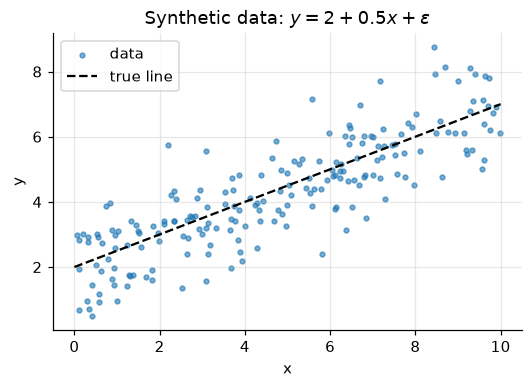

*그림 1. 합성 데이터 $y=2+0.5x+\varepsilon$ ($n=200$). 파란 점은 관측값, 검은 점선은 참 회귀직선 $\mathbb E[y\mid x]=2+0.5x$ 예요.*

가로축은 $x\in[0,10]$, 세로축은 $y$ 예요. 점들이 점선을 중심으로 위아래로 흩어져 있고, 세로 퍼짐의 표준편차가 $\sigma=1$ 이라 대부분의 점이 점선에서 $\pm2$ 안에 있어요.

#### 해석

점선은 이제부터 **모르는 척해야 하는** 모집단 회귀직선이에요. 점들만 보고 이 직선을 얼마나 정확히 복원하는지가 1-3 ~ 1-6의 주제예요. 데이터에서 구한 직선은 점선과 정확히 같지 않을 텐데, 그 차이는 계산 오류가 아니라 **표본 변동** 때문이에요 (1-5).

**생각해 볼 질문**

**Q1.** 이 셀의 시드만 바꿔 다시 실행하면 무엇이 바뀌고 무엇이 그대로일까요?

<details><summary>답</summary>

참값 $\boldsymbol\beta=(2,0.5)$, $\sigma=1$, $n=200$ 은 그대로예요. $x_i$ 와 $\varepsilon_i$ 가 바뀌므로 추정값 $\hat{\boldsymbol\beta}$, $R^2$ 같은 모든 표본 통계량이 바뀌어요. 1-5의 몬테카를로 실험은 $X$ 는 고정하고 $\boldsymbol\varepsilon$ 만 새로 뽑아 이 변동을 직접 재요.

</details>

### 1-3. 최소제곱 추정과 정규방정식

> 💻 **노트북**: 1-3의 코드 셀 (정규방정식 · QR · `lstsq` 세 방법으로 계수 계산, `cond(X)` 와 `cond(XᵀX)` 출력)

직선이 여러 개 가능할 때 "가장 좋은" 직선을 고르는 기준이 필요해요. 최소제곱(least squares)은 잔차제곱합(RSS)을 최소화하는 기준이에요. 미분 가능하고, 닫힌 해가 있고, 정규 오차에서는 최대우도와 같고(1-5), 기하적으로는 사영이라(1-4) 이론이 가장 잘 정리되어 있어요.

$$
L(\boldsymbol\beta)=\lVert\mathbf y-X\boldsymbol\beta\rVert_2^2=\sum_{i=1}^n\big(y_i-(X\boldsymbol\beta)_i\big)^2
$$

#### 방법 1: 기울기를 0으로 놓기

먼저 전개해요. $\mathbf y^\top X\boldsymbol\beta$ 는 스칼라라서 전치해도 같으므로 $\boldsymbol\beta^\top X^\top\mathbf y$ 와 같아요.

$$
\begin{aligned}
L(\boldsymbol\beta)&=(\mathbf y-X\boldsymbol\beta)^\top(\mathbf y-X\boldsymbol\beta)\\
&=\mathbf y^\top\mathbf y-\mathbf y^\top X\boldsymbol\beta-\boldsymbol\beta^\top X^\top\mathbf y+\boldsymbol\beta^\top X^\top X\boldsymbol\beta\\
&=\mathbf y^\top\mathbf y-2\boldsymbol\beta^\top X^\top\mathbf y+\boldsymbol\beta^\top X^\top X\boldsymbol\beta
\end{aligned}
$$

행렬 미분 공식 $\nabla_{\boldsymbol\beta}(\mathbf a^\top\boldsymbol\beta)=\mathbf a$ 와, 대칭행렬 $M$ 에 대한 $\nabla_{\boldsymbol\beta}(\boldsymbol\beta^\top M\boldsymbol\beta)=(M+M^\top)\boldsymbol\beta=2M\boldsymbol\beta$ 를 쓰면

$$
\nabla_{\boldsymbol\beta}L=-2X^\top\mathbf y+2X^\top X\boldsymbol\beta,\qquad\nabla^2_{\boldsymbol\beta}L=2X^\top X
$$

이에요. 기울기를 $\mathbf 0$ 으로 놓으면 **정규방정식**(normal equations)이 나와요.

$$
X^\top X\,\hat{\boldsymbol\beta}=X^\top\mathbf y
$$

이 정상점이 최솟점인지는 헤시안으로 확인해요. 임의의 $\mathbf v$ 에 대해 $\mathbf v^\top(2X^\top X)\mathbf v=2\lVert X\mathbf v\rVert^2\ge0$ 이니 $2X^\top X\succeq0$ 이고, $L$ 은 볼록 함수예요. 미분 가능한 볼록 함수는 $L(\boldsymbol\beta)\ge L(\hat{\boldsymbol\beta})+\nabla L(\hat{\boldsymbol\beta})^\top(\boldsymbol\beta-\hat{\boldsymbol\beta})$ 를 만족하므로, 기울기가 0인 점은 **전역 최솟점**이에요.

볼록성 정리 없이 직접 보일 수도 있어요. $\hat{\boldsymbol\beta}$ 가 정규방정식을 만족하면 임의의 $\boldsymbol\beta$ 에 대해

$$
\begin{aligned}
L(\boldsymbol\beta)&=\big\lVert(\mathbf y-X\hat{\boldsymbol\beta})+X(\hat{\boldsymbol\beta}-\boldsymbol\beta)\big\rVert^2\\
&=L(\hat{\boldsymbol\beta})+2(\hat{\boldsymbol\beta}-\boldsymbol\beta)^\top\underbrace{X^\top(\mathbf y-X\hat{\boldsymbol\beta})}_{=\mathbf 0}+\lVert X(\boldsymbol\beta-\hat{\boldsymbol\beta})\rVert^2\\
&=L(\hat{\boldsymbol\beta})+(\boldsymbol\beta-\hat{\boldsymbol\beta})^\top X^\top X(\boldsymbol\beta-\hat{\boldsymbol\beta})\ \ge\ L(\hat{\boldsymbol\beta})
\end{aligned}
$$

이고, 등호는 $X(\boldsymbol\beta-\hat{\boldsymbol\beta})=\mathbf 0$ 일 때만 성립해요. 이 항등식은 손실의 등위집합이 $X^\top X$ 로 정해지는 타원이라는 것도 보여 줘요. 1-6의 등고선 그림이 바로 이 타원이에요.

#### 방법 2: 잔차가 열공간에 직교

$\boldsymbol\beta$ 가 $\mathbb R^p$ 전체를 움직이면 $X\boldsymbol\beta$ 는 부분공간 $\operatorname{col}(X)\subseteq\mathbb R^n$ 을 움직여요. 그러니 최소제곱은 "$\operatorname{col}(X)$ 안에서 $\mathbf y$ 에 가장 가까운 점 찾기"예요. 사영 정리(projection theorem)에 따르면 부분공간 $W$ 의 점 $\mathbf v^\star$ 가 $\mathbf y$ 에 가장 가까울 필요충분조건은 $\mathbf y-\mathbf v^\star\perp W$ 예요.

- (충분성) $\mathbf y-\mathbf v^\star\perp W$ 이면 임의의 $\mathbf v\in W$ 에 대해 $\mathbf v^\star-\mathbf v\in W$ 이므로 피타고라스 정리로 $\lVert\mathbf y-\mathbf v\rVert^2=\lVert\mathbf y-\mathbf v^\star\rVert^2+\lVert\mathbf v^\star-\mathbf v\rVert^2\ge\lVert\mathbf y-\mathbf v^\star\rVert^2$ 이에요.
- (필요성) 어떤 $\mathbf w\in W$ 에 대해 $(\mathbf y-\mathbf v^\star)^\top\mathbf w\ne0$ 이라고 해요. 필요하면 $\mathbf w$ 를 $-\mathbf w$ 로 바꿔 $(\mathbf y-\mathbf v^\star)^\top\mathbf w>0$ 으로 둘 수 있어요. 그러면 $\frac{d}{dt}\lVert\mathbf y-\mathbf v^\star-t\mathbf w\rVert^2\big\rvert_{t=0}=-2(\mathbf y-\mathbf v^\star)^\top\mathbf w < 0$ 이라 작은 $t>0$ 에서 $\mathbf v^\star+t\mathbf w\in W$ 가 더 가까워요. 모순이에요.

$\operatorname{col}(X)$ 에 직교한다는 건 $X$ 의 모든 열과 직교한다는 뜻이니, 조건은 $X^\top(\mathbf y-X\hat{\boldsymbol\beta})=\mathbf 0$, 즉 **정규방정식 그 자체**예요. "normal"이 "수직"이라는 뜻인 이유예요.

#### 해의 존재와 유일성

**보조정리**: $\operatorname{null}(X^\top X)=\operatorname{null}(X)$. $X\mathbf v=\mathbf 0$ 이면 당연히 $X^\top X\mathbf v=\mathbf 0$ 이고, 반대로 $X^\top X\mathbf v=\mathbf 0$ 이면 $0=\mathbf v^\top X^\top X\mathbf v=\lVert X\mathbf v\rVert^2$ 이라 $X\mathbf v=\mathbf 0$ 이에요.

여기서 세 가지가 나와요.

1. **존재**: 임의의 행렬 $M$ 에 대해 $M\mathbf v=\mathbf 0$ 은 $\mathbf v$ 가 $M$ 의 모든 행, 즉 $M^\top$ 의 모든 열과 직교한다는 뜻이라 $\operatorname{null}(M)=\operatorname{col}(M^\top)^\perp$, 즉 $\operatorname{null}(M)^\perp=\operatorname{col}(M^\top)$ 이에요. 보조정리의 양변에 직교여공간을 취하면 $\operatorname{col}\big((X^\top X)^\top\big)=\operatorname{col}(X^\top)$ 이고, $X^\top X$ 는 대칭이니 $\operatorname{col}(X^\top X)=\operatorname{col}(X^\top)$ 이에요. $X^\top\mathbf y\in\operatorname{col}(X^\top)$ 이므로 정규방정식은 $\operatorname{rank}$ 와 상관없이 **항상 해가 있어요**.
2. **유일성**: $\operatorname{rank}(X)=p\iff\operatorname{null}(X)=\lbrace\mathbf 0\rbrace\iff X^\top X\succ0$ (가역)이고, 이때 해는 $\hat{\boldsymbol\beta}=(X^\top X)^{-1}X^\top\mathbf y$ 하나예요.
3. **계수 부족**($\operatorname{rank}(X) < p$): 해 집합은 $\hat{\boldsymbol\beta}+\operatorname{null}(X)$ 이에요. 하지만 $X\mathbf v=\mathbf 0$ 이라 모든 해의 적합값 $X\hat{\boldsymbol\beta}$ 는 같아요. 사영점은 하나뿐이니까요. 이때 흔히 노름이 가장 작은 해 $X^{+}\mathbf y$ (무어–펜로즈 유사역행렬)를 골라요.

#### 왜 $(X^\top X)^{-1}$ 을 직접 계산하지 않을까: 조건수

연립방정식 $M\mathbf z=\mathbf b$ 에서 조건수 $\kappa(M)$ 은 입력의 상대 오차가 해에서 최대 몇 배로 커지는지를 나타내요. 후진 안정(backward stable)한 알고리즘으로 풀면 상대 오차는 대략 $\kappa(M)\cdot u$ 예요. 여기서 $u$ 는 단위 반올림 오차(unit roundoff)로 `float64` 는 $2^{-53}\approx1.1\times10^{-16}$, `float32` 는 $2^{-24}\approx6\times10^{-8}$ 이에요. 대략 **유효숫자 $\log_{10}\kappa$ 자리를 잃는다**고 기억하면 돼요.

정규방정식은 조건수를 제곱으로 만들어요. 얇은 특이값 분해(thin SVD) $X=U\Sigma V^\top$ ($U\in\mathbb R^{n\times p}$ 는 정규직교 열, $\Sigma=\operatorname{diag}(\sigma_1\ge\cdots\ge\sigma_p>0)$, $V$ 는 직교행렬)를 넣으면

$$
X^\top X=V\Sigma U^\top U\Sigma V^\top=V\Sigma^2V^\top
\quad\Longrightarrow\quad
\kappa(X^\top X)=\frac{\sigma_1^2}{\sigma_p^2}=\kappa(X)^2
$$

예를 들어 $\kappa(X)=10^4$ 이면 $\kappa(X^\top X)=10^8$ 이라, `float32`(유효숫자 약 7자리)로 정규방정식을 풀면 유효숫자가 하나도 남지 않을 수 있어요. 고차 다항식 특성(1-7)이나 4-2의 예처럼 $\kappa$ 가 큰 문제에서 실제로 중요해져요.

엄밀히 말하면 최소제곱 문제 자체의 민감도는 $\kappa(X)+\kappa(X)^2\tan\theta$ 꼴이에요($\theta$ 는 $\mathbf y$ 와 $\operatorname{col}(X)$ 사이의 각). 직교분해(QR) 기반 풀이는 후진 안정이라 오차가 이 수준에 머물지만, 정규방정식은 잔차가 작은 문제($\theta\approx0$)에서도 항상 $\kappa(X)^2$ 를 치러요.

#### QR 분해로 풀기

$\operatorname{rank}(X)=p$ 일 때 얇은 QR 분해 $X=QR$ ($Q\in\mathbb R^{n\times p}$, $Q^\top Q=I_p$, $R\in\mathbb R^{p\times p}$ 는 대각 성분이 0이 아닌 상삼각행렬)을 쓰면

$$
\begin{aligned}
X^\top X\boldsymbol\beta=X^\top\mathbf y
&\iff R^\top Q^\top QR\boldsymbol\beta=R^\top Q^\top\mathbf y\\
&\iff R^\top R\boldsymbol\beta=R^\top Q^\top\mathbf y\\
&\iff R\boldsymbol\beta=Q^\top\mathbf y\qquad(R^\top\ \text{invertible})
\end{aligned}
$$

이에요. 같은 결론을 노름으로도 볼 수 있어요. $Q$ 를 직교행렬 $[Q\ \ Q_\perp]$ 로 확장하면 직교변환은 노름을 보존하므로

$$
\lVert\mathbf y-X\boldsymbol\beta\rVert^2=\lVert Q^\top\mathbf y-R\boldsymbol\beta\rVert^2+\lVert Q_\perp^\top\mathbf y\rVert^2
$$

이고, 둘째 항은 $\boldsymbol\beta$ 와 무관하니 첫째 항을 0으로 만드는 $R\boldsymbol\beta=Q^\top\mathbf y$ 가 해이고 최소 RSS는 $\lVert Q_\perp^\top\mathbf y\rVert^2$ 예요. $X^\top X=R^\top R$ 이라 $R$ 의 특이값은 $X$ 와 같고 $\kappa(R)=\kappa(X)$ 예요. 조건수를 제곱하지 않은 채로 상삼각 연립방정식을 **후진 대입**(back substitution)으로 $O(p^2)$ 에 풀면 끝나요.

#### `torch.linalg.lstsq` 가 하는 일

`torch.linalg.lstsq(A, B)` 는 LAPACK의 최소제곱 루틴을 불러요. `driver` 인자로 방법을 고를 수 있어요.

| `driver` | 방법 | 특징 |
|---|---|---|
| `'gelsy'` | 열 피벗팅 QR (완전 직교분해) | CPU 기본값. 계수 부족도 처리하고 최소노름 해를 줘요 |
| `'gels'` | QR | 완전 열계수를 가정해요. CUDA 텐서는 이것만 지원해요 |
| `'gelsd'` | SVD (분할정복) | 조건이 아주 나쁠 때 권장해요 |
| `'gelss'` | SVD | `gelsd` 가 메모리 문제를 일으킬 때 써요 |

`rcond` 보다 작은 (상대) 특이값 방향은 0으로 보고 유효 계수(rank)를 정해요. 기본값은 해당 dtype의 기계 엡실론 $\times\max(n,p)$ 예요. 결과는 `solution`, `residuals`, `rank`, `singular_values` 를 담은 named tuple이고, 뒤의 셋은 드라이버와 입력 조건에 따라 빈 텐서일 수 있어요(예: 기본 드라이버 `gelsy` 는 `rank` 만 채우고 `residuals` 와 `singular_values` 는 비워 둬요). 우변 `B` 가 $(n,k)$ 행렬이면 $k$ 개의 최소제곱 문제를 한 번에 풀어요 (1-5의 몬테카를로에서 써요).

#### 코드 읽기

<details><summary>📝 셀 전체 코드 (줄별 주석)</summary>

```python
# ── 1. 같은 최소제곱 문제를 세 가지 방법으로 풀기 ──────────────────
# X: (n, p) = (200, 2), y: (n,) 모두 float64 (1-2). 세 해 모두 모양 (p,) 예요.
# ① 정규방정식 XᵀXβ = Xᵀy 를 LU 분해(부분 피벗)로 풀어요. 역행렬은 만들지 않지만
#    넘기는 행렬이 XᵀX (p, p) 라서 조건수가 κ(X)² 로 커져요.
beta_ne = torch.linalg.solve(X.T @ X, X.T @ y)                               # ① 정규방정식
# ② 기본 mode='reduced' 가 얇은 QR: Q (n, p) 정규직교 열, R (p, p) 상삼각. κ(R) = κ(X) 예요.
Q, R = torch.linalg.qr(X)                                                    # ② QR: X = QR
# Rβ = Qᵀy 를 후진 대입으로 풀어요. solve_triangular 는 우변이 행렬이어야 해서
# unsqueeze(1) 로 (p,) → (p, 1) 을 만들고, 결과 (p, 1) 을 squeeze(1) 로 (p,) 로 되돌려요.
beta_qr = torch.linalg.solve_triangular(R, (Q.T @ y).unsqueeze(1), upper=True).squeeze(1)
# ③ LAPACK 최소제곱 루틴 (CPU 기본 driver 'gelsy' = 열 피벗 QR). 우변을 (n, 1) 로 넘겨서
#    .solution 이 (p, 1) 이므로 squeeze(1) 로 (p,) 를 만들어요.
beta_ls = torch.linalg.lstsq(X, y.unsqueeze(1)).solution.squeeze(1)          # ③ lstsq

# ── 2. 세 해와 참값 비교 ─────────────────────────────────────────
# .item() 은 원소 하나짜리 텐서를 파이썬 float 로 꺼내요. {name:10s}: 10칸 왼쪽 정렬, :.6f: 소수 여섯째 자리.
# 참값 (2, 0.5) 와의 차이는 수치 오차가 아니라 유한 표본에서 오는 통계적 오차예요 (1-5에서 판단).
for name, b in [("normal eq.", beta_ne), ("QR", beta_qr), ("lstsq", beta_ls), ("true", beta_true)]:
    print(f"{name:10s}  β0 = {b[0].item():.6f}   β1 = {b[1].item():.6f}")

# ── 3. 조건수: κ(XᵀX) = κ(X)² 확인 ────────────────────────────────
# cond 의 기본값은 2-노름 조건수 σ_max/σ_min (특이값의 비) 라서 정사각이 아닌 X 에도 쓸 수 있어요.
kX = torch.linalg.cond(X).item()
# \n 으로 한 줄 띄우고 출력해요. cond(XᵀX) 와 cond(X)² 가 같으면 "정규방정식은 조건수를 제곱한다"가 확인돼요.
print(f"\ncond(X) = {kX:.1f},  cond(XᵀX) = {torch.linalg.cond(X.T @ X).item():.1f}  (cond(X)² = {kX**2:.1f})")
```

</details>

```python
beta_ne = torch.linalg.solve(X.T @ X, X.T @ y)                               # ① 정규방정식
Q, R = torch.linalg.qr(X)                                                    # ② QR: X = QR
beta_qr = torch.linalg.solve_triangular(R, (Q.T @ y).unsqueeze(1), upper=True).squeeze(1)
beta_ls = torch.linalg.lstsq(X, y.unsqueeze(1)).solution.squeeze(1)          # ③ lstsq
```

- ① `torch.linalg.solve(A, b)` 는 부분 피벗팅 LU 분해로 $A\mathbf z=\mathbf b$ 를 풀어요. 역행렬을 만들지 않는 건 좋지만, 넘기는 행렬이 이미 $X^\top X$ 라서 조건수가 $\kappa(X)^2$ 예요.
- ② `torch.linalg.qr` 의 기본값 `mode='reduced'` 가 위의 얇은 QR이에요 ($Q$ 는 $(n,p)$, $R$ 은 $(p,p)$). `solve_triangular(R, B, upper=True)` 가 후진 대입이고, `B` 는 행렬이어야 해서 `unsqueeze(1)` 로 $(p,1)$ 을 만든 뒤 `squeeze(1)` 로 되돌려요.
- ③ 여기서는 `lstsq` 에도 우변을 $(n,1)$ 행렬로 넘겨서(1차원 벡터도 받아요), 해가 `.solution` 에 $(p,1)$ 로 들어 있어요.

```python
kX = torch.linalg.cond(X).item()
print(f"\ncond(X) = {kX:.1f},  cond(XᵀX) = {torch.linalg.cond(X.T @ X).item():.1f}  (cond(X)² = {kX**2:.1f})")
```

`torch.linalg.cond` 는 기본으로 특이값의 비 $\sigma_{\max}/\sigma_{\min}$ 을 계산해서 정사각이 아닌 $X$ 에도 쓸 수 있어요.

#### 결과

```text
normal eq.  β0 = 1.853694   β1 = 0.508506
QR          β0 = 1.853694   β1 = 0.508506
lstsq       β0 = 1.853694   β1 = 0.508506
true        β0 = 2.000000   β1 = 0.500000

cond(X) = 11.0,  cond(XᵀX) = 120.8  (cond(X)² = 120.8)
```

- 세 방법이 소수점 여섯째 자리까지 같아요($\hat\beta_0=1.853694$, $\hat\beta_1=0.508506$). $\kappa(X^\top X)=120.8$ 이면 `float64` 의 유효숫자 16자리 중 2자리 정도만 잃으니 차이가 보이지 않아요.
- 참값 $(2,\ 0.5)$ 와의 차이는 **수치 오차가 아니라 통계적 오차**예요. 데이터가 유한해서 생기는 차이이고, 그 크기는 1-5의 표준오차로 판단해요.
- `cond(XᵀX) = 120.8` 과 `cond(X)² = 120.8` 이 같아요. $11.0^2=121$ 이 아닌 건 `cond(X)` 를 소수 첫째 자리까지 반올림해 출력했기 때문이에요(실제 값은 11보다 조금 작아요).
- $\kappa(X)$ 가 1보다 큰 이유는 두 열 $\mathbf 1$ 과 $\mathbf x$ 가 모두 양수라 방향이 비슷하고(두 열 사이 각의 코사인이 $\bar x/\sqrt{\overline{x^2}}$), 크기도 다르기 때문이에요. 1-6에서 $x$ 를 표준화하면 이 문제가 사라져요.

#### 해석

> 💡 **핵심**: 정규방정식 · QR · `lstsq` 는 수학적으로 같은 해를 줘요. 차이는 **수치 안정성**뿐이고, 실무에서는 `lstsq` (또는 QR)를 써요.

계수만 필요할 때는 `torch.linalg.inv(X.T @ X) @ X.T @ y` 를 쓰지 않아요. 역행렬 계산은 연산량도 크고 $\kappa(X)^2$ 의 오차를 그대로 받아요. 다만 표준오차처럼 $(X^\top X)^{-1}$ **자체**가 필요할 때는 계산해요 (1-5의 `ols`). 이때도 $(X^\top X)^{-1}=R^{-1}R^{-\top}$ 으로 구하면 더 안정적이에요.

> ⚠️ **주의**: 정규방정식과 `float32` 의 조합이 가장 위험해요. 이 노트북이 닫힌 해와 통계량을 `float64` 로 계산하는 이유예요.

**생각해 볼 질문**

**Q1.** $\operatorname{rank}(X) < p$ 이면 위의 세 방법은 각각 어떻게 될까요?

<details><summary>답</summary>

① $X^\top X$ 가 특이행렬이라 `solve` 가 오류를 내거나, 반올림 때문에 겨우 풀리더라도 의미 없는 큰 값을 줘요. ② $R$ 의 대각 성분 중 (거의) 0인 것이 생겨 후진 대입이 터져요. ③ 기본 드라이버 `gelsy` 는 `rcond` 로 유효 계수를 정하고 최소노름 해를 줘요. 어느 경우든 적합값 $\hat{\mathbf y}$ 는 유일하므로, 예측만 필요하면 ③이 안전해요.

</details>

**Q2.** 열 $\mathbf x$ 를 $\mathbf x-\bar x\mathbf 1$ 로 바꾸면 $\hat{\mathbf y}$ 와 $\kappa(X)$ 는 각각 어떻게 될까요?

<details><summary>답</summary>

$\operatorname{col}([\mathbf 1,\ \mathbf x])=\operatorname{col}([\mathbf 1,\ \mathbf x-\bar x\mathbf 1])$ 이라 사영 $\hat{\mathbf y}$ 는 그대로예요(계수만 $\beta_0$ 가 $\beta_0+\beta_1\bar x$ 로 바뀌어요). 반면 두 열이 직교해져서 $X^\top X=\operatorname{diag}(n,S_{xx})$ 가 되고 $\kappa(X)=\sqrt{\max(n,S_{xx})/\min(n,S_{xx})}$ 로 바뀌어요. 스케일까지 맞추면 거의 1이 돼요. 1-6의 표준화가 이 아이디어예요.

</details>

### 1-4. 기하학적 해석: 열공간으로의 직교사영

> 💻 **노트북**: 1-4의 코드 셀 (평가 함수 `r2_score` · `rmse` 정의, hat matrix의 성질과 TSS = ESS + RSS 수치 확인)

1-3의 방법 2에서 $\hat{\mathbf y}$ 가 $\mathbf y$ 의 사영(projection)이라는 걸 봤어요. 이제 사영을 만드는 행렬 자체를 들여다봐요. 이 행렬의 성질에서 자유도, $R^2$, 레버리지가 모두 나오고, 1-5의 분포 이론과 1-7의 유효 자유도까지 이어져요.

$$
\hat{\mathbf y}=X\hat{\boldsymbol\beta}=\underbrace{X(X^\top X)^{-1}X^\top}_{H}\,\mathbf y
$$

$H$ 는 $\mathbf y$ 에 모자(hat)를 씌운다고 해서 hat matrix라고 불러요. 아래에서는 $\operatorname{rank}(X)=p$ 를 가정해요.

#### $H$ 의 성질과 증명

**(a) 대칭.** $(X^\top X)^{-1}$ 이 대칭이라 $H^\top=X\big((X^\top X)^{-1}\big)^\top X^\top=H$ 예요.

**(b) 멱등.** 가운데 $X^\top X$ 가 역행렬과 상쇄돼요.

$$
H^2=X(X^\top X)^{-1}\underbrace{X^\top X(X^\top X)^{-1}}_{I_p}X^\top=H
$$

**(c) 열공간으로의 직교사영.** $HX=X$ 이므로 $\mathbf v\in\operatorname{col}(X)$ 이면 $H\mathbf v=\mathbf v$ 이고, $\mathbf v\perp\operatorname{col}(X)$ 이면 $X^\top\mathbf v=\mathbf 0$ 이라 $H\mathbf v=\mathbf 0$ 이에요. QR을 넣으면 $H=QR(R^\top R)^{-1}R^\top Q^\top=QQ^\top$ 로 더 간단해져요.

**(d) 고윳값은 0 또는 1.** $H\mathbf v=\lambda\mathbf v$ ($\mathbf v\ne\mathbf 0$) 이면 $\lambda\mathbf v=H\mathbf v=H^2\mathbf v=\lambda^2\mathbf v$ 라서 $\lambda\in\lbrace0,1\rbrace$ 예요. $H$ 는 대칭이라 직교대각화되므로 $H=W\operatorname{diag}(1,\dots,1,0,\dots,0)W^\top$ 꼴이에요.

**(e) 대각합은 $p$.** 대각합의 순환성으로

$$
\operatorname{tr}(H)=\operatorname{tr}\big(X(X^\top X)^{-1}X^\top\big)=\operatorname{tr}\big((X^\top X)^{-1}X^\top X\big)=\operatorname{tr}(I_p)=p
$$

이에요. 고윳값이 0 또는 1이니 대각합은 1의 개수, 즉 $\operatorname{rank}(H)=p$ 예요. 적합값이 $p$ 차원 공간 안에서만 움직인다는 뜻이라 **모형의 자유도**라고 불러요.

**(f) $I-H$.** $I-H$ 도 대칭 · 멱등이고 $\operatorname{col}(X)^\perp$ 위로의 직교사영이에요. $\operatorname{tr}(I-H)=n-p$ 예요. $(I-H)X=\mathbf 0$ 이므로 잔차(residual)는

$$
\mathbf e=(I-H)\mathbf y=(I-H)(X\boldsymbol\beta+\boldsymbol\varepsilon)=(I-H)\boldsymbol\varepsilon
$$

이에요. 잔차는 참 계수와 무관하고 오차의 사영일 뿐이에요. 1-5에서 핵심적으로 써요.

**(g) $X^\top\mathbf e=\mathbf 0$.** $X^\top(I-H)=X^\top-X^\top=\mathbf 0$ 이에요. 정규방정식 그 자체예요.

#### TSS = ESS + RSS, 그리고 절편이 필요한 이유

$\mathbf y-\bar y\mathbf 1=(\hat{\mathbf y}-\bar y\mathbf 1)+\mathbf e$ 로 나누고 제곱하면

$$
\lVert\mathbf y-\bar y\mathbf 1\rVert^2=\lVert\hat{\mathbf y}-\bar y\mathbf 1\rVert^2+\lVert\mathbf e\rVert^2+2(\hat{\mathbf y}-\bar y\mathbf 1)^\top\mathbf e
$$

이에요. 교차항을 보면 $\hat{\mathbf y}^\top\mathbf e=\hat{\boldsymbol\beta}^\top X^\top\mathbf e=0$ 이에요. $\mathbf 1^\top\mathbf e$ 는 **절편이 있을 때만** 0이에요. $\mathbf 1\in\operatorname{col}(X)$ 이면 $\mathbf 1=X\mathbf c$ 인 $\mathbf c$ 가 있어서 $\mathbf 1^\top\mathbf e=\mathbf c^\top X^\top\mathbf e=0$ 이니까요. 그러면 교차항이 사라지고 피타고라스 정리가 성립해요.

$$
\underbrace{\lVert\mathbf y-\bar y\mathbf 1\rVert^2}_{\text{TSS}}=\underbrace{\lVert\hat{\mathbf y}-\bar y\mathbf 1\rVert^2}_{\text{ESS}}+\underbrace{\lVert\mathbf e\rVert^2}_{\text{RSS}},
\qquad R^2=1-\frac{\text{RSS}}{\text{TSS}}=\frac{\text{ESS}}{\text{TSS}}\in[0,1]
$$

$\sum_ie_i=0$ 이므로 적합값의 평균도 $\bar y$ 와 같아요. 결정계수(coefficient of determination) $R^2$ 는 $\mathbf y$ 의 변동 중 모형이 설명하는 비율이에요.

**$R^2=\operatorname{corr}(\mathbf y,\hat{\mathbf y})^2$.** $\mathbf a=\mathbf y-\bar y\mathbf 1$, $\mathbf b=\hat{\mathbf y}-\bar y\mathbf 1$ 로 둬요. 절편이 있으면 $\hat{\mathbf y}$ 의 평균도 $\bar y$ 라서 $\mathbf b$ 가 곧 중심화한 $\hat{\mathbf y}$ 예요. $\mathbf a=\mathbf b+\mathbf e$ 이고, 절편이 있으면 $\mathbf b\in\operatorname{col}(X)$ 라서 $\mathbf b^\top\mathbf e=0$ 이에요. 그러면

$$
\operatorname{corr}(\mathbf y,\hat{\mathbf y})=\frac{\mathbf a^\top\mathbf b}{\lVert\mathbf a\rVert\,\lVert\mathbf b\rVert}=\frac{\lVert\mathbf b\rVert^2+\mathbf e^\top\mathbf b}{\lVert\mathbf a\rVert\,\lVert\mathbf b\rVert}=\frac{\lVert\mathbf b\rVert}{\lVert\mathbf a\rVert}=\sqrt{\frac{\text{ESS}}{\text{TSS}}}
$$

이에요. 기하적으로 $R^2$ 는 중심화한 $\mathbf y$ 와 중심화한 $\hat{\mathbf y}$ 사이 각의 $\cos^2$ 예요. 단순회귀에서는 $\hat{\mathbf y}$ 가 $\mathbf x$ 의 아핀 함수라 $R^2=\operatorname{corr}(\mathbf x,\mathbf y)^2$ 이에요.

#### 레버리지 $h_{ii}$

$H$ 의 대각 성분 $h_{ii}=\tilde{\mathbf x}_i^\top(X^\top X)^{-1}\tilde{\mathbf x}_i$ 를 레버리지(leverage)라고 해요. 여기서 $\tilde{\mathbf x}_i^\top=(1,\mathbf x_i^\top)$ 는 절편의 1을 포함한 $X$ 의 $i$ 번째 행이에요. $\hat y_i=\sum_jh_{ij}y_j$ 이니 $h_{ii}=\partial\hat y_i/\partial y_i$, 즉 **관측 $i$ 가 자기 적합값을 얼마나 끌어당기는지**예요. $H=QQ^\top$ 이므로 $h_{ii}$ 는 $Q$ 의 $i$ 번째 행의 노름 제곱이기도 해요.

- $H=H^2=H^\top H$ 에서 $h_{ii}=\sum_jh_{ij}^2\ge h_{ii}^2$ 이라 $0\le h_{ii}\le1$ 이에요.
- $\sum_ih_{ii}=\operatorname{tr}(H)=p$ 라서 평균 레버리지는 $p/n$ 이에요. 절편이 있으면 $\mathbf 1\in\operatorname{col}(X)$ 라서 $H\mathbf 1=\mathbf 1$ 이고, 전치하면 $\mathbf 1^\top H=\mathbf 1^\top$ 이에요. 이걸로 전개하면 $\big(H-\frac1n\mathbf 1\mathbf 1^\top\big)^2=H-\frac1n\mathbf 1\mathbf 1^\top$ 이라, $H-\frac1n\mathbf 1\mathbf 1^\top$ 도 대칭 · 멱등인 직교사영행렬이에요. 첫 항목과 같은 이유로 그 대각 성분 $h_{ii}-\frac1n$ 이 0 이상이니 $h_{ii}\ge1/n$ 이에요.
- $\operatorname{Cov}(\hat{\mathbf y})=\sigma^2H$, $\operatorname{Cov}(\mathbf e)=\sigma^2(I-H)$ 라서 $\operatorname{Var}(\hat y_i)=\sigma^2h_{ii}$, $\operatorname{Var}(e_i)=\sigma^2(1-h_{ii})$ 예요. 레버리지가 큰 점은 적합값이 불안정하고 잔차는 작게 나와요.

$H$ 는 $\operatorname{col}(X)$ 에만 의존하므로 단순회귀를 $X=[\mathbf 1,\ \mathbf x-\bar x\mathbf 1]$ 로 바꿔 써도 같아요. 이때 $X^\top X=\operatorname{diag}(n,S_{xx})$, $S_{xx}=\sum_j(x_j-\bar x)^2$ 이라서

$$
h_{ii}=\frac1n+\frac{(x_i-\bar x)^2}{S_{xx}}
$$

이에요. $\bar x$ 에서 멀리 떨어진 점일수록 레버리지가 커요. 고차 다항식에서 데이터 가장자리가 불안정한 이유(1-7, 4-3)와 같은 이야기예요.

#### 코드 읽기

<details><summary>📝 셀 전체 코드 (줄별 주석)</summary>

```python
# ── 1. 평가 함수 (PART 2, 3에서도 다시 써요) ──────────────────────
def r2_score(y, y_hat):
    """결정계수 R² = 1 − RSS/TSS"""
    # 분자: RSS = Σ(yᵢ − ŷᵢ)², 분모: TSS = Σ(yᵢ − ȳ)². 0차원 텐서를 돌려줘요.
    # 이 정의는 테스트 데이터나 절편 없는 모형에서 음수가 될 수도 있어요.
    return 1 - ((y - y_hat) ** 2).sum() / ((y - y.mean()) ** 2).sum()

def rmse(y, y_hat):
    # √(RSS/n): 평균제곱오차의 제곱근이라 y 와 같은 단위예요.
    return torch.sqrt(((y - y_hat) ** 2).mean())

# ── 2. hat matrix H = X(XᵀX)⁻¹Xᵀ 와 잔차 ─────────────────────────
# solve(XᵀX, Xᵀ) 는 우변이 (p, n) 행렬인 연립방정식이라 역행렬 없이 (XᵀX)⁻¹Xᵀ (p, n) 을 구해요.
# H 는 (n, n) = (200, 200). 성질 확인용일 뿐, 메모리가 n² 이라 WM-811K 규모에서는 만들지 않아요.
H = X @ torch.linalg.solve(X.T @ X, X.T)            # hat matrix (n × n)
y_hat = H @ y                                       # ŷ = Hy: y 를 col(X) 로 직교사영한 적합값 (n,)
e = y - y_hat                                       # 잔차 e = (I − H)y, col(X) 에 직교 (n,)
# TSS = ‖y − ȳ1‖², ESS = ‖ŷ − ȳ1‖², RSS = ‖e‖². 절편이 있으면 TSS = ESS + RSS (피타고라스) 예요.
tss, ess, rss = ((y - y.mean())**2).sum(), ((y_hat - y.mean())**2).sum(), (e**2).sum()

# ── 3. H 의 성질을 수치로 확인 (float64 반올림 수준이면 0으로 봐요) ─────
# (a) 대칭 Hᵀ = H. matrix_norm 의 기본값은 프로베니우스 노름 ‖·‖_F, :.2e 는 지수 표기예요.
print(f"‖Hᵀ − H‖_F = {torch.linalg.matrix_norm(H.T - H).item():.2e}")
# (b) 멱등 H² = H: 한 번 사영한 것을 다시 사영해도 그대로예요.
print(f"‖H² − H‖_F = {torch.linalg.matrix_norm(H @ H - H).item():.2e}")
# (e) tr(H) = p: 모형의 자유도. X.shape[1] 이 열 개수 p 예요.
print(f"tr(H)      = {torch.trace(H).item():.6f}   (p = {X.shape[1]})")
# (g) Xᵀe = 0: 정규방정식 그 자체. (p,) 텐서를 .numpy() 로 바꿔 배열로 출력해요.
print(f"Xᵀe        = {(X.T @ e).numpy()}")
# 절편이 있으므로 1ᵀe = 0 이라 교차항이 사라져 TSS = ESS + RSS 가 성립해요.
print(f"TSS = {tss.item():.4f}   ESS + RSS = {(ess + rss).item():.4f}")
# 같은 R² 를 세 방식(1 − RSS/TSS, ESS/TSS, r2_score)으로 계산해 일치하는지 봐요.
print(f"R² = 1 − RSS/TSS = {(1 - rss / tss).item():.4f}   ESS/TSS = {(ess / tss).item():.4f}   r2_score = {r2_score(y, y_hat).item():.4f}")
```

</details>

```python
def r2_score(y, y_hat):
    """결정계수 R² = 1 − RSS/TSS"""
    return 1 - ((y - y_hat) ** 2).sum() / ((y - y.mean()) ** 2).sum()

def rmse(y, y_hat):
    return torch.sqrt(((y - y_hat) ** 2).mean())
```

- `r2_score` 는 $1-\text{RSS}/\text{TSS}$ 정의를 써요. 테스트 데이터에 쓰면(3-4 등) 음수가 나올 수도 있는 정의예요.
- `rmse` 는 $\sqrt{\text{RSS}/n}$ 이라 $y$ 와 같은 단위예요.

```python
H = X @ torch.linalg.solve(X.T @ X, X.T)            # hat matrix (n × n)
y_hat = H @ y
e = y - y_hat
```

- `solve(X.T @ X, X.T)` 는 우변이 $(p,n)$ 행렬인 연립방정식이라 역행렬 없이 $(X^\top X)^{-1}X^\top$ 을 구해요.
- $H$ 는 $200\times200$ 행렬이에요. 성질을 확인하려고 만든 것이고, 실제로는 $H$ 를 만들지 않아요. 메모리가 $n^2$ 이라 WM-811K 규모에서는 불가능하거든요. 적합값은 $X\hat{\boldsymbol\beta}$, 레버리지는 $Q$ 의 행 노름으로 구해요.
- `torch.linalg.matrix_norm` 의 기본값은 프로베니우스 노름이고, `torch.trace` 는 대각합이에요.

#### 결과

```text
‖Hᵀ − H‖_F = 3.14e-16
‖H² − H‖_F = 7.32e-16
tr(H)      = 2.000000   (p = 2)
Xᵀe        = [-4.06341627e-14 -1.31035129e-13]
TSS = 597.4787   ESS + RSS = 597.4787
R² = 1 − RSS/TSS = 0.7105   ESS/TSS = 0.7105   r2_score = 0.7105
```

- $\lVert H^\top-H\rVert_F=3.14\times10^{-16}$, $\lVert H^2-H\rVert_F=7.32\times10^{-16}$: `float64` 반올림 수준에서 0이에요. 대칭 · 멱등이 확인돼요.
- $\operatorname{tr}(H)=2.000000=p$ 예요.
- $X^\top\mathbf e$ 는 $10^{-14}\sim10^{-13}$ 이에요. $10^{-16}$ 보다 큰 건 각 성분이 200개 항의 합이고 $x$ 열의 원소가 10까지 커서, 계산 과정의 수 자체가 크기 때문이에요. 그 크기에 비하면 0이에요. 둘째 성분($x$ 열)이 더 큰 것도 같은 이유예요.
- TSS = 597.4787 = ESS + RSS 이고, 세 방법으로 계산한 $R^2$ 가 모두 0.7105예요.

#### 해석

표본 $R^2=0.7105$ 는 1-2에서 계산한 모집단 값 $25/37\approx0.68$ 과 비슷하지만 같지는 않아요. 이번 표본의 $x$ 퍼짐과 잡음 실현값에 따라 달라지는 표본 통계량이니까요. 마찬가지로 $\text{TSS}/(n-1)=597.4787/199\approx3.00$ 은 모분산 $37/12\approx3.08$ 의 추정값이에요.

> 💡 **핵심**: 최소제곱 = 열공간으로의 직교사영이에요. 잔차의 직교성, 피타고라스 분해, 자유도 $p$ 가 모두 "$H$ 가 사영행렬"이라는 한 사실에서 나와요.

> ⚠️ **주의**: $R^2\in[0,1]$ 은 **절편이 있는 모형의 학습 데이터**에서만 보장돼요. 그리고 특성을 추가하면 학습 $R^2$ 는 절대 줄지 않아서 모형 선택 기준으로 쓸 수 없어요 (1-7, 4-3).

**생각해 볼 질문**

**Q1.** (노트북의 질문) 절편이 없는 모형($\mathbf 1\notin\operatorname{col}(X)$)에서도 $1-\text{RSS}/\text{TSS}=\text{ESS}/\text{TSS}$ 가 성립할까요? $R^2 < 0$ 이 나올 수 있을까요?

<details><summary>답</summary>

일반적으로 성립하지 않아요. $\mathbf 1^\top\mathbf e\ne0$ 이라 교차항이 남아서 $\text{TSS}=\text{ESS}+\text{RSS}-2\bar y\,\mathbf 1^\top\mathbf e$ 가 돼요. $1-\text{RSS}/\text{TSS}$ 는 음수도 될 수 있어요. 예를 들어 $y\approx10+\varepsilon$ 인데 $x$ 가 0을 중심으로 대칭으로 퍼져 있으면($\sum_ix_i\approx0$), 원점을 지나는 직선의 기울기 $\sum_ix_iy_i/\sum_ix_i^2$ 가 거의 0이라 수준 10을 맞추지 못해서 $\text{RSS}\approx\sum y_i^2\gg\text{TSS}$ 가 돼요. 상수 $\bar y$ 보다 못한 모형이라는 뜻이에요. 이때도 $\hat{\mathbf y}\perp\mathbf e$ 라서 중심화하지 않은 분해 $\lVert\mathbf y\rVert^2=\lVert\hat{\mathbf y}\rVert^2+\lVert\mathbf e\rVert^2$ 은 성립해요. 그래서 절편 없는 모형에 중심화하지 않은 $R^2$ 를 보고하는 소프트웨어도 있어요. 절편이 있어도 **테스트 데이터**의 $R^2$ 는 음수가 될 수 있어요.

</details>

**Q2.** 이 예제에서 레버리지가 가장 큰 점은 어디일까요?

<details><summary>답</summary>

$h_{ii}=1/n+(x_i-\bar x)^2/S_{xx}$ 이니 $\bar x$ 에서 가장 먼 점, 즉 $x$ 의 최솟값(0 근처)과 최댓값(10 근처) 중 $\bar x$ 에서 더 먼 쪽 끝점이에요. 그런 점의 $y$ 가 조금만 바뀌어도 직선의 기울기가 크게 움직여요.

</details>

### 1-5. 확률적 관점: 최대우도와 추정량의 분포

> 💻 **노트북**: 1-5의 코드 셀 (`ols` 함수 정의 · 계수 · 표준오차 · 신뢰구간 표)과 (심화) 몬테카를로 셀 (그림 2). (심화) 셀은 90분 · 60분 진행 모두 건너뛰어요. `ols` 는 PART 2, 3에서 다시 쓰니 꼭 실행하세요.

$\hat{\boldsymbol\beta}$ 는 잡음 $\boldsymbol\varepsilon$ 에 의존하는 **확률변수**예요. 1-3에서 본 참값과의 차이가 "큰지 작은지" 판단하려면 그 분포를 알아야 해요. 분포를 알면 표준오차, 신뢰구간, 검정을 만들 수 있어요. 또 최소제곱이라는 기준 자체를 확률 모형으로 정당화할 수 있어요.

#### 최대우도 = 최소제곱

가정 5에서 $\mathbf y\mid X\sim\mathcal N(X\boldsymbol\beta,\sigma^2I_n)$ 이니 우도는 독립 정규밀도의 곱이에요.

$$
p(\mathbf y\mid X;\boldsymbol\beta,\sigma^2)=\prod_{i=1}^n\frac{1}{\sqrt{2\pi\sigma^2}}\exp\Big(-\frac{(y_i-(X\boldsymbol\beta)_i)^2}{2\sigma^2}\Big)=(2\pi\sigma^2)^{-n/2}\exp\Big(-\frac{\lVert\mathbf y-X\boldsymbol\beta\rVert^2}{2\sigma^2}\Big)
$$

로그를 취하면

$$
\ell(\boldsymbol\beta,\sigma^2)=-\frac n2\log(2\pi\sigma^2)-\frac{1}{2\sigma^2}\lVert\mathbf y-X\boldsymbol\beta\rVert^2
$$

이에요. 어떤 $\sigma^2$ 로 고정해도 $\boldsymbol\beta$ 에 대한 최대화는 $\lVert\mathbf y-X\boldsymbol\beta\rVert^2$ 의 최소화와 같으므로, $\boldsymbol\beta$ 의 **최대우도추정량(MLE)은 최소제곱해**예요. 음의 로그우도가 $\frac{n}{2\sigma^2}\,\text{MSE}+\text{const}$ 이니, 딥러닝에서 MSE 손실을 쓰는 것은 정규 잡음을 가정한 최대우도와 같아요 (1-6의 `nn.MSELoss`).

$\sigma^2$ 에 대해서는 $\partial\ell/\partial\sigma^2=-\frac{n}{2\sigma^2}+\frac{\text{RSS}}{2\sigma^4}=0$ 에서 $\hat\sigma^2_{\text{MLE}}=\text{RSS}/n$ 이에요.

#### $\hat{\boldsymbol\beta}$ 의 평균과 공분산

$W=(X^\top X)^{-1}X^\top$ 로 두면 $WX=I_p$ 이고

$$
\hat{\boldsymbol\beta}=W\mathbf y=W(X\boldsymbol\beta+\boldsymbol\varepsilon)=\boldsymbol\beta+(X^\top X)^{-1}X^\top\boldsymbol\varepsilon
$$

이에요. 여기서 바로

$$
\begin{aligned}
\mathbb E[\hat{\boldsymbol\beta}\mid X]&=\boldsymbol\beta+W\,\mathbb E[\boldsymbol\varepsilon\mid X]=\boldsymbol\beta&&(\text{assumptions 1, 2, 3})\\
\operatorname{Cov}(\hat{\boldsymbol\beta}\mid X)&=W(\sigma^2I_n)W^\top=\sigma^2(X^\top X)^{-1}X^\top X(X^\top X)^{-1}=\sigma^2(X^\top X)^{-1}&&(\text{assumption 4})
\end{aligned}
$$

가 나와요. 가정 5까지 있으면 정규벡터의 선형변환은 정규라서 $\hat{\boldsymbol\beta}\sim\mathcal N\big(\boldsymbol\beta,\ \sigma^2(X^\top X)^{-1}\big)$ 이에요.

단순회귀에서는 $\det(X^\top X)=n\sum x_i^2-(\sum x_i)^2=nS_{xx}$ 를 써서 역행렬을 직접 쓸 수 있어요.

$$
\sigma^2(X^\top X)^{-1}=\frac{\sigma^2}{S_{xx}}\begin{bmatrix}S_{xx}/n+\bar x^2&-\bar x\\-\bar x&1\end{bmatrix}
$$

$\operatorname{Var}(\hat\beta_1)=\sigma^2/S_{xx}$ 라서 $x$ 가 넓게 퍼질수록 기울기가 정확해지고, $\operatorname{Cov}(\hat\beta_0,\hat\beta_1)=-\sigma^2\bar x/S_{xx}$ 라서 $\bar x>0$ 이면 두 추정량이 **음의 상관**을 가져요.

#### $\sigma^2$ 추정: 왜 $n-p$ 로 나눌까

1-4의 (f)에서 $\mathbf e=(I-H)\boldsymbol\varepsilon$ 이고 $I-H$ 는 대칭 · 멱등이니 $\text{RSS}=\boldsymbol\varepsilon^\top(I-H)\boldsymbol\varepsilon$ 이에요. 스칼라는 자기 대각합과 같다는 사실(대각합 트릭)을 쓰면

$$
\mathbb E[\text{RSS}]=\mathbb E\big[\operatorname{tr}\big((I-H)\boldsymbol\varepsilon\boldsymbol\varepsilon^\top\big)\big]=\operatorname{tr}\big((I-H)\,\mathbb E[\boldsymbol\varepsilon\boldsymbol\varepsilon^\top]\big)=\sigma^2\operatorname{tr}(I-H)=\sigma^2(n-p)
$$

이에요. 따라서 $s^2=\text{RSS}/(n-p)$ 가 $\sigma^2$ 의 **불편추정량**(unbiased estimator)이고, 이 결과에는 가정 1–4만 필요해요. MLE $\text{RSS}/n$ 의 기댓값은 $\sigma^2(n-p)/n < \sigma^2$ 이라 아래로 편향돼요. 모형이 $p$ 차원만큼 잡음을 따라가서 잔차가 실제 오차보다 작아지기 때문이에요. $p$ 가 고정이고 $n\to\infty$ 이면 차이가 사라지지만, 1-7처럼 $p$ 가 $n$ 에 가까우면 차이가 커요.

#### $\hat{\boldsymbol\beta}$ 와 $s^2$ 의 독립, 그리고 $t$ 분포

가정 5 아래에서 차례로 보여요.

**(1) 독립.** $WH=W$ 이므로 $\hat{\boldsymbol\beta}-\boldsymbol\beta=W\boldsymbol\varepsilon=WH\boldsymbol\varepsilon$ 이고 $\mathbf e=(I-H)\boldsymbol\varepsilon$ 이에요. $(H\boldsymbol\varepsilon,(I-H)\boldsymbol\varepsilon)$ 은 $\boldsymbol\varepsilon$ 의 선형변환이라 결합 정규이고, $\operatorname{Cov}(H\boldsymbol\varepsilon,(I-H)\boldsymbol\varepsilon)=\sigma^2H(I-H)=\sigma^2(H-H^2)=\mathbf 0$ 이에요. 결합 정규에서는 무상관이면 독립이므로 $\hat{\boldsymbol\beta}$ 와 $\text{RSS}=\lVert\mathbf e\rVert^2$ 는 독립이에요.

**(2) 카이제곱.** $I-H=UU^\top$ ($U\in\mathbb R^{n\times(n-p)}$, 정규직교 열)로 쓰면 $\text{RSS}/\sigma^2=\lVert U^\top\boldsymbol\varepsilon/\sigma\rVert^2$ 이고 $U^\top\boldsymbol\varepsilon/\sigma\sim\mathcal N(\mathbf 0,I_{n-p})$ 라서 $\text{RSS}/\sigma^2\sim\chi^2_{n-p}$ 예요. $\lVert\boldsymbol\varepsilon\rVert^2=\boldsymbol\varepsilon^\top H\boldsymbol\varepsilon+\boldsymbol\varepsilon^\top(I-H)\boldsymbol\varepsilon$ 를 계수 $p+(n-p)=n$ 으로 나눈 것이니 Cochran 정리의 특수한 경우예요.

**(3) $t$ 통계량.** $c_{jj}=[(X^\top X)^{-1}]_{jj}$ 로 두면

$$
T_j=\frac{\hat\beta_j-\beta_j}{s\sqrt{c_{jj}}}=\frac{(\hat\beta_j-\beta_j)/(\sigma\sqrt{c_{jj}})}{\sqrt{\dfrac{\text{RSS}/\sigma^2}{n-p}}}=\frac{Z}{\sqrt{V/(n-p)}}\sim t_{n-p}
$$

이에요. $Z\sim\mathcal N(0,1)$, $V\sim\chi^2_{n-p}$ 이고 (1)에 의해 독립이니 $t$ 분포의 정의 그대로예요. 그래서 표준오차는 $\operatorname{se}(\hat\beta_j)=s\sqrt{c_{jj}}$, 95% 신뢰구간은 $\hat\beta_j\pm t_{n-p,\,0.975}\operatorname{se}(\hat\beta_j)$, 귀무가설 $\beta_j=0$ 의 검정통계량은 $t_j=\hat\beta_j/\operatorname{se}(\hat\beta_j)$ 예요.

`torch` 에는 $t$ 분포의 분위수 함수가 없어서 노트북은 정규근사 $z_{0.975}=1.96$ 을 써요. $n-p=198$ 이면 $t_{0.975}\approx1.972$ 라 차이가 아주 작아요. 정확히는 이 $z$ 구간의 포함확률이 $P(\lvert T_{198}\rvert\le1.96)\approx0.949$ 로 95%보다 아주 조금 작아요.

#### Gauss–Markov 정리 (증명 스케치)

**정리**: 가정 1–4 (정규성 불필요) 아래에서, 임의의 선형 불편추정량 $\tilde{\boldsymbol\beta}=C\mathbf y$ 에 대해 $\operatorname{Cov}(\tilde{\boldsymbol\beta})-\operatorname{Cov}(\hat{\boldsymbol\beta})\succeq0$ 이에요. OLS는 BLUE(Best Linear Unbiased Estimator)예요.

**증명.** 모든 $\boldsymbol\beta$ 에 대해 $\mathbb E[C\mathbf y]=CX\boldsymbol\beta=\boldsymbol\beta$ 이려면 $CX=I_p$ 여야 해요. $C=W+D$ 로 쓰면 $DX=CX-WX=\mathbf 0$ 이고, 따라서 $DW^\top=DX(X^\top X)^{-1}=\mathbf 0$ 이에요.

$$
\begin{aligned}
\operatorname{Cov}(\tilde{\boldsymbol\beta})&=\sigma^2CC^\top=\sigma^2(W+D)(W+D)^\top\\
&=\sigma^2\big(WW^\top+WD^\top+DW^\top+DD^\top\big)\\
&=\sigma^2(X^\top X)^{-1}+\sigma^2DD^\top\ \succeq\ \sigma^2(X^\top X)^{-1}=\operatorname{Cov}(\hat{\boldsymbol\beta})
\end{aligned}
$$

그러니 임의의 선형결합 $\mathbf a^\top\boldsymbol\beta$ 에 대해 $\operatorname{Var}(\mathbf a^\top\tilde{\boldsymbol\beta})-\operatorname{Var}(\mathbf a^\top\hat{\boldsymbol\beta})=\sigma^2\lVert D^\top\mathbf a\rVert^2\ge0$ 이에요. 모든 $\mathbf a$ 에서 등호가 성립하는 건 $D=\mathbf 0$, 즉 $\tilde{\boldsymbol\beta}=\hat{\boldsymbol\beta}$ 일 때뿐이에요. 정규성까지 있으면 비선형 불편추정량까지 포함해도 OLS가 최선이에요(UMVUE). 단, **편향을 허용하면** 평균제곱오차가 더 작은 추정량이 있어요. 1-7의 릿지가 그 예예요.

#### 코드 읽기

<details><summary>📝 셀 전체 코드 (줄별 주석)</summary>

```python
# ── 1. OLS 추정과 추론을 한 번에 하는 함수 (PART 2, 3에서도 다시 써요) ──
def ols(X, y):
    """X: 절편 열을 포함한 설계행렬. 계수 · 표준오차 · t값 · R² 를 돌려줘요."""
    n, p = X.shape                                    # X: (n, p), y: (n,), 모두 float64 를 가정해요
    # β̂ 는 1-3의 안정적인 풀이(lstsq). 우변 (n, 1) → 해 (p, 1) → squeeze(1) 로 (p,)
    beta = torch.linalg.lstsq(X, y.unsqueeze(1)).solution.squeeze(1)
    resid = y - X @ beta                              # 잔차 e = y − Xβ̂ (n,)
    # s² = RSS/(n − p). n 으로 나누는 MLE 는 E[RSS] = σ²(n − p) 라서 아래로 편향돼요.
    s2 = (resid ** 2).sum() / (n - p)                 # σ² 의 불편추정량
    # Cov(β̂) = σ²(XᵀX)⁻¹ 에서 σ² 를 s² 로 바꿔요. 여기서는 역행렬 자체가 목적이라 inv 를 써요. (p, p)
    cov = s2 * torch.linalg.inv(X.T @ X)              # Cov(β̂) 추정
    se = torch.sqrt(torch.diag(cov))                  # se(β̂ⱼ) = s·√cⱼⱼ, cⱼⱼ = [(XᵀX)⁻¹]ⱼⱼ. 모양 (p,)
    # "t": 귀무가설 βⱼ = 0 의 t 통계량 β̂ⱼ / se(β̂ⱼ) (원소별 나눗셈). r2_score 는 1-4에서 정의했어요.
    return {"beta": beta, "se": se, "t": beta / se, "s2": s2, "cov": cov, "r2": r2_score(y, X @ beta)}

# ── 2. 정규근사 분위수 ───────────────────────────────────────────
# torch 에는 t 분포의 분위수 함수가 없어서 표준정규 분위수 z₀.₉₇₅ = Φ⁻¹(0.975) 를 써요.
# n − p = 198 이면 t₀.₉₇₅ ≈ 1.972 라 차이가 아주 작아요. .item() 으로 파이썬 float 로 꺼내요.
Z975 = torch.distributions.Normal(0.0, 1.0).icdf(torch.tensor(0.975)).item()   # 1.95996…

# ── 3. 1-2 데이터에 적합하고 표로 정리 ────────────────────────────
fit = ols(X, y)
# ndtr 는 표준정규 누적분포함수 Φ. 양측 p-value = 2(1 − Φ(|t|)).
# |t| 가 매우 크면 Φ 가 1로 반올림되어 0.0 이 나와요 (상쇄 오차, 1-5 결과 설명 참고).
pval = 2 * (1 - torch.special.ndtr(fit["t"].abs()))   # 정규근사 양측 p-value
# 열마다 (p,) 텐서를 .numpy() 로 넘겨 표를 만들어요. 95% 신뢰구간은 β̂ⱼ ± z₀.₉₇₅·se(β̂ⱼ) 예요.
# 셀의 마지막 식이라 Jupyter 가 표로 출력해요 (display.precision = 4).
pd.DataFrame({"true": beta_true.numpy(), "estimate": fit["beta"].numpy(), "se": fit["se"].numpy(),
              "t": fit["t"].numpy(), "p (normal)": pval.numpy(),
              "95% CI low": (fit["beta"] - Z975 * fit["se"]).numpy(),
              "95% CI high": (fit["beta"] + Z975 * fit["se"]).numpy()}, index=["β0", "β1"])
```

</details>

```python
def ols(X, y):
    """X: 절편 열을 포함한 설계행렬. 계수 · 표준오차 · t값 · R² 를 돌려줘요."""
    n, p = X.shape
    beta = torch.linalg.lstsq(X, y.unsqueeze(1)).solution.squeeze(1)
    resid = y - X @ beta
    s2 = (resid ** 2).sum() / (n - p)                 # σ² 의 불편추정량
    cov = s2 * torch.linalg.inv(X.T @ X)              # Cov(β̂) 추정
    se = torch.sqrt(torch.diag(cov))
    return {"beta": beta, "se": se, "t": beta / se, "s2": s2, "cov": cov, "r2": r2_score(y, X @ beta)}
```

| 코드 | 수식 |
|---|---|
| `beta = torch.linalg.lstsq(...)` | $\hat{\boldsymbol\beta}$ (1-3의 안정적인 풀이) |
| `s2 = (resid ** 2).sum() / (n - p)` | $s^2=\text{RSS}/(n-p)$ |
| `cov = s2 * torch.linalg.inv(X.T @ X)` | $s^2(X^\top X)^{-1}$, 여기서는 역행렬 자체가 목적이라 `inv` 를 써요 |
| `se = torch.sqrt(torch.diag(cov))` | $\operatorname{se}(\hat\beta_j)=s\sqrt{c_{jj}}$ |
| `"t": beta / se` | 귀무가설 $\beta_j=0$ 의 $t_j$ |

```python
Z975 = torch.distributions.Normal(0.0, 1.0).icdf(torch.tensor(0.975)).item()   # 1.95996…

fit = ols(X, y)
pval = 2 * (1 - torch.special.ndtr(fit["t"].abs()))   # 정규근사 양측 p-value
```

- `torch.distributions.Normal(0.0, 1.0).icdf(...)` 는 표준정규 분위수 $\Phi^{-1}(0.975)$ 예요.
- `torch.special.ndtr` 는 표준정규 누적분포함수 $\Phi$ 라서 `2 * (1 - ndtr(|t|))` 가 정규근사 양측 p-value예요.

#### 결과

```text
    true  estimate      se        t  p (normal)  95% CI low  95% CI high
β0   2.0    1.8537  0.1279  14.4928         0.0      1.6030       2.1044
β1   0.5    0.5085  0.0231  22.0459         0.0      0.4633       0.5537
```

- 기울기: $\hat\beta_1=0.5085$, 표준오차 0.0231, 95% 신뢰구간 $[0.4633,\ 0.5537]$ 이 참값 0.5를 포함해요.
- 절편: $\hat\beta_0=1.8537$, 표준오차 0.1279, 신뢰구간 $[1.6030,\ 2.1044]$ 가 참값 2.0을 포함해요. 참값과의 차이 약 0.146은 표준오차의 약 1.1배라 흔한 크기의 표본 오차예요. 1-3에서 본 "참값과의 차이"가 이렇게 정량화돼요.
- $t$ 값(14.4928, 22.0459)이 매우 커서 "계수가 0"이라는 귀무가설은 확실히 기각돼요.
- p-value 열의 0.0은 참 p-value가 0이라는 뜻이 아니에요. $\Phi(14.49)$ 가 배정밀도에서 1로 반올림되어 $1-\Phi$ 가 정확히 0으로 계산된 거예요(상쇄 오차, catastrophic cancellation). 참값은 0보다 크지만 배정밀도의 $1-\Phi$ 로는 표현할 수 없을 만큼 작아요. 아주 작은 꼬리확률이 필요하면 `torch.special.erfc(t.abs() / math.sqrt(2))` 처럼 $2(1-\Phi(\lvert t\rvert))=\operatorname{erfc}(\lvert t\rvert/\sqrt2)$ 를 직접 계산해요.

#### (심화) 몬테카를로로 확인하기

> 💻 **노트북**: 1-5 끝의 (심화) 셀이에요. 90분 · 60분 진행 모두 건너뛰고, 복습할 때 보세요.

이론은 "같은 $X$ 에서 잡음만 바뀌면 $\hat{\boldsymbol\beta}$ 가 $\mathcal N(\boldsymbol\beta,\sigma^2(X^\top X)^{-1})$ 를 따른다"는 조건부 진술이에요. 그래서 실험도 $X$ 를 고정하고 $\boldsymbol\varepsilon$ 만 5,000번 새로 뽑아요.

<details><summary>📝 셀 전체 코드 (줄별 주석)</summary>

```python
# ── 1. X 를 고정하고 잡음만 M 번 새로 뽑기 ────────────────────────
# 이론 β̂ ~ N(β, σ²(XᵀX)⁻¹) 은 "X 가 주어졌을 때"의 조건부 진술이라 X 는 그대로 두고 ε 만 바꿔요.
M = 5000                                                    # 몬테카를로 반복 횟수
# 이 셀 전용 생성기 (시드 7). 1-2의 g 를 덮어쓰지만, 1-2 셀은 다시 실행하면 g 를 새로 만들어요.
g = torch.Generator().manual_seed(7)
# Xβ (n,) 를 unsqueeze(1) 로 (n, 1) 로 만들어 (n, M) 잡음과 브로드캐스팅 → 데이터셋 M 개를 열로 쌓아요.
Y = (X @ beta_true).unsqueeze(1) + sigma * torch.randn(n, M, generator=g, dtype=F64)   # (n, M)
# 우변이 (n, M) 행렬이면 열마다 독립인 최소제곱 문제를 한 번에 풀어요 (X 분해는 한 번이라 반복문보다 빨라요).
B = torch.linalg.lstsq(X, Y).solution                       # (p, M): β̂ 5,000개
XtX_inv = torch.linalg.inv(X.T @ X)                         # (XᵀX)⁻¹ (p, p): 이론 공분산 계산용

# ── 2. 경험적 공분산 vs 이론 공분산 ───────────────────────────────
# torch.cov 는 행을 변수, 열을 관측으로 봐요 → B (p, M) 에서 2×2 표본공분산 (기본 n−1 로 나눔).
print("경험적 Cov(β̂):\n", torch.cov(B).numpy())
# 참 σ 를 아는 합성 데이터라 σ²(XᵀX)⁻¹ 를 그대로 계산할 수 있어요. 상대 오차 ~ √(2/M) ≈ 0.02 이내면 일치.
print("이론 σ²(XᵀX)⁻¹:\n", (sigma**2 * XtX_inv).numpy())

# ── 3. 95% 신뢰구간의 포함 비율 ──────────────────────────────────
# 실험마다 s² = RSS/(n − p) 를 따로 계산해요. Y − XB 는 (n, M) 잔차, sum(0) 은 행 방향 합 → (M,).
# n − 2 의 2 는 p (절편 + 기울기) 예요.
s2_mc = ((Y - X @ B) ** 2).sum(0) / (n - 2)
se1 = torch.sqrt(s2_mc * XtX_inv[1, 1])                     # 실험별 se(β̂₁) = s·√c₁₁, 모양 (M,)
# 구간 [β̂₁ − z·se, β̂₁ + z·se] 가 참값 β₁ 을 포함하면 True. & 는 원소별 논리곱이에요.
# bool 텐서는 평균을 낼 수 없어서 .double() 로 0/1 float64 로 바꾼 뒤 평균 = 포함 비율이에요.
covered = ((B[1] - Z975 * se1 <= beta_true[1]) & (beta_true[1] <= B[1] + Z975 * se1)).double().mean()
# 비교 기준은 95% 가 아니라 약 0.949 (t₁₉₈ 대신 z = 1.96 을 썼으니까요). MC 표준오차 ≈ 0.003.
print(f"\nβ1 의 95% 신뢰구간이 참값을 포함한 비율: {covered.item():.3f}")

# ── 4. β̂₁ 의 히스토그램과 이론 정규밀도 겹쳐 그리기 ─────────────────
sd1 = math.sqrt(sigma**2 * XtX_inv[1, 1].item())             # 이론 표준편차 σ·√c₁₁ (파이썬 float)
# 밀도 곡선을 그릴 x 격자: β̂₁ 표본의 최솟값~최댓값 사이 200개 점
grid = torch.linspace(B[1].min().item(), B[1].max().item(), 200, dtype=F64)
# Normal 분포 객체에는 pdf 메서드가 없어서 log_prob(로그 밀도)에 exp 를 씌워 밀도를 구해요.
pdf = torch.exp(torch.distributions.Normal(beta_true[1], sd1).log_prob(grid))
fig, ax = plt.subplots(figsize=(5.5, 3.2))
# density=True: 막대 넓이의 합이 1이 되도록 정규화해서 확률밀도 곡선과 같은 척도로 비교해요. bins: 막대 수
ax.hist(B[1].numpy(), bins=60, density=True, alpha=0.6, label=r"Monte Carlo $\hat\beta_1$")
# "r-": 빨간 실선. 범례의 첨자 11 은 코드처럼 0부터 센 인덱스, 즉 기울기 성분이에요.
ax.plot(grid.numpy(), pdf.numpy(), "r-", label=r"$\mathcal{N}(\beta_1, \sigma^2[(X^TX)^{-1}]_{11})$")
ax.set(xlabel=r"$\hat\beta_1$", ylabel="density", title="Sampling distribution of the OLS slope")
ax.legend()
plt.show()
```

</details>

```python
M = 5000
g = torch.Generator().manual_seed(7)
Y = (X @ beta_true).unsqueeze(1) + sigma * torch.randn(n, M, generator=g, dtype=F64)   # (n, M)
B = torch.linalg.lstsq(X, Y).solution                       # (p, M): β̂ 5,000개
XtX_inv = torch.linalg.inv(X.T @ X)
```

- $(n,1)$ 과 $(n,M)$ 의 브로드캐스팅으로 데이터셋 5,000개를 한 번에 만들어요.
- `lstsq` 에 우변 행렬 $(n,M)$ 을 주면 **열마다 독립인 최소제곱 문제**를 풀어요. $X$ 의 분해는 한 번만 하니 반복문보다 훨씬 빨라요.
- `torch.cov(B)` 는 **행을 변수, 열을 관측**으로 봐서 $2\times2$ 표본공분산을 줘요.

```python
s2_mc = ((Y - X @ B) ** 2).sum(0) / (n - 2)
se1 = torch.sqrt(s2_mc * XtX_inv[1, 1])
covered = ((B[1] - Z975 * se1 <= beta_true[1]) & (beta_true[1] <= B[1] + Z975 * se1)).double().mean()
```

실험마다 $s^2$, 표준오차, 신뢰구간을 따로 계산하고, 참값을 포함한 비율을 세요.

```text
경험적 Cov(β̂):
 [[ 0.01879476 -0.00290313]
 [-0.00290313  0.00061236]]
이론 σ²(XᵀX)⁻¹:
 [[ 0.01872912 -0.00289177]
 [-0.00289177  0.00060909]]

β1 의 95% 신뢰구간이 참값을 포함한 비율: 0.946
```

- 경험적 공분산과 이론값이 세 성분 모두 1% 안쪽으로 맞아요. 분산 추정의 몬테카를로 상대 오차는 대략 $\sqrt{2/M}=\sqrt{2/5000}=0.02$ 이니 충분히 그 범위 안이에요.
- 포함 비율 0.946은 95%가 아니라 위에서 계산한 이론값 약 0.949와 비교해야 해요. 구간을 만들 때 $t_{198}$ 분위수 대신 정규 분위수 1.96을 썼으니까요. 몬테카를로 표준오차가 $\sqrt{0.95\times0.05/5000}\approx0.003$ 이니 정상 범위예요.
- 이론 분산 $0.00060909$ 의 제곱근은 약 0.0247이에요. 위 표의 $\operatorname{se}(\hat\beta_1)=0.0231$ 이 이보다 약간 작은 건, 1-2 표본의 $s$ 가 우연히 $\sigma=1$ 보다 조금 작았기 때문이에요($s=0.0231/0.0247\approx0.935$). 표준오차 자체도 추정값이에요.

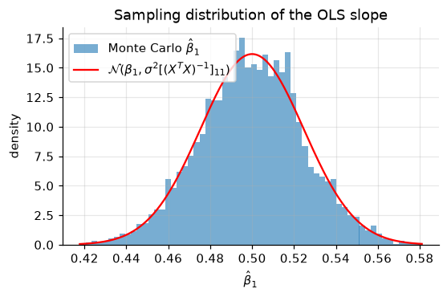

*그림 2. 같은 $X$ 에서 잡음만 바꿔 얻은 $\hat\beta_1$ 5,000개의 히스토그램(파랑, 밀도 척도)과 이론 분포 $\mathcal N(\beta_1,\sigma^2[(X^\top X)^{-1}]_{11})$ (빨강).*

히스토그램이 0.5를 중심으로 대칭이고 빨간 곡선과 잘 겹쳐요. 범례의 첨자 $11$ 은 코드처럼 0부터 센 인덱스라서 기울기 $\beta_1$ 의 분산 성분을 뜻해요.

#### 해석

$\hat\beta_0$ 와 $\hat\beta_1$ 의 공분산이 음수인 이유는 위 단순회귀 공식 $-\sigma^2\bar x/S_{xx}$ 에서 $\bar x>0$ 이기 때문이에요. 직관적으로는, 절편이 있으면 $\sum e_i=0$ 이라 적합 직선이 항상 $(\bar x,\bar y)$ 를 지나요. 기울기를 크게 잡으면 직선이 이 점을 축으로 돌면서 $x=0$ 에서의 값, 즉 절편이 작아져요. 이 강한 음의 상관은 1-6의 등고선이 비스듬하게 길쭉한 타원인 것과 같은 현상이에요. 두 그림 모두 $X^\top X$ 로 결정되니까요.

> 💡 **핵심**: 95% 신뢰구간은 "이 구간에 참값이 있을 확률이 95%"가 아니라 "이 **절차**를 반복하면 95%의 구간이 참값을 포함한다"는 뜻이에요. 몬테카를로 실험이 바로 그 반복이에요.

> ⚠️ **주의**: $\sigma^2(X^\top X)^{-1}$ 공식은 가정 4(무상관 · 등분산)에 기대요. 같은 로트의 웨이퍼처럼 관측이 묶여 상관되어 있으면 표준오차가 과소추정돼요. 3-7에서 군집-강건 표준오차로 다뤄요.

**생각해 볼 질문**

**Q1.** 왜 $n$ 이 아니라 $n-p$ 로 나눌까요? 기하적으로 설명해 보세요.

<details><summary>답</summary>

잔차 $\mathbf e=(I-H)\boldsymbol\varepsilon$ 은 $n-p$ 차원 공간 $\operatorname{col}(X)^\perp$ 에 갇혀 있어요. $n$ 차원 잡음 중 $p$ 차원 성분은 적합값이 흡수했으니, 잔차에는 $n-p$ 개 방향의 잡음만 남아요. 그래서 $\mathbb E[\text{RSS}]=\sigma^2(n-p)$ 예요.

</details>

**Q2.** 오차가 정규분포가 아니면(예: 균등분포) 위 신뢰구간이 틀릴까요?

<details><summary>답</summary>

불편성, $\operatorname{Cov}(\hat{\boldsymbol\beta})=\sigma^2(X^\top X)^{-1}$, $s^2$ 의 불편성, Gauss–Markov는 가정 1–4만 쓰므로 그대로예요. 정확한 $t$ 분포는 성립하지 않지만, $n$ 이 크고 레버리지가 고르게 작으면 중심극한정리로 $\hat{\boldsymbol\beta}$ 가 근사적으로 정규이고 $s^2$ 이 $\sigma^2$ 에 수렴해서, 포함 비율은 95%에 가까워요. $n$ 이 작으면 어긋날 수 있어요.

</details>

**Q3.** 같은 예산(관측 200개)으로 기울기를 더 정확히 추정하려면 $x$ 를 어떻게 정해야 할까요?

<details><summary>답</summary>

$\operatorname{Var}(\hat\beta_1)=\sigma^2/S_{xx}$ 이니 $S_{xx}$ 를 키우면 돼요. 구간 양 끝(0과 10)에 절반씩 두면 최대가 돼요. 다만 그러면 중간에서 직선성이 맞는지 확인할 수 없어요. 실험계획에서 정밀도와 모형 점검 사이의 절충이에요.

</details>

### 1-6. 경사하강법과 조건수

> 💻 **노트북**: 1-6의 코드 셀 3개 (① 헤시안 고윳값 · 조건수 출력, ② autograd 경사하강법과 그림 3, ③ `nn.Linear` + `DataLoader` + SGD 학습과 그림 4). 60분 진행이면 ③은 건너뛰고 3-5에서 설명해요.

선형회귀에는 닫힌 해가 있지만 신경망에는 없어요. 그래서 딥러닝은 모두 경사하강법(gradient descent)처럼 반복적으로 손실을 줄이는 방법으로 학습해요. 선형회귀의 손실은 정확히 이차함수라 경사하강법의 동작을 **정확한 식으로** 풀 수 있고, 여기서 얻는 학습률(learning rate) · 조건수 · 표준화의 교훈은 신경망에도 그대로 이어져요.

#### 기울기와 헤시안

평균제곱오차 $J(\boldsymbol\beta)=\frac1n\lVert\mathbf y-X\boldsymbol\beta\rVert^2=L(\boldsymbol\beta)/n$ 이니 1-3의 결과를 $n$ 으로 나누면 돼요.

$$
\nabla J(\boldsymbol\beta)=\frac2nX^\top(X\boldsymbol\beta-\mathbf y),\qquad A:=\nabla^2J=\frac2nX^\top X\quad(\text{constant matrix})
$$

1-3의 항등식을 $n$ 으로 나누면 $J$ 는 최솟점 주변에서 정확히

$$
J(\boldsymbol\beta)=J^\star+\frac12(\boldsymbol\beta-\hat{\boldsymbol\beta})^\top A(\boldsymbol\beta-\hat{\boldsymbol\beta}),\qquad J^\star=J(\hat{\boldsymbol\beta})
$$

예요. 테일러 전개가 2차에서 끝나는 거예요.

#### 오차의 선형 점화식

갱신식은 $\boldsymbol\beta_{t+1}=\boldsymbol\beta_t-\eta\nabla J(\boldsymbol\beta_t)$ 예요. $\nabla J$ 는 아핀 함수이고 $\nabla J(\hat{\boldsymbol\beta})=\mathbf 0$ 이므로 $\nabla J(\boldsymbol\beta_t)=\nabla J(\boldsymbol\beta_t)-\nabla J(\hat{\boldsymbol\beta})=A(\boldsymbol\beta_t-\hat{\boldsymbol\beta})$ 예요. 잔차 $\mathbf e$ 와 헷갈리지 않게 파라미터 오차를 $\boldsymbol\delta_t:=\boldsymbol\beta_t-\hat{\boldsymbol\beta}$ 로 쓰면

$$
\boldsymbol\delta_{t+1}=\boldsymbol\delta_t-\eta A\boldsymbol\delta_t=(I-\eta A)\boldsymbol\delta_t
\quad\Longrightarrow\quad
\boldsymbol\delta_t=(I-\eta A)^t\boldsymbol\delta_0
$$

이에요. 비선형으로 보이는 학습 과정이 **선형 점화식**이 됐어요.

#### 고유방향으로 분해하기

$A$ 는 대칭이고, $\operatorname{rank}(X)=p$ 이면 양의 정부호예요. 고유분해 $A=V\Lambda V^\top$ ($V=[\mathbf v_1\cdots\mathbf v_p]$ 정규직교, $0 < \lambda_{\min}=\lambda_1\le\cdots\le\lambda_p=\lambda_{\max}$)에서 좌표 $c_{t,i}=\mathbf v_i^\top\boldsymbol\delta_t$ 를 쓰면 방향마다 따로 움직여요.

$$
c_{t,i}=(1-\eta\lambda_i)^t\,c_{0,i},\qquad
\lVert\boldsymbol\delta_t\rVert^2=\sum_i(1-\eta\lambda_i)^{2t}c_{0,i}^2,\qquad
J(\boldsymbol\beta_t)-J^\star=\frac12\sum_i\lambda_i(1-\eta\lambda_i)^{2t}c_{0,i}^2
$$

방향 $i$ 의 인자 $1-\eta\lambda_i$ 가 $(0,1)$ 이면 단조롭게 줄고, $(-1,0)$ 이면 **부호가 번갈아 바뀌며**(지그재그) 줄고, 절댓값이 1보다 크면 발산해요.

#### 수렴 조건

모든 시작점에서 $\boldsymbol\delta_t\to\mathbf 0$ 일 필요충분조건은 스펙트럼 반지름이 1보다 작은 거예요.

$$
\rho(I-\eta A)=\max_i\lvert1-\eta\lambda_i\rvert < 1
\iff -1 < 1-\eta\lambda_i < 1\ \ \forall i
\iff 0 < \eta\lambda_i < 2\ \ \forall i
\iff 0 < \eta < \frac{2}{\lambda_{\max}}
$$

충분성은 위 식에서 바로 나오고, 필요성은 $\lvert1-\eta\lambda_i\rvert\ge1$ 인 방향 $\mathbf v_i$ 에서 출발하면 줄지 않는다는 걸로 보여요. $I-\eta A$ 가 대칭이라 $\lVert\boldsymbol\delta_t\rVert\le\rho^t\lVert\boldsymbol\delta_0\rVert$ 이고, 위 식에서 $J(\boldsymbol\beta_t)-J^\star\le\rho^{2t}\big(J(\boldsymbol\beta_0)-J^\star\big)$ 예요. 노트북이 "$J-J^\star$ 는 $\rho^{2t}$ 로 줄어요"라고 한 게 이거예요.

#### 최적 고정 학습률

$\rho(\eta)=\max\big(\lvert1-\eta\lambda_{\min}\rvert,\ \lvert1-\eta\lambda_{\max}\rvert\big)$ 에서 첫째 항은 $\eta\le1/\lambda_{\min}$ 범위에서 $\eta$ 가 커질수록 줄고, 둘째 항은 $\eta > 1/\lambda_{\max}$ 부터 커져요. 최댓값을 최소화하는 점은 두 항이 같아지는 $1-\eta\lambda_{\min}=\eta\lambda_{\max}-1$ 이에요.

$$
\eta^\star=\frac{2}{\lambda_{\min}+\lambda_{\max}},\qquad
\rho^\star=1-\frac{2\lambda_{\min}}{\lambda_{\min}+\lambda_{\max}}=\frac{\lambda_{\max}-\lambda_{\min}}{\lambda_{\max}+\lambda_{\min}}=\frac{\kappa-1}{\kappa+1},\qquad\kappa=\frac{\lambda_{\max}}{\lambda_{\min}}
$$

오차를 $\epsilon$ 배로 줄이는 데 필요한 반복 횟수는 $t\approx\ln(1/\epsilon)/\ln(1/\rho)$ 예요. $\kappa$ 가 크면 $\ln\frac{\kappa+1}{\kappa-1}\approx\frac2\kappa$ 라서 최적 학습률에서도 $t\approx\frac\kappa2\ln(1/\epsilon)$, $\eta=1/\lambda_{\max}$ 이면 $\rho=1-1/\kappa$ 라서 $t\approx\kappa\ln(1/\epsilon)$ 이에요. **반복 횟수가 조건수에 비례**해요.

#### 표준화가 $\kappa$ 를 줄이는 이유

원래 설계행렬 $[\mathbf 1,\ \mathbf x]$ 에서는 $A=2\begin{bmatrix}1&\bar x\\ \bar x&\overline{x^2}\end{bmatrix}$ 이에요. $\bar x$ 가 0이 아니라 비대각 성분이 크고, 두 대각 성분의 크기도 달라요. 이제 $z_i=(x_i-\bar x)/s_x$ 로 표준화해요. 노트북의 `x.std()` 는 $n-1$ 로 나누는 표본표준편차라서 $\mathbf 1^\top\mathbf z=0$, $\mathbf z^\top\mathbf z=\sum_i(x_i-\bar x)^2/s_x^2=n-1$ 이에요. 따라서

$$
X_s^\top X_s=\begin{bmatrix}n&0\\0&n-1\end{bmatrix},\qquad
A_s=\frac2nX_s^\top X_s=\operatorname{diag}\Big(2,\ 2\,\frac{n-1}{n}\Big),\qquad
\kappa=\frac{n}{n-1}
$$

이에요. $n=200$ 이면 고윳값은 1.99와 2이고 $\kappa=200/199\approx1.005$ 예요. 절편 열과 직교하고 스케일이 같아졌기 때문이에요.

특성이 여러 개면 이야기가 달라요. 표준화한 특성 행렬을 $Z$ ($n\times q$)라 하면 $R=Z^\top Z/(n-1)$ 은 표본 **상관행렬**이고

$$
A_s=\frac2n\begin{bmatrix}n&\mathbf 0^\top\\ \mathbf 0&(n-1)R\end{bmatrix}
$$

이에요. 고윳값은 $2$ 와 $2\frac{n-1}{n}\nu_j$ ($\nu_j$ 는 $R$ 의 고윳값)예요. $\operatorname{tr}R=q$ 라 $\nu_{\min}\le1\le\nu_{\max}$ 이므로, $\nu_{\max}\ge n/(n-1)$ 이기만 하면 $\kappa(A_s)=\nu_{\max}/\nu_{\min}=\kappa(R)$ 이에요. 노트북 표현대로 "$\kappa$ 는 대략 **특성 상관행렬의 조건수**"가 돼요. $\kappa\approx1$ 은 $R\approx I$, 즉 표준화된 특성들이 (거의) 서로 직교할 때만 성립해요. 표준화는 절편과의 결합과 스케일 차이를 없애 줄 뿐, **특성끼리의 상관은 없애지 못해요**. 특성끼리 상관이 강하면 표준화해도 $\kappa$ 가 커요 (3-5에서 확인해요).

표준화는 재매개화(reparametrization)라서 열공간이 같고, 적합값과 $J^\star$ 도 같아요. 바뀌는 건 좌표, 그래서 등고선의 모양뿐이에요. $X_s\boldsymbol\beta_s=b+w\,(x-\bar x)/s_x=(b-w\bar x/s_x)+(w/s_x)\,x$ 이므로 원래 좌표로는 $\beta_1=w/s_x$, $\beta_0=b-w\,\bar x/s_x$ 예요.

#### 코드 읽기 ①: 고윳값과 조건수

<details><summary>📝 셀 전체 코드 (줄별 주석)</summary>

```python
# ── 1. 손실 함수 J(β) 정의 ─────────────────────────────────────
# 평균제곱오차 J(β) = (1/n)‖y − Xβ‖² 그대로예요. .mean() 이 (1/n)Σᵢ 역할을 해요.
# X: (n, p), beta: (p,) → X @ beta: (n,) → 스칼라(0차원 텐서) 손실. 1-3의 RSS L(β) 를 n 으로 나눈 값이에요.
def mse_loss(beta, X, y):
    return ((y - X @ beta) ** 2).mean()

# ── 2. x 를 표준화한 설계행렬 Xs 만들기 ───────────────────────────
# x.std() 는 기본값 correction=1, 즉 n−1 로 나누는 표본표준편차예요.
# 그래서 z = (x − x̄)/s_x 는 1ᵀz = 0, zᵀz = n−1 이 되어 아래 λ = [1.99, 2] 가 나와요.
x_mu, x_sd = x.mean(), x.std()                            # 0차원 F64 텐서 x̄, s_x (나중에 역변환에도 써요)
# 절편 열 1 과 표준화한 z 를 열로 쌓아요. 절편 열과 직교하고 스케일이 같아져서 κ ≈ 1 이 돼요.
Xs = torch.stack([torch.ones(n, dtype=F64), (x - x_mu) / x_sd], dim=1)   # 표준화한 설계행렬

# ── 3. 헤시안 A = (2/n)XᵀX 의 고윳값 · 조건수 · 학습률 상한 ─────────
lam_max = {}                                              # 좌표계별 λmax 저장 → 다음 셀에서 학습률 η 를 정해요
for name, M_ in [("raw", X), ("standardized", Xs)]:
    # J 는 정확히 이차함수라 헤시안 ∇²J = (2/n)MᵀM 은 상수 (p, p) 대칭 행렬이에요.
    # eigvalsh 는 대칭(에르미트) 행렬 전용이고, 실수 고윳값을 오름차순으로 돌려줘요 → lam[0]=λmin, lam[-1]=λmax.
    lam = torch.linalg.eigvalsh(2 / n * M_.T @ M_)
    lam_max[name] = lam[-1].item()                        # .item() 으로 파이썬 float 로 꺼내 저장
    # {name:13s}: 13칸 왼쪽 정렬 문자열, .round(4): 고윳값 소수 넷째 자리까지.
    # κ = λmax/λmin 은 조건수, 2/λmax 는 경사하강법이 수렴하는 학습률 상한 (0 < η < 2/λmax) 이에요.
    print(f"{name:13s} λ = {lam.numpy().round(4)}   κ = {(lam[-1] / lam[0]).item():7.1f}   2/λmax = {2 / lam[-1].item():.4f}")
```

</details>

```python
def mse_loss(beta, X, y):
    return ((y - X @ beta) ** 2).mean()

x_mu, x_sd = x.mean(), x.std()
Xs = torch.stack([torch.ones(n, dtype=F64), (x - x_mu) / x_sd], dim=1)   # 표준화한 설계행렬

lam_max = {}
for name, M_ in [("raw", X), ("standardized", Xs)]:
    lam = torch.linalg.eigvalsh(2 / n * M_.T @ M_)
    lam_max[name] = lam[-1].item()
```

- `mse_loss` 는 $J(\boldsymbol\beta)=\frac1n\lVert\mathbf y-X\boldsymbol\beta\rVert^2$ 그대로예요. `.mean()` 이 $\frac1n\sum_i$ 예요.
- `x.std()` 는 기본값(`correction=1`)이 $n-1$ 로 나누는 표본표준편차라 위 계산의 1.99가 나와요.
- `torch.linalg.eigvalsh` 는 대칭(에르미트) 행렬 전용 고윳값 함수예요. 실수 고윳값을 **오름차순**으로 주므로 `lam[-1]` 이 $\lambda_{\max}$, `lam[0]` 이 $\lambda_{\min}$ 이에요.

```text
raw           λ = [ 0.5214 62.9769]   κ =   120.8   2/λmax = 0.0318
standardized  λ = [1.99 2.  ]   κ =     1.0   2/λmax = 1.0000
```

원래 좌표의 $\kappa=120.8$ 은 1-3의 `cond(XᵀX)` 와 같아요. $A$ 는 $X^\top X$ 에 상수 $2/n$ 을 곱한 것뿐이니까요. 허용되는 학습률은 원래 좌표에서 $\eta < 0.0318$, 표준화하면 $\eta < 1.0$ 이에요.

#### 코드 읽기 ②: autograd로 경사하강법

<details><summary>📝 셀 전체 코드 (줄별 주석)</summary>

```python
# ── 1. autograd 로 기울기를 구하는 경사하강법 ───────────────────────
def gradient_descent(X, y, lr, steps):
    """autograd로 기울기를 구하는 가장 기본적인 경사하강법"""
    # β₀ = 0 에서 출발해요. requires_grad=True 라서 beta 에서 시작하는 연산이 계산 그래프로 기록돼요.
    beta = torch.zeros(X.shape[1], dtype=F64, requires_grad=True)          # (p,) 잎(leaf) 텐서
    # beta 는 제자리 갱신되므로 detach(그래프에서 떼기) + clone(복사)으로 값을 따로 저장해요.
    # clone 없이 저장하면 path 의 원소가 모두 같은 메모리를 가리켜 마지막 값만 남아요.
    path, losses = [beta.detach().clone()], []
    for _ in range(steps):
        loss = mse_loss(beta, X, y)                                        # 순전파: J(β_t), 0차원 텐서
        losses.append(loss.item())                                         # losses[t] 는 갱신 "전"의 J(β_t)
        # 역방향 자동미분으로 ∂J/∂β = (2/n)Xᵀ(Xβ − y) 를 계산해 beta.grad 에 "더해요"(누적).
        loss.backward()                      # beta.grad ← ∇J(β)
        # 갱신 자체는 그래프에 기록하면 안 돼요. 또 requires_grad 인 잎 텐서를
        # 기록 중에 제자리 수정하면 RuntimeError 가 나서 no_grad 블록 안에서 해요.
        with torch.no_grad():
            beta -= lr * beta.grad                                         # β_{t+1} = β_t − η∇J(β_t)
            beta.grad.zero_()                                              # 누적 방지: 매 걸음 기울기를 0으로 지워요
        path.append(beta.detach().clone())
    # path: (steps+1, p) 경로, losses: (steps,) 손실 기록
    return torch.stack(path), torch.tensor(losses, dtype=F64)

# ── 2. 학습률을 바꿔 가며 네 번 실행 ─────────────────────────────
# J* = J(β̂): 1-3의 lstsq 해 beta_ls 에서의 최소 손실. 등고선 높이와 수렴 그래프의 기준이에요.
J_star = mse_loss(beta_ls, X, y).item()
# {범례 이름: (설계행렬, 학습률 η)}. η 를 λmax 의 배수로 정해서 빠른 방향 인자 1 − ηλmax 를 조절해요.
runs = {
    r"raw, $\eta = 1.0/\lambda_{max}$":           (X,  1.00 / lam_max["raw"]),           # 인자 0: 매끈, 느림
    r"raw, $\eta = 1.9/\lambda_{max}$":           (X,  1.90 / lam_max["raw"]),           # 인자 −0.9: 지그재그
    r"raw, $\eta = 2.02/\lambda_{max}$ (diverge)": (X,  2.02 / lam_max["raw"]),          # |인자| > 1: 발산
    r"standardized, $\eta = 1/\lambda_{max}$":     (Xs, 1.00 / lam_max["standardized"]), # κ ≈ 1: 몇 걸음에 수렴
}
# 각 실행마다 300걸음. 값은 (경로 (301, 2), 손실 (300,)) 튜플이에요. dict 는 삽입 순서를 유지해요.
results = {k: gradient_descent(M_, y, lr, steps=300) for k, (M_, lr) in runs.items()}

# ── 3. 손실 등고선용 격자 계산 ───────────────────────────────────
# 원래 좌표 (β0, β1) 에서의 손실 등고선
# indexing="ij": b0g[i, j] = i번째 β0, b1g[i, j] = j번째 β1. 둘 다 (160, 160)
b0g, b1g = torch.meshgrid(torch.linspace(-0.5, 3.0, 160, dtype=F64),
                          torch.linspace(-0.05, 0.9, 160, dtype=F64), indexing="ij")
# b0g[..., None]: (160, 160, 1) 이 x (200,) 와 브로드캐스팅 → (160, 160, 200) 잔차 배열.
# 마지막 축 평균이 격자점마다의 J 예요. 반복문 없이 약 500만 개 항을 한꺼번에 계산해요.
Jg = ((y - b0g[..., None] - b1g[..., None] * x) ** 2).mean(-1)   # (160, 160)

# ── 4. 표준화 좌표 경로 → 원래 좌표로 역변환 ─────────────────────
def to_original(path_std):
    """표준화 좌표의 (b, w) 경로 → 원래 좌표 (β0, β1)"""
    b_, w_ = path_std[:, 0], path_std[:, 1]                         # 각각 (T,)
    # b + w(x − x̄)/s_x = (b − w x̄/s_x) + (w/s_x) x 이므로 β0 = b − w x̄/s_x, β1 = w/s_x
    return torch.stack([b_ - w_ * x_mu / x_sd, w_ / x_sd], dim=1)   # (T, 2)

# ── 5. 왼쪽 그림: 등고선 위의 GD 경로 ────────────────────────────
keys = list(results)                                                # 실행 이름을 순서대로: keys[2] 가 발산 실행
fig, axes = plt.subplots(1, 2, figsize=(12, 4.2))
ax = axes[0]
# levels: J* + 10^(−2.5) … 10^(1.2) 로그 간격 16개 → 최솟점 근처 등고선이 촘촘해요.
# (logspace 는 기본 float32 라 levels 도 float32 지만 그리기용이라 상관없어요.) Greys_r: 낮을수록 어두운 회색
ax.contour(b0g.numpy(), b1g.numpy(), Jg.numpy(), levels=(J_star + torch.logspace(-2.5, 1.2, 16)).numpy(),
           cmap="Greys_r", linewidths=0.6)
# 발산 실행(keys[2])은 빼고 그려요. 표준화 실행(keys[3])은 to_original 로 원래 좌표에 옮겨요.
# results[k][0] 은 (경로, 손실) 중 경로 (301, 2) 예요.
for k, c, p in [(keys[0], "C0", results[keys[0]][0]), (keys[1], "C1", results[keys[1]][0]),
                (keys[3], "C2", to_original(results[keys[3]][0]))]:
    # ".-": 점 + 선, ms: 점 크기, lw: 선 두께. p[:, 0] = β0 궤적, p[:, 1] = β1 궤적
    ax.plot(p[:, 0].numpy(), p[:, 1].numpy(), ".-", ms=2.5, lw=0.7, color=c, label=k + " (300 steps)")
# *beta_ls.numpy() 로 (β̂0, β̂1) 두 값을 풀어서 x, y 로 넘겨요. "k*": 검은 별
ax.plot(*beta_ls.numpy(), "k*", ms=12, label=r"$\hat\beta$")
ax.set(xlim=(-0.5, 3.0), ylim=(-0.05, 0.9), xlabel=r"$\beta_0$", ylabel=r"$\beta_1$",
       title=r"GD paths in the original $(\beta_0, \beta_1)$ space")
ax.legend(fontsize=7, loc="upper right")

# ── 6. 오른쪽 그림: J(β_t) − J* 의 수렴 곡선 (로그 축) ─────────────
ax = axes[1]
# results.items() 순서대로 색을 붙여요: 발산 실행(세 번째)이 빨강 C3, 표준화가 초록 C2 → 왼쪽 그림과 색이 맞아요.
for (k, (_, losses)), c in zip(results.items(), ["C0", "C1", "C3", "C2"]):
    # 반올림 오차로 J − J* 가 0 이하가 되면 로그를 못 그리므로 clamp_min(1e-16) 으로 바닥을 깔아요.
    # 로그 축에서 각 고유방향 성분은 기울기 2·log10|1 − ηλᵢ| 인 직선이에요.
    ax.semilogy((losses - J_star).clamp_min(1e-16).numpy(), color=c, label=k)
# ylim 상한 1e4 로 발산 곡선이 그림을 덮지 않게 잘라요.
ax.set(xlabel="iteration t", ylabel=r"$J(\beta_t) - J^\star$", ylim=(1e-12, 1e4), title="Convergence (log scale)")
ax.legend(fontsize=7)
plt.tight_layout()                                                  # 두 그림의 라벨이 겹치지 않게 여백 조정
plt.show()
```

</details>

```python
def gradient_descent(X, y, lr, steps):
    """autograd로 기울기를 구하는 가장 기본적인 경사하강법"""
    beta = torch.zeros(X.shape[1], dtype=F64, requires_grad=True)
    path, losses = [beta.detach().clone()], []
    for _ in range(steps):
        loss = mse_loss(beta, X, y)
        losses.append(loss.item())
        loss.backward()                      # beta.grad ← ∇J(β)
        with torch.no_grad():
            beta -= lr * beta.grad
            beta.grad.zero_()
        path.append(beta.detach().clone())
    return torch.stack(path), torch.tensor(losses, dtype=F64)
```

- `requires_grad=True`: 이 텐서에서 시작하는 연산을 autograd가 계산 그래프로 기록해요. 모든 실행은 $\boldsymbol\beta_0=\mathbf 0$ 에서 출발해요.
- `loss.backward()`: 역방향 자동미분(reverse-mode autodiff)으로 $\partial J/\partial\boldsymbol\beta$ 를 계산해 `beta.grad` 에 **더해요**. 값은 손으로 유도한 $\frac2nX^\top(X\boldsymbol\beta-\mathbf y)$ 와 반올림 오차 범위에서 같아요. 학생들이 직접 `2 / n * X.T @ (X @ beta - y)` 와 비교해 보면 좋아요.
- `with torch.no_grad():` 갱신 자체는 그래프에 기록하면 안 돼요. 게다가 `requires_grad=True` 인 잎(leaf) 텐서(다른 텐서의 연산 결과가 아니라 직접 만든 텐서, 여기서는 `beta`)를 그래프 기록 중에 제자리(in-place) 수정하면 `RuntimeError` 가 나요.
- `beta.grad.zero_()`: `backward()` 는 기울기를 누적하므로 매 걸음 0으로 지워야 해요. 빠뜨리면 지난 기울기가 모두 더해져서 틀린 방향으로 가고 쉽게 발산해요.
- `beta.detach().clone()`: `detach` 로 그래프에서 떼고, `clone` 으로 복사해요. `beta` 는 제자리 갱신되므로 `clone` 없이 저장하면 `path` 의 원소가 모두 같은 메모리를 가리켜 마지막 값만 남아요.
- `losses[t]` 는 갱신 **전**의 $J(\boldsymbol\beta_t)$ 예요.

```python
runs = {
    r"raw, $\eta = 1.0/\lambda_{max}$":           (X,  1.00 / lam_max["raw"]),
    r"raw, $\eta = 1.9/\lambda_{max}$":           (X,  1.90 / lam_max["raw"]),
    r"raw, $\eta = 2.02/\lambda_{max}$ (diverge)": (X,  2.02 / lam_max["raw"]),
    r"standardized, $\eta = 1/\lambda_{max}$":     (Xs, 1.00 / lam_max["standardized"]),
}
```

출력된 $\lambda$ 와 $\kappa$ 로 각 실행의 방향별 인자를 계산하면 다음과 같아요.

| 실행 | $\eta\lambda_{\max}$ | 빠른 방향 인자 $1-\eta\lambda_{\max}$ | 느린 방향 인자 $1-\eta\lambda_{\min}$ | 예상 |
|---|---|---|---|---|
| raw, $1.0/\lambda_{\max}$ | 1.0 | $0$ | $1-1/\kappa\approx0.992$ | 첫 걸음에 빠른 방향 소멸, 이후 느림 |
| raw, $1.9/\lambda_{\max}$ | 1.9 | $-0.9$ | $1-1.9/\kappa\approx0.984$ | 지그재그, 느린 방향은 더 빠름 |
| raw, $2.02/\lambda_{\max}$ | 2.02 | $-1.02$ | $\approx0.983$ | 빠른 방향이 발산 |
| standardized, $1/\lambda_{\max}$ | 1.0 | $0$ | $1-1.99/2=0.005$ | 몇 걸음 만에 수렴 |

참고로 최적 학습률은 $\eta^\star=2/(0.5214+62.9769)\approx0.0315$ 로 $2/\lambda_{\max}=0.0318$ 바로 아래이고, $\eta^\star\lambda_{\max}=2\kappa/(\kappa+1)\approx1.98$, $\rho^\star=(\kappa-1)/(\kappa+1)\approx0.984$ 예요. $1.9/\lambda_{\max}$ 가 이미 최적 수렴률에 거의 닿아 있어요. 그래도 $\rho^\star\approx0.984$ 는 1에 가까워서 **학습률만으로는 조건수 문제를 해결할 수 없어요**.

등고선은 격자 위에서 한꺼번에 계산해요.

```python
b0g, b1g = torch.meshgrid(torch.linspace(-0.5, 3.0, 160, dtype=F64),
                          torch.linspace(-0.05, 0.9, 160, dtype=F64), indexing="ij")
Jg = ((y - b0g[..., None] - b1g[..., None] * x) ** 2).mean(-1)
```

`b0g[..., None]` 은 $(160,160,1)$ 이라 길이 200인 `x` 와 브로드캐스팅되어 $(160,160,200)$ 잔차 배열이 되고, 마지막 축 평균이 격자점마다의 $J$ 예요. 파이썬 반복문 없이 약 500만 개 항을 계산해요. 등고선 높이와 오른쪽 그림의 기준이 되는 $J^\star$ 는 `J_star = mse_loss(beta_ls, X, y).item()`, 즉 1-3의 `lstsq` 해에서의 손실이에요. 표준화 좌표의 경로는 `to_original` 이 위의 역변환 $\beta_1=w/s_x$, $\beta_0=b-w\bar x/s_x$ 로 원래 좌표에 옮겨요.

#### 결과

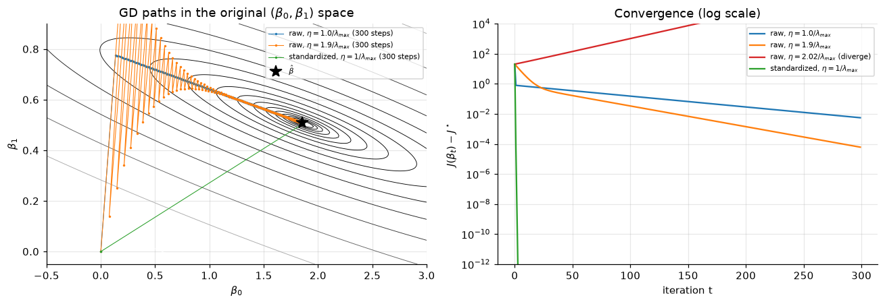

*그림 3. 왼쪽: 원래 좌표 $(\beta_0,\beta_1)$ 에서 손실 $J$ 의 등고선(회색)과 경사하강법 300걸음의 경로(발산 실행 제외), 검은 별은 $\hat{\boldsymbol\beta}$. 오른쪽: 반복 횟수 $t$ 에 따른 $J(\boldsymbol\beta_t)-J^\star$ (세로축 로그).*

**왼쪽 그림 읽기.**

- 등고선은 오른쪽 아래로 기울어진 가늘고 긴 타원이에요. 긴 축이 $\lambda_{\min}$ 의 고유벡터(곡률이 작은 "골짜기 바닥"), 짧은 축이 $\lambda_{\max}$ 의 고유벡터예요. 이차형식의 등위선에서 반축 길이는 $1/\sqrt{\lambda_i}$ 에 비례하므로 두 축의 비는 $\sqrt\kappa=\sqrt{120.8}\approx11.0$, 즉 $\kappa(X)$ 예요. 그림의 두 축 눈금이 달라서 눈에 보이는 비율은 이와 달라요.
- 파란색($\eta=1/\lambda_{\max}$): 첫 걸음에 원점에서 골짜기 바닥으로 뛰어올라요(빠른 방향 인자가 0이니까요). 그 뒤로는 바닥을 따라 아주 천천히 기어가고, 300걸음 뒤에도 $\hat{\boldsymbol\beta}$ 에 닿지 못해요.
- 주황색($\eta=1.9/\lambda_{\max}$): 빠른 방향 인자가 $-0.9$ 라 매 걸음 골짜기를 가로질러 반대편으로 튀는 지그재그를 그려요. 진폭은 걸음마다 0.9배로 줄고, 골짜기를 따라서는 파란색보다 빨리 움직여요.
- 초록색(표준화 후 $\eta=1/\lambda_{\max}$, 원래 좌표로 변환): 원점에서 $\hat{\boldsymbol\beta}$ 까지 거의 한 번에 직선으로 가요.
- 발산하는 실행($\eta=2.02/\lambda_{\max}$)은 왼쪽 그림에 그리지 않았어요. 코드가 `keys[0]`, `keys[1]`, `keys[3]` 의 경로만 그리거든요. 이 실행은 오른쪽 그림에만 빨간색으로 나와요.

**오른쪽 그림 읽기.** $J-J^\star$ 는 방향별 지수함수 $\lambda_i(1-\eta\lambda_i)^{2t}c_{0,i}^2/2$ 의 합이라, 로그 축에서 각 성분은 기울기 $2\log_{10}\lvert1-\eta\lambda_i\rvert$ 인 직선이에요.

- 파란색: $t=1$ 에서 뚝 떨어진 뒤(빠른 성분 소멸) 인자 $0.992^2$ 의 완만한 직선이에요.
- 주황색: 처음에는 빠른 성분(걸음당 $0.9^2=0.81$ 배)이 지배해서 파란색보다 위에 있지만, 그 성분이 사라지면 느린 성분(걸음당 $0.984^2$ 배)의 직선으로 꺾여요. 파란색보다 기울기가 가팔라서 곧 아래로 내려오고 300걸음 뒤에는 더 낮아요.
- 빨간색: 빠른 성분이 걸음당 $1.02^2$ 배로 커지는 직선으로 올라가요.
- 초록색: 몇 걸음 만에 $10^{-12}$ 아래로 떨어져요. 코드의 `clamp_min(1e-16)` 은 0 이하 값의 로그를 피하려는 처리예요.

#### 해석

노트북의 결론대로, 수렴률은 **가장 느린 방향**의 $\max_i\lvert1-\eta\lambda_i\rvert$ 로 정해져요. 파란색과 주황색은 각각 0.992, 0.984라 **지그재그가 심한 주황색이 오히려 더 빨라요**. 지그재그는 빠른 방향의 진동일 뿐이고, $\lvert-0.9\rvert < 1$ 이라 저절로 줄어들어요. $\eta=2.02/\lambda_{\max}$ 는 $\lvert1-\eta\lambda_{\max}\rvert>1$ 이라 발산하고, 표준화하면 $\kappa\approx1$ 이라 몇 걸음 만에 수렴해요.

등고선 타원과 1-5의 공분산은 같은 행렬 $X^\top X$ 로 정해져요. 손실의 긴 골짜기 방향은 데이터가 계수를 잘 못 정하는 방향, 즉 $\hat{\boldsymbol\beta}$ 의 분산이 가장 큰 방향이에요. 통계에서의 "추정량끼리 강한 상관(공선성)"과 최적화에서의 "느린 수렴"은 같은 현상이에요.

> 💡 **핵심**: 경사하강법의 속도는 학습률이 아니라 **조건수**가 정해요. 학습률은 $2/\lambda_{\max}$ 아래에서만 고를 수 있고, 그 안에서 최선이어도 $(\kappa-1)/(\kappa+1)$ 보다 빨라질 수 없어요. 조건수를 줄이는 표준화가 가장 효과적인 처방이에요.

#### PyTorch 표준 학습 루프: `nn.Linear` + `DataLoader` + SGD

> 💻 **노트북**: 1-6의 마지막 코드 셀 (그림 4). 60분 진행이면 건너뛰고 3-5에서 같은 구조의 루프를 설명해요.

실제 딥러닝에서는 기울기를 직접 쓰지 않고, 모델 · 데이터 공급 · 최적화기를 PyTorch 부품으로 조립해요. 같은 문제를 이 방식으로 풀어 보고, 미니배치(minibatch) 확률적 경사하강법(SGD)의 성질을 봐요.

**미니배치 기울기는 불편추정량이에요.** 표본별 손실을 $\ell_i(\boldsymbol\theta)=(y_i-(wz_i+b))^2$, 전체 손실을 $J=\frac1n\sum_i\ell_i$ 라 하고 크기 $m$ 인 미니배치 $\mathcal B$ 의 기울기를 $\mathbf g_{\mathcal B}=\frac1m\sum_{i\in\mathcal B}\nabla\ell_i$ 라 해요. $\mathcal B$ 가 크기 $m$ 인 부분집합 중 균등하게 뽑히면 $P(i\in\mathcal B)=m/n$ 이므로

$$
\mathbb E[\mathbf g_{\mathcal B}]=\frac1m\sum_{i=1}^nP(i\in\mathcal B)\,\nabla\ell_i=\frac1m\cdot\frac mn\sum_{i=1}^n\nabla\ell_i=\nabla J
$$

예요. `shuffle=True` 는 에폭(epoch)마다 데이터를 무작위로 섞어 겹치지 않는 배치로 나눠요. 각 배치를 따로 보면 균등한 크기 $m$ 부분집합이라 위 계산이 그대로 맞아요. 엄밀히 말하면 같은 에폭 안의 배치끼리는 겹치지 않아서 서로 독립이 아니고, 앞 배치들이 정해진 뒤의 조건부 기댓값은 $\nabla J$ 와 조금 달라요. 그래도 한 에폭 동안 모든 표본을 정확히 한 번씩 쓰므로 실용적으로는 불편추정량처럼 동작해요.

**학습률이 일정하면 최적점 근처에서 계속 흔들려요.** $\nabla J(\hat{\boldsymbol\theta})=\mathbf 0$ 이어도 $\mathbf g_{\mathcal B}(\hat{\boldsymbol\theta})\ne\mathbf 0$ 이니까요. 흔들림은 학습률이 클수록 커지고 배치가 클수록 작아져요. 줄이려면 학습률을 점점 줄이거나, 배치를 키우거나, 반복값을 평균해요.

**규모 감각.** $n=200$, 배치 20이니 에폭당 10번 갱신하고, 60에폭이면 600번이에요. 표준화 좌표의 헤시안이 약 $2I$ 라서 $\eta\lambda\approx0.05\times2=0.1$, 전체 배치 기준으로 오차는 걸음당 약 0.9배, 에폭당 약 $0.9^{10}\approx0.35$ 배로 줄어요. 몇 에폭이면 잡음 수준까지 내려간다는 뜻이에요.

<details><summary>📝 셀 전체 코드 (줄별 주석)</summary>

```python
# ── 1. 데이터 공급: TensorDataset + DataLoader ─────────────────────
# 전역 시드: 아래 nn.Linear 의 초깃값을 고정해요 (입력 차원 1 이면 w, b ~ U(−1, 1)).
torch.manual_seed(0)
# (zᵢ, yᵢ) 쌍을 묶어요. z = (x − x̄)/s_x 는 표준화한 입력이에요 (κ ≈ 1 인 좌표).
# .float(): 신경망 파라미터의 기본 dtype 이 float32 라 F64 데이터를 맞춰요 (안 하면 dtype 불일치 오류).
# .unsqueeze(1): (n,) → (n, 1). nn.Linear 는 (배치, 입력 특성 수) 꼴을 받고, 타깃도 출력과 같은 (n, 1) 로 맞춰요.
# 타깃을 (n,) 로 두면 MSELoss 가 (N, N) 으로 브로드캐스팅해서 조용히 틀린 손실을 계산해요.
ds = TensorDataset(((x - x_mu) / x_sd).float().unsqueeze(1), y.float().unsqueeze(1))
# batch_size=20 → 에폭당 200/20 = 10번 갱신. shuffle=True: 에폭마다 새로 섞어 겹치지 않는 배치로 나눠요.
# generator 를 따로 넘겨서 섞는 순서도 재현돼요 (전역 시드와 독립).
loader = DataLoader(ds, batch_size=20, shuffle=True, generator=torch.Generator().manual_seed(0))

# ── 2. 모델 · 최적화기 · 손실 함수 ──────────────────────────────
# ŷ = xWᵀ + b 를 계산하는 모듈. W (1×1), b (1,) 는 requires_grad=True 인 float32 파라미터예요.
model = nn.Linear(1, 1)                       # ŷ = w·x + b
# step() 마다 θ ← θ − 0.05·θ.grad. 표준화 좌표의 헤시안 ≈ 2I 라 ηλ ≈ 0.1 로 상한 2 보다 훨씬 작아요.
opt = torch.optim.SGD(model.parameters(), lr=0.05)
loss_fn = nn.MSELoss()                        # 기본 reduction='mean': 배치 평균 제곱오차

# ── 3. 미니배치 SGD 학습 루프 (60 에폭 = 600 걸음) ─────────────────
epoch_loss = []                               # 에폭별 평균 학습 MSE
for epoch in range(60):
    total = 0.0
    for xb, yb in loader:                     # xb, yb: (20, 1) float32 미니배치
        loss = loss_fn(model(xb), yb)         # 순전파: 미니배치 손실 (기울기는 ∇J 의 불편추정량)
        opt.zero_grad()                       # 누적된 기울기 지우기 (손으로 한 grad.zero_() 와 같아요)
        loss.backward()                       # W.grad, b.grad ← 미니배치 손실의 기울기
        opt.step()                            # 파라미터 갱신 (손으로 한 no_grad 안의 β -= lr·grad 와 같아요)
        # 배치 평균 손실 × 배치 크기 = 배치 손실 합. 마지막 배치가 작아도 정확한 가중 평균이 돼요.
        total += loss.item() * len(xb)
    # 에폭 평균이에요. 배치마다 파라미터가 달라서 에폭 끝 시점의 J 와는 조금 달라요.
    epoch_loss.append(total / len(ds))

# ── 4. 표준화 좌표 (w, b) → 원래 좌표 (β0, β1) 로 되돌리기 ───────────
w, b = model.weight.item(), model.bias.item()             # (1,1), (1,) 텐서에서 파이썬 float 로 꺼내요
beta1_sgd = w / x_sd.item()                               # β1 = w / s_x
beta0_sgd = b - w * x_mu.item() / x_sd.item()             # β0 = b − w·x̄ / s_x
# SGD 결과와 1-3 닫힌 해(lstsq)를 비교해요. 차이는 일정 학습률의 미니배치 잡음이 주된 원인이에요.
print(f"mini-batch SGD : β0 = {beta0_sgd:.4f}, β1 = {beta1_sgd:.4f}")
print(f"closed form    : β0 = {beta_ls[0].item():.4f}, β1 = {beta_ls[1].item():.4f}")

# ── 5. 에폭별 학습 MSE 그래프 ───────────────────────────────────
fig, ax = plt.subplots(figsize=(5.5, 3.2))
ax.plot(epoch_loss, label="train MSE (epoch mean)")       # x 를 생략하면 가로축은 0, 1, …, 59 (에폭 번호)
# 재매개화라 J* 는 좌표와 무관해요. 이 점선 바로 위에서 미니배치 잡음만큼 출렁여요.
ax.axhline(J_star, color="k", ls="--", label=r"$J^\star$ (closed form)")
ax.set(xlabel="epoch", ylabel="MSE", yscale="log", title="nn.Linear + SGD")   # yscale="log": 세로축 로그
ax.legend()
plt.show()
```

</details>

```python
torch.manual_seed(0)
ds = TensorDataset(((x - x_mu) / x_sd).float().unsqueeze(1), y.float().unsqueeze(1))
loader = DataLoader(ds, batch_size=20, shuffle=True, generator=torch.Generator().manual_seed(0))

model = nn.Linear(1, 1)                       # ŷ = w·x + b
opt = torch.optim.SGD(model.parameters(), lr=0.05)
loss_fn = nn.MSELoss()
```

- `torch.manual_seed(0)`: `nn.Linear` 의 초깃값을 고정해요. 입력 차원이 1이면 $w$, $b$ 는 $\mathcal U(-1,1)$ 에서 뽑혀요.
- `TensorDataset`: $(z_i,y_i)$ 쌍을 묶어요. 입력은 `unsqueeze(1)` 로 $(200,1)$ 이에요. `nn.Linear` 는 (배치, 입력 특성 수) 꼴을 받거든요. 타깃도 출력과 같은 $(200,1)$ 로 맞춰요.
- `.float()`: 신경망 파라미터의 기본 dtype이 `float32` 라 데이터도 맞춰요. `float64` 데이터를 그대로 넣으면 dtype 불일치 오류가 나요.
- `DataLoader(batch_size=20, shuffle=True, generator=...)`: 에폭마다 새로 섞되, 생성기를 넘겨서 섞는 순서도 재현돼요.
- `nn.Linear(1, 1)`: $\hat y=xW^\top+b$ 를 계산하는 모듈이에요. `model.parameters()` 가 $W$ $(1\times1)$ 와 $b$ $(1)$ 를 내주고, 둘 다 `requires_grad=True` 예요.
- `torch.optim.SGD(lr=0.05)`: `step()` 마다 $\boldsymbol\theta\leftarrow\boldsymbol\theta-0.05\,\nabla$ 를 해요. `nn.MSELoss()` 는 기본이 배치 평균(`reduction='mean'`)이에요.

```python
for epoch in range(60):
    total = 0.0
    for xb, yb in loader:
        loss = loss_fn(model(xb), yb)
        opt.zero_grad()
        loss.backward()
        opt.step()
        total += loss.item() * len(xb)
    epoch_loss.append(total / len(ds))
```

순전파(forward pass: `loss = loss_fn(model(xb), yb)` 처럼 입력에서 예측과 손실을 계산하는 단계) → `zero_grad()` → `backward()` → `step()` 네 줄이 위 `gradient_descent` 에서 손으로 한 일(`backward`, `no_grad` 갱신, `grad.zero_()`)과 정확히 같아요. `total` 은 배치 손실에 배치 크기를 곱해 더한 뒤 데이터 수로 나눈 **에폭 평균**이에요. 각 배치 손실은 그 시점의 (서로 다른) 파라미터에서 계산되므로, 에폭 끝의 $J$ 와는 달라요. 특히 에폭 0의 값에는 그 에폭 안에서의 개선이 섞여 있어요.

```python
w, b = model.weight.item(), model.bias.item()
beta1_sgd = w / x_sd.item()
beta0_sgd = b - w * x_mu.item() / x_sd.item()
```

표준화 좌표의 $(w,b)$ 를 위에서 유도한 식 $\beta_1=w/s_x$, $\beta_0=b-w\,\bar x/s_x$ 로 원래 좌표에 되돌려요.

#### 결과

```text
mini-batch SGD : β0 = 1.8737, β1 = 0.5073
closed form    : β0 = 1.8537, β1 = 0.5085
```

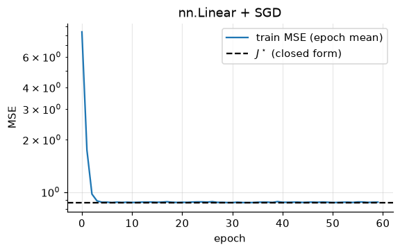

*그림 4. `nn.Linear` + 미니배치 SGD의 에폭 평균 학습 MSE(파랑, 세로축 로그)와 닫힌 해의 최소 손실 $J^\star$ (검은 점선).*

가로축은 에폭, 세로축은 MSE예요. 처음 몇 에폭 만에 급격히 줄어 점선에 거의 붙고, 그 뒤에는 점선 바로 위에서 작게 출렁이며 평평하게 유지돼요. 파라미터가 최적점 근처에서 미니배치 잡음만큼 흔들리기 때문에, 그만큼 $J^\star$ 보다 살짝 높은 곳에 머물러요.

#### 해석

SGD의 결과는 닫힌 해와 $\beta_0$ 에서 0.02, $\beta_1$ 에서 0.0012 차이가 나요. 1-5의 표준오차(0.1279, 0.0231)와 비교하면 각각 약 6분의 1, 20분의 1이에요. **최적화 오차가 통계적 불확실성보다 훨씬 작으니** 실용적으로는 충분해요. 차이의 주된 원인은 일정한 학습률에서의 미니배치 잡음이고, `float32` 반올림($u\approx6\times10^{-8}$)은 이 크기에 비하면 무시할 만해요. 큰 신경망에서도 정확한 최솟점에 도달하지 않으며, 그럴 필요도 없어요.

> ⚠️ **주의**: 타깃을 $(N,)$ 으로 두고 출력이 $(N,1)$ 이면 `nn.MSELoss` 가 브로드캐스팅으로 $(N,N)$ 차이 행렬의 평균을 계산해요. 경고만 나오고 학습은 진행되어 조용히 틀린 모형이 나와요. 코드가 `y.float().unsqueeze(1)` 로 모양을 맞추는 이유예요.

**생각해 볼 질문**

**Q1.** $\eta=2/\lambda_{\max}$ 정확히이면 어떻게 될까요?

<details><summary>답</summary>

빠른 방향의 인자가 $1-2=-1$ 이라 그 성분은 크기가 그대로인 채 부호만 영원히 바뀌어요. 발산하지도 수렴하지도 않아요. 다른 방향은 수렴하므로 $J(\boldsymbol\beta_t)-J^\star$ 는 0이 아닌 일정한 값으로 남아요(시작점에 그 방향 성분이 있다면). 그래서 수렴 조건은 등호 없는 부등식이에요.

</details>

**Q2.** 그림 3에서 지그재그가 심한 주황색이 매끈한 파란색보다 빨리 수렴하는 이유는 무엇일까요?

<details><summary>답</summary>

수렴률은 가장 느린 방향의 인자로 정해져요. 학습률을 키우면 느린 방향의 인자가 $1-1/\kappa\approx0.992$ 에서 $1-1.9/\kappa\approx0.984$ 로 작아져요. 빠른 방향은 $\lvert-0.9\rvert < 1$ 이라 진동하면서도 줄어드니 손해가 없어요. 최적 학습률은 $\eta^\star\lambda_{\max}\approx1.98$ 로 2에 더 가까워요.

</details>

**Q3.** `batch_size=200` (전체 데이터)으로 바꾸면 무엇이 달라질까요?

<details><summary>답</summary>

전체 배치 경사하강법이 되어 잡음이 사라지고, 반복이 결정적으로 닫힌 해를 향해 가요. 대신 에폭당 갱신이 1번뿐이라 60에폭이면 60걸음이고, 오차가 대략 $0.9^{60}\approx0.002$ 배까지만 줄어요. 갱신 횟수와 기울기 정확도 사이의 절충이에요.

</details>

### 1-7. 기저함수 확장 · 과적합 · 릿지

> 💻 **노트북**: 1-7의 코드 셀 2개 (① `poly_1d` · `ridge_fit` · `ridge_predict` · `mse` 정의와 차수별 학습/테스트 MSE, 그림 5, ② $d=15$ 에서 릿지 $\lambda$ 비교, 그림 6). 60분 진행이면 ②는 건너뛰고 4-4에서 다뤄요. ①에서 정의하는 `ridge_fit` · `ridge_predict` · `mse` 는 PART 3, 4에서 다시 쓰니 꼭 실행하세요.

실제 관계는 대개 직선이 아니에요. 기저함수(basis function)로 특성을 늘리면 파라미터에 대해 선형인 채로 곡선을 맞출 수 있어서, 지금까지의 이론이 그대로 적용돼요. 하지만 유연성을 키우면 잡음까지 맞추는 과적합(overfitting)이 생겨요. 이를 설명하는 틀(편향–분산 분해)과 다루는 도구(릿지)를 봐요.

#### 기저함수 확장

특성 사상 $\boldsymbol\phi:\mathbb R\to\mathbb R^q$, 예를 들어 $\boldsymbol\phi(x)=(x,x^2,\dots,x^d)$ 를 써도

$$
y=\beta_0+\boldsymbol\phi(x)^\top\mathbf w+\varepsilon
$$

은 $\mathbf w$ 에 대해 선형이에요. 설계행렬의 열이 $\mathbf 1,\mathbf x,\mathbf x^2,\dots$ 인 것뿐이에요. 스플라인, 푸리에 기저, 방사 기저함수도 같은 방식이고, PART 4는 웨이퍼 위 좌표의 2차원 다항식을 써요.

**학습 오차는 차수에 대해 단조감소해요.** $d < d'$ 이면 $\operatorname{col}(X_d)\subseteq\operatorname{col}(X_{d'})$ 이고, 더 큰 부분공간 위의 최소 거리는 더 작거나 같으니 $\text{RSS}_{d'}\le\text{RSS}_d$ 예요. $x_i$ 가 서로 다르고 $p\ge n$ 이면 RSS가 0이 되어(보간) 데이터를 정확히 통과해요. 이 예제는 $n=25$ 이고 최대 $d=15$ ($p=16$)라 완전 보간까지는 가지 않아요.

#### 편향–분산 분해

$y=f(x)+\varepsilon$, $\mathbb E\varepsilon=0$, $\operatorname{Var}\varepsilon=\sigma^2$ 이고, 학습 데이터 $\mathcal D$ 로 $\hat f$ 를 만든다고 해요. 고정된 점 $x_0$ 에서 새 관측 $y_0=f(x_0)+\varepsilon_0$ 의 $\varepsilon_0$ 는 $\mathcal D$ 와 독립이에요. 기댓값은 $\mathcal D$ 와 $\varepsilon_0$ 에 대해 취해요. 먼저 잡음을 떼어 내요.

$$
\begin{aligned}
\mathbb E\big[(y_0-\hat f(x_0))^2\big]
&=\mathbb E\big[(\varepsilon_0+f(x_0)-\hat f(x_0))^2\big]\\
&=\mathbb E[\varepsilon_0^2]+2\,\mathbb E[\varepsilon_0]\,\mathbb E\big[f(x_0)-\hat f(x_0)\big]+\mathbb E\big[(f(x_0)-\hat f(x_0))^2\big]\\
&=\sigma^2+\mathbb E\big[(f(x_0)-\hat f(x_0))^2\big]
\end{aligned}
$$

독립성으로 교차항의 기댓값이 곱으로 나뉘고 $\mathbb E\varepsilon_0=0$ 이라 사라졌어요. 다음으로 $m(x_0)=\mathbb E\hat f(x_0)$ 를 더하고 빼요.

$$
\begin{aligned}
\mathbb E\big[(f(x_0)-\hat f(x_0))^2\big]
&=\big(f(x_0)-m(x_0)\big)^2+2\big(f(x_0)-m(x_0)\big)\,\mathbb E\big[m(x_0)-\hat f(x_0)\big]+\mathbb E\big[(\hat f(x_0)-m(x_0))^2\big]\\
&=\underbrace{\big(f(x_0)-m(x_0)\big)^2}_{\text{bias}^2}+\underbrace{\operatorname{Var}\hat f(x_0)}_{\text{variance}}
\end{aligned}
$$

$\mathbb E[m(x_0)-\hat f(x_0)]=0$ 이라 교차항이 사라졌어요. 결론은 노트북의 식이에요.

$$
\mathbb E\big[(y_0-\hat f(x_0))^2\big]=\underbrace{\sigma^2}_{\text{irreducible}}+\underbrace{\big(f(x_0)-\mathbb E\hat f(x_0)\big)^2}_{\text{bias}^2}+\underbrace{\operatorname{Var}\hat f(x_0)}_{\text{variance}}
$$

코드의 테스트 MSE는 학습 데이터 **한 세트**에 대해 무작위 $x_0$ 2,000개로 평균한 값이에요. 위 분해는 그 값을 여러 학습 세트에 대해 평균했을 때 성립해요.

**OLS에서 각 항의 크기.** 학습 입력에서의 값을 벡터 $\mathbf f=(f(x_1),\dots,f(x_n))^\top$ 로 쓰면 $\hat{\mathbf y}=H\mathbf y=H\mathbf f+H\boldsymbol\varepsilon$ 이에요.

- 편향: $\mathbb E\hat{\mathbf y}-\mathbf f=-(I-H)\mathbf f$, 평균 제곱 편향은 $\lVert(I-H)\mathbf f\rVert^2/n$ 이에요. $\mathbf f\in\operatorname{col}(X)$ 일 때만 0이에요.
- 분산: $\operatorname{Cov}(\hat{\mathbf y})=\sigma^2H$ 라서 평균 분산은 $\sigma^2\operatorname{tr}(H)/n=\sigma^2p/n$ 이에요. **파라미터 수에 비례**해서 커져요.
- 학습 오차: $\mathbf e=(I-H)(\mathbf f+\boldsymbol\varepsilon)$ 에서 $\mathbb E[\text{RSS}]/n=\lVert(I-H)\mathbf f\rVert^2/n+\sigma^2(n-p)/n$ 이에요. 편향이 작으면 **$\sigma^2$ 보다 작아져요**.
- 같은 입력에서 새 잡음으로 잰 예측 오차는 $\sigma^2+\lVert(I-H)\mathbf f\rVert^2/n+\sigma^2p/n$ 이에요. 학습 오차와의 차이 $2\sigma^2p/n$ 만큼 학습 오차가 낙관적이에요.

**예: $f(x)=\sin(\pi x)$, $x\sim\mathcal U(-1,1)$.** $n\to\infty$ 이면 남는 편향은 "가장 잘 맞는 $d$ 차 다항식과 $f$ 의 차이"예요. 직접 계산해 볼 수 있어요.

- $d=0$: 최선의 상수는 $\mathbb Ef=0$, 평균 제곱 편향은 $\mathbb E[\sin^2(\pi x)]=1/2$ 이에요.
- $d=1$: $f$ 가 홀함수라 최선의 직선은 원점을 지나고, 기울기는 $\mathbb E[xf]/\mathbb E[x^2]$ 예요. $\mathbb E[x\sin\pi x]=\int_0^1x\sin(\pi x)\,dx=1/\pi$, $\mathbb E[x^2]=1/3$ 이라 기울기는 $3/\pi\approx0.955$ 이고, 평균 제곱 편향은 $\frac12-\frac{(1/\pi)^2}{1/3}=\frac12-\frac{3}{\pi^2}\approx0.196$ 이에요.
- $d=2$: $x^2$ 은 짝함수라 홀함수 $f$ 와 직교해서 개선이 없어요. 여전히 약 0.196이에요.
- $d=3$: 같은 방법(르장드르 다항식으로의 사영)으로 계산하면 약 0.0044로 뚝 떨어져요. $d=4$ 도 같은 이유로 그대로예요.

여기에 $\sigma^2=0.09$ 만 더해도 $d=0$ 은 약 0.59, $d=1,2$ 는 약 0.29이고, $d=3$ 은 $\sigma^2$ 바로 위예요. 실제 테스트 오차는 여기에 분산 항이 조금 더해져요. 그림 5에서 확인해요.

#### 코드 읽기

<details><summary>📝 셀 전체 코드 (줄별 주석)</summary>

```python
# ── 1. 다항식 기저함수 특성 행렬 ─────────────────────────────────
def poly_1d(x, d):
    """[x, x², …, x^d]  (상수항 제외 — 절편은 따로 다뤄요)"""
    if d == 0:
        # 열이 없는 (n, 0) 행렬 → 절편만 있는 모형이 돼요. dtype 은 입력(F64)에 맞춰요.
        return torch.zeros(len(x), 0, dtype=x.dtype)
    # x¹ … x^d 를 열로 쌓아 (n, d). 계수 w 에 대해서는 여전히 선형이라 OLS · 릿지 이론이 그대로 적용돼요.
    return torch.stack([x ** k for k in range(1, d + 1)], dim=1)

# ── 2. 릿지 적합: 특성 표준화 + 절편 분리 ─────────────────────────
def ridge_fit(P, y, lam=0.0):
    """특성 P(상수항 제외)를 표준화하고 릿지 회귀를 풀어요. 절편은 벌점 없음, lam=0 이면 OLS."""
    # 표준화한 Z 는 1ᵀZ = 0 이라 절편이 w 와 분리되고, 어떤 λ 에서도 b̂ = ȳ 가 정확한 해예요.
    b = y.mean()
    if P.shape[1] == 0:                                    # 절편만 있는 모형
        # P.sum(0) 은 (n, 0) 의 열 합 = 길이 0 텐서. dtype 이 맞는 빈 텐서를 만드는 요령이고, 예측은 상수 ȳ 예요.
        return {"mu": P.sum(0), "sd": P.sum(0) + 1, "w": P.sum(0), "b": b}
    # "학습 데이터"의 열 평균 · 표준편차 (q,). clamp_min 은 상수 열에서 0으로 나누는 걸 막아요.
    mu, sd = P.mean(0), P.std(0).clamp_min(1e-12)
    Z = (P - mu) / sd                                      # 표준화한 특성 (n, q): 벌점이 단위에 의존하지 않게
    if lam == 0:
        # 중심화한 Z 와 y − ȳ 로 lstsq 를 풀면 절편 있는 OLS 와 같아요. lstsq 는 2차원 B 를 받아서
        # unsqueeze(1) 로 (n, 1) 을 넘기고, 해 (q, 1) 을 squeeze(1) 로 (q,) 로 되돌려요.
        w = torch.linalg.lstsq(Z, (y - b).unsqueeze(1)).solution.squeeze(1)
    else:
        # 정규방정식 (ZᵀZ + nλI) w = Zᵀ(y − ȳ1). len(y) 가 n 이에요. λ > 0 이면 A 가 양의 정부호라 해가 유일해요.
        A = Z.T @ Z + lam * len(y) * torch.eye(P.shape[1], dtype=P.dtype)
        w = torch.linalg.solve(A, Z.T @ (y - b))           # 역행렬 대신 선형계를 직접 풀어요 (더 정확 · 빠름)
    # 예측에 필요한 것 전부: 학습 때의 표준화 통계(mu, sd), 계수 w (q,), 절편 b
    return {"mu": mu, "sd": sd, "w": w, "b": b}

# ── 3. 예측 · 평가 함수 ─────────────────────────────────────────
def ridge_predict(m, P):
    # f̂(x) = ȳ + ((φ(x) − μ)/s)ᵀ w. 새 데이터도 "학습 때의" mu, sd 로 표준화해요 (테스트 정보 누출 방지).
    return m["b"] + ((P - m["mu"]) / m["sd"]) @ m["w"]

def mse(a, b):
    return ((a - b) ** 2).mean()                           # 평균제곱오차 (0차원 텐서)

# ── 4. 참 함수를 아는 합성 데이터 ─────────────────────────────────
# 참 함수 f(x) = sin(πx), 학습 25개 · 테스트 2,000개, 잡음 σ = 0.3
g = torch.Generator().manual_seed(3)                       # 이 셀 전용 생성기 → 데이터 재현
f_true = lambda t: torch.sin(torch.pi * t)
x_tr = 2 * torch.rand(25, generator=g, dtype=F64) - 1                     # x ~ U(−1, 1), (25,)
y_tr = f_true(x_tr) + 0.3 * torch.randn(25, generator=g, dtype=F64)       # y = f(x) + ε, ε ~ N(0, 0.3²)
x_te = 2 * torch.rand(2000, generator=g, dtype=F64) - 1                   # 같은 분포에서 테스트 입력 (2000,)
y_te = f_true(x_te) + 0.3 * torch.randn(2000, generator=g, dtype=F64)

# ── 5. 차수 d = 0 … 15 를 OLS(lam=0)로 적합하고 학습/테스트 MSE 기록 ──
degrees = list(range(16))
fits_1d = {d: ridge_fit(poly_1d(x_tr, d), y_tr) for d in degrees}        # 차수별 적합 결과 dict
# 학습 MSE 는 d 에 대해 단조감소해요 (열공간이 커지니까요). 테스트 MSE 는 편향–분산 절충을 보여요.
tr_err = [mse(ridge_predict(fits_1d[d], poly_1d(x_tr, d)), y_tr).item() for d in degrees]
te_err = [mse(ridge_predict(fits_1d[d], poly_1d(x_te, d)), y_te).item() for d in degrees]

# ── 6. 그림: 왼쪽 차수별 MSE, 오른쪽 적합 곡선 ───────────────────
xg = torch.linspace(-1, 1, 400, dtype=F64)                 # 곡선을 그릴 x 격자 400개
fig, axes = plt.subplots(1, 2, figsize=(12, 3.8))
axes[0].semilogy(degrees, tr_err, "o-", label="train MSE")  # 세로축 로그. "o-": 원 + 선
axes[0].semilogy(degrees, te_err, "s-", label="test MSE")   # "s-": 사각형 + 선
# 잡음 분산 σ² = 0.09: 테스트 MSE 가 기댓값으로 넘을 수 없는 바닥이에요. 학습 MSE 가 이 아래면 잡음까지 맞춘 신호예요.
axes[0].axhline(0.3**2, color="k", ls=":", label=r"noise $\sigma^2$")
axes[0].set(xlabel="polynomial degree d", ylabel="MSE", title="Bias–variance trade-off")
axes[0].legend()
# zorder=3: 점을 곡선들 위에 그려요.
axes[1].scatter(x_tr.numpy(), y_tr.numpy(), color="k", s=15, zorder=3, label="train data")
axes[1].plot(xg.numpy(), f_true(xg).numpy(), "k--", lw=1, label="true f")
# d=1 과소적합(편향 큼), d=3 적당, d=15 과적합(분산 큼)을 비교해요.
for d, c in [(1, "C0"), (3, "C2"), (15, "C3")]:
    axes[1].plot(xg.numpy(), ridge_predict(fits_1d[d], poly_1d(xg, d)).numpy(), color=c, label=f"d = {d}")
# d=15 곡선이 가장자리에서 폭발하므로 ylim 으로 ±2 범위만 보여요.
axes[1].set(ylim=(-2, 2), xlabel="x", ylabel="y", title="Under- vs over-fitting")
axes[1].legend(fontsize=8)
plt.tight_layout()
plt.show()
```

</details>

```python
def poly_1d(x, d):
    """[x, x², …, x^d]  (상수항 제외 — 절편은 따로 다뤄요)"""
    if d == 0:
        return torch.zeros(len(x), 0, dtype=x.dtype)
    return torch.stack([x ** k for k in range(1, d + 1)], dim=1)
```

$(n,d)$ 특성 행렬을 만들어요. $d=0$ 이면 열이 없는 $(n,0)$ 행렬이라 절편만 있는 모형이 돼요.

```python
def ridge_fit(P, y, lam=0.0):
    """특성 P(상수항 제외)를 표준화하고 릿지 회귀를 풀어요. 절편은 벌점 없음, lam=0 이면 OLS."""
    b = y.mean()
    if P.shape[1] == 0:                                    # 절편만 있는 모형
        return {"mu": P.sum(0), "sd": P.sum(0) + 1, "w": P.sum(0), "b": b}
    mu, sd = P.mean(0), P.std(0).clamp_min(1e-12)
    Z = (P - mu) / sd
    if lam == 0:
        w = torch.linalg.lstsq(Z, (y - b).unsqueeze(1)).solution.squeeze(1)
    else:
        A = Z.T @ Z + lam * len(y) * torch.eye(P.shape[1], dtype=P.dtype)
        w = torch.linalg.solve(A, Z.T @ (y - b))
    return {"mu": mu, "sd": sd, "w": w, "b": b}

def ridge_predict(m, P):
    return m["b"] + ((P - m["mu"]) / m["sd"]) @ m["w"]
```

- `b = y.mean()`: 절편 $\hat b=\bar y$ 예요. 왜 이게 정확한 해인지는 아래 릿지 유도에서 보여요.
- $d=0$ 분기: `P.sum(0)` 은 $(n,0)$ 행렬의 열 합이라 길이 0인 텐서예요. 빈 텐서를 dtype에 맞게 만드는 요령이고, 예측은 상수 $\bar y$ 가 돼요.
- `mu`, `sd`: **학습 데이터**의 열 평균 · 표준편차예요. `clamp_min(1e-12)` 는 상수 열에서 0으로 나누는 걸 막아요.
- `lam == 0`: 중심화한 $Z$ 와 $\mathbf y-\bar y\mathbf 1$ 로 `lstsq` 를 풀어요. 절편이 있는 OLS와 같아요(아래 유도에서 $\lambda=0$).
- 그 밖에는 $(Z^\top Z+n\lambda I)\mathbf w=Z^\top(\mathbf y-b\mathbf 1)$ 을 `solve` 로 풀어요. `len(y)` 가 $n$ 이에요.
- `ridge_predict`: 새 데이터에도 **학습 때의** `mu`, `sd` 를 써요. 테스트 데이터로 다시 표준화하면 학습 때와 다른 좌표계가 되고 테스트 정보가 새어 들어가요.

```python
g = torch.Generator().manual_seed(3)
f_true = lambda t: torch.sin(torch.pi * t)
x_tr = 2 * torch.rand(25, generator=g, dtype=F64) - 1
y_tr = f_true(x_tr) + 0.3 * torch.randn(25, generator=g, dtype=F64)
x_te = 2 * torch.rand(2000, generator=g, dtype=F64) - 1
y_te = f_true(x_te) + 0.3 * torch.randn(2000, generator=g, dtype=F64)
```

학습 25개, 테스트 2,000개를 같은 분포 $x\sim\mathcal U(-1,1)$ 에서 뽑고 잡음은 $\sigma=0.3$ ($\sigma^2=0.09$)이에요. 그다음 $d=0,\dots,15$ 각각을 $\lambda=0$ (OLS)으로 적합해 학습 · 테스트 MSE를 기록해요.

#### 결과

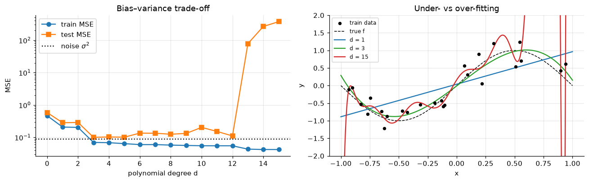

*그림 5. 왼쪽: 다항식 차수 $d$ 에 따른 학습 MSE(파랑 원)와 테스트 MSE(주황 사각형), 점선은 잡음 분산 $\sigma^2=0.09$ (세로축 로그). 오른쪽: 학습 데이터(검은 점), 참 함수(점선)와 $d=1,3,15$ 적합 곡선.*

**왼쪽 그림 읽기.**

- 학습 MSE는 차수가 오를수록 계속 내려가고, $d=3$ 부터는 $\sigma^2$ 점선 **아래**에 있어요. 위에서 유도한 $\sigma^2(n-p)/n$ 효과예요.
- 테스트 MSE는 $d=0$ 에서 크고, $d=1$ 과 $d=2$ 가 거의 같고, $d=3$ 에서 크게 떨어져 점선 근처에 붙어요. 위의 편향 계산과 맞아요.
- 중간 차수에서는 테스트 MSE가 점선 근처에서 완만하게 오르내리다가, $d\ge13$ 에서 로그 축으로 몇 자릿수나 뛰어올라요.

**오른쪽 그림 읽기.**

- $d=1$ (파랑): 직선이라 곡선을 못 따라가요. **과소적합**(편향이 큼)이에요.
- $d=3$ (초록): 참 함수의 모양을 잘 따라가요. 양 끝 $x=\pm1$ 근처에서만 조금 벗어나요.
- $d=15$ (빨강): 학습 점 근처는 지나가지만 그 사이에서 출렁이고, 특히 $x=-1$ 근처와 학습 점이 비어 있는 0.6 ~ 0.9 근처에서 그림 범위($\pm2$)를 크게 벗어나요. **과적합**(분산이 큼)이에요.

#### 해석

고차 다항식이 가장자리와 빈 구간에서 폭발하는 이유는 분산 항 때문이에요. OLS에서 $\operatorname{Var}\hat f(x_0)=\sigma^2\,\tilde{\boldsymbol\phi}(x_0)^\top(X^\top X)^{-1}\tilde{\boldsymbol\phi}(x_0)$ ($\tilde{\boldsymbol\phi}(x_0)=(1,\boldsymbol\phi(x_0))$)이고, 이건 새 점 $x_0$ 의 "레버리지"예요(1-4). $x^{15}$ 같은 고차항은 $\lvert x\rvert\to1$ 에서 급격히 변하고, 고차 단항식 열들은 서로 거의 공선이라 $X^\top X$ 의 조건수도 커요. 계수들이 부호가 엇갈리는 큰 값이 되어 학습 점에서는 서로 상쇄되지만, 데이터가 없는 곳에서는 상쇄되지 않아요. 다항식 보간의 Runge 현상과 비슷한 모습이고, 4-3의 2차원 웨이퍼 곡면에서도 다시 나타나요.

> 💡 **핵심**: 복잡도를 키우면 편향은 줄고 분산은 커져요. 테스트 오차는 그 사이 어딘가에서 최소이고, **학습 오차는 이 선택에 쓸 수 없어요**. 학습 오차가 $\sigma^2$ 보다 낮다는 건 잡음까지 맞췄다는 신호예요.

#### 릿지 회귀

> 💻 **노트북**: 1-7의 두 번째 코드 셀 (그림 6). 60분 진행이면 건너뛰고 4-4에서 다뤄요.

차수를 낮추는 대신, 계수 크기에 벌점을 줘서 분산을 줄일 수 있어요. 릿지(ridge) 회귀예요. 특성은 표준화한 $Z$ (열 평균 0, $\mathbf 1^\top Z=\mathbf 0^\top$)를 쓰고, 절편 $b$ 에는 벌점을 주지 않아요.

$$
\min_{b,\ \mathbf w}\ \frac1n\lVert\mathbf y-b\mathbf 1-Z\mathbf w\rVert^2+\lambda\lVert\mathbf w\rVert^2
$$

**1단계: 절편.** $b$ 로 미분하면 $-\frac2n\mathbf 1^\top(\mathbf y-b\mathbf 1-Z\mathbf w)=0$ 이고, $\mathbf 1^\top Z=\mathbf 0^\top$ 이라 $\hat b=\bar y-\frac1n\mathbf 1^\top Z\mathbf w=\bar y$ 예요. 중심화 덕분에 절편이 $\mathbf w$ 와 분리되고, **어떤 $\lambda$ 에서도** $\hat b=\bar y$ 예요. 코드의 `b = y.mean()` 이 정확한 해인 이유예요.

**2단계: 계수.** $\mathbf y_c=\mathbf y-\bar y\mathbf 1$ 로 두면 남은 문제는 $\frac1n\lVert\mathbf y_c-Z\mathbf w\rVert^2+\lambda\lVert\mathbf w\rVert^2$ 의 최소화예요. 기울기를 0으로 놓으면

$$
-\frac2nZ^\top(\mathbf y_c-Z\mathbf w)+2\lambda\mathbf w=\mathbf 0
\quad\Longrightarrow\quad
(Z^\top Z+n\lambda I)\,\hat{\mathbf w}_\lambda=Z^\top\mathbf y_c=Z^\top(\mathbf y-\bar y\mathbf 1)
$$

이에요. 코드의 `A = Z.T @ Z + lam * len(y) * torch.eye(...)`, `w = torch.linalg.solve(A, Z.T @ (y - b))` 와 정확히 같아요. $Z^\top\mathbf 1=\mathbf 0$ 이라 사실 $Z^\top\mathbf y_c=Z^\top\mathbf y$ 이기도 해요. 헤시안 $\frac2n(Z^\top Z+n\lambda I)$ 는 $\lambda>0$ 이면 양의 정부호라, 특성이 공선이거나 $q>n$ 이어도 해가 유일해요. $\lambda=0$ 이면 절편 있는 OLS로 돌아가요. 새 입력의 예측은 $\hat f(x)=\bar y+\big((\boldsymbol\phi(x)-\boldsymbol\mu)/\mathbf s\big)^\top\hat{\mathbf w}_\lambda$ 이고, 이게 `ridge_predict` 예요.

**왜 표준화하고, 왜 절편은 빼나요?** 벌점 $\sum_jw_j^2$ 는 단위에 의존해요. 어떤 열을 $c$ 배 하면 그 계수는 $1/c$ 배가 되어 벌점이 $1/c^2$ 배로 바뀌어요. 표준화하면 모든 특성이 같은 기준으로 벌점을 받아요. 절편에 벌점을 주면 예측이 0 쪽으로 끌려가는데, $y$ 의 원점은 임의로 정한 것이라 그럴 이유가 없어요.

**SVD로 보는 축소(shrinkage).** 얇은 SVD $Z=UDV^\top$ ($D=\operatorname{diag}(d_1\ge\cdots\ge d_r>0)$, $r=\operatorname{rank}Z$)를 쓰면, $Z^\top\mathbf y_c=VDU^\top\mathbf y_c$ 가 $\operatorname{col}(V)$ 에 있고 그 위에서 $Z^\top Z+n\lambda I$ 는 $V(D^2+n\lambda I)V^\top$ 로 작용하므로

$$
\hat{\mathbf w}_\lambda=V(D^2+n\lambda I)^{-1}DU^\top\mathbf y_c=\sum_{j=1}^r\mathbf v_j\,\frac{d_j}{d_j^2+n\lambda}\,\mathbf u_j^\top\mathbf y_c
$$

이고, 적합값은

$$
Z\hat{\mathbf w}_\lambda=\sum_{j=1}^r\mathbf u_j\,\frac{d_j^2}{d_j^2+n\lambda}\,\mathbf u_j^\top\mathbf y_c
$$

예요. OLS($\lambda=0$)는 $\sum_j\mathbf u_j\mathbf u_j^\top\mathbf y_c$, 즉 인자가 모두 1인 사영이에요. 릿지는 방향 $j$ 마다 인자 $d_j^2/(d_j^2+n\lambda)\in(0,1)$ 을 곱해요. $d_j^2\gg n\lambda$ 이면 거의 그대로, $d_j^2\ll n\lambda$ 이면 거의 0이에요. **작은 특이값 방향을 강하게 줄여요.** 작은 특이값 방향은 데이터가 그 방향으로 거의 퍼져 있지 않은 방향이고, OLS 계수의 분산이 $\sigma^2/d_j^2$ 로 가장 큰 방향이에요.

**유효 자유도.** 릿지의 적합 행렬 $S_\lambda=Z(Z^\top Z+n\lambda I)^{-1}Z^\top$ 의 대각합이에요.

$$
\operatorname{df}(\lambda)=\operatorname{tr}(S_\lambda)=\sum_{j=1}^r\frac{d_j^2}{d_j^2+n\lambda}
$$

$\lambda$ 에 대해 단조감소하고 $\lambda\to0$ 이면 $\operatorname{rank}(Z)$, $\lambda\to\infty$ 이면 0이에요. 1-4의 $\operatorname{tr}(H)=p$ 를 연속적으로 일반화한 거예요(절편까지 세면 $+1$). $Z$ 는 열 평균을 뺀 행렬이라 $\mathbf 1^\top Z=\mathbf 0^\top$, 즉 행들이 일차종속이므로 $\operatorname{rank}(Z)\le n-1$ 이에요. $Z$ 가 열 완전계수면 $\operatorname{rank}(Z)=q$ 이지만, $q\ge n$ 이면 $q$ 보다 작아요.

**편향과 분산의 교환.** 참 모형이 $\mathbf y=b\mathbf 1+Z\mathbf w+\boldsymbol\varepsilon$ 이고 설계가 고정되어 있다고 해요. $\boldsymbol\alpha=V^\top\mathbf w$ 로 두고 방향별로 계산하면(중심화해도 $\operatorname{Cov}(U^\top\mathbf y_c)=\sigma^2I$ 예요. $U^\top\mathbf 1=\mathbf 0$ 이니까요)

$$
\mathbb E\lVert\hat{\mathbf w}_\lambda-\mathbf w\rVert^2=\sum_{j=1}^r\Bigg[\underbrace{\frac{\sigma^2d_j^2}{(d_j^2+k)^2}}_{\text{variance}}+\underbrace{\frac{k^2\alpha_j^2}{(d_j^2+k)^2}}_{\text{bias}^2}\Bigg],\qquad k=n\lambda
$$

예요($r=q$ 일 때). $k$ 로 미분해 $k=0$ 에 넣으면, 편향 항은 분자에 $k^2$ 이 있어 도함수가 0이고 분산 항의 도함수 $-2\sigma^2d_j^2/(d_j^2+k)^3$ 만 남아서 $\sum_j(-2\sigma^2/d_j^4) < 0$ 이에요. 즉 **아주 작은 $\lambda>0$ 은 항상 OLS보다 평균제곱오차가 작아요**(Hoerl–Kennard). 1-5의 Gauss–Markov는 불편추정량끼리의 비교였고, 편향을 조금 허용하면 더 좋아질 수 있다는 뜻이에요.

**베이즈 해석.** 사전분포 $\mathbf w\sim\mathcal N(\mathbf 0,\tau^2I)$ 와 가능도 $\mathbf y_c\mid\mathbf w\sim\mathcal N(Z\mathbf w,\sigma^2I)$ 를 두면(중심화에 따른 작은 차이는 무시해요) 로그 사후밀도는

$$
\log p(\mathbf w\mid\mathbf y_c)=-\frac{1}{2\sigma^2}\lVert\mathbf y_c-Z\mathbf w\rVert^2-\frac{1}{2\tau^2}\lVert\mathbf w\rVert^2+\text{const}
$$

예요. 최대 사후확률(MAP) 추정은 $\lVert\mathbf y_c-Z\mathbf w\rVert^2+(\sigma^2/\tau^2)\lVert\mathbf w\rVert^2$ 의 최소화, 즉 $\lambda=\sigma^2/(n\tau^2)$ 인 릿지예요. 사후분포가 정규라 MAP는 사후평균과도 같아요. 사전분포가 좁을수록(작은 $\tau^2$) $\lambda$ 가 커지고, OLS는 $\tau^2\to\infty$ (평평한 사전분포)의 극한이에요.

#### 코드 읽기

<details><summary>📝 셀 전체 코드 (줄별 주석)</summary>

```python
# ── 1. d = 15 에서 λ 를 바꿔 가며 릿지 적합 ──────────────────────
d_big = 15                                                 # 앞 셀에서 과적합이 심했던 차수
# 학습 (25, 15) · 테스트 (2000, 15) · 그리기 격자 (400, 15) 특성 행렬을 한 번만 만들어 재사용해요.
P_tr, P_te, P_g = poly_1d(x_tr, d_big), poly_1d(x_te, d_big), poly_1d(xg, d_big)
# 10^−8, 10^−7.5, …, 10^1: 로그 간격 0.5 인 λ 격자 19개
lams = torch.logspace(-8, 1, 19, dtype=F64)
# λ 마다 학습 데이터로 적합 → 테스트 MSE. l.item() 으로 파이썬 float 를 넘겨 ridge_fit 의 lam == 0 비교가 단순해져요.
te_ridge = torch.tensor([mse(ridge_predict(ridge_fit(P_tr, y_tr, l.item()), P_te), y_te).item() for l in lams])
# 테스트 MSE 가 최소인 λ. 설명용으로만 이렇게 해요 (실제로는 교차검증으로 골라야 해요, 4-3 · 4-4).
lam_best = lams[te_ridge.argmin()].item()

# ── 2. 왼쪽 그림: λ 에 따른 테스트 MSE ────────────────────────────
fig, axes = plt.subplots(1, 2, figsize=(12, 3.8))
# 두 축 모두 로그. λ 가 작으면 분산, 크면 편향 때문에 커지는 U자 모양이에요.
axes[0].loglog(lams.numpy(), te_ridge.numpy(), "o-")
axes[0].axhline(0.3**2, color="k", ls=":")                 # 잡음 분산 σ² = 0.09 기준선
# {lam_best:.1e}: 지수 표기 유효숫자 둘 (예: 1.0e-03)
axes[0].set(xlabel=r"$\lambda$", ylabel="test MSE", title=f"Ridge (d = {d_big}): best λ ≈ {lam_best:.1e}")

# ── 3. 오른쪽 그림: λ 별 적합 곡선 ───────────────────────────────
axes[1].scatter(x_tr.numpy(), y_tr.numpy(), color="k", s=15, zorder=3)   # 학습 데이터 (곡선 위에 그려요)
axes[1].plot(xg.numpy(), f_true(xg).numpy(), "k--", lw=1, label="true f")
# 1e-8: 거의 OLS (흔들림), lam_best: 적당, 10.0: 강한 축소 → 거의 상수 ȳ (절편은 벌점 없음)
for lam, c in [(1e-8, "C3"), (lam_best, "C2"), (10.0, "C0")]:
    # 격자 위 예측을 그려요. {lam:.0e}: 지수 표기 유효숫자 하나 (예: 1e-08)
    axes[1].plot(xg.numpy(), ridge_predict(ridge_fit(P_tr, y_tr, lam), P_g).numpy(), color=c, label=f"λ = {lam:.0e}")
axes[1].set(ylim=(-2, 2), xlabel="x", title=f"Ridge fits, d = {d_big}")
axes[1].legend(fontsize=8)
plt.tight_layout()
plt.show()
```

</details>

```python
d_big = 15
P_tr, P_te, P_g = poly_1d(x_tr, d_big), poly_1d(x_te, d_big), poly_1d(xg, d_big)
lams = torch.logspace(-8, 1, 19, dtype=F64)
te_ridge = torch.tensor([mse(ridge_predict(ridge_fit(P_tr, y_tr, l.item()), P_te), y_te).item() for l in lams])
lam_best = lams[te_ridge.argmin()].item()
```

- `torch.logspace(-8, 1, 19)`: $10^{-8},10^{-7.5},\dots,10^{1}$ 로 로그 간격 0.5인 격자 19개예요.
- `l.item()`: 파이썬 실수로 넘겨서 `ridge_fit` 안의 `lam == 0` 비교가 단순하게 동작해요.
- `lam_best`: **테스트 MSE**가 가장 작은 $\lambda$ 예요. 설명용으로만 이렇게 해요.

#### 결과

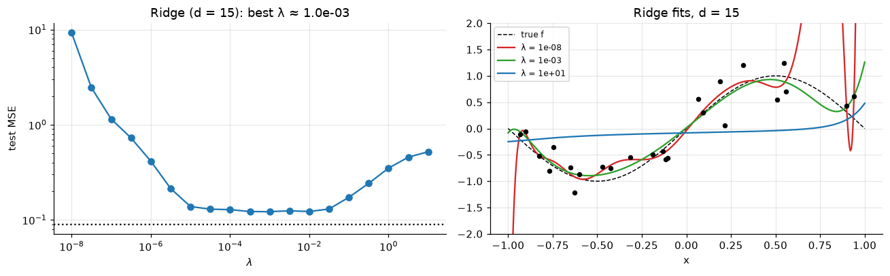

*그림 6. 왼쪽: $d=15$ 에서 $\lambda$ 에 따른 테스트 MSE (두 축 모두 로그), 점선은 $\sigma^2$. 오른쪽: 학습 데이터(검은 점), 참 함수(점선)와 $\lambda=10^{-8}$ (빨강), `lam_best` $=10^{-3}$ (초록), $10$ (파랑)의 적합 곡선.*

- 왼쪽: $\lambda$ 가 아주 작으면 테스트 MSE가 커요(분산). $\lambda$ 를 키우면 줄어들어 $10^{-5}$ ~ $10^{-2}$ 근처에서 점선 바로 위의 넓고 평평한 바닥을 이루고, 더 키우면 다시 커져요(편향). 그림 제목대로 격자 중 최소는 best λ ≈ 1.0e-03 이에요.
- 오른쪽: $\lambda=10^{-8}$ 은 OLS처럼 가장자리와 빈 구간에서 크게 흔들려요. $\lambda=10^{-3}$ 은 매끈하고 대부분의 구간에서 참 함수에 가까워요. 다만 오른쪽 끝($x>0.8$)에서는 아래로 처졌다가 $x\to1$ 에서 위로 휘어 올라가요. 데이터가 적은 가장자리는 벌점을 줘도 여전히 불안정해요. $\lambda=10$ 은 거의 평평한 곡선이에요. 계수가 0 쪽으로 강하게 줄어 예측이 상수 $\bar y$ 에 가까워졌어요(절편은 벌점이 없으니까요).

#### 해석

릿지는 차수 $d$ 라는 이산적인 손잡이를 $\lambda$ 라는 연속적인 손잡이로 바꿔요. $\operatorname{df}(\lambda)$ 는 그 손잡이가 "파라미터 몇 개짜리 모형"에 해당하는지 알려 줘요. $\lambda=10^{-8}$ 처럼 작은 값도 OLS와 완전히 같지는 않아요. $n\lambda=25\times10^{-8}$ 보다 $d_j^2$ 가 작은 방향은 절반 넘게, 훨씬 작은 방향은 거의 0으로 줄어드는데, 고차 단항식 특성들은 서로 거의 공선이라 그런 방향이 생기기 쉬워요. 그림 6 왼쪽에서 $\lambda=10^{-8}$ 의 테스트 MSE가 그림 5의 $d=15$ OLS보다 훨씬 작은 것이 그 흔적이에요. 4-4에서 $\operatorname{df}(\lambda)$ 를 직접 그려 확인해요.

> 💡 **핵심**: 릿지는 편향을 조금 받아들이고 분산을 크게 줄여요. 데이터가 잘 정하지 못하는(작은 특이값) 방향일수록 강하게 줄여요.

> ⚠️ **주의**: 여기서는 이해를 돕기 위해 **테스트 오차로 직접** $d$ 와 $\lambda$ 를 봤어요. 테스트 데이터로 고른 모형의 테스트 오차는 낙관적으로 치우쳐요(선택 편향). 실제로는 학습 데이터 안에서 교차검증(cross-validation)으로 고르고, 테스트 데이터는 마지막에 한 번만 써요 (4-3, 4-4).

**생각해 볼 질문**

**Q1.** 그림 5에서 학습 MSE가 잡음 분산 $\sigma^2$ 점선 아래로 내려가는 건 이상한 일일까요?

<details><summary>답</summary>

아니에요. $\mathbb E[\text{train MSE}]=\sigma^2(n-p)/n+\lVert(I-H)\mathbf f\rVert^2/n$ 이라, 편향이 작아지면 $\sigma^2$ 보다 작아지는 게 정상이에요. 모형이 $p$ 차원만큼 잡음을 흡수하니까요. 예를 들어 편향이 0이라면 $d=15$ ($p=16$, $n=25$)에서 기댓값은 $0.09\times9/25\approx0.032$ 예요.

</details>

**Q2.** 그림 5에서 $d=1$ 과 $d=2$ 의 테스트 오차가 거의 같은 이유는 무엇일까요?

<details><summary>답</summary>

$\sin(\pi x)$ 는 홀함수이고 $x^2$ 은 짝함수라, 대칭인 분포 $\mathcal U(-1,1)$ 아래에서 서로 직교해요. 최선의 $x^2$ 계수가 0이라 편향이 줄지 않고, 파라미터만 늘어 분산이 조금 커질 뿐이에요. $d=3$ 과 $d=4$ 도 같은 이유로 비슷해요.

</details>

**Q3.** $\lambda\to\infty$ 이면 릿지 예측은 어떻게 될까요? 절편에도 벌점을 주면요?

<details><summary>답</summary>

$\hat{\mathbf w}_\lambda\to\mathbf 0$ 이라 예측은 상수 $\bar y$ 로 가요($\operatorname{df}\to0$). 그림 6의 $\lambda=10$ 이 그 근처예요. 절편에도 벌점을 주면 예측이 0으로 가는데, $y$ 의 원점을 옮기면 결과가 바뀌어서 바람직하지 않아요.

</details>

PART 1에서 본 것을 정리하면, 최소제곱 추정량은 하나지만 그것을 보는 눈이 여럿이에요. 계산할 때는 QR · `lstsq` (1-3), 해석할 때는 사영과 $R^2$ (1-4), 불확실성을 말할 때는 $\sigma^2(X^\top X)^{-1}$ 과 $t$ 분포(1-5), 큰 모형을 학습할 때는 조건수와 학습률(1-6), 복잡도를 정할 때는 편향–분산과 릿지(1-7)예요. PART 2부터는 이 도구들을 WM-811K 웨이퍼 맵에 써요.

## PART 2. WM-811K 데이터 탐색 (90분: 15분 · 60분: 10분)

PART 1에서 정리한 선형회귀를 실제 반도체 공정 데이터에 쓰기 전에, 데이터를 **안전하게 불러오고**, 회귀에 쓸 **웨이퍼 단위 표 `wafer`** 를 만들고, 짧은 분석 세 가지(2-7 ~ 2-9)로 PART 3 · 4의 문제를 준비해요.

| 단계 | 섹션 | 만드는 것 |
|---|---|---|
| 불러오기 · 정리 | 2-1 ~ 2-3 | 원본 `raw` → 정리된 표 `df` (웨이퍼 811,457장) |
| 보기 · 특징 계산 | 2-4 ~ 2-5 | 웨이퍼 맵 갤러리, 특징 표 `wafer` (29열) |
| 탐색적 분석 | 2-6 ~ 2-9 | 수율 분포, Poisson 수율 모형, 로트 효과, 반지름별 불량률 |

PART 2에는 (심화) 셀이 없어요. 60분 진행에서는 2-7만 그림과 결론을 보고 넘어가요.

### 2-1. 데이터셋 소개

> 💻 **노트북**: 2-1은 설명(마크다운) 셀만 있어요. 여기 나오는 숫자는 2-2 · 2-3의 출력으로 다시 확인해요.

어떤 데이터든 모형을 세우기 전에 **한 행이 무엇을 뜻하는지, 무엇을 잰 값인지**부터 알아야 해요. 반도체 용어가 처음인 분들을 위해 꼭 필요한 것만 정리해요.

#### 반도체 용어 최소한으로 알기

- **웨이퍼(wafer)**: 실리콘 단결정을 얇게 자른 원판이에요. 그 위에 사진 · 식각 · 증착 · 이온주입 · 연마 같은 공정을 수백 단계 반복해서 **같은 회로를 격자 모양으로 여러 개** 한꺼번에 만들어요.
- **다이(die)**: 웨이퍼 위에서 칩 하나가 차지하는 직사각형 영역이에요. 공정이 끝나면 웨이퍼를 잘라 다이를 하나씩 떼어 내 패키지에 넣어요. 칩이 클수록 웨이퍼 한 장에 들어가는 다이 수 $N$ 이 적어요.
- **웨이퍼 테스트와 웨이퍼 맵**: 공정이 끝난 웨이퍼의 다이마다 탐침(probe)을 대서 전기적으로 검사하고 정상/불량을 판정해요. 이 결과를 다이 위치 그대로 그린 2차원 그림이 **웨이퍼 (빈) 맵(wafer bin map)** 이에요. 빈(bin)은 검사 결과에 따라 다이를 나눈 범주라는 뜻인데, 이 데이터에는 정상 · 불량 두 범주만 있어요.
- **로트(lot)**: 보통 25장 단위로 **같은 장비 · 같은 조건에서 함께 공정을 거치는** 웨이퍼 묶음이에요. 로트 안에서의 순서가 웨이퍼 번호(1–25)예요.
- **수율(yield)**: 정상 다이의 비율이에요. 웨이퍼 한 장에서 팔 수 있는 칩의 수를 정하니까 원가와 직결되는 지표예요.
- **불량 패턴(failure pattern)**: 불량 다이가 웨이퍼 위에 모인 **모양**이에요. 모양은 원인의 단서가 돼요. 예를 들어 가장자리를 따라 생기는 링은 웨이퍼 가장자리에 영향을 주는 공정, 가는 선은 취급이나 연마 중의 긁힘, 웨이퍼 전체에 고르게 흩어진 불량은 입자(파티클) 같은 원인과 흔히 연결해서 생각해요.

#### 데이터셋 규모와 열

WM-811K는 실제 반도체 제조 공정에서 수집한 웨이퍼 맵 데이터셋이에요 (Wu, Jang & Chen, *IEEE Trans. Semiconductor Manufacturing*, 2015). 웨이퍼 **811,457장**, 로트 **46,293개**이고, 한 행이 웨이퍼 한 장이에요.

| 열 | 내용 | 원본에서의 형태 (2-2 출력) |
|---|---|---|
| `waferMap` | 웨이퍼 맵. 2차원 정수 배열, 크기는 제품마다 달라요 | 배열 |
| `dieSize` | 웨이퍼 안 다이 수 (이름과 달리 다이의 '크기'가 아니에요) | 실수 (`1683.0`) |
| `lotName` | 로트 이름 | 문자열 (`lot1`) |
| `waferIndex` | 로트 안에서의 웨이퍼 번호 (1–25) | 실수 (`1.0`) |
| `trianTestLabel` | 원 논문의 학습/테스트 구분 (열 이름의 오타는 원본 그대로) | 2차원 배열로 감싼 문자열 (`[[Training]]`) |
| `failureType` | 불량 패턴 라벨 | 2차원 배열로 감싼 문자열 (`[[none]]`) |

웨이퍼 맵의 값은 `0` = 웨이퍼 밖, `1` = 정상 다이, `2` = 불량 다이예요.

#### 라벨 커버리지

전문가가 **172,950장**에 9가지 라벨(`none`, `Center`, `Donut`, `Edge-Loc`, `Edge-Ring`, `Loc`, `Near-full`, `Random`, `Scratch`)을 달았어요. `none` 은 '뚜렷한 패턴 없음'이라는 라벨이지 '불량 다이 없음'이 아니에요. 나머지 약 79%(638,507장)는 라벨이 없어요.

#### 분류 데이터를 회귀 문제로

원래는 패턴 **분류**용 데이터지만, 이번 시간에는 연속형 타깃을 만들어 **회귀**로 다뤄요. 웨이퍼 $m$ 의 다이 집합을 $\mathcal D_m$, 다이 $d$ 의 불량 여부를 $b_d\in\lbrace 0,1\rbrace$ 라고 하면

$$
\text{yield}_m=\frac{\#\lbrace d\in\mathcal D_m : b_d=0\rbrace}{\lvert\mathcal D_m\rvert}=1-\frac{1}{\lvert\mathcal D_m\rvert}\sum_{d\in\mathcal D_m} b_d
$$

이에요. 즉 수율은 **불량 지시변수의 표본평균을 1에서 뺀 값**이에요. PART 3은 웨이퍼의 수율을, PART 4는 다이 위치에 따른 불량 확률 $p(x,y)=P(b=1\mid x,y)$ 를 타깃으로 삼아요. PART 4와 표기법 표에서는 같은 불량 지시변수를 $b$ 대신 $z$ 로 써요.

**생각해 볼 질문**

1. 결함이 웨이퍼 위에 같은 밀도로 떨어진다면, 다이가 큰 제품과 작은 제품 중 어느 쪽 수율이 낮을까요?

<details><summary>답</summary>

다이가 큰 제품이에요. 다이 면적이 크면 결함이 그 안에 하나라도 떨어질 확률이 커지니까요. 2-7에서 이 관계를 수식(Poisson 수율 모형)으로 만들고 데이터로 확인해요.

</details>

2. 라벨이 붙은 약 21%의 웨이퍼만 보고 "불량 패턴별 평균 수율"을 말해도 될까요?

<details><summary>답</summary>

라벨을 붙일 웨이퍼를 무작위로 골랐다는 보장이 없으면 조심해야 해요. 2-6에서 실제로 `none` 라벨 웨이퍼의 평균 수율(0.894)이 라벨 없는 웨이퍼(0.909)보다 낮게 나와요. 라벨이 붙은 표본이 전체를 대표하지 않을 수 있다는 신호예요.

</details>

### 2-2. 안전하게 불러오기

> 💻 **노트북**: 2-2의 코드 셀 (`WaferUnpickler` · `load_wm811k`). 약 2.1GB 파일을 메모리에 올려요.

`LSWMD.pkl` 을 여는 데는 두 가지 문제가 있어요. 첫째, **Python 2 + pandas 0.x 시절의 pickle**이라 `pd.read_pickle` 로 열면 `ModuleNotFoundError: No module named 'pandas.indexes'` 가 나요. 둘째, pickle은 **여는 순간 임의의 코드를 실행할 수 있는** 형식이라, 인터넷에서 받은 파일을 그대로 여는 건 위험해요. 두 문제를 한 번에 푸는 방법이 **허용 목록(whitelist) Unpickler** 예요.

#### pickle은 '데이터'가 아니라 '프로그램'이에요

pickle 파일은 작은 **스택 기계(stack machine)** 가 실행하는 명령(opcode)의 나열이에요. 객체를 복원하는 데 핵심인 명령은 두 가지예요.

- `GLOBAL` (프로토콜 4 이상에서는 `STACK_GLOBAL`): 모듈 이름과 객체 이름을 읽어 **그 모듈을 import하고** 객체를 꺼내 스택에 올려요.
- `REDUCE`: 스택에서 인자 튜플과 호출 가능한 객체 $f$ 를 꺼내 $f(\text{인자})$ 를 **호출**하고 결과를 스택에 올려요.

클래스는 `__reduce__` 로 "나를 복원하려면 이 함수를 이 인자로 호출하라"를 정해요. 그런데 이 함수가 무엇이든 될 수 있어요. 아래는 노트북에 없는 시연용 예시예요.

```python
import pickle, pickletools

class Evil:
    def __reduce__(self):                 # "나를 복원하려면 print(...)를 호출하세요"
        return (print, ("언피클링 중에 임의의 함수가 실행됐어요!",))

blob = pickle.dumps(Evil(), protocol=2)
pickle.loads(blob)                        # ← 불러오기만 했는데 print가 실행돼요
```

`pickletools.dis` 로 열어 보면 (`PROTO` 와 메모 명령을 빼고) 명령은 `GLOBAL '__builtin__ print'` → 문자열 → `TUPLE1` → `REDUCE` → `STOP` 이에요. `print` 자리에 `os.system` 을 넣으면 **파일을 여는 것만으로 셸 명령이 실행**돼요. 그래서 Python 공식 문서도 "신뢰하는 데이터만 unpickle하라"고 경고해요.

#### 왜 `pd.read_pickle` 은 실패할까

`GLOBAL` 명령은 모듈 경로를 **문자열 그대로** 파일에 적어 둬요. 이 파일에는 저장 당시의 경로가 들어 있어요.

- `pandas.indexes.base` → 지금 pandas에서는 `pandas.core.indexes.base` 로 옮겨졌고, 최근 pandas의 호환 계층도 이 옛 경로를 더는 연결해 주지 않아요. 그래서 import 단계에서 `ModuleNotFoundError` 가 나요. **실패의 원인은 이것이에요.**
- `numpy.core.multiarray` → numpy ≥ 2.0에서는 `numpy._core.multiarray` 예요. 다만 numpy 2.x는 옛 경로를 호환용으로 남겨 둬서 이것 때문에 실패하지는 않아요.
- `__builtin__` → Python 3에서는 `builtins` 예요. 기본 언피클러가 (`fix_imports=True` 일 때) 알아서 바꿔 줘요.

#### 허용 목록 Unpickler의 원리

언피클러가 `GLOBAL` 을 만날 때마다 부르는 메서드가 **`find_class(module, name)`** 하나예요. 이것을 덮어쓰면

1. 파일에 적힌 `(module, name)` 이 목록에 없으면 바로 `UnpicklingError` 로 멈추고,
2. 목록에 있으면 **지금 환경의 올바른 객체**를 돌려줘요 (옛 경로 → 새 경로 연결도 여기서 해요).

`REDUCE` 같은 호출 명령은 이미 스택에 있는 객체만 호출할 수 있고, 모듈에서 함수나 클래스를 스택으로 가져오는 길은 `find_class` 를 거쳐요. 그래서 `find_class` 를 막으면 **불러오는 동안 호출될 수 있는 대상이 허용 목록으로 제한**돼요.

이 파일이 참조하는 전역 이름은 아래 10개예요 (클래스와 함수가 섞여 있어요).

| 파일에 적힌 이름 | 연결하는 객체 | 쓰임 |
|---|---|---|
| `pandas.core.frame.DataFrame` | `pd.DataFrame` | 데이터프레임 |
| `pandas.core.internals.BlockManager` | `_internals.BlockManager` | 데이터프레임 내부 저장 구조 |
| `pandas.indexes.base._new_Index` | `_ibase._new_Index` | 인덱스 복원 함수 (옛 경로 → 새 경로) |
| `pandas.indexes.base.Index` | `pd.Index` | 인덱스 |
| `pandas.indexes.range.RangeIndex` | `pd.RangeIndex` | 0, 1, 2, … 행 번호 인덱스 |
| `numpy.ndarray` | `np.ndarray` | 배열 |
| `numpy.dtype` | `np.dtype` | 배열의 자료형 |
| `numpy.core.multiarray._reconstruct` | `_multiarray._reconstruct` | 배열 복원 함수 |
| `numpy.core.multiarray.scalar` | `_multiarray.scalar` | numpy 스칼라 복원 함수 |
| `__builtin__.slice` | `slice` | Python 2 내장 이름 → Python 3 |

#### 코드 읽기

<details><summary>📝 셀 전체 코드 (줄별 주석)</summary>

```python
# ── 1. 허용 목록에 넣을 '지금 환경의' 객체 준비 ──────────────────────
# 파일에는 옛 경로(pandas.indexes.base 등)가 적혀 있으니, 연결해 줄 새 위치의 모듈을 직접 import 해요.
import pandas.core.indexes.base as _ibase        # _new_Index (인덱스 복원 함수) 가 지금 있는 곳
import pandas.core.internals as _internals       # BlockManager (DataFrame 내부 저장 구조) 가 있는 곳
# numpy 2.0에서 내부 모듈 numpy.core 가 numpy._core 로 바뀌었어요. 어느 버전이든 같은 _multiarray 를 얻도록
# 새 경로를 먼저 시도하고, 실패(ImportError)하면 옛 경로로 가요.
try:                                       # numpy ≥ 2.0
    from numpy._core import multiarray as _multiarray
except ImportError:                        # numpy 1.x
    from numpy.core import multiarray as _multiarray


# ── 2. 허용 목록(whitelist) Unpickler ─────────────────────────────
# pickle 은 '데이터'가 아니라 스택 기계의 '프로그램'이에요. GLOBAL 명령이 (module, name) 을 import 하고
# REDUCE 가 그것을 호출해요. 언피클러는 GLOBAL 을 만날 때마다 find_class 를 부르니, 이것만 덮어쓰면
# 불러오는 동안 호출될 수 있는 대상이 아래 목록으로 제한돼요.
class WaferUnpickler(pickle.Unpickler):
    """LSWMD.pkl 전용: 파일이 참조하는 클래스만 허용하고, 옛 모듈 경로를 새 경로로 연결해요."""
    # (파일에 적힌 모듈 경로, 이름) → 지금 환경의 객체. 조회 한 번으로 '검사'와 '경로 변환'을 같이 해요.
    # 이 파일이 참조하는 전역 이름 10개가 전부예요 (pickletools.genops 로 실행 없이 훑어서 확인할 수 있어요).
    ALLOWED = {
        ("pandas.core.frame", "DataFrame"): pd.DataFrame,
        ("pandas.core.internals", "BlockManager"): _internals.BlockManager,
        ("pandas.indexes.base", "_new_Index"): _ibase._new_Index,       # pandas.indexes → pandas.core.indexes
        ("pandas.indexes.base", "Index"): pd.Index,
        ("pandas.indexes.range", "RangeIndex"): pd.RangeIndex,          # 0, 1, 2, … 행 번호 인덱스
        ("numpy", "ndarray"): np.ndarray,
        ("numpy", "dtype"): np.dtype,                                   # 배열의 자료형
        ("numpy.core.multiarray", "_reconstruct"): _multiarray._reconstruct,   # 배열 복원 함수
        ("numpy.core.multiarray", "scalar"): _multiarray.scalar,               # numpy 스칼라 복원 함수
        # 기본 find_class 는 fix_imports=True 일 때 __builtin__ → builtins 변환을 '자기 안에서' 해 줘요.
        # 그 메서드를 덮어썼으니 Python 2 이름이 그대로 들어와서, 여기에 옛 이름으로 적어 둬요.
        ("__builtin__", "slice"): slice,                                # Python 2 → 3
    }

    # GLOBAL / STACK_GLOBAL 명령마다 호출돼요. 반환값이 스택에 올라가고, 나중에 REDUCE 가 그것을 호출해요.
    def find_class(self, module, name):
        # 목록에 없는 이름(예: os.system)은 import 하기 전에 바로 멈춰요 → 임의 코드 실행 차단.
        if (module, name) not in self.ALLOWED:
            raise pickle.UnpicklingError(f"허용되지 않은 객체: {module}.{name}")
        return self.ALLOWED[(module, name)]                  # 옛 경로 대신 지금 환경의 올바른 객체


# ── 3. 불러오기 ────────────────────────────────────────────────
def load_wm811k(path):
    with open(path, "rb") as f:                              # pickle 은 바이너리 모드("rb")로 열어요
        # latin1 은 바이트 0–255 를 U+0000–U+00FF 에 일대일 대응시켜서, numpy 가 다시 latin1 로 인코딩하면
        # 배열의 원시 바이트를 손실 없이 되찾아요. 기본값 ASCII 나 UTF-8 은 여기서 디코딩 오류가 나요.
        return WaferUnpickler(f, encoding="latin1").load()   # Python 2 문자열 → latin1


t0 = time.time()                                             # 걸린 시간(초)을 재려고 시작 시각 기록
raw = load_wm811k(PKL_PATH)                                  # 약 2.1GB → DataFrame (811,457행, 6열)
print(f"불러오기 {time.time() - t0:.1f}초, shape = {raw.shape}")
# 셀의 마지막 식이라 Jupyter 가 표로 보여 줘요. dieSize · waferIndex 가 실수, 라벨이 [[...]] 로 감싸진 걸 확인해요.
raw.head(3)
```

</details>

```python
try:                                       # numpy ≥ 2.0
    from numpy._core import multiarray as _multiarray
except ImportError:                        # numpy 1.x
    from numpy.core import multiarray as _multiarray
```

numpy 2.0에서 내부 모듈 `numpy.core` 가 `numpy._core` 로 바뀌어서, 어느 버전에서든 같은 `_multiarray` 를 얻도록 두 경로를 차례로 시도해요.

```python
    def find_class(self, module, name):
        if (module, name) not in self.ALLOWED:
            raise pickle.UnpicklingError(f"허용되지 않은 객체: {module}.{name}")
        return self.ALLOWED[(module, name)]

def load_wm811k(path):
    with open(path, "rb") as f:
        return WaferUnpickler(f, encoding="latin1").load()   # Python 2 문자열 → latin1
```

- `ALLOWED` 는 `(옛 모듈 경로, 이름) → 지금의 객체` 사전이에요. 조회 한 번으로 **검사와 경로 변환**을 동시에 해요.
- 기본 `find_class` 는 원래 `fix_imports=True` 일 때 `__builtin__` → `builtins` 같은 Python 2 → 3 이름 변환을 해 주는데, 그 변환이 **`find_class` 안에서** 일어나요. 우리가 덮어썼으니 파일에 적힌 이름이 그대로 들어와요. 그래서 목록에 `("__builtin__", "slice")` 처럼 Python 2 이름을 적어요.
- `encoding="latin1"`: Python 2의 `str` 은 사실상 바이트열이에요. Python 3에서는 이를 문자열로 디코딩해야 하는데, numpy 배열의 원시 데이터도 이 형태로 저장돼 있어요. latin1은 바이트 0–255를 코드 포인트 U+0000–U+00FF에 **일대일로** 대응시키니까, numpy가 다시 latin1로 인코딩하면 원래 바이트를 정확히 되찾아요. 기본값 ASCII는 128 이상의 바이트에서, UTF-8은 유효하지 않은 바이트열에서 오류가 나요. Python 문서도 Python 2에서 저장한 numpy 배열을 읽을 때 `encoding='latin1'` 이 필요하다고 적어 둬요.

#### 결과

```text
불러오기 1.7초, shape = (811457, 6)
```

`raw.head(3)` 을 보면 `dieSize` 가 `1683.0`, `waferIndex` 가 `1.0` 처럼 실수이고, 라벨이 `[[Training]]`, `[[none]]` 처럼 감싸져 있어요. 2-3에서 이것을 정리해요.

#### 해석

> 💡 **핵심**: 언피클링은 '읽기'가 아니라 '실행'이에요. `find_class` 를 덮어써서 실행될 수 있는 대상을 허용 목록으로 제한하고, 같은 자리에서 옛 모듈 경로를 새 경로로 연결해요.

> ⚠️ **주의**: 허용 목록은 위험을 크게 줄이지만 완벽한 증명은 아니에요. 허용한 객체 자체가 위험한 일을 할 수 있다면 소용없으니 꼭 필요한 것만 넣어요. 어떤 이름이 필요한지는 `pickletools.genops` 로 파일을 **실행하지 않고** 명령만 훑어서 알아낼 수 있어요. 데이터를 배포하는 쪽이라면 실행 코드가 없는 형식(예: `np.save` 로 저장하고 `np.load(..., allow_pickle=False)` 로 읽는 `.npy`, Parquet)을 쓰는 게 근본적인 해결책이에요.

**생각해 볼 질문**

1. 왜 `find_class` 하나만 막아도 임의 코드 실행을 막을 수 있을까요?

<details><summary>답</summary>

pickle이 모듈에서 함수나 클래스를 가져오는 경로는 `GLOBAL` 계열 명령이고, 언피클러는 이때 항상 `find_class` 를 불러요. `REDUCE` 같은 호출 명령은 이미 스택에 있는 객체만 호출할 수 있어요. 그래서 `find_class` 가 허용 목록만 돌려주면, 호출될 수 있는 대상이 그 목록(과 그 결과물)으로 한정돼요.

</details>

2. `encoding="latin1"` 대신 `encoding="utf-8"` 을 쓰면 어떻게 될까요?

<details><summary>답</summary>

numpy 배열의 원시 바이트는 임의의 값이라 유효한 UTF-8이 아닌 경우가 많아서 디코딩 오류가 나요. 설령 디코딩되더라도 numpy는 그 문자열을 **latin1로** 다시 인코딩해 바이트를 얻어요. UTF-8은 2바이트 이상을 문자 하나로 묶으니, 바이트 수와 값이 원래와 달라지거나 (U+0100 이상의 문자가 있으면) 인코딩 오류가 나요. latin1은 0–255의 일대일 대응이라 디코딩 → 인코딩 왕복에 손실이 없어요.

</details>

### 2-3. 정리하기

> 💻 **노트북**: 2-3의 코드 셀 2개 (`unwrap` 으로 라벨 풀기와 라벨 × 분할 교차표, 불량 패턴별 웨이퍼 수 막대그래프)

원본의 라벨은 `[['none']]` 처럼 2차원 배열로 감싸져 있고 라벨이 없으면 빈 배열이에요. 분석하기 좋은 평평한 표 `df` 로 바꾸고, 라벨이 얼마나 고르게 있는지 확인해요.

#### 코드 읽기

<details><summary>📝 셀 전체 코드 (줄별 주석)</summary>

**① 1번째 코드 셀**

```python
# ── 1. 2차원 배열로 감싼 라벨 풀기 ────────────────────────────────
# [['none']] 은 모양 (1, 1), size == 1 이라 .item() 이 Python 문자열 'none' 을 꺼내요.
# 라벨이 없으면 빈 배열(size == 0) → None. getattr 기본값 0 은 배열이 아닌 값이 와도 오류 없이 None 으로 보내요.
def unwrap(v):
    """[['none']] → 'none',  빈 배열(라벨 없음) → None"""
    return v.item() if getattr(v, "size", 0) == 1 else None

# ── 2. 분석하기 좋은 평평한 표 df 만들기 ────────────────────────────
df = pd.DataFrame({
    "waferMap":    raw["waferMap"],                          # 웨이퍼 맵 (H, W) 정수 배열 (0 밖 · 1 정상 · 2 불량)
    "lot":         raw["lotName"],                           # 로트 이름 ('lot1' …)
    "wafer_index": raw["waferIndex"].astype(int),            # 원본은 실수 1.0 … 25.0 → 정수
    # .map(unwrap) 이 원소마다 풀어 주고, None 은 fillna 로 'unlabeled' 가 돼요. (열 이름 오타는 원본 그대로)
    "split":       raw["trianTestLabel"].map(unwrap).fillna("unlabeled"),
    "label":       raw["failureType"].map(unwrap).fillna("unlabeled"),
    "die_size":    raw["dieSize"].astype(int),               # 이름과 달리 '웨이퍼 안 다이 수' (2-5에서 확인)
})
# 맵 크기 (H, W) 를 열로 둬요. 2-5에서 같은 크기끼리 묶어 쌓고, 2-7 · 2-8에서 제품의 대리 변수로 써요.
df["H"] = df["waferMap"].map(lambda a: a.shape[0])           # 행 수 (세로 다이 개수)
df["W"] = df["waferMap"].map(lambda a: a.shape[1])           # 열 수 (가로 다이 개수)

# 표 · 그림에서 쓸 라벨 순서: 'none' 을 맨 앞에, 그다음 불량 패턴 8종.
CLASSES = ["none", "Center", "Donut", "Edge-Loc", "Edge-Ring", "Loc", "Near-full", "Random", "Scratch"]

# ── 3. 규모 · 맵 값 · 라벨 × 분할 확인 ─────────────────────────────
# {…:,} 는 천 단위 쉼표. nunique() 는 서로 다른 로트 수, groupby(...).ngroups 는 서로 다른 (H, W) 조합 수예요.
print(f"웨이퍼 {len(df):,}장 · 로트 {df['lot'].nunique():,}개 · 맵 크기(제품) {df.groupby(['H', 'W']).ngroups}종")
# 첫 번째 맵만 펴서(ravel) 등장하는 값의 집합을 봐요. 모든 맵을 검사한 건 아니에요 (2-3 해석 참고).
print(f"맵에 들어 있는 값: {sorted(set(df['waferMap'].iloc[0].ravel().tolist()))}")
# crosstab: 행 = label, 열 = split 인 빈도표. .loc[...] 로 행 순서를 CLASSES + unlabeled 로 맞춰요.
display(pd.crosstab(df["label"], df["split"]).loc[CLASSES + ["unlabeled"]])
```

**② 2번째 코드 셀**

```python
# ── 1. 라벨별 웨이퍼 수 ───────────────────────────────────────────
# value_counts() 는 많은 순으로 정렬된 빈도예요. reindex(CLASSES) 로 순서를 CLASSES 에 맞추고
# 'unlabeled' 는 목록에 없으니 빠져요. 결과는 길이 9 Series.
counts = df["label"].value_counts().reindex(CLASSES)

# ── 2. 막대그래프 (세로축 로그) ────────────────────────────────────
fig, ax = plt.subplots(figsize=(9, 3.2))
# 막대 색: 'none' 은 회색(C7), 불량 패턴 8종은 파랑(C0). ax.bar 는 막대 객체 묶음(BarContainer)을 돌려줘요.
bars = ax.bar(counts.index, counts.to_numpy(), color=["C7"] + ["C0"] * 8)
# bar_label: 각 막대 위에 글자를 붙여요. 천 단위 쉼표로 정확한 개수를 적어요.
ax.bar_label(bars, labels=[f"{v:,}" for v in counts.to_numpy()], fontsize=8)
# none 147,431 vs Near-full 149 처럼 약 1,000배 차이라 로그 축이 필요해요 (그만큼 높이 차이가 작아 보여요).
# 제목의 {:,} 자리에는 라벨 없는 웨이퍼 수(불리언 합 = True 개수)가 들어가요.
ax.set(yscale="log", ylabel="# wafers (log)", title="Labeled wafers per failure type (unlabeled: {:,})".format((df['label'] == 'unlabeled').sum()))
plt.xticks(rotation=30)                                      # 긴 라벨이 겹치지 않게 x 눈금 글자를 30° 기울여요
plt.show()
```

</details>

```python
def unwrap(v):
    """[['none']] → 'none',  빈 배열(라벨 없음) → None"""
    return v.item() if getattr(v, "size", 0) == 1 else None
```

- `[['none']]` 은 모양 $(1,1)$, 원소 수 `size == 1` 인 배열이라 `.item()` 이 Python 문자열 `'none'` 을 꺼내요.
- 빈 배열은 `size == 0` 이라 `None` 이 되고, 아래에서 `fillna("unlabeled")` 로 바뀌어요. `getattr(v, "size", 0)` 은 혹시 배열이 아닌 값이 들어와도 오류 없이 `None` 으로 보내는 안전장치예요.

```python
    "split":       raw["trianTestLabel"].map(unwrap).fillna("unlabeled"),
    "label":       raw["failureType"].map(unwrap).fillna("unlabeled"),
```

```python
df["H"] = df["waferMap"].map(lambda a: a.shape[0])
df["W"] = df["waferMap"].map(lambda a: a.shape[1])
```

맵 크기 $(H,W)$ 를 열로 만들어 두면 2-5에서 같은 크기끼리 묶을 수 있고, 2-7 · 2-8에서 **제품의 대리 변수**로 써요. `wafer_index` 와 `die_size` 는 `astype(int)` 로 정수로 바꿔요.

#### 결과

```text
웨이퍼 811,457장 · 로트 46,293개 · 맵 크기(제품) 632종
맵에 들어 있는 값: [0, 1, 2]
```

라벨 × 원 논문 분할 교차표(`pd.crosstab`)에서는 예를 들어 `none` 이 Test 110,701 · Training 36,730장, `Edge-Ring` 이 Test 1,126 · Training 8,554장이고, `unlabeled` 638,507장은 모두 분할도 `unlabeled` 예요.

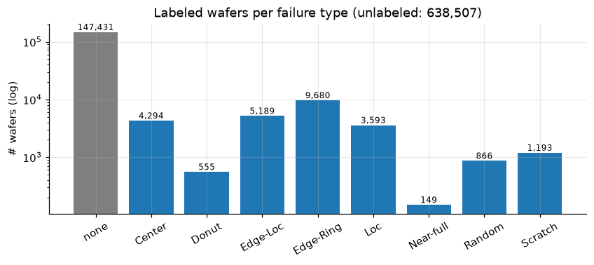

*그림 7. 불량 패턴별 라벨 웨이퍼 수 (세로축 로그). 회색 막대가 `none`, 파란 막대가 8가지 불량 패턴이고, 제목에 라벨 없는 웨이퍼 수(638,507)가 적혀 있어요.*

막대 위 숫자는 `none` 147,431, `Center` 4,294, `Donut` 555, `Edge-Loc` 5,189, `Edge-Ring` 9,680, `Loc` 3,593, `Near-full` 149, `Random` 866, `Scratch` 1,193장이에요.

#### 해석

- **클래스 불균형**: `none` 147,431장 vs `Near-full` 149장, 약 1,000배 차이예요. 세로축이 로그라서 막대 높이 차이가 실제 차이보다 훨씬 작아 보여요.
- 노트북의 교차표에서 라벨이 있는 행의 `unlabeled` 열과 `unlabeled` 행의 Test · Training 칸이 모두 0이에요. 라벨과 분할 정보는 함께 있거나 함께 없어요.
- 원 논문의 Training/Test 분할은 **클래스 비율을 맞춘(층화) 분할이 아니에요**. `none` 은 Test 쪽에, `Edge-Ring` 은 Training 쪽에 훨씬 많아요. 이 분할을 그대로 쓰면 학습과 평가의 클래스 분포가 달라요.
- `맵에 들어 있는 값` 출력은 **첫 번째 맵만** 확인한 거예요. 2-5에서 다이는 `> 0`, 불량은 `== 2` 로 세니까, 다른 맵에 1, 2가 아닌 양수 값(예: 3)이 섞여 있다면 다이로는 세고 불량으로는 세지 않아서 조용히 '정상'으로 처리돼요.

> 💡 **핵심**: 분류 문제를 다룰 때(다음 시간들)는 정확도 하나로 성능을 말하면 안 돼요. 클래스별 재현율이나 macro 평균 같은 지표, 층화 분할, 가중치 · 재표집이 필요해요.

**생각해 볼 질문**

1. 라벨이 있는 웨이퍼에서 무조건 `none` 이라고 답하는 분류기의 정확도는 얼마일까요?

<details><summary>답</summary>

$147{,}431/172{,}950\approx0.85$ 예요. 아무것도 배우지 않아도 85%가 나오니, 불균형 데이터에서 정확도는 좋은 지표가 아니에요. 이 분류기의 불량 패턴 8종 재현율은 모두 0이에요.

</details>

### 2-4. 웨이퍼 맵 시각화

> 💻 **노트북**: 2-4의 코드 셀 (`show_wafer` 와 불량 패턴별 4장씩 무작위 갤러리)

숫자 요약보다 먼저 **눈으로 보는 것**이 탐색의 출발점이에요. 패턴 이름이 실제로 어떤 모양인지, 같은 패턴 안에서 얼마나 다양한지 확인해요.

#### 코드 읽기

<details><summary>📝 셀 전체 코드 (줄별 주석)</summary>

```python
# ── 1. 웨이퍼 맵 그리기 도구 ─────────────────────────────────────
# 색 3개짜리 colormap. 아래에서 vmin=0, vmax=2 를 주면 [0, 2] 가 세 구간으로 나뉘어 값 0 · 1 · 2 가 정확히
# 흰색 · 연파랑 · 빨강에 대응해요.
WAFER_CMAP = ListedColormap(["#ffffff", "#c6dbef", "#cb181d"])   # 0: 웨이퍼 밖, 1: 정상, 2: 불량

def show_wafer(ax, wm, title=None):
    """웨이퍼 맵을 정규화 좌표 [-1, 1]² 위에 그려요 (다이가 직사각형이어도 웨이퍼가 원으로 보여요)"""
    # vmin/vmax 고정: 빼면 맵마다 색 범위가 자동으로 정해져서, 불량이 없는 맵(값 0, 1뿐)은 정상이 빨강이 돼요.
    # interpolation="nearest": 다이 경계를 흐리지 않고 칸 그대로. extent=(왼, 오, 아래, 위): 그림을 [-1, 1]² 에 펴요.
    ax.imshow(wm, cmap=WAFER_CMAP, vmin=0, vmax=2, interpolation="nearest", extent=(-1, 1, -1, 1))
    # extent 와 함께 가로세로 비율을 1:1 로 → H×W 가 달라도 웨이퍼가 원으로 보여요 (2-5 정규화 좌표와 같은 좌표).
    ax.set_aspect("equal")
    ax.set_axis_off()                                        # 눈금 · 축선 숨기기
    if title:
        ax.set_title(title, fontsize=8)

# ── 2. 불량 패턴별 4장씩 무작위 갤러리 ─────────────────────────────
g = torch.Generator().manual_seed(1)                         # 이 셀 전용 난수 생성기 → 누구나 같은 그림
n_show = 4                                                   # 패턴(열)마다 보여 줄 웨이퍼 수(행)
# 행 = n_show, 열 = 패턴 9종인 서브플롯 격자. axes 는 (4, 9) 배열이에요.
fig, axes = plt.subplots(n_show, len(CLASSES), figsize=(1.7 * len(CLASSES), 1.8 * n_show))
for j, c in enumerate(CLASSES):
    # 라벨이 c 인 행들의 인덱스 '라벨'을 정수 텐서로 (아래 df.at 이 라벨 기반 접근이에요).
    idx = torch.tensor(df.index[df["label"] == c].to_numpy())
    # randperm 으로 섞은 뒤 앞 n_show 개 → 비복원 추출. .tolist() 로 Python int 목록으로 바꿔 돌아요.
    for i, k in enumerate(idx[torch.randperm(len(idx), generator=g)[:n_show]].tolist()):
        wm = df.at[k, "waferMap"]                            # (H, W) numpy 배열 한 장
        wm_t = torch.from_numpy(wm)                          # 복사 없이 같은 메모리를 텐서로 봐요
        # 수율 = 1 − (불량 다이 수 = 값 2) / (다이 수 = 값 > 0). 2-1의 정의 그대로예요.
        y_k = 1 - (wm_t == 2).sum().item() / (wm_t > 0).sum().item()
        # 첫 행(i == 0)에만 패턴 이름 · 맵 크기 H×W · 수율을, 나머지 행엔 수율만 적어요.
        show_wafer(axes[i, j], wm, f"{c}\n{wm.shape[0]}×{wm.shape[1]}, yield {y_k:.2f}" if i == 0 else f"yield {y_k:.2f}")
plt.suptitle("WM-811K wafer maps (white: outside, blue: good die, red: defective die)", y=1.0)   # y: 전체 제목 높이
plt.tight_layout()                                           # 서브플롯 사이 간격 자동 조정
plt.show()
```

</details>

```python
WAFER_CMAP = ListedColormap(["#ffffff", "#c6dbef", "#cb181d"])   # 0: 웨이퍼 밖, 1: 정상, 2: 불량
```

```python
    ax.imshow(wm, cmap=WAFER_CMAP, vmin=0, vmax=2, interpolation="nearest", extent=(-1, 1, -1, 1))
    ax.set_aspect("equal")
```

- 색 3개짜리 `ListedColormap` 에 `vmin=0, vmax=2` 를 주면 $[0,2]$ 가 세 구간으로 나뉘어 값 0, 1, 2가 정확히 흰색 · 연파랑 · 빨강에 대응해요. `vmin`, `vmax` 를 빼면 색 범위가 맵마다 자동으로 정해져서, 불량이 하나도 없는 맵(값 0, 1뿐)에서는 정상 다이가 빨강으로 칠해져요.
- `interpolation="nearest"` 는 다이 경계를 흐리지 않고 칸 그대로 그려요.
- `extent=(-1, 1, -1, 1)` 과 `set_aspect("equal")`: 다이는 보통 정사각형이 아니라서 $H\times W$ 격자를 칸 그대로 그리면 웨이퍼가 타원으로 보여요. 맵을 $[-1,1]^2$ 에 펴서 그리면 원으로 보여요. 이 좌표가 2-5의 **정규화 좌표**와 정확히 같아요.

```python
    for i, k in enumerate(idx[torch.randperm(len(idx), generator=g)[:n_show]].tolist()):
        wm = df.at[k, "waferMap"]
        wm_t = torch.from_numpy(wm)
        y_k = 1 - (wm_t == 2).sum().item() / (wm_t > 0).sum().item()
```

- `torch.Generator().manual_seed(1)` 을 쓴 `randperm` 으로 패턴마다 4장을 **비복원 추출**해요. 시드가 고정이라 누구나 같은 그림을 얻어요.
- `torch.from_numpy` 는 복사 없이 배열을 텐서로 봐요. `y_k` 는 2-1의 수율 정의 그대로 $1-(\text{불량 수})/(\text{다이 수})$ 예요.

#### 결과

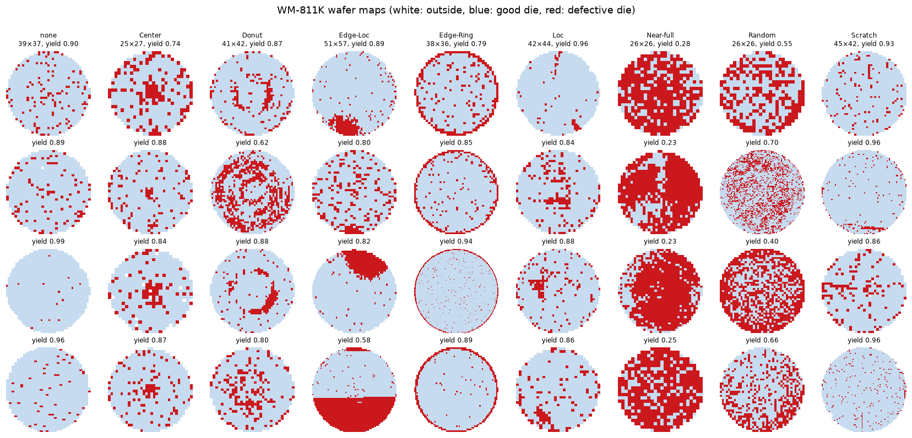

*그림 8. 불량 패턴별 무작위 웨이퍼 맵 4장 (열 = 패턴, 흰색 = 웨이퍼 밖, 연파랑 = 정상 다이, 빨강 = 불량 다이). 첫 행 제목에 패턴 이름 · 맵 크기 · 수율, 나머지 행에는 수율이 적혀 있어요.*

- `Center` 는 중심, `Donut` 은 중간 반지름의 고리, `Edge-Ring` 은 바깥 테두리 전체, `Edge-Loc` 은 가장자리의 한 부분, `Loc` 은 안쪽의 한 부분에 불량이 몰려 있어요. `Scratch` 는 가는 선, `Random` 은 전체에 흩어진 불량, `Near-full` 은 거의 전체가 불량이에요.
- 맵 크기는 패턴마다, 그리고 같은 열 안에서도 제각각이에요 (첫 행 제목만 봐도 25×27부터 51×57까지 있어요). 다이가 많은 맵은 칸이 촘촘해 보여요 (예: `Edge-Ring` 셋째 행, `Random` 둘째 행). 수율도 같은 패턴 안에서 크게 달라요.

#### 해석

- **패턴(모양)과 수율(양)은 다른 정보**예요. 같은 `Edge-Loc` 이라도 가장자리 조각이 크면 수율이 크게 떨어지고, `Scratch` 는 선이 가늘어 수율이 거의 안 떨어져요. 2-6에서 숫자로 확인해요.
- `none` 도 불량 다이가 흩어져 있어요. '패턴 없음'이지 '불량 없음'이 아니에요.

**생각해 볼 질문**

1. `Loc` 과 `Edge-Loc` 처럼 불량 위치가 웨이퍼마다 다른 패턴을 여러 장 평균 내면 어떤 그림이 나올까요?

<details><summary>답</summary>

위치가 서로 다르니까 평균하면 덩어리가 여기저기로 퍼져서 거의 평평한 모양이 돼요. `Edge-Loc` 은 반지름 방향의 위치(가장자리)는 같으니 '바깥으로 갈수록 올라가는' 모양은 남지만, 각도 방향의 위치는 지워져요. 2-9의 반지름 프로파일에서 실제로 이렇게 나와요.

</details>

### 2-5. 웨이퍼 단위 특징 계산 (PyTorch)

> 💻 **노트북**: 2-5의 코드 셀 (정규화 좌표 · 반지름 구간 one-hot · `einsum` 으로 특징 22개 계산 → 표 `wafer`)

맵 크기가 632종이라 모든 맵을 하나의 텐서로 쌓을 수 없어요. 그래서 웨이퍼 한 장을 **길이가 같은 특징 벡터**로 요약해요. 전체 · 불량 다이 수(`n_die`, `n_def`)와 반지름 구간 10개별 다이 · 불량 수(`die_r0` … `die_r9`, `def_r0` … `def_r9`)를 구하고, 이 표를 2-6 ~ 2-9와 PART 3 · 4에서 계속 써요.

#### 정규화 좌표 유도

격자 칸 $(i,j)$ (행 $i=0,\dots,H-1$, 열 $j=0,\dots,W-1$)는 픽셀 좌표에서 $[j,j+1]\times[i,i+1]$ 을 차지하고 중심은 $(j+\tfrac12,\ i+\tfrac12)$ 예요. 맵의 중심 $(\tfrac W2,\tfrac H2)$ 를 원점으로 옮기고 반폭 $\tfrac W2$, 반높이 $\tfrac H2$ 로 나누면, 행 번호는 아래로 커지니까 $y$ 는 부호를 뒤집어서

$$
x=\frac{j+\frac12-\frac W2}{W/2}=\frac{j-(W-1)/2}{W/2},\qquad y=\frac{\frac H2-\big(i+\frac12\big)}{H/2}=\frac{(H-1)/2-i}{H/2},\qquad r=\sqrt{x^2+y^2}
$$

이 돼요. 이 값은 2-4에서 `extent=(-1, 1, -1, 1)` 로 그린 각 칸의 중심 좌표와 정확히 같아요.

왜 다이가 직사각형이어도 원이 되는지 볼게요. 다이의 가로 · 세로를 $a,b$, 웨이퍼 반지름을 $R$ 이라 하고, 맵의 테두리 상자가 웨이퍼 지름에 딱 맞고 맵 중심이 웨이퍼 중심이라고 가정하면 $aW\approx 2R$, $bH\approx 2R$ 이에요. 칸 중심의 물리적 위치를 웨이퍼 중심 기준으로 $(X,Y)$ 라 하면 $X=a\big(j+\tfrac12-\tfrac W2\big)$ 이니

$$
\frac{X}{R}\approx\frac{a\big(j+\frac12-\frac W2\big)}{aW/2}=x,\qquad \frac{Y}{R}\approx\frac{b\big(\frac H2-i-\frac12\big)}{bH/2}=y
$$

라서 $(x,y)$ 는 **웨이퍼 반지름으로 나눈 물리적 위치**예요. 그래서 웨이퍼는 단위원이 되고 $r$ 은 중심에서의 상대 거리예요.

#### 반지름 구간과 다이 수

구간 $k$ 는 $r$ 이 $k/10$ 과 $(k+1)/10$ 사이인 칸이에요 ($k=0,\dots,9$, 경계값을 어느 쪽에 넣는지는 아래 코드 읽기에서 봐요). 경계의 $r\ge1$ 인 0.6%는 마지막 구간에 넣어요. 다이가 원판 위에 고르게 깔려 있으면 구간 $k$ 에 들어가는 다이의 비율은 고리 넓이의 비율이에요.

$$
\frac{\pi\big((k+1)^2-k^2\big)/100}{\pi}=\frac{2k+1}{100},\qquad k=0,\dots,9
$$

중심 구간($k=0$)에는 다이의 약 1%, 가장 바깥 구간($k=9$)에는 약 19%가 들어가요. **중심 구간은 표본이 적어서 불량률 추정이 흔들리기 쉬워요** (4-2에서 다시 봐요).

#### one-hot과 einsum으로 구간별 개수 세기

맵 크기가 같은 웨이퍼 $M$ 장을 쌓은 다이 지시 텐서를 $D\in\lbrace 0,1\rbrace^{M\times H\times W}$ ($D_{mhw}=1$ 이면 웨이퍼 $m$ 의 칸 $(h,w)$ 가 다이), 각 칸의 구간 번호를 $b(h,w)$ 라 하고 one-hot 텐서 $O_{hwk}=\mathbf 1[b(h,w)=k]$ 를 만들면, 웨이퍼 $m$ 의 구간 $k$ 다이 수는

$$
C_{mk}=\sum_{h=0}^{H-1}\sum_{w=0}^{W-1}D_{mhw}\,O_{hwk}=\sum_{(h,w):\ b(h,w)=k}D_{mhw}
$$

이에요. $D$ 를 $M\times HW$, $O$ 를 $HW\times 10$ 행렬로 (같은 순서로) 펴면 $C=DO$, 즉 **행렬곱 한 번**이에요. `einsum("mhw,hwk->mk", ...)` 은 이 식을 첨자 그대로 적은 거예요. 불량 수는 $D$ 대신 불량 지시 텐서를 넣으면 돼요.

#### 코드 읽기

<details><summary>📝 셀 전체 코드 (줄별 주석)</summary>

```python
# ── 1. 상수와 특징 이름 ──────────────────────────────────────────
N_BINS = 10                                                  # 반지름 구간 수 (폭 0.1)
R_EDGES = torch.linspace(0, 1, N_BINS + 1, dtype=F64)        # 구간 경계 0, 0.1, …, 1.0 (11개)
# 특징 22개: 전체 다이 · 불량 수 2개 + 구간별 다이 수 10개 + 구간별 불량 수 10개. 모두 '개수'라 그룹별로 더할 수 있어요.
FEAT_COLS = ["n_die", "n_def"] + [f"die_r{k}" for k in range(N_BINS)] + [f"def_r{k}" for k in range(N_BINS)]
MAPS = df["waferMap"].to_numpy()          # 웨이퍼 맵 배열들 (object array)

# ── 2. 도우미 함수 ───────────────────────────────────────────────
def normalized_grid(H, W):
    """맵 격자의 정규화 좌표 (x, y): 중심 0, 반지름 1"""
    # indexing="ij": ii 는 행 번호, jj 는 열 번호인 (H, W) 격자 (F64).
    ii, jj = torch.meshgrid(torch.arange(H, dtype=F64), torch.arange(W, dtype=F64), indexing="ij")
    # x = (j − (W−1)/2) / (W/2),  y = ((H−1)/2 − i) / (H/2). 행 번호는 아래로 커지니 y 는 부호를 뒤집어요.
    # 칸 중심 좌표라서 2-4 의 extent=(-1, 1, -1, 1) 로 그린 위치와 정확히 같아요.
    return (jj - (W - 1) / 2) / (W / 2), ((H - 1) / 2 - ii) / (H / 2)

def stack_maps(idx):
    """같은 크기 맵들을 (m, H, W) uint8 텐서로"""
    # from_numpy 는 복사 없이 텐서로 보고, torch.stack 이 새 첫 축(m)으로 쌓으면서 한 번 복사해요.
    return torch.stack([torch.from_numpy(MAPS[k]) for k in idx])

# ── 3. 맵 크기 그룹별로 특징 계산 ──────────────────────────────────
feats = torch.zeros(len(df), len(FEAT_COLS), dtype=F64)      # (811,457, 22) 결과 표 (통계용이라 F64)
t0 = time.time()
# groupby(...).indices: {(H, W): 그 크기 웨이퍼들의 행 위치(int64 numpy 배열)} 사전. 크기가 같아야 stack 할 수 있어요.
for (H, W), idx in df.groupby(["H", "W"]).indices.items():
    xg_, yg_ = normalized_grid(H, W)                         # 각각 (H, W)
    # r = √(x² + y²). bucketize 에 안쪽 경계 9개(0.1 … 0.9)를 주면 각 r 이 몇 번째 경계 뒤인지 0 … 9 를 돌려줘요.
    # 기본 right=False 라 경계값과 같은 r 은 아래 구간 → 구간은 (k/10, (k+1)/10]. r ≥ 1 인 칸도 9 가 돼요.
    rbin = torch.bucketize(torch.sqrt(xg_**2 + yg_**2).clamp(max=1 - 1e-9), R_EDGES[1:-1])  # 0 … 9
    # O[h, w, k] = 1[칸 (h, w) 가 구간 k]. 맵 크기에만 의존하니 그룹마다 한 번만 만들어요.
    onehot = nn.functional.one_hot(rbin, N_BINS).float()                                     # (H, W, 10)
    for s in range(0, len(idx), 20_000):                       # 메모리를 아끼려고 나눠서 처리
        part = torch.from_numpy(idx[s:s + 20_000])             # 이번 청크의 행 위치 (m,) int64
        maps = stack_maps(part.tolist())                       # (m, H, W) uint8
        # 다이 = 값 > 0, 불량 = 값 == 2 인 0/1 지시 텐서 (m, H, W) float32. 2^24 까지 정수를 정확히 세요.
        die, bad = (maps > 0).float(), (maps == 2).float()
        feats[part, 0] = die.sum((1, 2)).double()              # 웨이퍼별 다이 수 n_die: (H, W) 축 합 → (m,)
        feats[part, 1] = bad.sum((1, 2)).double()              # 웨이퍼별 불량 수 n_def
        # C[m, k] = Σ_h Σ_w D[m, h, w] · O[h, w, k]: 출력("->mk")에 없는 첨자 h, w 는 합해져요.
        # (m, HW) @ (HW, 10) 행렬곱 한 번과 같아요 → 웨이퍼별 · 구간별 다이 수 (m, 10).
        feats[part, 2:2 + N_BINS] = torch.einsum("mhw,hwk->mk", die, onehot).double()    # die_r0 … die_r9
        feats[part, 2 + N_BINS:] = torch.einsum("mhw,hwk->mk", bad, onehot).double()     # def_r0 … def_r9
print(f"특징 계산 {time.time() - t0:.1f}초")

# ── 4. 웨이퍼 단위 표 wafer 조립 ──────────────────────────────────
# 정보 6열 + 특징 22열을 옆으로(axis=1) 붙여요. index=df.index 로 맞춰야 행이 어긋나지 않아요.
wafer = pd.concat([df[["lot", "wafer_index", "split", "label", "H", "W"]],
                   pd.DataFrame(feats.numpy(), columns=FEAT_COLS, index=df.index)], axis=1)
wafer["yield"] = (1 - feats[:, 1] / feats[:, 0]).numpy()          # 수율 = 1 − 불량 수 / 다이 수
# 값이 0보다 큰 칸의 수가 원본 dieSize 와 모두 같은지 데이터로 확인해요 (통과하면 표는 29열).
assert (wafer["n_die"].to_numpy() == df["die_size"].to_numpy()).all()   # dieSize = 웨이퍼 안 다이 수 ✔
wafer.head()
```

</details>

```python
def normalized_grid(H, W):
    """맵 격자의 정규화 좌표 (x, y): 중심 0, 반지름 1"""
    ii, jj = torch.meshgrid(torch.arange(H, dtype=F64), torch.arange(W, dtype=F64), indexing="ij")
    return (jj - (W - 1) / 2) / (W / 2), ((H - 1) / 2 - ii) / (H / 2)
```

`indexing="ij"` 는 첫 번째 출력 `ii` 가 행 번호, `jj` 가 열 번호인 $(H,W)$ 격자를 만들어요. 반환식이 위의 $x,y$ 공식 그대로예요.

```python
    rbin = torch.bucketize(torch.sqrt(xg_**2 + yg_**2).clamp(max=1 - 1e-9), R_EDGES[1:-1])  # 0 … 9
    onehot = nn.functional.one_hot(rbin, N_BINS).float()                                     # (H, W, 10)
```

- `R_EDGES[1:-1]` 은 안쪽 경계 9개 $(0.1,\dots,0.9)$ 예요. `torch.bucketize` 는 각 $r$ 이 몇 번째 경계 뒤에 오는지를 0 … 9로 돌려줘요. 0.9보다 큰 값은 모두 9가 되니 $r\ge1$ 인 칸도 마지막 구간에 들어가요.
- 세부 사항: `bucketize` 의 기본값(`right=False`)은 경계값과 **같은** $r$ 을 아래 구간에 넣어요. 그래서 정확히는 $(k/10,(k+1)/10]$ 구간이에요. 경계에 딱 걸리는 칸에만 해당하는 차이라 결과에는 거의 영향이 없어요.
- `one_hot(...).float()` 로 $(H,W,10)$ 의 0/1 텐서 $O$ 를 만들어요. 구간 정보는 맵 크기에만 의존하니 같은 크기 그룹에서 **한 번만** 계산해요.

```python
    for s in range(0, len(idx), 20_000):                       # 메모리를 아끼려고 나눠서 처리
        part = torch.from_numpy(idx[s:s + 20_000])
        maps = stack_maps(part.tolist())
        die, bad = (maps > 0).float(), (maps == 2).float()
        feats[part, 0] = die.sum((1, 2)).double()
        feats[part, 1] = bad.sum((1, 2)).double()
        feats[part, 2:2 + N_BINS] = torch.einsum("mhw,hwk->mk", die, onehot).double()
        feats[part, 2 + N_BINS:] = torch.einsum("mhw,hwk->mk", bad, onehot).double()
```

- 바깥 루프의 `df.groupby(["H", "W"]).indices` 는 맵 크기별 **행 위치 배열** 사전이에요. 같은 크기 맵만 `torch.stack` 으로 $(m,H,W)$ 텐서로 쌓을 수 있어요.
- 한 크기 그룹에 웨이퍼가 아주 많을 수 있어서 20,000장씩 나눠 처리해요. 메모리 사용량이 청크 크기에 비례하도록 묶어 두는 거예요.
- `die`, `bad` 는 `float32` 예요. `float32` 는 $2^{24}=16{,}777{,}216$ 까지의 정수를 정확히 표현하니, 웨이퍼 한 장의 다이 수 정도는 오차 없이 세요. 저장은 `.double()` 로 배정밀도 표 `feats` 에 해요.
- `feats[part, 0] = ...` 처럼 정수 텐서로 행을 골라 한 번에 채워요.

```python
wafer["yield"] = (1 - feats[:, 1] / feats[:, 0]).numpy()          # 수율 = 1 − 불량 수 / 다이 수
assert (wafer["n_die"].to_numpy() == df["die_size"].to_numpy()).all()   # dieSize = 웨이퍼 안 다이 수 ✔
```

`assert` 가 통과했으니 원본의 `dieSize` 는 **값이 0보다 큰 칸의 수**와 정확히 같아요. 열 이름만 보고 다이의 '크기'로 오해하지 않도록 데이터로 확인한 거예요.

#### 결과

```text
특징 계산 2.6초
```

`wafer.head()` 의 앞 5행은 `lot1` 의 1–5번 웨이퍼(맵 45×48, `n_die` 1683)예요. `n_def` 는 88, 86, 66, 104, 71이고 수율은 0.9477, 0.9489, 0.9608, 0.9382, 0.9578이에요. 표는 29열(정보 6열 + 특징 22열 + `yield`)이에요.

#### 해석

- 첫 웨이퍼의 `die_r0` = 16, `die_r1` = 54예요. 넓이 비율로 계산한 기대값 $1683\times\tfrac{1}{100}\approx17$, $1683\times\tfrac{3}{100}\approx50$ 과 비슷해요. 격자라서 정확히 맞지는 않아요.
- 22개 특징은 모두 **개수**라서 그룹별로 더할 수 있어요. 비율(불량률)은 개수를 다 더한 다음에 나눠요 (2-9).

**생각해 볼 질문**

1. `clamp(max=1 - 1e-9)` 를 빼면 결과가 달라질까요?

<details><summary>답</summary>

달라지지 않아요. `bucketize` 에 넘기는 경계가 안쪽 9개(0.1 … 0.9)뿐이라 0.9보다 큰 $r$ 은 $r\ge1$ 이어도 9가 돼요. 만약 경계에 1.0까지 넣었다면(`R_EDGES[1:]`) `clamp` 가 없을 때 $r>1$ 인 칸이 10이 되어 `one_hot(rbin, 10)` 이 오류를 냈을 거예요. 그러니 `clamp` 는 경계 배열을 바꿔도 안전하게 해 주는 장치이고, 지금 코드에서는 하는 일이 없어요.

</details>

### 2-6. 수율 분포

> 💻 **노트북**: 2-6의 코드 셀 (전체 수율 히스토그램, 불량 패턴별 상자그림, 패턴별 요약표)

회귀의 타깃이 될 수율이 어떤 분포인지 먼저 봐요. 범위, 치우침, 뭉친 곳, 이상치를 알아야 모형과 손실함수를 고를 수 있어요.

#### 이항 잡음만으로 설명될까

웨이퍼마다 불량 확률 $p$ 가 같고 다이가 서로 독립이라면, 다이 $N$ 개짜리 웨이퍼의 수율은 $1-\text{Bin}(N,p)/N$ 이라서

$$
\operatorname{Var}(\text{yield})=\frac{p(1-p)}{N}
$$

예요. $p\approx1-0.9031$, $N=1683$ (2-5의 `lot1`)을 넣으면 표준편차가 약 0.007이에요. 실제 표준편차 0.1070은 이보다 열 배 이상 커요. 웨이퍼마다 $p$ (와 $N$)가 다르다고 보고, $(p,N)$ 에 조건부로 전체분산 공식(law of total variance)을 쓰면 $\operatorname{Var}(\text{yield}\mid p,N)=p(1-p)/N$, $\mathbb E[\text{yield}\mid p,N]=1-p$ 이니

$$
\operatorname{Var}(\text{yield})=\mathbb E\big[\operatorname{Var}(\text{yield}\mid p,N)\big]+\operatorname{Var}\big(\mathbb E[\text{yield}\mid p,N]\big)=\mathbb E\Big[\frac{p(1-p)}{N}\Big]+\operatorname{Var}(p)
$$

이에요. 첫 항(이항 잡음)은 다이가 수백 ~ 수천 개인 웨이퍼에서는 작아요. 그러니 관측된 큰 분산은 대부분 두 번째 항, 즉 **웨이퍼 · 로트 · 제품마다 불량 확률이 다른 것**에서 와요. 그 변동이 어디서 오는지를 2-7(제품)과 2-8(로트)에서 나눠 봐요.

#### 코드 읽기

<details><summary>📝 셀 전체 코드 (줄별 주석)</summary>

```python
# ── 1. 전체 수율 요약 통계 ────────────────────────────────────────
yield_all = torch.tensor(wafer["yield"].to_numpy(), dtype=F64)   # (811,457,) 웨이퍼별 수율. 2-8에서도 써요
# std() 는 기본으로 n−1 로 나누는 표본표준편차. median() 은 짝수 개면 가운데 두 값 중 작은 값인데, 여기선 홀수 개예요.
print(f"평균 수율 {yield_all.mean().item():.4f}, 중앙값 {yield_all.median().item():.4f}, 표준편차 {yield_all.std().item():.4f}")

# ── 2. 히스토그램과 패턴별 상자그림 ────────────────────────────────
# width_ratios: 왼쪽 : 오른쪽 그림 폭 = 1 : 1.4 (상자 9개가 들어갈 오른쪽을 넓게).
fig, axes = plt.subplots(1, 2, figsize=(12, 3.8), gridspec_kw={"width_ratios": [1, 1.4]})
axes[0].hist(yield_all.numpy(), bins=100, color="C0")       # [min, max] 를 같은 폭 막대 100개로
# 세로축 로그: 1 근처에 몰린 덩어리와 왼쪽 긴 꼬리(0.18 근처 뾰족한 막대, 수율 0 웨이퍼)를 함께 보려고요.
axes[0].set(xlabel="yield", ylabel="# wafers", yscale="log", title="Yield distribution (all 811,457 wafers)")
# CLASSES 순서대로 라벨별 수율 벡터 9개 (dtype 은 numpy float64 를 따라 F64).
data = [torch.tensor(wafer.loc[wafer["label"] == c, "yield"].to_numpy()) for c in CLASSES]
# 상자 = 사분위(25–75%), 가운데 선 = 중앙값, 수염 = 사분위범위의 1.5배까지. showfliers=False 로 그 밖의 점은 생략해요.
axes[1].boxplot([d.numpy() for d in data], showfliers=False)
# boxplot 은 상자를 x = 1, 2, …, 9 에 놓으니, 그 위치에 패턴 이름을 30° 기울여 붙여요.
axes[1].set_xticks(range(1, len(CLASSES) + 1), CLASSES, rotation=30)
axes[1].set(ylabel="yield", title="Yield by failure type (labeled wafers)")
plt.tight_layout()
plt.show()

# ── 3. 패턴별 요약표 ─────────────────────────────────────────────
# 라벨 있는 웨이퍼만 → 라벨별 수율의 개수 · 평균 · 중앙값 · 표준편차(pandas 도 ddof=1). .loc 로 행 순서를 맞춰요.
wafer[wafer["label"] != "unlabeled"].groupby("label")["yield"].agg(["size", "mean", "median", "std"]).loc[CLASSES]
```

</details>

```python
yield_all = torch.tensor(wafer["yield"].to_numpy(), dtype=F64)
print(f"평균 수율 {yield_all.mean().item():.4f}, 중앙값 {yield_all.median().item():.4f}, 표준편차 {yield_all.std().item():.4f}")
```

`torch.std` 는 기본으로 $n-1$ 로 나누는 표본표준편차예요. `torch.median` 은 개수가 짝수면 가운데 두 값 중 작은 값을 돌려주는데, 여기서는 웨이퍼 수(811,457)가 홀수라 보통의 중앙값과 같아요.

```python
axes[1].boxplot([d.numpy() for d in data], showfliers=False)
```

`showfliers=False` 라서 상자그림의 수염(사분위범위의 1.5배) 밖에 있는 점은 그리지 않아요.

#### 결과

```text
평균 수율 0.9031, 중앙값 0.9289, 표준편차 0.1070
```

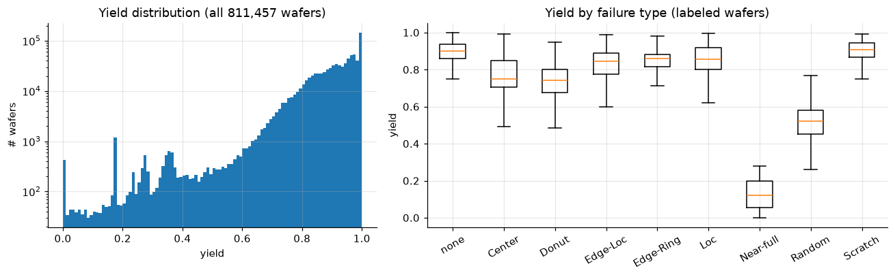

*그림 9. 왼쪽: 웨이퍼 811,457장 전체의 수율 히스토그램 (막대 100개, 세로축 로그). 오른쪽: 라벨이 있는 웨이퍼의 불량 패턴별 수율 상자그림 (주황 선 = 중앙값, 이상치 점은 생략).*

| label | 웨이퍼 수 | 평균 | 중앙값 | 표준편차 |
|---|---|---|---|---|
| `none` | 147,431 | 0.8944 | 0.9017 | 0.0531 |
| `Center` | 4,294 | 0.7675 | 0.7495 | 0.1029 |
| `Donut` | 555 | 0.7232 | 0.7424 | 0.1116 |
| `Edge-Loc` | 5,189 | 0.8172 | 0.8443 | 0.1087 |
| `Edge-Ring` | 9,680 | 0.8487 | 0.8597 | 0.0530 |
| `Loc` | 3,593 | 0.8500 | 0.8575 | 0.0972 |
| `Near-full` | 149 | 0.1231 | 0.1221 | 0.0835 |
| `Random` | 866 | 0.5194 | 0.5232 | 0.1083 |
| `Scratch` | 1,193 | 0.8994 | 0.9083 | 0.0608 |

#### 해석

- 수율은 1 쪽에 몰려 있고 **왼쪽으로 긴 꼬리**가 있어요 (평균 0.903 < 중앙값 0.929). 세로축이 로그라서 꼬리가 실제보다 크게 보여요.
- 0.18 근처의 뾰족한 막대(약 1,200장)는 거의 **한 제품(맵 122×102)** 의 웨이퍼예요. 수율이 정확히 0인 웨이퍼도 339장 있어요. 이런 덩어리는 2-7에서 이상치로 다시 나타나요.
- `Near-full`(중앙값 0.1221)과 `Random`(0.5232)은 수율이 크게 낮지만, `Scratch` 의 중앙값(0.9083)은 오히려 `none`(0.9017)보다 높아요. 패턴의 **모양**과 수율의 **크기**는 관련은 있어도 같은 정보가 아니에요.
- 라벨이 `none` 인 웨이퍼의 평균 수율(0.894)이 라벨 없는 웨이퍼(0.909)보다 낮아요. 라벨을 붙인 웨이퍼가 무작위 표본이 아닐 수 있다는 뜻이에요.

> ⚠️ **주의**: 수율은 $[0,1]$ 에 갇혀 있고 한쪽으로 치우쳐 있어요. 제곱오차로 선형모형을 맞추면 예측이 1을 넘을 수도 있고, 평균은 꼬리 쪽 소수의 웨이퍼에 크게 끌려가요. PART 3에서 잔차를 볼 때 이 점을 기억하세요.

**생각해 볼 질문**

1. 평균(0.9031)이 중앙값(0.9289)보다 작은 것은 분포에 대해 무엇을 말해 줄까요?

<details><summary>답</summary>

왼쪽(낮은 수율 쪽)으로 꼬리가 길다는 뜻이에요. 대부분의 웨이퍼는 0.9 이상인데, 수율이 아주 낮은 소수의 웨이퍼가 평균을 끌어내려요. 중앙값은 이런 꼬리에 덜 민감해요.

</details>

2. `Scratch` 웨이퍼의 수율이 `none` 보다 높게 나오는 게 이상하지 않나요?

<details><summary>답</summary>

이상하지 않아요. 긁힘은 가는 선 위의 다이 몇 개만 망가뜨리니까 불량 다이 수가 적어요. 라벨은 불량이 '어떤 모양으로' 모였는지를 말할 뿐 '얼마나 많은지'를 말하지 않아요. 또 라벨 붙은 표본이 무작위가 아닐 수 있어서 패턴 간 평균 비교는 조심해서 읽어야 해요.

</details>

### 2-7. 데이터 분석 사례: 다이 크기와 수율 (Poisson 수율 모형)

> 💻 **노트북**: 2-7의 코드 셀 (제품별 평균 수율로 $\ln Y$ 를 $1/N$ 에 회귀, 그림, 영향점 확인). ⏱ 60분 진행에서는 그림 10과 결론만 보고 넘어가요.

**물리 모형에서 출발한 회귀**의 예예요. 비선형 모형을 변환해서 선형회귀로 바꾸고, 회귀 진단(영향점)까지 해 봐요.

#### 모형 유도

가정을 먼저 적어요.

1. 치명적인 결함(killer defect)은 웨이퍼 위에 밀도(단위 면적당 평균 개수) $D_0$ 인 **동질 포아송 과정(homogeneous Poisson process)** 으로 떨어져요.
2. 다이는 결함이 하나도 없을 때만 정상이에요.
3. 다이 $N$ 개가 같은 넓이 $A$ 로 웨이퍼 면적 $A_w$ 를 나눠 가져요. 즉 $A\approx A_w/N$ 이에요 (가장자리 손실 등은 무시해요).
4. 이와 별도로(결함 수와 독립적으로), **면적과 무관한** 이유로 다이가 정상일 확률을 $Y_0$ 라고 해요.

포아송 과정의 정의에 의해 넓이 $A$ 인 영역의 결함 수 $K$ 는 평균 $AD_0$ 인 포아송 분포를 따라요.

$$
P(K=k)=\frac{(AD_0)^k}{k!}\,e^{-AD_0},\qquad k=0,1,2,\dots
$$

가정 4의 독립성에 의해 다이 하나가 정상일 확률은 $Y_0\,P(K=0)=Y_0e^{-AD_0}$ 예요. 웨이퍼의 기대 수율은 기댓값의 선형성으로

$$
\begin{aligned}
\mathbb E[Y]&=\mathbb E\Big[\frac1N\sum_{d=1}^{N}\mathbf 1[\text{다이 }d\text{ 정상}]\Big]=\frac1N\sum_{d=1}^{N}P(\text{다이 }d\text{ 정상})\\
&=Y_0\,e^{-AD_0}=Y_0\,e^{-A_wD_0/N}
\end{aligned}
$$

이에요. 기댓값의 선형성만 썼으니 다이끼리 독립일 필요는 없어요. 이제부터 기대 수율 $\mathbb E[Y]$ 를 그냥 $Y$ 로 쓰고 양변에 로그를 취하면 $u=1/N$ 에 대한 **선형모형**이 돼요.

$$
\ln Y=\underbrace{\ln Y_0}_{\beta_0}+\underbrace{(-A_wD_0)}_{\beta_1}\cdot u,\qquad u=\frac1N
$$

모수의 뜻도 분명해요. $Y_0=e^{\beta_0}$ 는 다이가 한없이 작을 때($N\to\infty$)의 수율이고, $-\beta_1=A_wD_0$ 는 **웨이퍼 한 장에 떨어지는 치명적 결함의 기대 개수**예요.

#### 코드 읽기

<details><summary>📝 셀 전체 코드 (줄별 주석)</summary>

```python
# ── 1. 제품(맵 크기) 단위로 집계 ───────────────────────────────────
# 관측 단위는 웨이퍼가 아니라 제품이에요. named aggregation: 새 열 이름=(원래 열, 집계 함수).
#   n_wafers = 웨이퍼 수, N = 다이 수의 중앙값, Y = 평균 수율 (모형이 기대 수율 E[Y] 에 대한 식이라 평균을 써요).
# query 로 웨이퍼 300장 이상인 제품만 남기고, reset_index 로 그룹 키 H, W 를 일반 열로 돌려요 → 227행.
prod = (wafer.groupby(["H", "W"])
        .agg(n_wafers=("yield", "size"), N=("n_die", "median"), Y=("yield", "mean"))
        .query("n_wafers >= 300").reset_index())

# ── 2. ln Y = β0 + β1·(1/N) 적합 (Poisson 수율 모형의 선형화) ─────────
# Y = Y0·exp(−A_w D0 / N) 의 양변에 로그 → ln Y 가 u = 1/N 에 선형. β0 = ln Y0, β1 = −A_w D0.
u = 1 / torch.tensor(prod["N"].to_numpy(), dtype=F64)                 # 특성: 1/N
v = torch.log(torch.tensor(prod["Y"].to_numpy(), dtype=F64))          # 타깃: ln Y
# 설계행렬 X = [1  u] (227, 2). ols 는 1-5에서 만든 함수(lstsq 계수, s²(XᵀX)⁻¹ 표준오차, t, R²)예요.
fit_p = ols(torch.stack([torch.ones_like(u), u], 1), v)
b0, b1 = fit_p["beta"].tolist()                              # 계수 두 개를 Python float 로
print(f"제품 {len(prod)}개")
# Y0 = e^{β0} 는 다이가 한없이 작을 때(N→∞)의 수율, −β1 = A_w·D0 는 웨이퍼 한 장의 치명적 결함 기대 개수예요.
print(f"ln Y = {b0:.4f} + ({b1:.1f})·(1/N)   →  Y0 = {math.exp(b0):.3f},  A_w·D0 = {-b1:.1f}")
print(f"slope t = {fit_p['t'][1].item():.2f},  R² = {fit_p['r2'].item():.3f}")   # t[1]: 기울기의 t 값

# ── 3. 원래 척도(Y vs N)로 그림 ───────────────────────────────────
# 곡선용 N 격자 200개: 로그 축에서 고르게 보이도록 10^a … 10^b 를 로그 간격으로 (logspace 의 밑은 10).
Ng = torch.logspace(math.log10(prod["N"].min()), math.log10(prod["N"].max()), 200, dtype=F64)
fig, ax = plt.subplots(figsize=(6.5, 3.8))
# 점 크기 s = 8 + 40 × (웨이퍼 수 / 최대 웨이퍼 수): 웨이퍼가 많은 제품일수록 큰 점. 회귀 자체는 제품을 같은 무게로 다뤄요.
sc = ax.scatter(prod["N"], prod["Y"], s=8 + 40 * prod["n_wafers"] / prod["n_wafers"].max(), alpha=0.6, label="product (map size)")
# 적합 곡선 Y = e^{β0} · e^{β1/N} = Y0 e^{−A_w D0/N}. 라벨은 raw 문자열이라 \, 같은 LaTeX 가 그대로 전달돼요.
ax.plot(Ng.numpy(), (math.exp(b0) * torch.exp(b1 / Ng)).numpy(), "r-", label=r"fit: $Y_0\,e^{-A_wD_0/N}$")
ax.set(xscale="log", xlabel="dies per wafer N (log)", ylabel="mean yield", title=f"Poisson yield model across products (R² on ln Y = {fit_p['r2'].item():.3f})")
ax.legend()
plt.show()

# ── 4. 영향점 진단 (민감도 분석) ────────────────────────────────────
# 영향점 확인: 평균 수율이 0.5 미만인 제품을 빼고 다시 적합
keep = torch.tensor((prod["Y"] >= 0.5).to_numpy())          # (227,) bool 마스크. ~keep 이 빼는 5개 제품
resid_p = v - torch.stack([torch.ones_like(u), u], 1) @ fit_p["beta"]   # 원래 적합의 잔차 e = v − Xβ̂ (227,)
# 불리언 인덱싱 [keep] 으로 X 의 행과 v 를 같이 골라 222개 제품으로 다시 적합해요.
fit_k = ols(torch.stack([torch.ones_like(u), u], 1)[keep], v[keep])
# 빼는 제품의 잔차제곱합 / 전체 RSS. {…:.0%} 는 100을 곱해 소수점 없이 % 로 표시해요.
print(f"평균 수율 0.5 미만 제품 {(~keep).sum().item()}개가 잔차제곱합에서 차지하는 비율: "
      f"{((resid_p[~keep] ** 2).sum() / (resid_p ** 2).sum()).item():.0%}")
# 기울기는 거의 그대로인데 R² 와 |t| 가 크게 오르면, 그 점들은 계수보다 RSS(적합도 · 불확실성)를 흔든 거예요.
print(f"이 {(~keep).sum().item()}개를 빼면: slope = {fit_k['beta'][1].item():.1f},  t = {fit_k['t'][1].item():.2f},  R² = {fit_k['r2'].item():.3f}")
```

</details>

```python
prod = (wafer.groupby(["H", "W"])
        .agg(n_wafers=("yield", "size"), N=("n_die", "median"), Y=("yield", "mean"))
        .query("n_wafers >= 300").reset_index())
u = 1 / torch.tensor(prod["N"].to_numpy(), dtype=F64)                 # 특성: 1/N
v = torch.log(torch.tensor(prod["Y"].to_numpy(), dtype=F64))          # 타깃: ln Y
fit_p = ols(torch.stack([torch.ones_like(u), u], 1), v)
```

- 관측 단위는 웨이퍼가 아니라 **제품(맵 크기)** 이에요. 웨이퍼가 300장 이상인 제품만 남기고, 제품마다 다이 수의 중앙값 $N$ 과 평균 수율 $Y$ 를 구해요.
- 모형이 말하는 것은 **기대 수율**이라서 평균 수율에 로그를 취해요. 웨이퍼마다 로그를 먼저 취하면 수율 0인 웨이퍼(339장)에서 $\ln 0=-\infty$ 가 돼요.
- `torch.stack([torch.ones_like(u), u], 1)` 이 설계행렬 $X=[\mathbf 1\ \ \mathbf u]$ 이고, `ols` 는 1-5에서 만든 함수(`torch.linalg.lstsq` 로 계수, $s^2(X^\top X)^{-1}$ 의 대각 원소의 제곱근으로 표준오차, $t$ 값, $R^2$)예요. `torch.stack(..., 1)` 은 두 벡터를 열로 붙여 $(227,2)$ 행렬을 만들어요.

```python
keep = torch.tensor((prod["Y"] >= 0.5).to_numpy())
resid_p = v - torch.stack([torch.ones_like(u), u], 1) @ fit_p["beta"]
fit_k = ols(torch.stack([torch.ones_like(u), u], 1)[keep], v[keep])
```

평균 수율이 0.5 미만인 제품이 잔차제곱합에서 차지하는 비율을 구하고, 그 제품을 뺀 불리언 인덱싱 `[keep]` 으로 다시 적합해요.

#### 결과

```text
제품 227개
ln Y = -0.0444 + (-86.8)·(1/N)   →  Y0 = 0.957,  A_w·D0 = 86.8
slope t = -3.19,  R² = 0.043
```

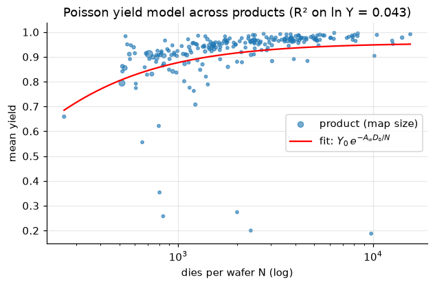

*그림 10. 제품(맵 크기) 227개의 웨이퍼당 다이 수 $N$ (가로축 로그)과 평균 수율. 점 크기는 제품의 웨이퍼 수가 많을수록 커지고(크기 = 8 + 40 × 웨이퍼 수 / 최대 웨이퍼 수), 빨간 곡선은 적합한 $Y_0e^{-A_wD_0/N}$ 이에요.*

```text
평균 수율 0.5 미만 제품 5개가 잔차제곱합에서 차지하는 비율: 90%
이 5개를 빼면: slope = -90.8,  t = -11.49,  R² = 0.375
```

빨간 곡선은 다이가 적은(다이가 큰) 왼쪽에서 낮고 오른쪽으로 갈수록 $Y_0=0.957$ 에 다가가요. 대부분의 점은 0.8 ~ 1.0에 모여 있고, 그림 아래쪽에 수율 0.5 미만인 점 5개가 따로 떨어져 있어요.

#### 왜 $R^2$ 가 낮을까: 영향점 분석

단순회귀에서는 $\text{ESS}=\hat\beta_1^2S_{uu}$ ($S_{uu}=\sum_j(u_j-\bar u)^2$)이고

$$
R^2=\frac{\text{ESS}}{\text{TSS}},\qquad t=\frac{\hat\beta_1}{s/\sqrt{S_{uu}}},\qquad s^2=\frac{\text{RSS}}{n-2}
$$

이에요 ($\text{TSS}=\text{ESS}+\text{RSS}$). 아래쪽 5개 제품은 $\ln Y$ 척도에서 직선과 아주 멀어서($\ln 0.19\approx-1.7$) 원래 적합의 RSS 중 90%를 차지해요. 5개를 뺀 나머지 222개의 집합을 $\mathcal S$ 라 하고 (위 모형의 결함 수 $K$ 와 겹치지 않게 다른 글자를 써요), 다시 맞췄을 때 각 양이 어떻게 바뀌는지 부등식으로 따져 봐요.

- **RSS**: 다시 맞춘 직선은 $\mathcal S$ 위에서 잔차제곱합을 최소로 만드니, 원래 직선의 잔차로 잰 값보다 클 수 없어요. 그래서 $\text{RSS}_{\mathcal S}\le\sum_{i\in\mathcal S}e_i^2\approx0.1\,\text{RSS}$ 예요.
- **ESS**: 점을 빼면 $S_{uu}$ 는 줄거나 같아요. $\sum_{i\in\mathcal S}(u_i-\bar u_{\mathcal S})^2=\min_c\sum_{i\in\mathcal S}(u_i-c)^2\le\sum_{i\in\mathcal S}(u_i-\bar u)^2\le S_{uu}$ 이니까요. 기울기의 크기는 86.8에서 90.8로 조금만 커졌으니 $\text{ESS}_{\mathcal S}\le(90.8/86.8)^2\,\text{ESS}\approx1.09\,\text{ESS}$ 예요.

즉 $R^2$ 가 0.043에서 0.375로 커진 것은 설명된 변동(ESS)이 늘어서가 아니라 **분모의 RSS가 크게 줄어서**예요. 5개 점은 기울기는 거의 건드리지 않고 TSS와 RSS만 부풀려서 $R^2$ 를 끌어내렸던 거예요. $t$ 도 같은 이야기예요. 단순회귀에서는

$$
t^2=\frac{\hat\beta_1^2S_{uu}}{s^2}=\frac{(n-2)\,\text{ESS}}{\text{RSS}}=\frac{(n-2)R^2}{1-R^2}
$$

라서 RSS가 줄면 $\lvert t\rvert$ 가 커져요 (3.19 → 11.49). 표준오차 쪽에서 보면 $s^2=\text{RSS}/(n-2)$ 가 대략 10분의 1 이하로 줄어 $s$ 가 약 $1/\sqrt{10}$ 배 이하가 된 거예요.

그렇다면 잔차가 그렇게 큰데 왜 **기울기는 거의 안 움직였을까요?** 관측 $i$ 하나를 뺐을 때 계수의 변화를 정확히 구해 봐요. $A=X^\top X$ (위 수율 모형의 다이 면적 $A$ 와는 다른 기호예요), $\mathbf x_i$ 를 $X$ 의 $i$ 번째 행, 레버리지(leverage, 1-4)를 $h_{ii}=\mathbf x_i^\top A^{-1}\mathbf x_i$ 라고 하면, $i$ 를 뺀 자료에서 $X_{(i)}^\top X_{(i)}=A-\mathbf x_i\mathbf x_i^\top$, $X_{(i)}^\top\mathbf y_{(i)}=X^\top\mathbf y-\mathbf x_iy_i$ 이고, $h_{ii}\ne1$ 이면 셔먼-모리슨(Sherman–Morrison) 공식으로

$$
\begin{aligned}
\big(A-\mathbf x_i\mathbf x_i^\top\big)^{-1}&=A^{-1}+\frac{A^{-1}\mathbf x_i\mathbf x_i^\top A^{-1}}{1-h_{ii}}\\
\hat{\boldsymbol\beta}_{(i)}&=\Big(A^{-1}+\frac{A^{-1}\mathbf x_i\mathbf x_i^\top A^{-1}}{1-h_{ii}}\Big)\big(X^\top\mathbf y-\mathbf x_iy_i\big)\\
&=\hat{\boldsymbol\beta}-A^{-1}\mathbf x_iy_i+\frac{A^{-1}\mathbf x_i\,(\hat y_i-h_{ii}y_i)}{1-h_{ii}}=\hat{\boldsymbol\beta}-\frac{A^{-1}\mathbf x_i\,e_i}{1-h_{ii}}
\end{aligned}
$$

이에요 ($\hat y_i=\mathbf x_i^\top\hat{\boldsymbol\beta}$, $e_i=y_i-\hat y_i$). 셋째 줄은 전개한 뒤 $A^{-1}X^\top\mathbf y=\hat{\boldsymbol\beta}$, $\mathbf x_i^\top A^{-1}X^\top\mathbf y=\hat y_i$, $\mathbf x_i^\top A^{-1}\mathbf x_i=h_{ii}$ 를 쓴 것이고, 마지막 등호는 $-y_i=-(1-h_{ii})y_i/(1-h_{ii})$ 로 통분하면 분자가 $\hat y_i-y_i=-e_i$ 가 되어 나와요. (여기서 반응변수는 $v=\ln Y$ 지만 일반 기호 $\mathbf y$ 로 썼어요.) 단순회귀에서 $A^{-1}\mathbf x_i$ 의 기울기 성분은 $(u_i-\bar u)/S_{uu}$ 이고 $h_{ii}=\frac1n+\frac{(u_i-\bar u)^2}{S_{uu}}$ 라서

$$
\hat\beta_1-\hat\beta_{1(i)}=\frac{(u_i-\bar u)\,e_i}{(1-h_{ii})\,S_{uu}}
$$

예요. 기울기를 움직이려면 **잔차 $e_i$ 가 크고 동시에 $u_i$ 가 평균에서 멀어야** 해요 ($h_{ii}$ 가 1에 가까우면 효과가 더 커져요). 그림 10으로 보면 아래쪽 5개는 $N$ 이 약 800 ~ 9,500 사이에 흩어져 있어요. $u=1/N$ 으로 보면 $N$ 이 가장 작은 왼쪽 끝 제품들보다 평균 $\bar u$ 에 훨씬 가까워서 레버리지가 크지 않아요. 또 잔차는 모두 음수여도 점들이 $\bar u$ 의 양쪽에 흩어져 있으면 $(u_i-\bar u)e_i$ 의 부호가 갈려 기울기에 주는 효과가 서로 상쇄돼요. 실제로 5개를 한꺼번에 빼도 기울기는 −86.8에서 −90.8로 조금만 바뀌어요. 이 점들은 기울기 대신 $s^2$, TSS, $R^2$, $t$ 를 크게 흔들어요.

> 💡 **핵심**: 이상치(잔차가 큰 점), 레버리지가 큰 점($u_i$ 가 평균에서 먼 점), 영향점(빼면 결과가 크게 바뀌는 점)은 서로 다른 개념이에요. 여기서 5개 제품은 계수보다 **적합도와 불확실성 지표**에 큰 영향을 줘요. 로그 변환은 작은 값을 크게 벌려 놓아서 이런 점을 만들기 쉬워요.

#### (참고) $D_0$ 가 일정하지 않다면

위 모형은 결함 밀도가 어디서나 같은 $D_0$ 라고 가정해요. 실제로는 결함이 뭉쳐서 생기기 때문에 밀도가 웨이퍼마다, 또 웨이퍼 안의 영역마다 달라요. 다이 위치의 결함 밀도 $D$ 가 평균 $D_0$ 인 감마분포 $\text{Gamma}(\alpha,\ \text{rate}=\alpha/D_0)$ 를 따른다고 두고 평균을 내면

$$
\mathbb E\big[e^{-AD}\big]=\int_0^\infty e^{-Ax}\,\frac{(\alpha/D_0)^\alpha}{\Gamma(\alpha)}\,x^{\alpha-1}e^{-\alpha x/D_0}\,dx=\Big(1+\frac{AD_0}{\alpha}\Big)^{-\alpha}\ \ge\ e^{-AD_0}
$$

이 돼요 (부등식은 $e^{-Ax}$ 가 볼록이라 옌센 부등식에서 나와요). 반도체 업계에서 쓰는 음이항(negative binomial) 수율 모형이 이 식이고, $\alpha\to\infty$ 이면 포아송 모형으로 돌아가요. 결함 밀도가 고르지 않으면 같은 평균 밀도에서도 수율이 포아송 모형보다 높게 나와요. (제품마다 평균 밀도 $D_0$ 자체가 다른 문제는 이것과 별개로, 아래 해석의 **누락 변수** 이야기예요.)

#### 해석

- 기울기의 부호(다이가 클수록 = $N$ 이 작을수록 수율이 낮음)는 이론과 맞고, $t=-3.19$ 로 통계적으로도 유의해요.
- 하지만 $R^2=0.043$ 으로 매우 작아요. 평균 수율이 0.5도 안 되는 제품 5개가 잔차제곱합의 90%를 차지하기 때문이에요. 이 5개를 빼면 기울기는 거의 그대로(−90.8)인데 $R^2$ 와 $\lvert t\rvert$ 가 크게 올라가요($R^2=0.375$, $t=-11.49$).
- 5개를 빼도 변동의 60% 이상은 설명되지 않아요. 제품마다 $D_0$ 가 다른데 모형에는 없으니 **누락 변수**예요. 아래쪽 5개는 그 극단적인 경우예요. (여기서 '제품'은 맵 크기로 대신한 거예요.)
- 이 회귀는 제품 227개를 **똑같은 무게**로 다뤄요. 그림의 점 크기처럼 제품마다 웨이퍼 수가 다르니, 웨이퍼 수를 가중치로 쓰는 가중최소제곱(WLS)도 생각해 볼 수 있어요.
- **"이론적으로 타당한 모형" ≠ "설명력이 높은 모형"** 이에요. 데이터가 모형을 얼마나 지지하는지, 결과가 몇 개의 점에 좌우되지 않는지 항상 확인해야 해요.

> ⚠️ **주의**: 영향점을 빼고 얻은 $R^2=0.375$ 는 '진짜 결과'가 아니라 **진단 결과**예요. 보고할 때는 두 결과를 모두 보여 주고, 왜 그 제품들이 다른지(다른 공정? 측정 문제?)를 따로 조사해야 해요.

**생각해 볼 질문**

1. $Y_0 < 1$ 은 물리적으로 무엇을 뜻할까요? (노트북의 질문)

<details><summary>답</summary>

다이 면적과 **무관한** 수율 손실이에요. 다이를 아무리 작게 만들어도($N\to\infty$) 수율이 $Y_0=0.957$ 에 머무니, 약 4%는 점 결함이 아닌 원인으로 잃는다는 뜻이에요. 웨이퍼 전체나 넓은 영역을 망가뜨리는 공정 이상(예: 막 두께나 노광 조건의 체계적 편차), 측정 · 테스트 쪽 문제 같은 체계적 손실이 여기에 들어가요. 모형이 데이터와 맞지 않는 부분도 이 상수에 흡수될 수 있어요.

</details>

2. 웨이퍼마다 $\ln(\text{수율})$ 을 구해 제품별로 평균 내지 않고, 제품별 평균 수율에 로그를 취한 이유는 무엇일까요?

<details><summary>답</summary>

모형 $\mathbb E[Y]=Y_0e^{-A_wD_0/N}$ 은 **기대 수율**에 대한 식이라서 $\ln\mathbb E[Y]$ 가 $1/N$ 에 선형이에요. 옌센 부등식에 의해 $\mathbb E[\ln Y]\le\ln\mathbb E[Y]$ 라 두 값은 일반적으로 달라요. 게다가 수율이 0인 웨이퍼(339장)는 $\ln 0$ 이 정의되지 않아요.

</details>

3. 이상치 5개를 빼고 다시 적합하는 것은 정당한 분석일까요?

<details><summary>답</summary>

'이 결론이 몇 개의 점에 좌우되는가'를 확인하는 **민감도 분석**으로는 정당해요. 하지만 결과가 마음에 들 때까지 점을 빼는 것은 안 돼요. 뺄 기준을 미리 정하고, 두 결과를 함께 보고하고, 빠진 점의 원인을 따로 조사해야 해요. 대안으로 잔차에 덜 민감한 강건 회귀나 제품별 $D_0$ 차이를 모형에 넣는 방법이 있어요.

</details>

### 2-8. 로트 효과: 같은 로트의 웨이퍼는 닮았다

> 💻 **노트북**: 2-8의 코드 셀 (로트 · 제품별 $\eta^2$ 를 scatter-add로 계산, 로트 40개 산점도, 웨이퍼 번호별 평균 ± 2 표준오차)

같은 로트의 웨이퍼는 같은 장비 · 조건에서 함께 공정을 거쳐요. 수율 변동 중 얼마가 **로트 간 차이**인지 재 보면, PART 3의 질문("앞쪽 몇 장으로 나머지를 예측할 수 있을까?")이 해 볼 만한지, 그리고 데이터를 어떻게 나눠야 하는지(3-3)가 정해져요.

#### 분산분석 분해

로트 $g=1,\dots,G$ 에 웨이퍼가 $n_g$ 장 있고, $y_{gi}$ 가 로트 $g$ 의 $i$ 번째 웨이퍼 수율, $\bar y_g$ 가 로트 평균, $\bar y$ 가 전체 평균이라고 해요. 편차를 $(y_{gi}-\bar y_g)+(\bar y_g-\bar y)$ 로 쪼개서 제곱하면

$$
\begin{aligned}
\text{SST}=\sum_{g=1}^{G}\sum_{i=1}^{n_g}(y_{gi}-\bar y)^2
&=\underbrace{\sum_{g,i}(y_{gi}-\bar y_g)^2}_{\text{SSW (로트 내)}}+\underbrace{\sum_{g}n_g(\bar y_g-\bar y)^2}_{\text{SSB (로트 간)}}+2\sum_{g}(\bar y_g-\bar y)\underbrace{\sum_{i=1}^{n_g}(y_{gi}-\bar y_g)}_{=\,0}
\end{aligned}
$$

이고, 교차항은 로트 안에서 평균과의 편차를 더하면 0이라서 사라져요. 로트 간 변동의 비율을 $\eta^2=\text{SSB}/\text{SST}=1-\text{SSW}/\text{SST}$ 라고 해요.

#### $\eta^2$ 는 로트 더미 회귀의 $R^2$ 예요

로트 지시 행렬 $Z\in\lbrace 0,1\rbrace^{n\times G}$, $Z_{jg}=\mathbf 1[\text{웨이퍼 }j\in\text{로트 }g]$ 를 설계행렬로 쓰는 회귀를 생각해요. 열들의 지지집합이 서로소라서 열끼리 직교하고, 모든 로트에 웨이퍼가 한 장 이상 있으니 $Z$ 는 열 완전계수(full column rank)예요.

$$
Z^\top Z=\operatorname{diag}(n_1,\dots,n_G),\qquad (Z^\top\mathbf y)_g=\sum_{i=1}^{n_g}y_{gi}
$$

그래서 정규방정식의 해는

$$
\hat{\boldsymbol\gamma}=(Z^\top Z)^{-1}Z^\top\mathbf y=(\bar y_1,\dots,\bar y_G)^\top,\qquad (Z\hat{\boldsymbol\gamma})_j=\bar y_{g(j)}
$$

이에요. 즉 **열공간 $\operatorname{col}(Z)$ 로의 사영은 각 웨이퍼를 자기 로트의 평균으로 보내요.** 따라서 RSS = SSW예요. 또 $\mathbf 1=Z\mathbf 1_G\in\operatorname{col}(Z)$ 이니 1-4의 피타고라스 분해가 성립하고, ESS = SSB, $R^2=1-\text{SSW}/\text{SST}=\eta^2$ 예요. (절편과 더미 $G$ 개를 함께 넣으면 열들이 일차종속이라 $X^\top X$ 가 특이행렬이 돼요. 절편을 넣고 더미를 $G-1$ 개만 쓰면 열공간이 같아서 적합값은 똑같아요.)

#### 자유도 보정

설명변수가 $G-1$ 개나 되니 로트 효과가 전혀 없어도 $R^2$ 는 0보다 커요. 오차가 독립 · 등분산 정규분포이고 로트 효과가 없으면 (코크런 정리에 의해) $\text{SSB}/\sigma^2\sim\chi^2_{G-1}$, $\text{SSW}/\sigma^2\sim\chi^2_{n-G}$ 가 독립이라서

$$
\eta^2=\frac{\text{SSB}}{\text{SSB}+\text{SSW}}\sim\operatorname{Beta}\Big(\frac{G-1}{2},\frac{n-G}{2}\Big),\qquad \mathbb E[\eta^2]=\frac{G-1}{n-1}
$$

이에요. 여기서는 $(46{,}293-1)/(811{,}457-1)\approx0.057$ 이에요. 그래서 분산 추정량의 비로 정의한 조정된 $R^2$ 도 같이 봐요.

$$
R^2_{adj}=1-\frac{\text{SSW}/(n-G)}{\text{SST}/(n-1)}=1-(1-\eta^2)\,\frac{n-1}{n-G}
$$

로트 효과가 없으면 $\mathbb E[\text{SSW}]=(n-G)\sigma^2$, $\mathbb E[\text{SST}]=(n-1)\sigma^2$ 이라 분자와 분모가 모두 $\sigma^2$ 의 불편추정량이에요. 그래서 $R^2_{adj}$ 는 0 근처에 머물고, 0보다 확실히 크면 자유도로 설명되지 않는 로트 효과가 있다는 뜻이에요.

#### 제품과 로트는 겹쳐 있어요 (내포 구조)

로트마다 제품(맵 크기)이 하나로 정해져 있어요. 제품 지시 행렬을 $P$ 라 하면 각 제품 열은 그 제품에 속한 로트 열들의 합이라서 $\operatorname{col}(P)\subseteq\operatorname{col}(Z)$ 예요. 사영행렬을 $H_P$, $H_Z$ 라 하면 $\mathbf y-H_P\mathbf y=(\mathbf y-H_Z\mathbf y)+(H_Z\mathbf y-H_P\mathbf y)$ 에서 첫 항은 $\operatorname{col}(Z)$ 에 직교하고 둘째 항은 $\operatorname{col}(Z)$ 안에 있으니

$$
\underbrace{\lVert\mathbf y-H_P\mathbf y\rVert^2}_{\text{SSW}_{\text{제품}}}=\underbrace{\lVert\mathbf y-H_Z\mathbf y\rVert^2}_{\text{SSW}_{\text{로트}}}+\underbrace{\lVert H_Z\mathbf y-H_P\mathbf y\rVert^2}_{\text{같은 제품 안의 로트 간 변동}}
$$

이에요. 그래서 $\eta^2_{\text{로트}}\ge\eta^2_{\text{제품}}$ 은 **항상** 성립하고, 로트의 $\eta^2$ 에는 제품 효과가 이미 들어 있어요. 코드의 `(ssw_p - ssw) / ssw_p` 는 마지막 항을 $\text{SSW}_{\text{제품}}$ 으로 나눈 값, 즉 **같은 제품 안의 변동 중 로트가 설명하는 비율**이에요.

#### 웨이퍼 번호의 효과와 표준오차

웨이퍼 번호 $i$ 인 웨이퍼 $n_i$ 장의 평균과 표준오차는

$$
\bar y_{(i)}=\frac1{n_i}\sum_{j:\ \text{번호}_j=i}y_j,\qquad s_i^2=\frac{1}{n_i-1}\sum_{j:\ \text{번호}_j=i}\big(y_j-\bar y_{(i)}\big)^2,\qquad \widehat{\operatorname{se}}_i=\frac{s_i}{\sqrt{n_i}}
$$

예요. $s_i/\sqrt{n_i}$ 는 웨이퍼들이 서로 독립일 때의 공식인데, 로트 안에서 웨이퍼 번호가 겹치지 않는다면 같은 번호의 웨이퍼는 로트마다 많아야 한 장이라 **서로 다른 로트**에서 와요. 로트들이 서로 독립이라고 보면 각 평균의 표준오차로는 타당해요. (서로 다른 번호의 평균끼리는 같은 로트를 공유하니 독립이 아니에요. 아래 질문 2에서 다뤄요.)

#### 코드 읽기

<details><summary>📝 셀 전체 코드 (줄별 주석)</summary>

```python
# ── 1. 로트별 평균: 로트 더미 회귀의 해를 scatter-add 로 ──────────────────
# pd.factorize 는 (정수 코드, 고유값) 을 돌려줘요. [0] 의 코드는 처음 등장한 순서대로 0 … G−1 (int64).
lot_id = torch.from_numpy(pd.factorize(wafer["lot"])[0])
G = int(lot_id.max()) + 1                                    # 로트 수 (46,293)
n_w = len(yield_all)                                         # 웨이퍼 수 n (811,457)
# index_add_(0, lot_id, src): 모든 j 에 대해 out[lot_id[j]] += src[j] (scatter-add, 제자리 연산).
# 1 을 더하면 로트별 웨이퍼 수 n_g = diag(ZᵀZ) 예요.
cnt = torch.zeros(G, dtype=F64).index_add_(0, lot_id, torch.ones_like(yield_all))
# 수율을 더하면 (Zᵀy)_g, n_g 로 나누면 γ̂ = (ZᵀZ)⁻¹Zᵀy. 46,293열짜리 Z 를 만들지 않고 정규방정식을 푼 셈이에요.
lot_mean = torch.zeros(G, dtype=F64).index_add_(0, lot_id, yield_all) / cnt     # 로트별 평균 (scatter-add)

# ── 2. η² = 1 − SSW/SST 와 자유도 보정 R²_adj ───────────────────────
sst = ((yield_all - yield_all.mean()) ** 2).sum()            # 전체 제곱합 SST
# lot_mean[lot_id]: 각 웨이퍼에 자기 로트 평균을 붙이는 gather = 사영 H_Z y. 그 잔차제곱합이 RSS = SSW.
ssw = ((yield_all - lot_mean[lot_id]) ** 2).sum()
# R²_adj = 1 − [SSW/(n−G)] / [SST/(n−1)]. 로트 효과가 없으면 0 근처 (η² 의 기대값은 (G−1)/(n−1) ≈ 0.057).
print(f"로트 {G:,}개:  η² = 1 − SSW/SST = {(1 - ssw / sst).item():.3f},   R²_adj = {(1 - (ssw / (n_w - G)) / (sst / (n_w - 1))).item():.3f}")

# 비교: 로트가 아니라 제품(맵 크기)으로만 묶으면?
# ngroup(): 각 행이 속한 (H, W) 그룹 번호 0 … Pn−1 (키를 정렬한 순서).
prod_id = torch.tensor(wafer.groupby(["H", "W"]).ngroup().to_numpy())
Pn = int(prod_id.max()) + 1                                  # 제품 수 (632)
cnt_p = torch.zeros(Pn, dtype=F64).index_add_(0, prod_id, torch.ones_like(yield_all))   # 제품별 웨이퍼 수
prod_mean = torch.zeros(Pn, dtype=F64).index_add_(0, prod_id, yield_all) / cnt_p        # 제품별 평균
ssw_p = ((yield_all - prod_mean[prod_id]) ** 2).sum()        # SSW_제품 = ‖y − H_P y‖²
# 로트는 제품 안에 내포(col(P) ⊆ col(Z))라 SSW_제품 = SSW_로트 + ‖H_Z y − H_P y‖² 예요.
# (ssw_p − ssw) / ssw_p = 같은 제품 안의 변동 중 로트 간 차이가 차지하는 비율.
print(f"제품 {Pn}종:  η² = {(1 - ssw_p / sst).item():.3f},   같은 제품 안의 변동 중 로트가 설명하는 비율 = {((ssw_p - ssw) / ssw_p).item():.2f}")

# ── 3. 왼쪽 그림: 무작위 로트 40개의 웨이퍼 수율 ─────────────────────
fig, axes = plt.subplots(1, 2, figsize=(12, 3.8), gridspec_kw={"width_ratios": [1.5, 1]})
g = torch.Generator().manual_seed(2)                         # 이 그림 전용 난수 생성기
lots_all = wafer["lot"].unique()                             # 로트 이름 배열 (등장 순서)
pick = lots_all[torch.randperm(len(lots_all), generator=g)[:40].numpy()]   # 비복원으로 40개 뽑기
sub = wafer[wafer["lot"].isin(pick)]                         # 뽑힌 로트의 웨이퍼만
order = sub.groupby("lot")["yield"].mean().sort_values().index   # 로트 평균 수율 오름차순의 로트 이름
for i, l in enumerate(order):
    yl = sub.loc[sub["lot"] == l, "yield"].to_numpy()        # 로트 l 의 웨이퍼 수율들
    # 한 로트 = x = i 인 세로줄 하나. 색은 C0 … C9 를 돌려 써서 이웃 로트를 구분해요.
    axes[0].scatter([i] * len(yl), yl, s=6, alpha=0.6, color=f"C{i % 10}")
axes[0].set(xlabel="40 random lots (sorted by lot mean)", ylabel="wafer yield", title="Wafers cluster by lot")
axes[0].set_xticks([])                                       # x 위치(순번)는 의미가 없으니 눈금 숨김

# ── 4. 오른쪽 그림: 웨이퍼 번호별 평균 ± 2 표준오차 ──────────────────
widx = torch.tensor(wafer["wafer_index"].to_numpy()) - 1                       # 0 … 24
# 같은 scatter-add 를 세 번: 번호별 개수 n_i, 평균 ȳ_(i), 표본분산 s_i² (n_i − 1 로 나눔).
cnt_i = torch.zeros(25, dtype=F64).index_add_(0, widx, torch.ones_like(yield_all))
mean_i = torch.zeros(25, dtype=F64).index_add_(0, widx, yield_all) / cnt_i
# mean_i[widx] 로 각 웨이퍼에 자기 번호의 평균을 붙여 편차 제곱을 번호별로 더해요.
var_i = torch.zeros(25, dtype=F64).index_add_(0, widx, (yield_all - mean_i[widx]) ** 2) / (cnt_i - 1)
# se_i = s_i / √n_i. 같은 번호의 웨이퍼는 서로 다른 로트에서 오니, 로트끼리 독립이면 타당한 표준오차예요.
se_i = torch.sqrt(var_i / cnt_i)
# fmt="o-": 점과 선, ms: 점 크기, capsize: 오차 막대 끝 가로선 길이. yerr 는 위아래 ±2·se.
axes[1].errorbar(range(1, 26), mean_i.numpy(), yerr=(2 * se_i).numpy(), fmt="o-", ms=3, capsize=2)
axes[1].set(xlabel="wafer index in lot", ylabel="mean yield (±2 se)", title="Position in lot barely matters")
plt.tight_layout()
plt.show()
```

</details>

```python
lot_id = torch.from_numpy(pd.factorize(wafer["lot"])[0])
G = int(lot_id.max()) + 1
n_w = len(yield_all)
cnt = torch.zeros(G, dtype=F64).index_add_(0, lot_id, torch.ones_like(yield_all))
lot_mean = torch.zeros(G, dtype=F64).index_add_(0, lot_id, yield_all) / cnt     # 로트별 평균 (scatter-add)
```

- `pd.factorize` 는 로트 이름을 0 … $G-1$ 정수 번호로 바꿔요.
- `index_add_(0, lot_id, src)` 는 `out[lot_id[j]] += src[j]` 를 모든 $j$ 에 대해 한 번에 해요 (scatter-add). 1을 더하면 $n_g$, 수율을 더하면 로트 합이 되고, 나누면 $\hat{\boldsymbol\gamma}$ 예요. 46,293열짜리 설계행렬을 만들지 않고 정규방정식의 해를 바로 구한 셈이에요 ($Z^\top Z$ 가 대각행렬이라 가능해요).

```python
sst = ((yield_all - yield_all.mean()) ** 2).sum()
ssw = ((yield_all - lot_mean[lot_id]) ** 2).sum()
```

`lot_mean[lot_id]` 는 각 웨이퍼에 자기 로트 평균을 붙이는 gather, 즉 사영 $H_Z\mathbf y$ 예요. 제품도 `groupby(["H", "W"]).ngroup()` 으로 번호를 매겨 같은 방식으로 `ssw_p` 를 구해요. 왼쪽 그림은 `torch.randperm`(시드 2)으로 로트 40개를 무작위로 뽑아 로트 평균 순으로 정렬하고, 로트마다 한 세로줄에 웨이퍼 수율을 점으로 찍어요.

```python
widx = torch.tensor(wafer["wafer_index"].to_numpy()) - 1                       # 0 … 24
cnt_i = torch.zeros(25, dtype=F64).index_add_(0, widx, torch.ones_like(yield_all))
mean_i = torch.zeros(25, dtype=F64).index_add_(0, widx, yield_all) / cnt_i
var_i = torch.zeros(25, dtype=F64).index_add_(0, widx, (yield_all - mean_i[widx]) ** 2) / (cnt_i - 1)
se_i = torch.sqrt(var_i / cnt_i)
```

웨이퍼 번호로 같은 scatter-add를 세 번 해서 $n_i$, $\bar y_{(i)}$, $s_i^2$ ($n_i-1$ 로 나눔)를 구하고, $\widehat{\operatorname{se}}_i=\sqrt{s_i^2/n_i}$ 를 계산해요. 그림에는 $\pm2\,\widehat{\operatorname{se}}_i$ 를 오차 막대로 그려요.

#### 결과

```text
로트 46,293개:  η² = 1 − SSW/SST = 0.913,   R²_adj = 0.908
제품 632종:  η² = 0.527,   같은 제품 안의 변동 중 로트가 설명하는 비율 = 0.82
```

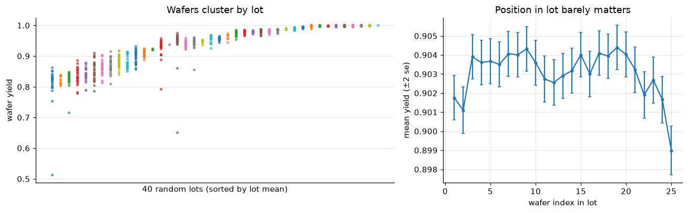

*그림 11. 왼쪽: 무작위로 고른 로트 40개의 웨이퍼 수율 (로트 평균 순으로 정렬, 한 세로줄 = 한 로트). 오른쪽: 로트 안 웨이퍼 번호(1–25)별 평균 수율과 ±2 표준오차 막대.*

- 왼쪽: 같은 로트의 점들은 세로로 좁게 모여 있고, 로트끼리는 평균이 크게 달라요. 몇몇 로트에는 홀로 떨어진 웨이퍼도 있어요.
- 오른쪽: **y축 범위가 0.898–0.905로 아주 좁아요.** 양 끝(1–2번, 24–25번)이 조금 낮고 25번이 가장 낮지만, 차이는 0.5%p 안팎이에요.

#### 해석

- 수율 변동의 대부분($\eta^2\approx0.91$)이 **로트 간 차이**에서 와요. 로트가 46,293개나 되지만 $R^2_{adj}=0.908$ 로 거의 줄지 않으니, 설명변수가 많아서 생긴 착시가 아니에요 (로트 효과가 없을 때 $\eta^2$ 의 기대값은 약 0.057).
- 다만 로트마다 제품이 정해져 있어서 **제품만으로도 $\eta^2\approx0.53$** 이 설명돼요. 0.913이라는 숫자에는 제품 효과가 섞여 있어요(**교락**, confounding). 제품을 고정해도 남은 변동의 82%가 로트 간 차이니, 로트 효과는 제품 효과와 별개로 커요.
- 로트 안에서의 **위치(웨이퍼 번호)** 는 평균 수율과 거의 관계가 없어요. 번호 하나에 평균 3만 장이 넘는 웨이퍼가 있어서(811,457장 / 25) 표준오차가 아주 작아요. 그래서 25번처럼 다른 번호 대부분과 오차 막대가 겹치지 않는 차이도 보이지만, 그 크기(0.5%p 안팎)는 왼쪽 그림의 로트 간 차이에 비하면 아주 작아요. **통계적으로 구분되는 것**과 **실질적으로 큰 것**은 다른 문제예요.
- → PART 3: **"로트의 앞쪽 몇 장만 검사하면 나머지 웨이퍼의 수율을 예측할 수 있을까?"** 로트 효과가 크니 해 볼 만한 질문이에요.

> ⚠️ **주의**: 같은 로트의 웨이퍼는 서로 독립이 아니에요. 웨이퍼 단위로 무작위로 학습/테스트를 나누면 같은 로트가 양쪽에 들어가 성능이 부풀려져요(3-3의 로트 단위 분할). 표준오차도 독립을 가정하면 너무 작게 나와요(3-7의 (심화) 셀).

**생각해 볼 질문**

1. 로트로 묶은 $\eta^2$ 가 제품으로 묶은 $\eta^2$ 보다 큰 것은 데이터의 성질일까요, 수학적 필연일까요?

<details><summary>답</summary>

수학적 필연이에요. 로트가 제품 안에 내포되어 있어서 $\operatorname{col}(P)\subseteq\operatorname{col}(Z)$ 이고, 더 큰 부분공간으로 사영하면 잔차제곱합이 커질 수 없어요. 그래서 "로트가 제품보다 중요하다"는 결론은 $\eta^2$ 비교만으로는 나오지 않고, 제품 안의 변동을 따로 본 0.82 같은 값이 필요해요.

</details>

2. 오른쪽 그림에서 1번과 10번 웨이퍼의 평균 차이가 유의한지를 오차 막대가 겹치는지로 판단해도 될까요?

<details><summary>답</summary>

너무 보수적인 판단이 돼요. 두 평균이 독립이라도 차이의 표준오차는 $\sqrt{\mathrm{se}_1^2+\mathrm{se}_{10}^2}\le\mathrm{se}_1+\mathrm{se}_{10}$ 라서, $\pm2\,\mathrm{se}$ 막대가 조금 겹쳐도 차이가 유의할 수 있어요. 게다가 1번과 10번 웨이퍼는 많은 경우 **같은 로트**에서 오니 두 평균이 양의 상관을 가져요. $\operatorname{Var}(\bar y_{(1)}-\bar y_{(10)})=\operatorname{Var}(\bar y_{(1)})+\operatorname{Var}(\bar y_{(10)})-2\operatorname{Cov}(\bar y_{(1)},\bar y_{(10)})$ 에서 $2\operatorname{Cov}$ 만큼 분산이 더 줄어요. 같은 로트 안에서 두 웨이퍼의 차이를 구해 평균 내는 **대응 비교**를 하면 로트 효과(변동의 91%)가 빠져서 훨씬 정밀해요.

</details>

### 2-9. 반지름에 따른 불량률 (불량 패턴별)

> 💻 **노트북**: 2-9의 코드 셀 (불량 패턴별 · 반지름 구간별 불량률 표와 그림)

2-4에서 눈으로 본 패턴의 **공간적 모양**을 숫자로 요약해요. 이 모양을 매끄러운 함수로 추정하는 것이 PART 4의 목표예요.

#### 개수를 먼저 더하고 나누는 불량률 추정

패턴 $c$ 에 속한 웨이퍼들의 반지름 구간 $k$ 불량률을

$$
\hat p_{c,k}=\frac{\sum_{m\in c}\text{def}_{m,k}}{\sum_{m\in c}\text{die}_{m,k}}
$$

로 정의해요. 웨이퍼별 비율의 평균이 아니라 **개수를 다 더한 다음 나눈 값**이에요. 이 값은 두 가지로 정당화돼요.

- 패턴 $c$, 구간 $k$ 의 다이가 모두 같은 확률 $p_{c,k}$ 로 불량인 서로 독립인 베르누이 시행이라면, 로그우도 $\sum_d\big[b_d\ln p+(1-b_d)\ln(1-p)\big]$ 를 $p$ 로 미분해 0으로 두면 그 칸의 다이 수 $n_{c,k}$ 에 대해 $\hat p=\sum_d b_d/n_{c,k}$ 가 나와요. 즉 **최대우도추정량**이에요.
- 다이 하나를 관측 하나로 보고 불량 지시변수 $b_d$ 를 (패턴 × 구간) 더미에 회귀하면, 2-8과 같은 논리로 사영이 그룹 평균이 되니 적합값이 바로 $\hat p_{c,k}$ 예요. 불량 확률을 선형회귀로 추정하는 이 틀(선형확률모형)을 PART 4에서 다이 1.8억 개에 그대로 써요.

#### 코드 읽기

<details><summary>📝 셀 전체 코드 (줄별 주석)</summary>

```python
# ── 1. 개수를 먼저 더하고 나누는 불량률 p̂_{c,k} ──────────────────────
die_cols = [f"die_r{k}" for k in range(N_BINS)]              # 구간별 다이 수 열 10개 (2-5)
def_cols = [f"def_r{k}" for k in range(N_BINS)]              # 구간별 불량 수 열 10개
# 라벨별로 열마다 합 → (라벨 10종 × 구간 10) 표. 행은 라벨 이름의 정렬 순서이고 'unlabeled' 도 들어 있어요.
grp_def = wafer.groupby("label")[def_cols].sum()            # 패턴별 · 구간별 불량 수 (집계)
grp_die = wafer.groupby("label")[die_cols].sum()            # 패턴별 · 구간별 다이 수
# 원소별 나눗셈 p̂_{c,k} = Σ def / Σ die (F64). 웨이퍼별 비율의 평균이 아니라 베르누이 가정의 최대우도추정량이에요.
rate = torch.tensor(grp_def.to_numpy()) / torch.tensor(grp_die.to_numpy())
# 열 이름은 구간 범위 '0.0–0.1', …, '0.9–1.0' (k/10 을 소수 첫째 자리로).
radial_rate = pd.DataFrame(rate.numpy(), index=grp_def.index, columns=[f"{k/10:.1f}–{(k+1)/10:.1f}" for k in range(N_BINS)])
r_mid = ((R_EDGES[:-1] + R_EDGES[1:]) / 2).numpy()          # 구간 중앙 0.05, 0.15, …, 0.95 → 그림의 가로축

# ── 2. 패턴별 반지름 프로파일 그림 ─────────────────────────────────
fig, ax = plt.subplots(figsize=(9, 4))
for i, c in enumerate(CLASSES):                              # 'unlabeled' 는 빼고 9종만 그려요
    ax.plot(r_mid, radial_rate.loc[c].to_numpy(), "o-", ms=3, color=f"C{i}", label=c)   # 선 하나 = 패턴 하나
ax.set(xlabel="normalized radius r", ylabel="defect rate", title="Radial defect profile by failure type")
# loc="center left" 인 범례 상자를 축 오른쪽 바깥 (x=1.01, y=0.5) 에 붙여서 곡선을 가리지 않게 해요.
ax.legend(fontsize=8, loc="center left", bbox_to_anchor=(1.01, 0.5))
plt.show()
radial_rate.loc[CLASSES]                                     # 표도 CLASSES 순서 9행만 보여 줘요
```

</details>

```python
grp_def = wafer.groupby("label")[def_cols].sum()            # 패턴별 · 구간별 불량 수 (집계)
grp_die = wafer.groupby("label")[die_cols].sum()            # 패턴별 · 구간별 다이 수
rate = torch.tensor(grp_def.to_numpy()) / torch.tensor(grp_die.to_numpy())
```

- 2-5에서 특징을 **개수**로 저장해 둔 덕분에 `groupby(...).sum()` 한 번으로 분자와 분모를 구해요. `rate` 는 (라벨 × 구간) 행렬을 원소별로 나눈 것이에요. `unlabeled` 행도 계산되지만 표와 그림에는 `CLASSES` 만 보여 줘요.
- `r_mid = ((R_EDGES[:-1] + R_EDGES[1:]) / 2).numpy()` 는 구간 중앙(0.05, 0.15, …, 0.95)이고, 그림의 가로축 위치예요.

#### 결과

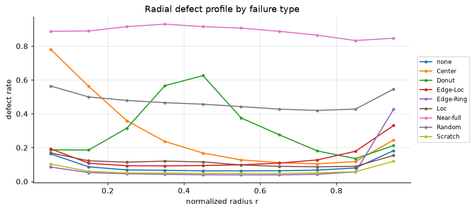

*그림 12. 불량 패턴별 반지름 구간(가로축 = 구간 중앙의 정규화 반지름 $r$)의 불량률. 선 하나가 패턴 하나예요.*

| label | 0.0–0.1 | 0.3–0.4 | 0.4–0.5 | 0.8–0.9 | 0.9–1.0 |
|---|---|---|---|---|---|
| `none` | 0.1627 | 0.0658 | 0.0625 | 0.0797 | 0.1818 |
| `Center` | 0.7813 | 0.2362 | 0.1677 | 0.1178 | 0.2448 |
| `Donut` | 0.1869 | 0.5662 | 0.6254 | 0.1349 | 0.2124 |
| `Edge-Loc` | 0.1928 | 0.0920 | 0.0940 | 0.1783 | 0.3305 |
| `Edge-Ring` | 0.0850 | 0.0422 | 0.0394 | 0.0565 | 0.4265 |
| `Loc` | 0.1687 | 0.1200 | 0.1154 | 0.0893 | 0.1539 |
| `Near-full` | 0.8876 | 0.9300 | 0.9152 | 0.8329 | 0.8465 |
| `Random` | 0.5641 | 0.4655 | 0.4565 | 0.4278 | 0.5458 |
| `Scratch` | 0.1025 | 0.0496 | 0.0478 | 0.0577 | 0.1193 |

(노트북의 표에는 10개 구간이 모두 있어요. 여기서는 모양을 읽는 데 필요한 구간만 옮겼어요.)

#### 해석

각 곡선이 말하는 것을 차례로 읽어요.

- **`Center`**: 중심에서 0.7813으로 가장 높고 바깥으로 갈수록 0.7–0.8 구간의 0.1038까지 단조롭게 줄어요. 중심에 몰린 덩어리 그대로예요. 마지막 두 구간에서 다시 오르는 건 아래 `none` 에서 보듯 모든 패턴에 공통인 가장자리 효과예요.
- **`Donut`**: 안쪽은 0.19 정도로 낮고 0.4–0.5에서 0.6254로 봉우리를 이룬 뒤 다시 내려가요. **중간 반지름의 고리**예요.
- **`Edge-Ring`**: 중심 구간을 빼면 안쪽은 0.04 안팎으로, 마지막 구간 전까지 모든 구간에서 `none` 보다도 낮다가 마지막 구간에서 0.4265로 치솟아요. 테두리의 얇은 고리가 마지막 구간 하나에 다 들어가요.
- **`Edge-Loc`**: 중간 반지름부터 바깥으로 갈수록 서서히 올라 마지막 구간이 0.3305예요. 가장자리의 **한 부분**에만 불량이 있으니, 원 둘레 전체로 평균하면 `Edge-Ring` 보다 낮고 완만해요.
- **`Loc`**, **`Scratch`**: 양 끝 구간을 빼면 거의 평평해요. 위치가 웨이퍼마다 달라서 평균을 내면 모양이 지워져요 (2-4의 질문).
- **`Random`** 은 0.42 ~ 0.56, **`Near-full`** 은 0.83 ~ 0.93으로 어디서나 높아요. 공간적 모양보다 **수준**이 특징인 패턴이에요.
- **`none`** 도 가장 바깥 구간(0.1818)과 중심 구간(0.1627)에서 높아요. 가장 바깥 구간이 바로 안쪽 구간보다 높은 것은 9개 패턴 모두에서, 중심 구간이 바로 바깥 구간보다 높은 것은 `Near-full` 을 뺀 8개 패턴에서 보여요. 가장자리 불량은 패턴과 무관하게 흔한 현상이고, 중심 구간이 튀는 이유는 4-2의 (심화) 셀에서 정중앙 다이를 따로 조사해요.

> 💡 **핵심**: 패턴마다 반지름에 따른 **공간적 모양**이 뚜렷해요. → PART 4에서 이 모양을 **기저함수 회귀**로 매끄러운 함수 $p(r)$, $p(x,y)$ 로 추정해요.

**생각해 볼 질문**

1. 웨이퍼마다 구간별 불량률을 구해서 평균 내면 안 될까요?

<details><summary>답</summary>

그렇게 하면 모든 웨이퍼가 같은 무게를 받아요. 다이가 적은 맵의 중심 구간은 다이가 몇 개뿐이라 비율이 0, 0.5, 1처럼 크게 흔들리고, 그 잡음이 다이 수와 상관없이 같은 무게로 섞여요. 어떤 맵에서 구간에 다이가 하나도 없다면 $0/0$ 이 되는 문제도 생겨요. 개수를 더한 다음 나누면 다이 하나하나가 같은 무게를 받고, 공통 확률 가정에서 최대우도추정량이에요. 다만 둘은 추정 대상 자체가 달라요(웨이퍼 평균 vs 다이 평균). 무엇을 알고 싶은지에 따라 골라야 해요.

</details>

2. `Edge-Ring` 의 마지막 구간 불량률(0.4265)이 `Edge-Loc`(0.3305)보다 높은 이유는 무엇일까요?

<details><summary>답</summary>

`Edge-Ring` 은 테두리를 **한 바퀴 전부** 따라 불량이 생기고, `Edge-Loc` 은 테두리의 **일부**에만 생겨요. 반지름 구간은 원 둘레 전체를 합친 값이라 `Edge-Loc` 의 불량은 같은 구간의 정상 다이들과 섞여 희석돼요. 반지름 하나로 요약하면 각도 정보가 사라진다는 뜻이고, 그래서 PART 4에서 2차원 곡면 $p(x,y)$ 를 맞춰요.

</details>

## PART 3. 사례 ① 로트 조기 수율 예측 — 다중회귀 (90분: 20분 · 60분: 15분)

2-8에서 두 가지를 확인했어요. 수율 변동의 대부분($\eta^2\approx0.91$)이 **로트 간 차이**에서 오고, 로트 안에서의 **위치(웨이퍼 번호)** 는 평균 수율과 거의 관계가 없어요. 그렇다면 로트의 앞쪽 몇 장만 검사해도 나머지 웨이퍼의 수율을 꽤 정확히 맞힐 수 있을 거예요. PART 3에서는 이 질문을 다중회귀 문제로 정식화하고, PART 1에서 만든 도구(닫힌 해, 경사하강법, 추론)를 학습 관측 35만 개에 그대로 적용해요.

| 절 | 하는 일 | 다시 쓰는 PART 1 · 2 내용 |
|---|---|---|
| 3-1, 3-2 | 시나리오 정식화, 특성 만들기 | 1-1 설계행렬, 2-5 반지름 구간 특징 |
| 3-3 | 로트 단위 분할, 학습 통계로 표준화 | 1-6 표준화 |
| 3-4 | 닫힌 해로 M0 · M1 · M2 비교 | 1-3 `lstsq`, 1-4 $R^2$ |
| 3-5 | `nn.Linear` + SGD로 같은 모형 학습 | 1-6 학습률 조건과 조건수 |
| 3-6 | 잔차 분석 | 1-1 가정 4 · 5 |
| 3-7 | 계수 해석, $t$ 통계량, 군집-강건 표준오차 | 1-5 추정량의 분포 |
| 3-8 | 검사 매수 $K$ 와 예측 성능의 천장 | 2-8 $\eta^2$ |

### 3-1. 시나리오

> 💻 **노트북**: 3-1의 마크다운 셀 (시나리오와 특성 표). 이 절에는 코드 셀이 없어요.

25장짜리 로트에서 **앞쪽 $K=5$ 장**(웨이퍼 번호 1–5)만 먼저 검사하고, 그 결과로 **나머지 20장 각각의 수율**을 예측해요. 이 예측이 되면 검사 순서와 샘플링 계획을 세우거나, 문제 로트를 일찍 찾아내서 추가 검사나 공정 점검을 앞당길 수 있어요.

#### 문제를 수식으로

로트 $g$ 의 $i$ 번째 웨이퍼 수율을 $y_{gi}$ ($i=1,\dots,25$) 라고 할게요. 예측하는 시점에 알 수 있는 정보 $\mathcal I_g^{(K)}$ 는 두 가지뿐이에요.

- 같은 로트의 앞 $K$ 장 웨이퍼 맵 (웨이퍼 번호 $1,\dots,K$)
- 검사 전에 알 수 있는 값: 제품 정보(웨이퍼당 다이 수 $N_g$)와 예측할 웨이퍼의 번호 $i$

관측 단위는 "웨이퍼 번호 $i\in\lbrace K+1,\dots,25\rbrace$ 인 웨이퍼 한 장"이고, 타깃은 그 웨이퍼의 수율이에요. $\mathcal I_g^{(K)}$ 에서 로트 요약 5개 $\mathbf s_g$ 를 계산하고 웨이퍼 번호 $i$ 를 더해서 특성 6개를 만들어요 (3-2). 모형은

$$
y_{gi}=\beta_0+\mathbf s_g^\top\boldsymbol\beta_s+\beta_w\,i+\varepsilon_{gi},\qquad i=K+1,\dots,25
$$

예요. 제곱오차 기준으로 가장 좋은 예측은 조건부 기댓값 $\mathbb E[y_{gi}\mid\mathcal I_g^{(K)},\,i]$ 이고, 선형회귀는 이것을 특성의 선형함수로 근사해요.

#### 왜 동어반복이 아닌 "진짜" 예측 문제인가

1. **타깃 웨이퍼 자신의 정보는 특성에 하나도 들어가지 않아요.** 특성은 웨이퍼 $1,\dots,K$ 에서, 타깃은 웨이퍼 $K+1,\dots,25$ 에서 나와요. 두 집합은 서로소예요.
2. 동어반복(tautology)과 비교하면 차이가 분명해요. 그 웨이퍼 자신의 불량 비율 $n_{\text{def}}/n_{\text{die}}$ 를 특성으로 넣으면 정의상 $y=1-n_{\text{def}}/n_{\text{die}}$ 라서 $R^2=1$ 이 나오지만, 아무것도 예측하지 않은 거예요. 타깃을 포함한 로트 25장 평균을 특성으로 써도 타깃이 특성에 섞여 들어가요.
3. 예측이 되는 이유는 데이터의 실제 구조, 즉 같은 로트의 웨이퍼가 같은 장비 · 조건에서 함께 공정을 거쳐 서로 닮는다는 사실(2-8)뿐이에요. 이 구조가 약했다면 $R^2$ 는 0 근처였을 거예요. 그래서 여기서 얻는 $R^2$ 는 "로트 정보가 아직 검사하지 않은 웨이퍼로 얼마나 전달되는가"를 재는 값이에요.

> 💡 **핵심**: 특성은 **예측 시점에 실제로 알 수 있는 정보**로만 만들어요. 이 원칙이 깨지면 성능 숫자가 아무리 좋아도 의미가 없어요.

**생각해 볼 질문**

1. 타깃을 포함한 로트 25장의 평균 수율을 특성으로 넣으면 $R^2$ 가 크게 오를 텐데, 왜 쓰면 안 될까요?

<details><summary>답</summary>

두 가지 이유예요. ① 타깃 $y_{gi}$ 가 그 평균에 $1/25$ 비중으로 직접 들어 있어요. ② 더 근본적으로, 나머지 20장을 검사하기 전에는 그 값을 알 수 없어요. 예측 시점에 존재하지 않는 정보를 쓰는 **정보 누수**라서, 학습 · 평가 숫자는 좋아도 실제로는 쓸 수 없는 모형이 돼요.

</details>

2. 이 예측이 잘 안 되는 웨이퍼는 어떤 웨이퍼일까요?

<details><summary>답</summary>

로트 공통 수준에서 벗어나는 웨이퍼예요. 예를 들어 한 장에만 갑자기 대량 불량이 생기는 경우(3-6의 `Near-full`, `Random`)는 앞 웨이퍼에 흔적이 없어서 예측할 수 없어요. 로트 안 웨이퍼끼리의 차이가 예측 성능의 상한을 정하고, 3-8의 '천장'이 그 상한을 수치로 보여 줘요.

</details>

### 3-2. 데이터셋 만들기

> 💻 **노트북**: 3-2의 코드 셀 (`FEATURES` · `build_lot_dataset` · `lotdata.head()`)

2-5에서 만든 웨이퍼 단위 표 `wafer`(한 행 = 웨이퍼 한 장, 반지름 구간별 다이 수 `die_r{k}` · 불량 수 `def_r{k}` 포함)를 "로트 요약 특성 + 타깃 웨이퍼 한 장" 형태의 표로 바꿔요. 관측 단위와 타깃 범위를 모든 로트에서 똑같이 맞추려고 **25장이 모두 있는 로트만** 써요.

#### 특성의 정의

로트 $g$ 의 앞 $K$ 장을 $i=1,\dots,K$ 라 하고, 웨이퍼 $i$ 의 반지름 구간 $k$ ($r$ 이 $k/10$ 과 $(k+1)/10$ 사이, $k=0,\dots,9$, 경계값 처리는 2-5) 다이 수와 불량 다이 수를 $d_{gik}$, $b_{gik}$ 라 할게요 (2-5).

| 특성 | 정의 | 의미 |
|---|---|---|
| `first_mean` | $\bar y_g^{(K)}=\frac1K\sum_{i\le K}y_{gi}$ | 앞 $K$ 장 평균 수율. 로트 수준을 가장 직접 추정해요 |
| `first_std` | $\sqrt{\frac1{K-1}\sum_{i\le K}(y_{gi}-\bar y_g^{(K)})^2}$, $K=1$ 이면 0 | 앞 $K$ 장의 흩어짐. 한두 장만 튀는 로트를 구별해요 |
| `first_edge` | $\sum_{i\le K}b_{gi9}\big/\sum_{i\le K}d_{gi9}$ | 가장자리($r\ge0.9$) 다이의 불량률 |
| `first_center` | $\sum_{i\le K}\sum_{k\le2}b_{gik}\big/\sum_{i\le K}\sum_{k\le2}d_{gik}$ | 중심부($r$ < 0.3) 다이의 불량률 |
| `log_n_die` | $\log N_g$ | 제품 정보. 다이 크기의 대리 변수예요 (2-7) |
| `wafer_index` | $i\in\lbrace 6,\dots,25\rbrace$ | 예측할 웨이퍼의 로트 내 번호 |

- `first_edge` 의 마지막 구간에는 2-5에서 넣어 둔 $r\ge1$ 인 경계 다이도 포함돼요.
- 두 불량률은 **합을 먼저 구한 뒤 나눈 비율**(pooled ratio)이에요. 이는 웨이퍼별 불량률을 다이 수로 가중평균한 값과 같고, 앞 $K$ 장의 구간별 다이 수가 같으면(같은 제품이면) 단순평균과 같아요.

`first_mean`, `first_center`, `first_edge` 세 특성은 구조적으로 얽혀 있어요. 앞 $K$ 장의 다이 배치가 같다고 하면(구간별 다이 수 $d_k$) $y_{gi}=1-\sum_k b_{gik}/N_g$ 이에요. 구간 $k$ 의 다이 비율을 $w_k=d_k/N_g$, 앞 $K$ 장을 합쳐서 구한 구간 불량률을 $q_{gk}=\sum_i b_{gik}/(K d_k)$ 라 하면

$$
\bar y_g^{(K)}=1-\sum_{k=0}^{9}w_k\,q_{gk}
=1-\big(w_{\text{ctr}}\,q_{g,\text{ctr}}+w_{\text{mid}}\,q_{g,\text{mid}}+w_{\text{edge}}\,q_{g,\text{edge}}\big)
$$

이 돼요. 여기서 $w_{\text{ctr}},w_{\text{mid}},w_{\text{edge}}$ 는 $r$ < 0.3, $0.3\le r$ < 0.9, $r\ge0.9$ 구간의 다이 비율이고, $q_{g,\text{ctr}}$ 가 `first_center`, $q_{g,\text{edge}}$ 가 `first_edge` 예요. 즉 같은 제품 안에서 `first_mean` 은 `first_center`, `first_edge` 와 중간 구간 불량률의 **선형결합**이에요 (가중치 $w$ 는 제품의 다이 배치로 정해져요). 그래서 3-3에서 강한 음의 상관이 나오는 게 당연해요.

#### 코드 읽기

<details><summary>📝 셀 전체 코드 (줄별 주석)</summary>

```python
# ── 1. 특성 목록 ────────────────────────────────────────────────
# 로트 요약 5개 + 예측할 웨이퍼의 번호. 이 순서가 3-3 의 설계행렬 D_lot 열 순서(절편 다음)가 돼요.
# wafer_index 를 반드시 맨 뒤에 둬야 해요: 아래의 FEATURES[:-1] 이 "로트 요약 5개"를 뜻하거든요.
FEATURES = ["first_mean", "first_std", "first_edge", "first_center", "log_n_die", "wafer_index"]

def build_lot_dataset(wafer, K=5, target_from=None):
    """25장 로트에서 앞 K장(wafer_index ≤ K)으로 특징을 만들고, wafer_index ≥ target_from 인 웨이퍼를 타깃으로 해요."""
    # 기본값은 K+1 번부터 타깃이에요 (3-4: 6–25번). 3-8 에서는 target_from=11 로 타깃을 고정해요.
    target_from = K + 1 if target_from is None else target_from

    # ── 2. 25장이 모두 있는 로트만 남기기 ─────────────────────────
    # transform("size") 는 각 행에 "그 행이 속한 로트의 행 수"를 원래 길이 그대로 돌려줘요.
    # 그래서 == 25 가 바로 행 단위 불리언 마스크예요. (agg("size") 는 로트당 한 행으로 줄어 마스크가 안 돼요.)
    full = wafer[wafer.groupby("lot")["lot"].transform("size") == 25]

    # ── 3. 앞 K장만 골라 중심부(r < 0.3, 구간 0–2) 불량 수 · 다이 수를 웨이퍼마다 더해 두기 ──
    # assign 의 lambda 는 필터링된 데이터프레임 d 를 받아 새 열을 만들어요. sum(axis=1) 은 행(웨이퍼)별 합이에요.
    first = full[full["wafer_index"] <= K].assign(
        ctr_def=lambda d: d[["def_r0", "def_r1", "def_r2"]].sum(axis=1),
        ctr_die=lambda d: d[["die_r0", "die_r1", "die_r2"]].sum(axis=1))

    # ── 4. 로트별 요약 (named aggregation: 새 열 이름=(원래 열, 함수)) ──
    # 결과는 로트당 한 행, 인덱스가 lot 이에요. 불량 수 · 다이 수는 '합'을 먼저 구해서 뒤에서 나누니
    # 웨이퍼별 불량률의 다이 수 가중평균(pooled ratio)이 돼요 (3-2).
    agg = first.groupby("lot").agg(
        first_mean=("yield", "mean"), first_std=("yield", "std"),   # 앞 K장 평균 · 표본표준편차(분모 K−1)
        edge_def=("def_r9", "sum"), edge_die=("die_r9", "sum"),     # 가장자리 구간 9 (r ≥ 0.9, 경계 다이 포함)
        # n_die: 로트 안 웨이퍼는 같은 제품(같은 다이 수)이라고 보고 첫 값을 써요.
        ctr_def=("ctr_def", "sum"), ctr_die=("ctr_die", "sum"), n_die=("n_die", "first"))

    # ── 5. 비율 · 로그 특성 완성 ────────────────────────────────
    # pandas 의 "std" 는 분모 K−1 이라 K = 1 이면 NaN → 0 으로 바꿔요 (이때 열 전체가 0, 3-8 참고).
    agg["first_std"] = agg["first_std"].fillna(0.0)                 # K = 1 이면 표준편차가 정의되지 않아요
    # clip(lower=1): 분모(다이 수 합)가 0 이 되는 경우를 막는 안전장치예요.
    agg["first_edge"] = agg["edge_def"] / agg["edge_die"].clip(lower=1)
    agg["first_center"] = agg["ctr_def"] / agg["ctr_die"].clip(lower=1)
    agg["log_n_die"] = agg["n_die"].map(math.log)                   # 자연로그 log N_g (다이 크기의 대리 변수, 2-7)

    # ── 6. 타깃 웨이퍼 행에 로트 특성 붙이기 ──────────────────────
    # label 은 특성이 아니라 3-6 의 잔차 진단에만 써요. yield 가 타깃 y 예요.
    target = full.loc[full["wafer_index"] >= target_from, ["lot", "wafer_index", "yield", "label"]]
    # join(on="lot"): target 의 lot 열을 agg 의 인덱스(lot)에 맞춰 로트 특성 5개를 붙여요.
    # 한 로트의 특성이 그 로트의 타깃 행(기본 20행)마다 똑같이 복사돼요. reset_index 로 0,1,2,… 번호를 새로 매겨요.
    return target.join(agg[FEATURES[:-1]], on="lot").reset_index(drop=True)

# ── 7. K = 5 로 데이터셋 만들기 ─────────────────────────────────
lotdata = build_lot_dataset(wafer, K=5)
# {:,} 는 천 단위 쉼표 형식이에요. 결과: 로트 21,762개 × 20장 = 435,240개 관측
print(f"로트 {lotdata['lot'].nunique():,}개 × 20장 = {len(lotdata):,}개 관측")
lotdata.head()                                                       # lot1 의 6–10번 행은 로트 특성 5개가 모두 같아요
```

</details>

```python
def build_lot_dataset(wafer, K=5, target_from=None):
    """25장 로트에서 앞 K장(wafer_index ≤ K)으로 특징을 만들고, wafer_index ≥ target_from 인 웨이퍼를 타깃으로 해요."""
    target_from = K + 1 if target_from is None else target_from
    full = wafer[wafer.groupby("lot")["lot"].transform("size") == 25]
    first = full[full["wafer_index"] <= K].assign(
        ctr_def=lambda d: d[["def_r0", "def_r1", "def_r2"]].sum(axis=1),
        ctr_die=lambda d: d[["die_r0", "die_r1", "die_r2"]].sum(axis=1))
    agg = first.groupby("lot").agg(
        first_mean=("yield", "mean"), first_std=("yield", "std"),
        edge_def=("def_r9", "sum"), edge_die=("die_r9", "sum"),
        ctr_def=("ctr_def", "sum"), ctr_die=("ctr_die", "sum"), n_die=("n_die", "first"))
```

- `groupby(...).transform("size")` 는 각 행에 "그 행이 속한 그룹의 크기"를 원래 길이 그대로 돌려줘요. 그래서 `== 25` 가 바로 행 단위 불리언 마스크가 돼요. (`agg("size")` 를 쓰면 로트당 한 행으로 줄어들어서 마스크로 쓸 수 없어요.)
- 앞 $K$ 장만 골라서 구간 0–2($r$ < 0.3)의 불량 수와 다이 수를 웨이퍼마다 더해 둬요.
- `agg(이름=(열, 함수))` 는 pandas의 named aggregation이에요. 로트마다 한 행이 나오고, 합(`sum`)을 먼저 구하니까 위 표의 pooled ratio가 돼요.
- pandas의 `"std"` 는 표본표준편차(분모 $K-1$)라서 $K=1$ 이면 NaN이에요. 다음 줄의 `fillna(0.0)` 이 이를 0으로 바꿔요.
- `n_die=("n_die", "first")` 는 로트 안의 웨이퍼가 같은 제품이라고 보고 첫 값을 써요.

```python
    agg["first_std"] = agg["first_std"].fillna(0.0)                 # K = 1 이면 표준편차가 정의되지 않아요
    agg["first_edge"] = agg["edge_def"] / agg["edge_die"].clip(lower=1)
    agg["first_center"] = agg["ctr_def"] / agg["ctr_die"].clip(lower=1)
    agg["log_n_die"] = agg["n_die"].map(math.log)
    target = full.loc[full["wafer_index"] >= target_from, ["lot", "wafer_index", "yield", "label"]]
    return target.join(agg[FEATURES[:-1]], on="lot").reset_index(drop=True)
```

- `clip(lower=1)` 은 분모가 0이 되는 경우를 막는 안전장치예요.
- `target` 은 타깃 웨이퍼들(기본값 `target_from = K + 1`)이에요. `join(..., on="lot")` 이 로트 특성 5개(`FEATURES[:-1]`, 즉 `wafer_index` 를 뺀 것)를 그 로트의 타깃 행마다 붙여요. 한 로트의 특성이 20행에 똑같이 복사되는 거예요.
- `label` 은 특성이 아니라 3-6의 잔차 진단에만 써요. `target_from` 인자는 3-8에서 타깃을 11–25번으로 고정할 때 써요.

#### 결과

```text
로트 21,762개 × 20장 = 435,240개 관측
```

전체 46,293개 로트 중 25장이 모두 있는 21,762개 로트가 남았어요. `lotdata.head()` 를 보면 `lot1` 의 웨이퍼 6–10번 다섯 행의 특성이 모두 같아요 (`first_mean` 0.9507, `first_std` 0.009, `first_edge` 0.1127, `first_center` 0.032, `log_n_die` 7.4283). 2-5의 `wafer.head()` 로 검산할 수 있어요.

- `lot1` 의 웨이퍼 1–5번 수율은 0.9477, 0.9489, 0.9608, 0.9382, 0.9578이에요. 평균을 내면 0.9507이에요.
- 같은 다섯 값의 표본표준편차는 약 0.009예요 (pandas가 표시 정밀도 4자리로 0.0090을 만든 뒤, 열의 모든 값에 공통인 끝자리 0을 지워서 0.009로 보여 줘요).
- `lot1` 의 다이 수는 1683개이고, $\ln 1683\approx7.4283$ 이에요.

#### 해석

한 로트가 20행을 차지하고, 그중 특성 5개는 20행 모두 똑같아요. 행마다 다른 건 `wafer_index` 와 타깃 `yield` 뿐이에요. 이 구조가 3-3(분할을 로트 단위로)과 3-7(관측이 독립이 아님)의 출발점이에요.

> ⚠️ **주의**: 결론은 "25장이 모두 있는 로트"에만 적용돼요. 장수가 모자란 로트가 무작위로 빠진 것인지(예: 일부 웨이퍼 폐기)는 이 데이터로 확인할 수 없어요.

**생각해 볼 질문**

1. 불량률을 "웨이퍼별 불량률의 평균"이 아니라 "불량 수 합 / 다이 수 합"으로 계산했어요. 두 값은 언제 같을까요?

<details><summary>답</summary>

$\sum_i b_i/\sum_i d_i=\sum_i \frac{d_i}{\sum_j d_j}\cdot\frac{b_i}{d_i}$ 이므로 pooled ratio는 웨이퍼별 불량률을 다이 수 $d_i$ 로 가중평균한 값이에요. 모든 $d_i$ 가 같으면(같은 제품이라 다이 배치가 같으면) 단순평균과 정확히 같아요. pooled ratio는 어떤 웨이퍼의 해당 구간 다이 수가 0이어도 정의된다는 장점도 있어요.

</details>

2. $K=1$ 이면 `first_std` 열은 어떻게 되고, 회귀에 어떤 문제가 생길까요?

<details><summary>답</summary>

모든 로트에서 0이에요 (`fillna(0.0)`). 표준화 전에는 영벡터 열이라 $\operatorname{rank}(X)$ < $p$ 가 되고, $X^\top X$ 가 특이행렬이라 정규방정식의 해가 유일하지 않아요. 3-8에서 `torch.linalg.lstsq` 가 이 경우를 어떻게 처리하는지 다시 봐요. (이 상태로 표준화하면 표준편차가 0이라 0으로 나누게 되니 주의해야 해요.)

</details>

### 3-3. 학습/테스트 분할은 로트 단위로

> 💻 **노트북**: 3-3의 코드 셀 (`lot_split` · `to_tensors` · 학습 통계로 표준화 · 절편 열 추가 · 특성 상관행렬)

우리가 알고 싶은 건 **처음 보는 로트**에 대한 성능이에요. 그러려면 테스트 데이터가 그 상황을 그대로 흉내 내야 해요.

#### 왜 웨이퍼 단위 무작위 분할은 정보가 새는가

특성으로 설명되지 않는 로트 고유의 편차를 $u_g$ (랜덤효과), 로트 안 웨이퍼별 잡음을 $\xi_{gi}$ 라 하고 오차를 $\varepsilon_{gi}=u_g+\xi_{gi}$ 로 나눠 볼게요. $u_g$ 와 $\xi_{gi}$ 가 독립이고 분산이 $\tau^2$, $\sigma_w^2$ 이면 같은 로트의 두 웨이퍼($i\ne j$)에 대해

$$
\operatorname{Cov}(\varepsilon_{gi},\varepsilon_{gj})=\operatorname{Var}(u_g)=\tau^2 > 0
$$

이에요. 웨이퍼를 무작위로 20%만 테스트로 보내면, 테스트 웨이퍼 하나마다 같은 로트의 나머지 19장 중 평균 15장 남짓이 학습 데이터에 들어가요. 그 웨이퍼들은 `wafer_index` 를 뺀 **특성 5개가 똑같고** 오차가 $u_g$ 를 공유해요. (노트북의 "특성이 똑같고"는 이 5개를 말해요.)

- 특성 값의 조합(예: 소수 넷째 자리까지의 `first_mean`)은 사실상 로트의 지문이에요. 유연한 모형(최근접 이웃, 결정나무, 신경망)은 "이 지문을 가진 학습 웨이퍼들의 평균"을 외워서 $u_g$ 까지 맞힐 수 있어요. 새 로트에서는 불가능한 일이라 성능이 부풀려져요.
- 파라미터가 7개뿐인 지금의 선형모형은 $u_g$ 를 외울 수 없어서 숫자 자체는 크게 달라지지 않을 거예요. 그래도 평가는 "이미 일부를 본 로트"라는 다른 질문에 답하게 되고, 테스트 오차가 $u_g$ 를 통해 학습 오차와 상관돼서 독립적인 평가가 아니게 돼요.

**그룹 분할(group split)** 은 한 로트의 20장을 통째로 학습이나 테스트 한쪽에만 보내요. 그러면 테스트 로트의 $u_g$ 는 학습 중에 한 번도 보이지 않아요.

#### 표준화는 학습 통계로만

학습 행에서 구한 열별 평균 $\boldsymbol\mu$ 와 표준편차 $S=\operatorname{diag}(s_1,\dots,s_6)$ 로 모든 행을 $Z=(X-\mathbf 1\boldsymbol\mu^\top)S^{-1}$ 로 바꿔요. 테스트 로트의 통계는 예측 시점에 알 수 없는 정보라서 쓰지 않아요.

흥미롭게도 이 표준화는 최소제곱 예측값을 **바꾸지 않아요**. 절편 열까지 붙이면

$$
\begin{bmatrix}\mathbf 1 & Z\end{bmatrix}=\begin{bmatrix}\mathbf 1 & X\end{bmatrix}T,\qquad
T=\begin{bmatrix}1 & -\boldsymbol\mu^\top S^{-1}\\ \mathbf 0 & S^{-1}\end{bmatrix}
$$

이고 $T$ 는 가역이에요. 그래서 두 설계행렬의 열공간이 같고, 열공간으로의 사영(1-4)인 적합값도 같아요. 테스트 행도 같은 $T$ 로 변환되니까 테스트 예측값도 같고, 계수만 $\tilde{\boldsymbol\beta}=T^{-1}\hat{\boldsymbol\beta}$ 로 바뀌어요. 표준화가 바꾸는 건 두 가지예요. **경사하강법의 조건수**(3-5)와 **계수의 단위**(3-7)예요. 반대로 테스트 행을 테스트 통계로 따로 표준화하면 두 집합이 다른 $T$ 로 변환돼서 예측값이 달라져요.

#### 코드 읽기

<details><summary>📝 셀 전체 코드 (줄별 주석)</summary>

```python
# ── 1. 로트 단위(그룹) 분할 함수 ─────────────────────────────────
def lot_split(lots, test_frac=0.2, seed=0):
    """로트 이름 Series → 테스트 로트 여부 (bool 텐서)"""
    # 로트 이름을 정렬해 두면 행 순서와 상관없이 같은 시드 → 같은 테스트 로트예요 (3-8 에서 K 를 바꿔도 그대로).
    uniq = sorted(lots.unique())
    # 전역 난수 상태를 건드리지 않는 전용 생성기예요.
    g = torch.Generator().manual_seed(seed)
    # randperm(L): 0 … L−1 의 무작위 순열. 앞의 int(0.2 × 21,762) = 4,352 개 번호를 테스트 로트로 뽑아요.
    perm = torch.randperm(len(uniq), generator=g)[: int(test_frac * len(uniq))]
    test_lots = {uniq[i] for i in perm.tolist()}                    # 집합(set)이라 isin 조회가 빨라요
    # isin: 각 행의 로트가 테스트 집합에 있으면 True. 결과는 행 단위 bool 텐서 (n,) 이고, 한 로트의 행은 전부 같은 쪽이에요.
    return torch.tensor(lots.isin(test_lots).to_numpy())

def to_tensors(data, features):
    # 특성 행렬 (n, len(features)) 와 타깃 (n,) 을 float64(F64) 로 만들어요. 닫힌 해 · 통계는 배정밀도로 (0-2).
    # wafer_index(정수)와 실수 열이 섞여 있어도 to_numpy() 가 float 배열로 맞춰 줘요.
    X = torch.tensor(data[features].to_numpy(), dtype=F64)
    y = torch.tensor(data["yield"].to_numpy(), dtype=F64)
    return X, y

# ── 2. 분할 · 텐서 변환 ─────────────────────────────────────────
is_te = lot_split(lotdata["lot"])                                # (435,240,) bool: 테스트 행
is_tr = ~is_te                                                   # ~ 는 bool 텐서의 논리 부정 → 학습 행
X_raw, y_lot = to_tensors(lotdata, FEATURES)                     # (n, 6), (n,) float64

# ── 3. 학습 통계로만 표준화 → 절편 열 추가 ───────────────────────
# mean(0) · std(0) 은 열(특성)별 통계, 모양 (6,). torch.std 는 기본이 표본표준편차(분모 n−1)예요.
# 테스트 로트의 통계는 예측 시점에 알 수 없는 정보라 쓰지 않아요.
mu, sd = X_raw[is_tr].mean(0), X_raw[is_tr].std(0)
# (n, 6) − (6,) 브로드캐스팅. Z = (X − 1μᵀ)S⁻¹. 테스트 행도 같은 μ, S 로 변환돼서 최소제곱 예측값은 그대로예요 (3-3).
Z_lot = (X_raw - mu) / sd                                       # 학습 통계로 표준화
ones = torch.ones(len(Z_lot), 1, dtype=F64)                     # (n, 1) 절편 열
# 열 순서: [절편, first_mean, first_std, first_edge, first_center, log_n_die, wafer_index] → (n, 7)
D_lot = torch.cat([ones, Z_lot], dim=1)                         # 절편 열 추가

# ── 4. 분할 크기 확인 · 특성 상관행렬 ────────────────────────────
# .loc 에는 bool 텐서 대신 .numpy() 로 바꾼 bool 배열을 넘겨요. 두 집합 모두 정확히 로트 수 × 20 이에요.
print(f"train {is_tr.sum().item():,}개 ({lotdata.loc[is_tr.numpy(), 'lot'].nunique():,} lots) / "
      f"test {is_te.sum().item():,}개 ({lotdata.loc[is_te.numpy(), 'lot'].nunique():,} lots)")
print("특성 상관행렬 (train):")
# torch.corrcoef 는 '행'을 변수로 봐서 (6, n_tr) 로 전치해 넘겨요 → 6×6 상관행렬 R.
# first_mean–first_center −0.93 같은 강한 상관이 3-5 의 조건수, 3-7 의 VIF 로 이어져요.
pd.DataFrame(torch.corrcoef(Z_lot[is_tr].T).numpy(), index=FEATURES, columns=FEATURES).round(2)
```

</details>

```python
def lot_split(lots, test_frac=0.2, seed=0):
    """로트 이름 Series → 테스트 로트 여부 (bool 텐서)"""
    uniq = sorted(lots.unique())
    g = torch.Generator().manual_seed(seed)
    perm = torch.randperm(len(uniq), generator=g)[: int(test_frac * len(uniq))]
    test_lots = {uniq[i] for i in perm.tolist()}
    return torch.tensor(lots.isin(test_lots).to_numpy())
```

- 로트 이름을 **정렬**한 뒤 섞어서, 데이터프레임의 행 순서와 상관없이 같은 시드면 항상 같은 테스트 로트가 나와요. 3-8에서 $K$ 를 바꿔 가며 이 함수를 다시 불러도 같은 로트 집합이라 테스트 로트가 그대로예요.
- 전역 난수 상태를 건드리지 않도록 별도의 `torch.Generator` 를 써요.
- `int(0.2 × 21,762)` = 4,352개 로트가 테스트예요. 돌려주는 값은 행 단위 불리언 텐서라서 `~is_te` 로 학습 마스크를 만들어요.

```python
X_raw, y_lot = to_tensors(lotdata, FEATURES)
mu, sd = X_raw[is_tr].mean(0), X_raw[is_tr].std(0)
Z_lot = (X_raw - mu) / sd                                       # 학습 통계로 표준화
ones = torch.ones(len(Z_lot), 1, dtype=F64)
D_lot = torch.cat([ones, Z_lot], dim=1)                         # 절편 열 추가
```

- `to_tensors` 는 특성과 타깃을 `float64`(`F64`) 텐서로 만들어요. 닫힌 해와 통계량은 배정밀도로 계산하는 게 이 노트북의 원칙이에요 (0-2).
- `mean(0)`, `std(0)` 은 열(특성)별 통계예요. `torch.std` 는 기본이 표본표준편차(분모 $n-1$)예요. `(X_raw - mu) / sd` 는 `(n, 6)` 과 `(6,)` 의 브로드캐스팅이에요.
- `D_lot` 의 열 순서는 [절편, `first_mean`, `first_std`, `first_edge`, `first_center`, `log_n_die`, `wafer_index`]예요. 3-4의 `cols_M1 = [0, 1]` 이 이 순서를 이용해요.
- `torch.corrcoef` 는 **행**을 변수로 보기 때문에 `Z_lot[is_tr].T` 를 넘겨요.

#### 결과

```text
train 348,200개 (17,410 lots) / test 87,040개 (4,352 lots)
```

두 집합 모두 정확히 로트 수 × 20이에요. 학습 데이터의 특성 상관행렬에서 눈여겨볼 값은 다음과 같아요.

| 특성 쌍 | 상관계수 |
|---|---|
| `first_mean` – `first_center` | −0.93 |
| `first_mean` – `first_edge` | −0.87 |
| `first_edge` – `first_center` | 0.76 |
| `first_mean` – `first_std` | −0.47 |
| `first_mean` – `log_n_die` | 0.37 |
| `wafer_index` – 나머지 모두 | 0.00 |

`wafer_index` 와의 상관이 0.00(또는 −0.00)인 건 우연이 아니라 **정확히 0**이에요. 모든 로트에 6–25번이 한 번씩 들어 있으니 학습 데이터에서 `wafer_index` 의 평균은 정확히 15.5이고, 로트 수준 특성 $s_g$ 에 대해

$$
\sum_{g}\sum_{i=6}^{25}(i-15.5)(s_g-\bar s)=\sum_g(s_g-\bar s)\underbrace{\sum_{i=6}^{25}(i-15.5)}_{=\,0}=0
$$

이 돼요. 표에 보이는 −0.00은 부동소수점 반올림 오차예요.

#### 해석

- `first_mean` 과 두 불량률의 강한 음의 상관은 3-2에서 본 구조적 관계(평균 수율 = 1 − 구간 불량률의 가중합) 때문이에요. 이 상관이 3-5의 조건수와 3-7의 계수 해석에 그대로 영향을 줘요.
- `wafer_index` 가 다른 특성과 정확히 직교한다는 사실은 3-5(헤시안의 블록 구조)와 3-7(표준오차)에서 계산을 깔끔하게 만들어 줘요.

> 💡 **핵심**: 이 데이터에서 독립인 단위는 웨이퍼가 아니라 **로트**예요. 분할(3-3), 표준오차(3-7), 성능의 천장(3-8)이 모두 이 사실에서 나와요.

**생각해 볼 질문**

1. 웨이퍼 단위로 무작위 분할하고 "로트 특성 5개가 똑같은 학습 행들의 평균 수율"로 예측하는 모형(일종의 최근접 이웃)을 쓰면 테스트 $R^2$ 는 어떻게 될까요?

<details><summary>답</summary>

로트 특성 5개가 똑같은 학습 행은 대부분 같은 로트의 다른 웨이퍼들이에요. 그래서 이 모형은 사실상 "같은 로트 동료들의 실제 평균"으로 예측하고, $u_g$ 까지 맞혀서 테스트 $R^2$ 가 3-8의 천장 근처까지 올라갈 거예요. 하지만 새 로트에서는 동료 웨이퍼의 수율을 알 수 없으니 실제 성능과는 무관한 숫자예요. 로트 단위로 분할하면 테스트 로트와 특성이 똑같은 학습 행이 거의 없어서 이 모형은 대부분의 테스트 행에서 예측조차 할 수 없어요.

</details>

2. 표준화를 하든 안 하든 M2의 예측값이 같다면 왜 굳이 표준화할까요?

<details><summary>답</summary>

닫힌 해의 예측값은 열공간에만 의존해서 같아요. 하지만 ① 경사하강법의 수렴 속도는 헤시안 $\tfrac2nX^\top X$ 의 조건수에 달려 있고, 표준화하면 절편 열과 직교하고 스케일이 같아져서 조건수가 크게 줄어요 (1-6, 3-5). ② 계수가 "1 표준편차당 효과"가 되어 특성끼리 크기를 비교할 수 있어요 (3-7).

</details>

### 3-4. 닫힌 해로 기준 모델 만들기

> 💻 **노트북**: 3-4의 코드 셀 (`evaluate` · M0/M1/M2 닫힌 해 · 결과 표)

반복 학습에 앞서 최소제곱의 **정확한 해**를 구해 둬요. 이 숫자가 기준선이자, 3-5의 SGD가 도달해야 할 정답이에요. 아무 특성도 쓰지 않는 M0를 함께 두면 $R^2$ 숫자가 무엇을 뜻하는지 감을 잡을 수 있어요.

#### 세 모형과 평가 지표

- **M0**: $\hat y=\bar y_{\text{tr}}$ (항상 학습 데이터 평균 수율). 설계행렬은 $\mathbf 1$ 뿐이에요.
- **M1**: $\hat y=\beta_0+\beta_1 z_{\text{mean}}$ (절편 + `first_mean`).
- **M2**: $\hat y=D\boldsymbol\beta$ (절편 + 특성 6개).

열공간이 $\operatorname{col}(\mathbf 1)\subset\operatorname{col}([\mathbf 1, z_{\text{mean}}])\subset\operatorname{col}(D)$ 로 포개져 있어서, 더 큰 열공간으로의 사영은 RSS를 늘릴 수 없어요. 그래서 **학습** $R^2$ 는 M0 ≤ M1 ≤ M2가 보장되지만, 테스트 $R^2$ 에는 그런 보장이 없어요.

특성이 학습 평균으로 중심화되어 있으면($\sum_{i\in\text{tr}}\mathbf z_i=\mathbf 0$), 정규방정식의 첫 행 $\mathbf 1^\top(\mathbf y-D\hat{\boldsymbol\beta})=0$ 에서 $n\hat\beta_0+\big(\sum_i\mathbf z_i\big)^\top\hat{\boldsymbol\beta}_s=\sum_i y_i$, 즉 $\hat\beta_0=\bar y_{\text{tr}}$ 이 돼요. M1, M2의 절편은 모두 학습 평균 수율이에요.

테스트 지표는 테스트 집합($n_{\text{te}}$ 개)에서 계산해요. $R^2$ 의 분모에는 **테스트 평균** $\bar y_{\text{te}}$ 가 들어가요 (1-4의 `r2_score` 가 넘겨받은 `y` 의 평균을 쓰니까요).

$$
R^2_{\text{te}}=1-\frac{\sum_{i\in\text{te}}(y_i-\hat y_i)^2}{\sum_{i\in\text{te}}(y_i-\bar y_{\text{te}})^2},\qquad
\text{RMSE}=\Big(\frac1{n_{\text{te}}}\sum_{i\in\text{te}}(y_i-\hat y_i)^2\Big)^{1/2},\qquad
\text{MAE}=\frac1{n_{\text{te}}}\sum_{i\in\text{te}}\lvert y_i-\hat y_i\rvert
$$

두 가지 성질을 짚고 갈게요.

**성질 1.** 테스트 분산을 $v_{\text{te}}=\frac1{n_{\text{te}}}\sum(y_i-\bar y_{\text{te}})^2$ 라 하면 $\text{RMSE}^2=(1-R^2_{\text{te}})\,v_{\text{te}}$ 예요. 같은 테스트 집합에서는 RMSE와 $R^2$ 가 같은 정보를 담고 있어요.

**성질 2.** 상수 $c$ 로 예측하면 $\sum(y_i-c)^2=\sum(y_i-\bar y_{\text{te}})^2+n_{\text{te}}(\bar y_{\text{te}}-c)^2$ 이므로

$$
R^2_{\text{te}}(\text{M0})=-\frac{n_{\text{te}}(\bar y_{\text{te}}-\bar y_{\text{tr}})^2}{\sum_{i\in\text{te}}(y_i-\bar y_{\text{te}})^2}\le0
$$

이에요. 1-4의 $R^2\in[0,1]$ 은 절편이 있는 모형이 바로 그 $\mathbf y$ 를 사영한 적합값에서만 성립해요. 테스트 $R^2$ 는 음수가 될 수 있어요.

#### 코드 읽기

<details><summary>📝 셀 전체 코드 (줄별 주석)</summary>

```python
# ── 1. 평가 지표 묶음 ──────────────────────────────────────────
# r2_score · rmse 는 1-4 의 함수예요. R² 의 분모에는 넘겨받은 y(여기선 테스트)의 평균이 들어가요.
# .item() 은 0차원 텐서를 파이썬 float 로 바꿔서 표로 만들기 쉽게 해요.
def evaluate(y, y_hat):
    return {"R²": r2_score(y, y_hat).item(), "RMSE": rmse(y, y_hat).item(), "MAE": (y - y_hat).abs().mean().item()}

rows = {}                                            # 모형 이름 → {열 이름: 값}, 마지막에 표 한 행씩이 돼요
y_tr, y_te = y_lot[is_tr], y_lot[is_te]              # (348,200,), (87,040,) float64

# ── 2. M0: 항상 학습 평균으로 예측 ───────────────────────────────
# full_like(y_te, c): y_te 와 같은 모양 · dtype 에 c 를 채운 텐서. 학습 R² 는 정의상 0 이라 직접 넣었어요.
# f"test {k}" 로 키 이름을 바꾸고 **{...} 로 펼쳐서 한 딕셔너리로 합쳐요. 테스트 R² 는 ≤ 0 (3-4 성질 2).
rows["M0 mean only"] = {"train R²": 0.0, **{f"test {k}": v for k, v in evaluate(y_te, torch.full_like(y_te, y_tr.mean().item())).items()}}

# ── 3. M1: 절편 + first_mean ────────────────────────────────────
cols_M1 = [0, 1]                                     # 절편 + first_mean
# D_lot[is_tr] 로 학습 행을, [:, cols_M1] 로 열을 골라 (n_tr, 2) 설계행렬. ols 는 1-5 의 lstsq 기반 함수예요.
fit_M1 = ols(D_lot[is_tr][:, cols_M1], y_tr)
# 테스트 예측 = (n_te, 2) @ (2,). 테스트 행은 이미 학습 통계로 표준화되어 있어요 (3-3).
rows["M1 first_mean"] = {"train R²": fit_M1["r2"].item(),
                         **{f"test {k}": v for k, v in evaluate(y_te, D_lot[is_te][:, cols_M1] @ fit_M1["beta"]).items()}}

# ── 4. M2: 절편 + 특성 6개 (이후 3-5 · 3-7 의 기준이 되는 닫힌 해) ──
fit_M2 = ols(D_lot[is_tr], y_tr)                     # β̂ (7,), se, t, s², 학습 R² 를 한꺼번에
rows["M2 all features"] = {"train R²": fit_M2["r2"].item(),
                           **{f"test {k}": v for k, v in evaluate(y_te, D_lot[is_te] @ fit_M2["beta"]).items()}}
# 딕셔너리의 딕셔너리 → DataFrame 은 바깥 키가 열이 되니 .T 로 전치해 모형을 행으로 만들어요.
pd.DataFrame(rows).T.round(4)
```

</details>

```python
def evaluate(y, y_hat):
    return {"R²": r2_score(y, y_hat).item(), "RMSE": rmse(y, y_hat).item(), "MAE": (y - y_hat).abs().mean().item()}
```

`r2_score`, `rmse` 는 1-4에서 정의한 함수예요. `.item()` 은 0차원 텐서를 파이썬 실수로 바꿔서 표로 만들기 쉽게 해요.

```python
cols_M1 = [0, 1]                                     # 절편 + first_mean
fit_M1 = ols(D_lot[is_tr][:, cols_M1], y_tr)
rows["M1 first_mean"] = {"train R²": fit_M1["r2"].item(),
                         **{f"test {k}": v for k, v in evaluate(y_te, D_lot[is_te][:, cols_M1] @ fit_M1["beta"]).items()}}

fit_M2 = ols(D_lot[is_tr], y_tr)
rows["M2 all features"] = {"train R²": fit_M2["r2"].item(),
                           **{f"test {k}": v for k, v in evaluate(y_te, D_lot[is_te] @ fit_M2["beta"]).items()}}
```

- `ols` 는 1-5의 함수예요. 내부에서 `torch.linalg.lstsq` 로 $\hat{\boldsymbol\beta}$ 를 구하고 $s^2$, 표준오차, $t$, 학습 $R^2$ 를 함께 돌려줘요.
- `D_lot[is_tr]` 는 불리언 마스크로 학습 행을, `[:, cols_M1]` 은 열을 골라요. `**{...}` 는 테스트 지표 딕셔너리를 펼쳐서 표의 한 행으로 합쳐요.
- 테스트 예측은 `D_lot[is_te] @ fit_M2["beta"]` 예요. 테스트 행은 이미 **학습 통계로** 표준화되어 있어요 (3-3).
- M0은 `torch.full_like(y_te, y_tr.mean().item())` 로 학습 평균을 테스트 길이만큼 채워요. 학습 $R^2$ 는 정의상 0이라 0.0을 직접 넣었어요.

#### 결과

```text
                 train R²  test R²  test RMSE  test MAE
M0 mean only       0.0000  -0.0000     0.0978    0.0661
M1 first_mean      0.8469   0.8549     0.0373    0.0168
M2 all features    0.8578   0.8650     0.0359    0.0161
```

- `first_mean` 하나만으로 테스트 $R^2$ 가 0.8549예요. 나머지 특성 5개를 더하면 0.8650으로 약 0.01 올라요.
- 성질 2에 따라 M0의 테스트 RMSE는 $\sqrt{v_{\text{te}}+(\bar y_{\text{te}}-\bar y_{\text{tr}})^2}$ 이고, 테스트 $R^2$ 가 −0.0000이니 0.0978은 사실상 테스트 수율의 표준편차 $\sqrt{v_{\text{te}}}$ 예요. M2는 전형적인 오차를 약 3.6%p(0.0359)로 줄였어요. $0.0978^2\times(1-0.8650)$ 을 계산해 보면 $0.0359^2$ 와 거의 같아요 (성질 1).
- M0의 테스트 $R^2$ 가 −0.0000인 건 성질 2 때문이에요. 학습 평균과 테스트 평균이 아주 조금 달라서 0보다 살짝 작아요.
- M1 · M2에서는 MAE가 RMSE의 절반에도 못 미쳐요. 오차가 정규분포라면 $\text{MAE}/\text{RMSE}=\sqrt{2/\pi}\approx0.80$ 이어야 해요. 대부분의 오차는 작고 소수의 큰 오차가 RMSE를 끌어올린다는 뜻이에요 (두꺼운 꼬리, 3-6).

#### 해석

- 로트 요약 하나(`first_mean`)가 거의 모든 일을 해요. 2-8의 "수율 변동의 대부분은 로트 간 차이"와 맞아떨어지는 결과예요.
- 테스트 $R^2$ 가 학습 $R^2$ 보다 높은 건 이상해 보이지만, 3-5 끝에서 설명해요.

> ⚠️ **주의**: $R^2$ 는 그 집합의 타깃 분산 $v_{\text{te}}$ 에 따라 달라져요. 서로 다른 테스트 집합의 $R^2$ 를 비교하면 안 되고, 모형 비교는 **같은 테스트 집합**에서 해야 해요.

**생각해 볼 질문**

1. M1에서 M2로 갈 때 학습 $R^2$ 가 오르는 건 보장돼요. 왜 그런가요? 테스트 $R^2$ 는요?

<details><summary>답</summary>

M1의 설계행렬 열공간이 M2의 열공간에 포함되니까, M2의 최소 RSS는 M1의 해를 그대로 쓸 때의 RSS보다 클 수 없어요 (M2에서 나머지 계수를 0으로 두면 M1이 돼요). 테스트 데이터는 적합에 쓰이지 않았으니 이런 부등식이 없어요. 추가 특성이 잡음만 맞추면 테스트 $R^2$ 는 떨어질 수 있어요. 여기서는 0.8549에서 0.8650으로 올랐어요.

</details>

### 3-5. PyTorch로 학습하기

> 💻 **노트북**: 3-5의 코드 셀 (헤시안 κ · `DataLoader` · `nn.Linear` + SGD(모멘텀) + `CosineAnnealingLR` · 계수 비교 · 그림 13). 60분 진행에서는 1-6의 `nn.Linear` 예제를 건너뛰었으니, PyTorch 학습 루프를 여기서 처음 설명해요.

같은 다중회귀(M2)를 `nn.Linear` + 미니배치 SGD로 학습하고 닫힌 해와 비교해요. 미니배치 SGD는 학습 데이터를 무작위로 섞어 1,024개씩 나눈 묶음(미니배치)마다 기울기를 계산해 갱신하는 경사하강법이고, 이렇게 학습 데이터 전체를 한 번 다 훑는 단위를 epoch(에폭)라고 해요 (1-6). 선형회귀에는 닫힌 해가 있으니 굳이 반복 학습을 할 필요가 없지만, 실제 딥러닝 모델도 **이 루프 구조 그대로** 학습해요. 정답을 아는 문제에서 루프를 먼저 익혀 두는 거예요.

#### 손실 곡면: 헤시안과 조건수

평균제곱오차 $J(\boldsymbol\beta)=\frac1n\lVert\mathbf y-D\boldsymbol\beta\rVert^2$ 의 헤시안은 $A=\frac2nD^\top D$ 예요 (1-6). 3-3에서 특성을 학습 통계로 표준화했으니 학습 데이터에서 $\mathbf 1^\top Z=\mathbf 0^\top$ 이고 $Z^\top Z=(n-1)R$ ($R$ 은 3-3의 상관행렬)이에요. 따라서

$$
D^\top D=\begin{bmatrix} n & \mathbf 0^\top\\ \mathbf 0 & (n-1)R\end{bmatrix}
\quad\Longrightarrow\quad
A=\begin{bmatrix} 2 & \mathbf 0^\top\\ \mathbf 0 & \frac{2(n-1)}{n}R\end{bmatrix}
$$

예요. $A$ 의 고윳값은 절편 방향의 $2$ 와, $R$ 의 고윳값 $\nu_j$ 에 $\frac{2(n-1)}{n}$ 을 곱한 값들이에요. `wafer_index` 는 나머지와 직교하니 $R$ 은 다시 5×5 블록과 1×1 블록 $[1]$ 로 나뉘고, 고윳값 1이 있으니 $\nu_{\min}\le1\le\nu_{\max}$ 예요. 그래서 절편 방향의 고윳값 2는 양 끝 사이에 들어가고, $\kappa(A)$ 는 사실상 $\kappa(R)=\nu_{\max}/\nu_{\min}$ 과 같아요. 출력된 값은 **κ = 74.1**이에요. 표준화를 해도 특성끼리 상관이 강하면 조건수가 크다는 1-6의 예고가 확인된 거예요. (3-3의 반올림된 상관행렬로 직접 고윳값을 구해 봐도 비슷한 값(약 73)이 나와요.)

**학습률은 안전한가?** 1-6에서 경사하강법은 $0 < \eta < 2/\lambda_{\max}$ 일 때 수렴했어요. 5×5 블록의 대각합이 5이고 고윳값이 모두 음이 아니니 $\nu_{\max}\le5$, 따라서 $\lambda_{\max}=\frac{2(n-1)}{n}\nu_{\max}\le10$ 이에요. 그러면 $2/\lambda_{\max}\ge0.2$ 라서 $\eta=0.05$ 는 데이터를 보지 않고도 안전한 범위에 있어요. (반올림된 상관행렬로 계산하면 $\nu_{\max}$ 는 약 3.2, $\lambda_{\max}$ 는 약 6.5예요.) 이 조건은 모멘텀이 없는 경사하강법의 조건이고, 모멘텀을 쓰면 아래에서 보듯 오히려 더 느슨해져요.

#### 모멘텀: 갱신식과 안정 조건

PyTorch의 `SGD(momentum=μ)` 는 다음 갱신을 해요 ($\mathbf g_t$ 는 미니배치 기울기, $\mu=0.9$).

$$
\begin{aligned}
\mathbf v_{t+1}&=\mu\,\mathbf v_t+\mathbf g_t\\
\boldsymbol\beta_{t+1}&=\boldsymbol\beta_t-\eta\,\mathbf v_{t+1}
\end{aligned}
$$

풀어 쓰면 $\mathbf v_{t+1}=\sum_{k=0}^{t}\mu^{t-k}\mathbf g_k$ 로, 지난 기울기의 지수가중합이에요. 기울기 부호가 번갈아 바뀌는 방향(1-6의 지그재그, 큰 고윳값 방향)에서는 항들이 서로 상쇄되고, 기울기 방향이 일정한 골짜기 방향(작은 고윳값 방향)에서는 $\mathbf v\to\mathbf g/(1-\mu)=10\,\mathbf g$ 까지 쌓여서 가속돼요.

미니배치 잡음을 무시하고 전체 기울기 $\nabla J(\boldsymbol\beta_t)=A(\boldsymbol\beta_t-\hat{\boldsymbol\beta})$ 로 보면, $A$ 의 고유벡터 좌표에서 고윳값 $\lambda$ 방향의 오차 $\delta_t$ 에 대해 $g_t=\lambda\delta_t$ 예요. 둘째 갱신식에서 $v_{t+1}=(\delta_t-\delta_{t+1})/\eta$ 이고, 한 걸음 전에도 $v_t=(\delta_{t-1}-\delta_t)/\eta$ 예요. 이 둘을 첫째 갱신식 $v_{t+1}=\mu v_t+\lambda\delta_t$ 에 넣고 양변에 $\eta$ 를 곱해 정리하면

$$
\delta_{t+1}=(1+\mu-\eta\lambda)\,\delta_t-\mu\,\delta_{t-1}
$$

인 2계 선형 점화식이 돼요. 특성방정식 $z^2-(1+\mu-\eta\lambda)z+\mu=0$ 의 두 근이 단위원 안에 있을 조건(2차 다항식의 Schur–Cohn 조건: $\lvert\mu\rvert < 1$ 이고 $\lvert1+\mu-\eta\lambda\rvert < 1+\mu$)은

$$
0 < \eta\lambda < 2(1+\mu)
$$

이에요. 모멘텀이 있으면 허용되는 학습률 상한이 $2/\lambda_{\max}$ 에서 $2(1+\mu)/\lambda_{\max}=3.8/\lambda_{\max}$ 로 넓어져요. 또 $(1+\mu-\eta\lambda)^2 < 4\mu$ 이면 두 근이 켤레복소수이고 그 절댓값은 근의 곱의 제곱근인 $\sqrt\mu\approx0.949$ 예요. 이 범위에 있는 모든 방향이 $\lambda$ 와 **상관없이** 같은 속도로 줄어드는 셈이라, 조건수가 클 때 모멘텀이 도움이 돼요. 참고로 κ = 74.1에서 최적 학습률을 쓴 경사하강법의 수렴률은 $(\kappa-1)/(\kappa+1)\approx0.973$, 최적으로 조정한 모멘텀의 수렴률은 $(\sqrt\kappa-1)/(\sqrt\kappa+1)\approx0.79$ 예요.

#### 코사인 스케줄

`CosineAnnealingLR(opt, T_max=8)` 은 `sched.step()` 을 $e$ 번 부른 뒤의 학습률을

$$
\eta_e=\eta_{\min}+\frac{\eta_0-\eta_{\min}}{2}\Big(1+\cos\frac{\pi e}{T_{\max}}\Big),\qquad \eta_0=0.05,\ \ \eta_{\min}=0,\ \ T_{\max}=8
$$

로 정해요. `sched.step()` 을 epoch 끝마다 부르니 epoch $e$ 에서는 $\eta_{e-1}$ 을 써요.

| epoch | 1 | 2 | 3 | 4 | 5 | 6 | 7 | 8 |
|---|---|---|---|---|---|---|---|---|
| 학습률 | 0.0500 | 0.0481 | 0.0427 | 0.0346 | 0.0250 | 0.0154 | 0.0073 | 0.0019 |

정확히 0이 되는 건 학습이 끝난 뒤예요. 학습률을 줄이는 이유는 미니배치 잡음이에요. 미니배치 기울기는 전체 기울기의 불편추정량이지만(1-6) 분산이 있어서, 학습률이 일정하면 최적점 근처에서 계속 흔들려요. 이 흔들림(정상 상태에서 파라미터의 분산)은 학습률이 작을수록 작아지기 때문에, 끝으로 갈수록 학습률을 낮추면 최적점에 더 가까이 머물러요.

#### 코드 읽기

<details><summary>📝 셀 전체 코드 (줄별 주석)</summary>

```python
# ── 1. 손실 곡면의 조건수 확인 ──────────────────────────────────
# MSE J(β) = (1/n)‖y − Dβ‖² 의 헤시안 A = (2/n) DᵀD (7×7). eigvalsh 는 대칭행렬 전용이라
# 실수 고윳값을 오름차순으로 돌려줘요 → lam_A[-1] / lam_A[0] = λ_max / λ_min = κ (출력 74.1).
lam_A = torch.linalg.eigvalsh(2 / is_tr.sum().item() * D_lot[is_tr].T @ D_lot[is_tr])
print(f"표준화한 특성 6개 + 절편: 헤시안 κ = {(lam_A[-1] / lam_A[0]).item():.1f}\n")

# ── 2. 데이터 준비: DataLoader 와 테스트 텐서 ─────────────────────
torch.manual_seed(0)                                # 아래 nn.Linear 의 무작위 초기화를 재현하려고요
# TensorDataset: 같은 길이의 텐서를 행 단위로 짝지어 (x_i, y_i) 를 돌려줘요.
# 입력은 절편 열이 없는 Z (n_tr, 6) — 절편은 nn.Linear 의 bias 가 맡아요.
# .float(): float64 → float32. nn.Linear 의 파라미터가 float32 라 dtype 을 맞춰야 해요 (SGD 엔 float32 로 충분).
# unsqueeze(1): 타깃 (B,) → (B, 1) 로 모델 출력과 모양을 맞춰요. 빼면 MSELoss 가 (B, B) 로 브로드캐스팅돼요.
# shuffle=True: epoch 마다 순서를 섞고, 시드를 준 generator 로 그 순서가 재현돼요.
# 348,200 = 340 × 1,024 + 40 → epoch 당 341 번 갱신, 마지막 배치는 40 개예요.
train_loader = DataLoader(TensorDataset(Z_lot[is_tr].float(), y_tr.float().unsqueeze(1)),
                          batch_size=1024, shuffle=True, generator=torch.Generator().manual_seed(0))
# 테스트 텐서는 한 번만 device(GPU 가 있으면 cuda, 없으면 cpu)로 옮겨 둬요. (n_te, 6), (n_te, 1) float32
Z_te_dev = Z_lot[is_te].float().to(device)
y_te_dev = y_te.float().unsqueeze(1).to(device)

# ── 3. 모델 · 옵티마이저 · 스케줄러 · 손실 ──────────────────────────
# nn.Linear(6, 1): ŷ = x Wᵀ + b. weight W (1, 6) 가 β_s, bias b (1,) 가 β0 에 해당해요.
# 초깃값은 PyTorch 기본값인 ±1/√6 범위 균등분포예요.
model = nn.Linear(len(FEATURES), 1).to(device)
# 모멘텀 SGD: v ← μv + g,  β ← β − ηv  (η = 0.05, μ = 0.9). 안정 조건 0 < ηλ < 2(1+μ) (3-5).
opt = torch.optim.SGD(model.parameters(), lr=0.05, momentum=0.9)
# η_e = (η0/2)(1 + cos(πe/8)): sched.step() 을 부를 때마다 코사인 곡선을 따라 0.05 → 0 으로 줄어요.
sched = torch.optim.lr_scheduler.CosineAnnealingLR(opt, T_max=8)   # 학습률을 점점 줄여 마지막 흔들림을 줄여요
loss_fn = nn.MSELoss()                              # 배치 평균 (1/B)Σ(y_b − ŷ_b)²

# ── 4. 학습 루프 (8 epoch) ──────────────────────────────────────
history = []                                        # epoch 별 (train MSE, test MSE)
t0 = time.time()
for epoch in range(1, 9):
    model.train()                                   # nn.Linear 엔 영향 없지만 드롭아웃 · BN 모델을 위한 습관이에요
    total = 0.0                                     # epoch 동안의 손실 합 (배치 손실 × 배치 크기)
    for xb, yb in train_loader:                     # xb (B, 6), yb (B, 1) float32, CPU
        xb, yb = xb.to(device), yb.to(device)
        loss = loss_fn(model(xb), yb)               # 순전파 model(xb): (B, 1) → 스칼라 손실
        opt.zero_grad()                             # PyTorch 는 .grad 를 누적하니 매 단계 지워요
        loss.backward()                             # autograd 로 ∂loss/∂W, ∂loss/∂b 를 .grad 에 (= g_t)
        opt.step()                                  # 위의 모멘텀 갱신
        # 마지막 배치(40개)처럼 크기가 달라도 맞도록 개수로 가중해 더해요.
        total += loss.item() * len(xb)
    sched.step()                                    # epoch 끝에 한 번: 다음 epoch 의 학습률로 바꿔요
    model.eval()
    with torch.no_grad():                           # 평가에선 계산 그래프를 만들지 않아요 (메모리 · 시간 절약)
        test_mse = loss_fn(model(Z_te_dev), y_te_dev).item()
    # 학습 MSE 는 '학습 도중' 배치 손실의 평균이에요 (epoch 이 끝난 모델의 값이 아니에요).
    history.append((total / is_tr.sum().item(), test_mse))
    print(f"epoch {epoch}: train MSE {history[-1][0]:.6f}   test MSE {test_mse:.6f}")
print(f"학습 {time.time() - t0:.1f}초 ({device})")

# ── 5. 닫힌 해와 계수 비교 ──────────────────────────────────────
# detach() 로 그래프에서 떼고 CPU · float64 로 옮겨 [bias, weight 6개] (7,) 로 이어 붙여요.
# squeeze(0): weight (1, 6) → (6,). 이 순서가 D_lot 열 순서와 같아서 fit_M2["beta"] 와 바로 비교돼요.
w_nn = torch.cat([model.bias.detach().cpu().double(), model.weight.detach().cpu().double().squeeze(0)])
# display: 셀 중간에서도 표를 출력하는 Jupyter 함수예요 (셀 마지막 줄이 아니라서 필요해요).
display(pd.DataFrame({"closed form (lstsq)": fit_M2["beta"].numpy(), "nn.Linear + SGD": w_nn.numpy()},
                     index=["(intercept)"] + FEATURES))

# ── 6. 학습 곡선 (그림 13) ──────────────────────────────────────
# 기준선: 닫힌 해의 학습 MSE (mse 는 1-7 의 함수). SGD 가 도달해야 할 최솟값이에요.
closed_tr = mse(D_lot[is_tr] @ fit_M2["beta"], y_tr).item()
fig, ax = plt.subplots(figsize=(5.5, 3.2))
ax.plot(range(1, 9), [h[0] for h in history], "o-", label="train MSE")   # 원 마커 + 실선
ax.plot(range(1, 9), [h[1] for h in history], "s-", label="test MSE")    # 사각형 마커 + 실선
ax.axhline(closed_tr, color="k", ls="--", lw=1, label="closed-form train MSE")   # 수평 점선
# yscale="log": epoch 1 의 큰 값(0.019)과 이후 값(0.0013)을 한 그림에서 보려고 로그 축을 써요.
ax.set(xlabel="epoch", ylabel="MSE (log)", yscale="log", title="Training nn.Linear on 348k wafers")
ax.legend()
plt.show()
```

</details>

```python
lam_A = torch.linalg.eigvalsh(2 / is_tr.sum().item() * D_lot[is_tr].T @ D_lot[is_tr])
print(f"표준화한 특성 6개 + 절편: 헤시안 κ = {(lam_A[-1] / lam_A[0]).item():.1f}\n")
```

`eigvalsh` 는 대칭행렬 전용 고윳값 함수로, 실수 고윳값을 **오름차순**으로 돌려줘요. 그래서 `lam_A[-1] / lam_A[0]` 이 $\lambda_{\max}/\lambda_{\min}$ 이에요.

```python
torch.manual_seed(0)
train_loader = DataLoader(TensorDataset(Z_lot[is_tr].float(), y_tr.float().unsqueeze(1)),
                          batch_size=1024, shuffle=True, generator=torch.Generator().manual_seed(0))
Z_te_dev = Z_lot[is_te].float().to(device)
y_te_dev = y_te.float().unsqueeze(1).to(device)
```

- `TensorDataset` 은 같은 길이의 텐서들을 행 단위로 짝지어요. `DataLoader` 는 epoch마다 순서를 섞어서 1,024개씩 잘라 줘요. 348,200 = 340 × 1,024 + 40이라 epoch당 341번 갱신하고, 마지막 배치는 40개예요. 시드를 준 `generator` 덕분에 섞는 순서가 재현돼요.
- 입력은 절편 열이 없는 `Z_lot` 이에요. 절편은 `nn.Linear` 의 `bias` 가 맡아요.
- `.float()` 은 `float64` → `float32` 변환이에요. `nn.Linear` 의 파라미터는 기본이 `float32` 라서 `float64` 입력을 넣으면 "dtype이 다르다"는 오류가 나요. `float32` 의 상대 정밀도(약 $10^{-7}$)는 SGD에 충분해요. 닫힌 해와 통계량은 계속 `float64` 로 계산해요 (0-2).
- `.unsqueeze(1)` 은 타깃 모양을 `(B,)` 에서 `(B, 1)` 로 바꿔서 모델 출력 `(B, 1)` 과 맞춰요. 이걸 빼면 `nn.MSELoss` 가 두 텐서를 `(B, B)` 로 브로드캐스팅해서 **경고만 내고 틀린 손실**을 계산해요.
- 테스트 텐서는 한 번만 `device` 로 옮기고, 학습 배치는 루프 안에서 옮겨요. `device` 는 GPU가 있으면 `cuda`, 없으면 `cpu` 예요 (0-2).

```python
model = nn.Linear(len(FEATURES), 1).to(device)
opt = torch.optim.SGD(model.parameters(), lr=0.05, momentum=0.9)
sched = torch.optim.lr_scheduler.CosineAnnealingLR(opt, T_max=8)   # 학습률을 점점 줄여 마지막 흔들림을 줄여요
loss_fn = nn.MSELoss()
```

- `nn.Linear(6, 1)` 은 $\hat y=\mathbf x W^\top+b$ 를 계산하고, `weight` $W$ (모양 `(1, 6)`)가 $\boldsymbol\beta_s$, `bias` $b$ (모양 `(1,)`)가 $\beta_0$ 에 해당해요. 초깃값은 PyTorch 기본값인 $\pm1/\sqrt6$ 범위의 균등분포이고, 셀 앞부분의 `torch.manual_seed(0)` 으로 재현돼요 (그 사이의 `DataLoader` 생성은 전역 난수를 쓰지 않고, 섞을 때도 자기 `generator` 를 써요).
- `nn.MSELoss()` 는 배치 평균 $\frac1B\sum_b(y_b-\hat y_b)^2$ 이라서 기댓값으로 보면 위의 $J$ 와 같은 헤시안 $A$ 를 가져요.

```python
for epoch in range(1, 9):
    model.train()
    total = 0.0
    for xb, yb in train_loader:
        xb, yb = xb.to(device), yb.to(device)
        loss = loss_fn(model(xb), yb)
        opt.zero_grad()
        loss.backward()
        opt.step()
        total += loss.item() * len(xb)
    sched.step()
    model.eval()
    with torch.no_grad():
        test_mse = loss_fn(model(Z_te_dev), y_te_dev).item()
```

- 순전파(forward pass, `model(xb)` 로 입력에서 예측을 계산하는 단계) → 손실 → `zero_grad()` → `backward()` → `step()` 이 딥러닝 학습의 기본 단위예요. PyTorch는 기울기를 **누적**하기 때문에 매 단계 `zero_grad()` 로 지워야 해요. `backward()` 는 autograd로 $\partial\text{loss}/\partial W$, $\partial\text{loss}/\partial b$ 를 구해 `.grad` 에 넣고(이게 $\mathbf g_t$), `step()` 이 위의 모멘텀 갱신을 해요.
- `loss.item() * len(xb)` 를 더한 뒤 학습 행 수로 나누면, 배치 크기가 다른 마지막 배치까지 고려한 epoch 평균 손실이 돼요.
- `sched.step()` 은 epoch마다 한 번, 그 epoch의 `opt.step()` 들이 끝난 뒤에 불러요.
- `model.train()` · `model.eval()` 은 `nn.Linear` 에는 아무 영향이 없지만, 드롭아웃이나 배치 정규화를 쓰는 모델에서는 필수라서 습관으로 넣어 둬요. epoch마다 하는 테스트 평가는 `torch.no_grad()` 안에서 해서 계산 그래프를 만들지 않아요.

```python
w_nn = torch.cat([model.bias.detach().cpu().double(), model.weight.detach().cpu().double().squeeze(0)])
```

`detach()` 로 그래프에서 떼고, CPU · `float64` 로 옮긴 뒤 [절편, 계수 6개] 순서로 이어 붙여요. `D_lot` 의 열 순서와 같아서 `fit_M2["beta"]` 와 바로 비교할 수 있어요.

#### 결과

```text
표준화한 특성 6개 + 절편: 헤시안 κ = 74.1

epoch 1: train MSE 0.019016   test MSE 0.001298
epoch 2: train MSE 0.001374   test MSE 0.001302
epoch 3: train MSE 0.001379   test MSE 0.001312
epoch 4: train MSE 0.001371   test MSE 0.001302
epoch 5: train MSE 0.001362   test MSE 0.001298
epoch 6: train MSE 0.001362   test MSE 0.001292
epoch 7: train MSE 0.001358   test MSE 0.001293
epoch 8: train MSE 0.001356   test MSE 0.001293
학습 3.8초 (cpu)
```

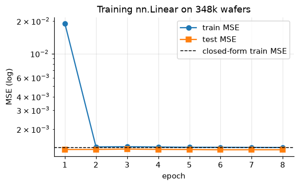

*그림 13. epoch별 학습 MSE(파란 원)와 테스트 MSE(주황 사각형). 세로축은 로그 척도이고, 검은 점선은 닫힌 해의 학습 MSE예요.*

- 파란 선은 epoch 1에서 0.019016으로 높았다가 epoch 2부터 0.001356–0.001379 사이에서 평평해져요. 주황 선은 epoch 1부터 0.001292–0.001312 사이예요.
- 학습 MSE는 epoch 2–8 내내 점선 바로 위에, 테스트 MSE는 점선 바로 아래에 있어요. `closed_tr = mse(D_lot[is_tr] @ fit_M2["beta"], y_tr)` 가 그 점선이에요 (`mse` 는 1-7에서 정의한 함수예요).

| | closed form (lstsq) | nn.Linear + SGD |
|---|---|---|
| (intercept) | 0.9073 | 0.9074 |
| `first_mean` | 0.0875 | 0.0874 |
| `first_std` | 0.0113 | 0.0108 |
| `first_edge` | −0.0036 | −0.0037 |
| `first_center` | −0.0044 | −0.0045 |
| `log_n_die` | 0.0013 | 0.0011 |
| `wafer_index` | −0.0004 | −0.0004 |

#### 해석

- **첫 epoch의 학습 MSE가 큰 이유**: epoch 평균은 계속 바뀌는 모델의 배치 손실을 평균한 값이에요. 무작위로 초기화한 모델의 예측은 수율(0.9 안팎)과 동떨어져 있어서 처음 몇 배치의 손실이 커요. epoch 1이 끝난 시점의 테스트 MSE가 이미 0.001298이라, 실질적인 수렴은 첫 epoch(341번 갱신) 안에 끝났어요.
- **닫힌 해와의 일치**: 계수 차이가 가장 큰 것도 `first_std` 의 0.0113 대 0.0108이고, 나머지는 반올림한 넷째 자리에서 0–2만큼 달라요. 최적점에서는 기울기가 0이라 손실이 계수 변화의 **제곱**으로만 늘어나요. 특히 작은 고윳값 방향(상관이 강한 특성들의 조합)으로는 손실이 거의 변하지 않아서, MSE가 거의 같아도 SGD가 멈춘 지점의 계수는 정확한 최소점과 조금 다를 수 있어요. 절편 0.9073은 3-4에서 유도한 대로 학습 평균 수율이에요.
- **테스트 MSE가 학습 MSE보다 작은 이유**: 과적합의 반대가 아니라 **어떤 로트가 테스트에 뽑혔는지**에 따른 우연이에요. 1-5의 $\mathbb E[\text{RSS}]=\sigma^2(n-p)$ 에서 학습 MSE의 기댓값은 $\sigma^2(1-p/n)$ 이고, 새 데이터의 MSE는 대략 $\sigma^2(1+p/n)$ 이에요. 학습 오차가 낙관적으로 나오는 정도가 상대적으로 $2p/n$ 정도라서, $p=7$, $n=348{,}200$ 이면 무시할 만큼 작아요. 반면 테스트 MSE는 사실상 4,352개 로트의 평균이고, 3-6에서 볼 대형 불량 웨이퍼 몇 장이 어느 쪽에 들어가느냐에 따라 눈에 띄게 달라져요. 노트북 설명대로 `lot_split` 의 `seed` 를 1–5로 바꾸면 테스트 $R^2$ 는 0.84–0.86 사이에서 바뀌고, 대부분 학습 $R^2$ 보다 작아요. 0.8650과 0.8578의 차이는 이 변동보다 작으니 "일반화가 특별히 잘 된다"는 증거가 아니에요. 불확실성을 재려면 시드를 바꿔 반복하거나, **로트 단위로** 부트스트랩하거나 그룹 교차검증을 해야 해요.

> 💡 **핵심**: 데이터 → 순전파 → 손실 → `zero_grad` → `backward` → `step` → (epoch 끝) 스케줄러. 이 루프는 모델이 `nn.Linear` 든 깊은 신경망이든 그대로예요.

> ⚠️ **주의**: 로그에 찍히는 epoch별 학습 MSE는 학습 도중 손실의 평균이라, epoch이 끝난 모델을 평가한 값이 아니에요. 정확히 비교하려면 테스트처럼 `eval()` + `no_grad()` 로 다시 계산해야 해요.

**생각해 볼 질문**

1. 모멘텀 0.9면 느린 방향에서 기울기가 10배까지 쌓이니 "실효 학습률"은 $0.05/(1-0.9)=0.5$ 예요. 이 값은 $2/\lambda_{\max}$ (반올림 상관행렬 기준 약 0.31)보다 큰데, 왜 발산하지 않을까요?

<details><summary>답</summary>

$\eta/(1-\mu)$ 는 기울기 부호가 계속 같은 느린 방향에서의 보폭이에요. 큰 고윳값 방향에서는 기울기 부호가 번갈아 바뀌어 $\mathbf v$ 가 쌓이지 않아요. 안정성은 2계 점화식의 근으로 판단해야 하고, 그 조건은 $\eta\lambda < 2(1+\mu)=3.8$ 이에요. $\lambda_{\max}\le10$ 이니 $\eta\lambda_{\max}\le0.5$ 로 넉넉히 안전해요. 표준화를 하지 않았다면 `wafer_index`(6–25)처럼 평균이 0에서 먼 원래 값 때문에 $\frac2nX^\top X$ 의 대각 원소(제곱 평균의 2배)부터 수백이 넘고, $\lambda_{\max}$ 가 훨씬 커져서 이런 보장을 할 수 없어요.

</details>

2. `y_tr.float().unsqueeze(1)` 에서 `unsqueeze(1)` 을 빼면 무슨 일이 생길까요?

<details><summary>답</summary>

모델 출력은 `(B, 1)`, 타깃은 `(B,)` 가 돼요. `nn.MSELoss` 는 브로드캐스팅으로 `(B, B)` 행렬을 만들어 모든 쌍 $(\hat y_a-y_b)^2$ 의 평균을 계산해요. 경고만 나오고 학습은 진행되는데, 이 손실의 최소점은 모든 타깃의 평균을 예측하는 모델이라 결과가 엉망이 돼요. 모양(shape)을 맞추는 건 PyTorch에서 가장 흔한 버그 중 하나예요.

</details>

### 3-6. 평가와 잔차 분석

> 💻 **노트북**: 3-6의 코드 셀 (테스트 평가 · 그림 14의 세 패널 · 불량 패턴별 잔차 표)

$R^2\approx0.86$ 이라는 숫자 하나로는 **어디서** 틀리는지 알 수 없어요. 잔차를 보면 1-1의 가정이 맞는지, 모형이 어떤 웨이퍼에서 실패하는지 드러나요.

#### 잔차로 무엇을 확인하나

테스트 잔차 $e_i=y_i-\hat y_i$ 를 세 가지 관점에서 봐요.

**가정 4 (등분산).** $\operatorname{Var}(\varepsilon\mid\mathbf x)$ 가 일정하면 잔차–예측값 그림이 0을 중심으로 폭이 일정한 띠가 돼요.

**가정 5 (정규성).** 정규분포의 로그 밀도는 포물선이에요.

$$
\log\varphi_\sigma(e)=-\frac{e^2}{2\sigma^2}-\log\big(\sigma\sqrt{2\pi}\big)
$$

세로축을 로그로 그리면 정규분포의 꼬리는 포물선을 따라 빠르게 떨어지고, 두꺼운 꼬리는 포물선보다 훨씬 위에 남은 막대로 보여요.

**유계 타깃.** $y\in[0,1]$ 이므로 $e=y-\hat y\in[-\hat y,\ 1-\hat y]$ 예요. 예측값이 0.95면 양의 잔차는 최대 0.05인데 음의 잔차는 −0.95까지 가능해요. 수율이 높은 구간에서는 큰 잔차가 음수 쪽에서만 나올 수 있어서 분포가 왼쪽으로 치우치기 쉬워요. 실제 수율이 0인 웨이퍼들은 잔차–예측값 그림에서 기울기 −1인 경계선 $e=-\hat y$ 위에 놓여요.

비율 타깃은 원래 이분산이기 쉬워요. 다이 $N$ 개가 각각 확률 $p$ 로 독립적으로 불량이라면 (2-6과 같은 이항 모형) $\operatorname{Var}(y)=p(1-p)/N$ 이라서 분산이 평균에 따라 달라져요. 실제로는 웨이퍼 단위의 충격까지 더해져요. 가정 1–3이 성립하면 이분산이어도 OLS는 여전히 불편추정량이지만, 분산이 가장 작은 추정량(BLUE)은 아니고 $\sigma^2(X^\top X)^{-1}$ 로 계산한 표준오차도 틀려요. 대안으로 분산에 반비례하는 가중치를 주는 **가중최소제곱(WLS)** 이 있어요.

$$
\hat{\boldsymbol\beta}_W=\arg\min_{\boldsymbol\beta}\sum_i w_i\,(y_i-\mathbf x_i^\top\boldsymbol\beta)^2=(X^\top WX)^{-1}X^\top W\mathbf y,\qquad W=\operatorname{diag}(w_i),\ \ w_i\propto\frac1{\operatorname{Var}(\varepsilon_i)}
$$

가중치가 정확하면 WLS가 BLUE예요 (Aitken 정리). 다른 방법은 타깃 변환이에요 (과제 1의 $\operatorname{logit}$).

#### 코드 읽기

<details><summary>📝 셀 전체 코드 (줄별 주석)</summary>

```python
# ── 1. 테스트 예측과 잔차 ──────────────────────────────────────
with torch.no_grad():                               # 예측만 하니 그래프를 만들지 않아요
    # 3-5 의 nn.Linear 출력 (n_te, 1) float32 → squeeze(1) 로 (n_te,) → float64 · CPU 로 바꿔 F64 타깃과 계산해요.
    pred_te = model(Z_te_dev).squeeze(1).double().cpu()
res_te = y_te - pred_te                             # 테스트 잔차 e_i = y_i − ŷ_i, (87,040,) float64
print({k: round(v, 4) for k, v in evaluate(y_te, pred_te).items()})    # 닫힌 해(0.8650)와 거의 같은 R²
# 선형모형은 [0, 1] 을 벗어난 예측을 낼 수 있어요. 범위와 이탈 개수를 확인해요.
print(f"예측값 범위 [{pred_te.min().item():.3f}, {pred_te.max().item():.3f}],  "
      f"0 미만 {(pred_te < 0).sum().item()}개 · 1 초과 {(pred_te > 1).sum().item()}개 (테스트 {len(pred_te):,}개 중)")

# ── 2. 그림 14 (왼쪽): 예측 vs 실제 ──────────────────────────────
fig, axes = plt.subplots(1, 3, figsize=(15, 4))
# 점이 8.7만 개라 산점도 대신 hexbin(육각형 칸 2D 히스토그램). gridsize=70: 가로 칸 수,
# bins="log": 색을 개수의 로그로, mincnt=1: 빈 칸은 그리지 않아요.
hb = axes[0].hexbin(y_te.numpy(), pred_te.numpy(), gridsize=70, bins="log", cmap="viridis", mincnt=1)
axes[0].plot([0, 1], [0, 1], "r--", lw=1)           # 완벽한 예측선 y = x
axes[0].set(xlabel="actual yield", ylabel="predicted yield", title="Predicted vs actual (test lots)")
fig.colorbar(hb, ax=axes[0], label="# wafers (log scale)")   # hexbin 색 범례 (칸당 웨이퍼 수)

# ── 3. 그림 14 (가운데): 잔차 vs 예측값 — 가정 4 (등분산) 확인 ──────
# 폭이 일정한 띠면 등분산. y ∈ [0,1] 이라 e ∈ [−ŷ, 1−ŷ] 로 묶여서 깔때기 · 경계선이 생겨요.
hb = axes[1].hexbin(pred_te.numpy(), res_te.numpy(), gridsize=70, bins="log", cmap="viridis", mincnt=1)
axes[1].axhline(0, color="r", ls="--", lw=1)        # 잔차 0 기준선
axes[1].set(xlabel="predicted yield", ylabel="residual", title="Residual vs fitted")

# ── 4. 그림 14 (오른쪽): 잔차 분포 — 가정 5 (정규성) 확인 ───────────
# density=True: 넓이가 1 이 되도록 정규화해서 밀도 곡선과 같은 축에 그려요.
axes[2].hist(res_te.numpy(), bins=150, density=True, alpha=0.7, label="residuals")
sd_r = res_te.std().item()                          # 잔차의 표본표준편차
gg = torch.linspace(res_te.min().item(), res_te.max().item(), 400, dtype=F64)   # 밀도를 그릴 격자 400개
# 같은 표준편차의 정규밀도 φ(e) = exp(log_prob(e)). 로그 축에서 포물선이라 두꺼운 꼬리가 바로 드러나요.
axes[2].plot(gg.numpy(), torch.exp(torch.distributions.Normal(0.0, sd_r).log_prob(gg)).numpy(), "r-", lw=1, label="normal (same sd)")
# 세로축 로그 + ylim 10⁻³–10²: 꼬리의 아주 작은 밀도까지 보이게 해요.
axes[2].set(xlabel="residual", ylabel="density", yscale="log", ylim=(1e-3, 1e2), title="Residual distribution (log)")
axes[2].legend(fontsize=8)
plt.tight_layout()                                  # 패널 간격 자동 조정
plt.show()

# ── 5. 불량 패턴별 절대 잔차 (진단용, 라벨은 특성이 아니에요) ──────
# 불량 패턴별 잔차 크기 (테스트 로트)
# lotdata 의 테스트 행 라벨을 numpy 배열로 꺼내 res_te 와 같은 순서로 짝지어요 (둘 다 is_te 행 순서).
# groupby("label") → 개수 · 평균 · 중앙값. reindex 로 CLASSES(none + 불량 패턴 8종) + unlabeled 순서로 행을 정렬해요.
res_by_label = (pd.DataFrame({"label": lotdata.loc[is_te.numpy(), "label"].to_numpy(), "|residual|": res_te.abs().numpy()})
                .groupby("label")["|residual|"].agg(["size", "mean", "median"]).reindex(CLASSES + ["unlabeled"]))
res_by_label.round(4)                               # Near-full · Random · Donut 처럼 한 장에만 생긴 대형 불량의 오차가 커요
```

</details>

```python
with torch.no_grad():
    pred_te = model(Z_te_dev).squeeze(1).double().cpu()
res_te = y_te - pred_te
```

3-5에서 학습한 `nn.Linear` 모델의 예측이에요. `float32` 출력을 `float64` 로 바꿔서 `float64` 타깃과 계산해요.

```python
hb = axes[0].hexbin(y_te.numpy(), pred_te.numpy(), gridsize=70, bins="log", cmap="viridis", mincnt=1)
```

점이 87,040개라 산점도는 점이 겹쳐서 밀도를 읽을 수 없어요. `hexbin` 은 평면을 육각형 칸으로 나눈 2차원 히스토그램이에요. `bins="log"` 는 색을 개수의 로그로 칠하고, `mincnt=1` 은 빈 칸을 그리지 않아요.

```python
sd_r = res_te.std().item()
gg = torch.linspace(res_te.min().item(), res_te.max().item(), 400, dtype=F64)
axes[2].plot(gg.numpy(), torch.exp(torch.distributions.Normal(0.0, sd_r).log_prob(gg)).numpy(), "r-", lw=1, label="normal (same sd)")
```

잔차와 **같은 표준편차**를 가진 정규분포 밀도를 겹쳐 그려요. `log_prob` 의 지수를 취하면 밀도예요.

```python
res_by_label = (pd.DataFrame({"label": lotdata.loc[is_te.numpy(), "label"].to_numpy(), "|residual|": res_te.abs().numpy()})
                .groupby("label")["|residual|"].agg(["size", "mean", "median"]).reindex(CLASSES + ["unlabeled"]))
```

타깃 웨이퍼의 불량 패턴 라벨별로 절대 잔차의 개수 · 평균 · 중앙값을 구해요. 라벨은 특성으로 쓰지 않고 진단에만 써요.

#### 결과

```text
{'R²': 0.8649, 'RMSE': 0.036, 'MAE': 0.016}
예측값 범위 [-0.001, 1.000],  0 미만 10개 · 1 초과 0개 (테스트 87,040개 중)
```

SGD 모델의 테스트 $R^2$ 0.8649는 닫힌 해의 0.8650과 거의 같아요.

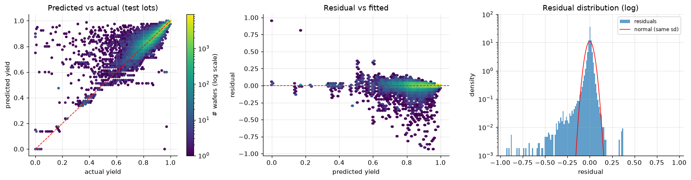

*그림 14. 왼쪽: 실제 수율(가로) 대 예측 수율(세로)의 hexbin, 빨간 점선은 $y=x$. 가운데: 예측값 대 잔차. 오른쪽: 잔차 히스토그램(로그 세로축)과 같은 표준편차의 정규분포(빨간 선).*

- **왼쪽**: 노란 칸(웨이퍼 수천 장)이 오른쪽 위 0.9–1.0 근처 대각선에 몰려 있어요. 대각선 위쪽 멀리, 실제 수율이 0 근처인데 0.6–1.0으로 예측된 점들이 흩어져 있어요. 예측값이 같은 **수평 줄무늬**도 여러 개 보여요.
- **가운데**: 웨이퍼가 몰린 초록 · 노란 띠는 예측값 1 근처에서 가장 좁고, 예측값이 0.6 쪽으로 낮아질수록 세로 폭이 넓어지는 깔때기 모양이에요. 예측값이 1에 가까울수록 양의 잔차가 들어갈 공간이 줄어들어요. 반면 −0.9 아래까지 내려가는 가장 큰 음의 잔차들은 예측값 0.85–0.95 근처에 있어요. 수율이 높을 것으로 예측된 웨이퍼가 한 장만 크게 망가진 경우예요.
- 반대 방향의 극단값도 두 개 있어요. 예측값이 0 근처와 0.17 근처인데 실제 수율은 0.95 근처라서, 잔차가 +0.95, +0.8 정도예요 (왼쪽 그림의 오른쪽 아래 두 점). 앞 웨이퍼가 크게 나빴는데 뒤 웨이퍼는 정상인 로트로 보여요. 이 두 점은 밀도가 너무 낮아서 오른쪽 히스토그램의 세로축 범위($10^{-3}$ 이상)에는 나타나지 않아요.
- **오른쪽**: 히스토그램의 봉우리가 빨간 곡선보다 훨씬 높고 좁아요. 빨간 포물선은 ±0.15 근처에서 이미 $10^{-3}$ 아래로 떨어지는데, 막대는 왼쪽으로 −1 근처까지, 오른쪽으로도 0.3–0.4 근처까지 남아 있어요.

```text
            size    mean  median
label                           
none       23390  0.0173  0.0127
Center       339  0.0504  0.0264
Donut         60  0.1267  0.1169
Edge-Loc     640  0.0663  0.0349
Edge-Ring   1294  0.0167  0.0112
Loc          491  0.0558  0.0367
Near-full     18  0.7042  0.6876
Random       102  0.2165  0.2126
Scratch      154  0.0303  0.0199
unlabeled  60552  0.0138  0.0058
```

#### 해석

- **이분산**: 가운데 그림의 깔때기는 가정 4(등분산) 위반이에요. 낮은 수율 구간에서 퍼짐이 커요.
- **두꺼운 꼬리와 뾰족한 봉우리**: 대부분의 잔차는 표준편차가 시사하는 것보다 작고(높은 봉우리), 소수의 아주 큰 잔차가 표준편차를 부풀려요(두꺼운 꼬리). 3-4에서 MAE가 RMSE의 절반에도 못 미친 것과 같은 현상이에요. 가정 5(정규성)도 성립하지 않아요.
- **큰 오차의 정체**: 패턴별 표에서 `Near-full`(18장, 평균 절대 잔차 0.7042), `Random`(0.2165), `Donut`(0.1267)처럼 **웨이퍼 한 장에 갑자기 대량 불량이 생긴 경우**의 오차가 커요. 같은 로트의 앞 웨이퍼에는 이런 사건의 흔적이 없으니 예측하기 어려워요. 반면 `none` 은 0.0173, 라벨 없는 웨이퍼는 0.0138(중앙값 0.0058)로 작아요.
- `Edge-Ring` 의 오차(0.0167)는 `none` 수준이에요. 가장자리 링 불량이 로트 전체에 걸쳐 반복된다면 앞 웨이퍼에서 이미 드러나서(`first_edge`) 예측이 쉬울 거라는 가설을 세울 수 있어요. 같은 로트 앞 $K$ 장의 라벨을 세어 보면 확인할 수 있어요.
- **수평 줄무늬 = 로트**: 한 로트의 20장은 로트 특성이 같아서 예측값이 거의 같아요 (`wafer_index` 효과만큼만 달라요). 그래서 한 로트가 왼쪽 그림의 가로선, 가운데 그림의 세로선으로 나타나요. 줄 위의 흩어짐은 모형이 원리적으로 볼 수 없는 **로트 안 변동**이에요 (3-8의 천장).
- **범위 이탈**: 예측값이 [−0.001, 1.000]으로, 10개가 0 아래예요. 선형모형은 원리적으로 $[0,1]$ 을 벗어날 수 있어요. 이번에는 살짝 넘는 정도지만, PART 4의 불량 확률 곡면에서는 확실히 벗어나요.

> ⚠️ **주의**: 라벨은 그 웨이퍼를 검사한 **뒤에야** 알 수 있어요. 패턴별 표는 오차를 진단하는 도구이지, 예측에 쓸 수 있는 특성이 아니에요.

**생각해 볼 질문**

1. 예측을 $[0,1]$ 안으로 보장하려면 어떻게 할까요? (노트북의 💬 질문)

<details><summary>답</summary>

① 타깃을 $\operatorname{logit}(y)=\log\frac{y}{1-y}$ 로 바꿔 회귀하고, 예측을 시그모이드 $\sigma(t)=1/(1+e^{-t})$ 로 되돌려요. 수율이 정확히 0이나 1이면 logit이 무한대라서 예를 들어 $\tilde y=(n_{\text{good}}+0.5)/(N+1)$ 처럼 보정해야 해요. 과제 1이 바로 이 실험이에요. ② 모델 출력에 시그모이드를 씌우고 손실을 바꿔요. 예를 들어 다이 단위 베르누이 우도(이항 교차엔트로피)를 쓰면 다음 시간의 로지스틱 회귀가 돼요.

</details>

2. 이분산이면 3-4에서 구한 계수 $\hat{\boldsymbol\beta}$ 자체가 틀린 건가요?

<details><summary>답</summary>

아니요. 불편성은 가정 1–3만으로 성립해서($\mathbb E[\hat{\boldsymbol\beta}]=\boldsymbol\beta+(X^\top X)^{-1}X^\top\mathbb E[\boldsymbol\varepsilon]$) 이분산과 무관해요. 깨지는 건 효율성(BLUE)과, $\sigma^2(X^\top X)^{-1}$ 에 기반한 표준오차 · $t$ 값 · 신뢰구간이에요. 그래서 3-7에서 표준오차를 다시 봐요.

</details>

### 3-7. 계수 해석과 통계적 추론

> 💻 **노트북**: 3-7의 첫 코드 셀 (표준화 계수 · iid 표준오차 · $t$). 뒤의 **(심화)** 군집-강건 표준오차 마크다운 · 코드 셀은 90분 · 60분 진행 모두 건너뛰어요.

예측을 넘어서 "어떤 특성이 얼마나 중요한가, 그 추정을 얼마나 믿을 수 있나"를 물어요. 계수의 단위, 특성 사이의 상관, 오차 가정 세 가지를 모두 신경 써야 해요.

#### 표준화 계수 · 편회귀 · 분산팽창

표준화한 특성 $z_j=(x_j-\mu_j)/s_j$ 의 계수 $\beta_j=\partial\hat y/\partial z_j$ 는 **"다른 특성을 고정한 채 $x_j$ 만 1 표준편차 바뀔 때 예측 수율의 변화"** 예요 (편회귀계수). 원래 단위의 기울기는 $\beta_j/s_j$ 이고, 노트북 표의 %p 효과는 $100\,\beta_j$ 예요. 인과 효과가 아니라 예측 관계라는 점을 기억하세요.

"다른 특성을 고정한다"의 정확한 뜻은 Frisch–Waugh–Lovell 정리가 알려 줘요. $z_j$ 를 나머지 열(절편 포함)에 회귀한 잔차를 $\mathbf r_j$, 그 회귀의 결정계수를 $R_j^2$ 라 하면

$$
\hat\beta_j=\frac{\mathbf r_j^\top\mathbf y}{\mathbf r_j^\top\mathbf r_j},\qquad
\operatorname{Var}(\hat\beta_j)=\frac{\sigma^2}{\mathbf r_j^\top\mathbf r_j}=\frac{\sigma^2}{(n-1)(1-R_j^2)}
$$

예요 ($\mathbf r_j^\top\mathbf r_j=(1-R_j^2)\,\mathbf z_j^\top\mathbf z_j$ 이고 표준화했으니 $\mathbf z_j^\top\mathbf z_j=n-1$). 즉 계수는 **다른 특성으로 설명되지 않는 $z_j$ 의 부분만으로** 추정되고, 그 부분이 작을수록 분산이 $\text{VIF}_j=1/(1-R_j^2)$ (분산팽창인자) 배 커져요.

3-5의 블록 구조를 쓰면 같은 결과를 행렬로 볼 수 있어요.

$$
(D^\top D)^{-1}=\begin{bmatrix}\frac1n & \mathbf 0^\top\\ \mathbf 0 & \frac{1}{n-1}R^{-1}\end{bmatrix},\qquad
\operatorname{se}(\hat\beta_0)=\frac{s}{\sqrt n},\qquad
\operatorname{se}(\hat\beta_j)=s\sqrt{\frac{[R^{-1}]_{jj}}{n-1}},\qquad [R^{-1}]_{jj}=\text{VIF}_j
$$

마지막 등식은 분할행렬의 역행렬(슈어 보수) 공식에서 나와요. 검정통계량은 1-5와 같이 $t_j=\hat\beta_j/\operatorname{se}(\hat\beta_j)$ 이고, 자유도가 $n-p=348{,}193$ 이라 사실상 표준정규분포예요.

#### 코드 읽기

<details><summary>📝 셀 전체 코드 (줄별 주석)</summary>

```python
# ── 1. M2 닫힌 해의 계수 · iid 표준오차 · t 값 표 ──────────────────
# fit_M2 는 3-4 의 ols 결과(float64)예요. se = s·√[(XᵀX)⁻¹]_jj,  s² = RSS/(n−p),  t = β̂ / se.
# 자유도 n−p = 348,193 이라 t 는 사실상 표준정규분포로 읽어요.
t_M2 = fit_M2["t"]
coef = pd.DataFrame({"coef (standardized)": fit_M2["beta"].numpy(), "se (iid)": fit_M2["se"].numpy(),
                     "t (iid)": t_M2.numpy()}, index=["(intercept)"] + FEATURES)   # 행 순서 = D_lot 열 순서

# ── 2. 표준화 계수 → 수율 %p 효과 ────────────────────────────────
# 표준화 계수 β_j = 다른 특성을 고정하고 x_j 만 1 표준편차 늘 때 예측 수율의 변화 → ×100 하면 %p 예요.
coef["effect of +1 sd on yield (%p)"] = 100 * coef["coef (standardized)"]
# 절편(= 학습 평균 수율 0.9073)은 '1 sd 효과'가 의미가 없어서 NaN 으로 둬요.
coef.loc["(intercept)", "effect of +1 sd on yield (%p)"] = float("nan")
coef                                                 # 절편과 wafer_index 의 se 가 같은 건 직교성(VIF = 1) 때문이에요
```

</details>

```python
t_M2 = fit_M2["t"]
coef = pd.DataFrame({"coef (standardized)": fit_M2["beta"].numpy(), "se (iid)": fit_M2["se"].numpy(),
                     "t (iid)": t_M2.numpy()}, index=["(intercept)"] + FEATURES)
coef["effect of +1 sd on yield (%p)"] = 100 * coef["coef (standardized)"]
```

3-4의 닫힌 해 `fit_M2`(`float64`)를 그대로 써요. `se` 는 1-5의 `ols` 가 계산한 $s\sqrt{[(X^\top X)^{-1}]_{jj}}$ 이고, 절편의 %p 효과는 의미가 없어서 NaN으로 둬요.

#### 결과

```text
              coef (standardized)    se (iid)     t (iid)  effect of +1 sd on yield (%p)
(intercept)                0.9073  6.2388e-05  14542.4540                            NaN
first_mean                 0.0875  2.3809e-04    367.4818                         8.7494
first_std                  0.0113  7.0916e-05    159.7243                         1.1327
first_edge                -0.0036  1.3607e-04    -26.2077                        -0.3566
first_center              -0.0044  1.7907e-04    -24.4618                        -0.4380
log_n_die                  0.0013  6.9374e-05     18.7156                         0.1298
wafer_index               -0.0004  6.2388e-05     -5.7668                        -0.0360
```

(노트북 출력은 열이 두 줄로 나뉘어 있는데, 여기서는 한 표로 합쳤어요.)

- 절편과 `wafer_index` 의 표준오차가 **똑같이** 6.2388e-05예요. `wafer_index` 는 다른 모든 열과 직교하니(3-3) $\text{VIF}=1$ 이고, $s/\sqrt{n-1}$ 과 $s/\sqrt n$ 은 $n$ 이 이렇게 크면 구별되지 않아요.
- 그러면 `wafer_index` 의 표준오차를 $\operatorname{se}_w$ 라 할 때 $(\operatorname{se}_j/\operatorname{se}_w)^2$ 이 곧 $\text{VIF}_j$ 예요. 계산하면 `first_mean` 약 14.6, `first_center` 약 8.2, `first_edge` 약 4.8, `first_std` 약 1.3, `log_n_die` 약 1.2예요. 3-3의 반올림된 상관행렬의 역행렬 대각선(약 14.3, 8.2, 4.7, 1.3, 1.2)과 거의 같아요.
- 절편의 $t$ 값 14542.4540은 "평균 수율 = 0"이라는 의미 없는 가설을 검정한 거라 해석하지 않아요.

#### 해석

- **`first_mean` 이 압도적이에요.** 다른 특성이 같을 때 앞 5장 평균 수율이 1 표준편차(노트북 설명으로 약 9%p) 높으면 나머지 웨이퍼의 예측 수율이 8.7494%p 높아요. 거의 1:1이에요.
- **다중공선성**: `first_mean` 의 $\text{VIF}\approx14.6$ 은 $R_j^2\approx0.93$, 즉 `first_mean` 변동의 약 7%만 다른 특성과 겹치지 않는다는 뜻이에요. 상관이 −0.93(`first_center`), −0.87(`first_edge`)이나 되니 "다른 특성을 고정한 채 하나만 바꾼다"는 상황은 현실에서 거의 일어나지 않아요. `first_edge`, `first_center` 의 음의 계수는 "평균 수율이 같다면 불량이 중심이나 가장자리에 몰린 로트의 나머지 웨이퍼가 조금 더 나쁘다"로 읽을 수 있지만, 이런 해석은 조심해야 해요.
- **`first_std` 의 계수가 양수예요.** `first_mean` 이 같다면 표준편차가 클수록 "앞 5장 중 한두 장만 크게 나빠서 평균이 끌려 내려간" 경우일 가능성이 커요. 그러면 나머지 웨이퍼는 평균보다 좋을 수 있어요.
- **통계적 유의성 ≠ 실질적 중요성**: `wafer_index` 는 $\lvert t\rvert\approx5.8$ 로 "유의"하지만, 효과는 1 표준편차당 −0.0360%p예요. 6–25의 정수 20개가 고르게 있으니 표준편차는 $\sqrt{(20^2-1)/12}\approx5.77$ 장(노트북의 "약 6장")이에요. 표준오차는 $1/\sqrt n$ 으로 줄어드니, 관측이 35만 개면 아주 작은 효과도 유의해져요.

> ⚠️ **주의**: 위 표준오차는 오차가 등분산이고 서로 상관이 없다(가정 4)는 전제로 계산했어요. 같은 로트의 20개 관측은 이 전제를 깨뜨려요. 바로 아래 (심화)에서 다뤄요.

#### (심화) 군집-강건 표준오차

같은 로트의 20개 관측은 특성이 같고, 특성으로 설명되지 않는 로트 공통 편차($u_g$, 3-3)를 공유해서 오차가 서로 상관돼요. 이때 $s^2(X^\top X)^{-1}$ 은 분산을 과소평가해요. 로트를 군집 $g$ 로 보고 군집 안 상관을 허용하는 **샌드위치 추정량**을 유도해 볼게요.

**유도.** 관측을 로트별로 묶어 $X_g\in\mathbb R^{m_g\times p}$, $\boldsymbol\varepsilon_g\in\mathbb R^{m_g}$ 라 쓰고 다음을 가정해요.

1. $\operatorname{rank}(X)=p$, $\mathbb E[\boldsymbol\varepsilon_g\mid X]=\mathbf 0$
2. 로트끼리는 독립: $g\ne h$ 이면 $\operatorname{Cov}(\boldsymbol\varepsilon_g,\boldsymbol\varepsilon_h\mid X)=0$
3. 로트 안의 공분산 $\operatorname{Cov}(\boldsymbol\varepsilon_g\mid X)=\Omega_g$ 는 아무 형태여도 됨

$\hat{\boldsymbol\beta}-\boldsymbol\beta=(X^\top X)^{-1}X^\top\boldsymbol\varepsilon=(X^\top X)^{-1}\sum_g X_g^\top\boldsymbol\varepsilon_g$ 이므로

$$
\begin{aligned}
\operatorname{Cov}(\hat{\boldsymbol\beta}\mid X)
&=(X^\top X)^{-1}\Big(\sum_g\sum_h X_g^\top\operatorname{Cov}(\boldsymbol\varepsilon_g,\boldsymbol\varepsilon_h\mid X)X_h\Big)(X^\top X)^{-1}\\
&=(X^\top X)^{-1}\Big(\sum_g X_g^\top\Omega_g X_g\Big)(X^\top X)^{-1}
\end{aligned}
$$

예요. 바깥의 $(X^\top X)^{-1}$ 이 빵(bread), 가운데가 고기(meat)라서 샌드위치라고 불러요. $\Omega_g=\sigma^2I$ 이면 1-5의 $\sigma^2(X^\top X)^{-1}$ 로 돌아가요. $\Omega_g$ 는 모르니 로트 잔차 $\mathbf e_g$ 로 만든 $\mathbf e_g\mathbf e_g^\top$ 를 대입해요. 계수(rank)가 1인 행렬 하나는 $\Omega_g$ 의 좋은 추정이 아니지만, 로트끼리 독립이니 평균 $\frac1G\sum_gX_g^\top\mathbf e_g\mathbf e_g^\top X_g$ 와 $\frac1G\sum_gX_g^\top\Omega_gX_g$ 의 차이는 로트 수 $G\to\infty$ 일 때 0으로 수렴해요 (로트 크기가 유계이고 $\hat{\boldsymbol\beta}$ 가 일치추정량이라는 정칙 조건에서, 큰수의 법칙). 그래서 이 방법은 관측 수가 아니라 **군집 수가 많아야** 믿을 수 있어요 (여기서는 학습 로트 17,410개).

$$
\widehat{\operatorname{Cov}}_{CR}(\hat{\boldsymbol\beta})=(X^\top X)^{-1}\Big(\sum_g X_g^\top\mathbf e_g\mathbf e_g^\top X_g\Big)(X^\top X)^{-1}\cdot\frac{G}{G-1}\frac{n-1}{n-p}
$$

**CR1 보정.** 잔차는 오차보다 평균적으로 작아요 ($\mathbb E[\mathbf e\mathbf e^\top]=(I-H)\Omega(I-H)$, 1-5에서 RSS를 $n-p$ 로 나눈 것과 같은 이유). 마지막 인자 $\frac{G}{G-1}\frac{n-1}{n-p}$ 는 이를 보정하는 자유도 조정이에요 (CR1, Stata의 기본값). 로트마다 관측이 하나면($G=n$) 이 인자는 $\frac{n}{n-p}$ 가 되어 이분산-강건 표준오차의 HC1 보정과 같아져요. 여기서는 $G=17{,}410$, $n=348{,}200$, $p=7$ 이라 인자가 1에 아주 가까워요.

**얼마나 커지나: Moulton 계산.** 가장 단순한 경우로 로트 안 오차가 등분산 · 등상관이라고 해 볼게요. $m=20$, $\Omega_g=\sigma^2\big[(1-\rho)I_m+\rho\mathbf 1\mathbf 1^\top\big]$ 이에요. 로트 안에서 값이 일정한 특성(로트 수준 특성)은 $X_g$ 의 해당 부분이 $\mathbf 1\mathbf x_g^\top$ 꼴이라

$$
X_g^\top\Omega_gX_g=\mathbf x_g\,\mathbf 1^\top\Omega_g\mathbf 1\,\mathbf x_g^\top=\sigma^2m\big(1+(m-1)\rho\big)\,\mathbf x_g\mathbf x_g^\top
$$

이에요. 한편 같은 열들의 $X^\top X$ 블록은 $\sum_g m\,\mathbf x_g\mathbf x_g^\top$ 이니, 고기가 빵의 역행렬에 정확히 $\sigma^2\big(1+(m-1)\rho\big)$ 를 곱한 꼴이 돼요. 이 데이터처럼 나머지 열이 로트 안 합이 0인 열(`wafer_index`)뿐이면 교차항 $\mathbf x_g\mathbf 1^\top\Omega_g\mathbf w$ 가 0이라 블록이 섞이지 않고, 샌드위치가 정리되어 로트 수준 계수의 분산은 iid 공식 $\sigma^2(X^\top X)^{-1}$ 의 $1+(m-1)\rho$ 배가 돼요. 표준오차 비율은 $\sqrt{1+(m-1)\rho}$ 이고, $\rho\le1$ 이니 최대 $\sqrt{20}\approx4.47$ 배예요. 반대로 로트 안에서 합이 0인 특성 $\mathbf w$ ($\mathbf 1^\top\mathbf w=0$)는 $\mathbf w^\top\Omega_g\mathbf w=\sigma^2(1-\rho)\lVert\mathbf w\rVert^2$ 이라서 공통 성분이 **정확히 상쇄**되고, 비율은 $\sqrt{1-\rho}$ ≤ 1이에요. 표준화한 `wafer_index` 는 모든 로트에서 합이 0이라 바로 이 경우예요.

**코드 읽기.**

<details><summary>📝 셀 전체 코드 (줄별 주석)</summary>

```python
# ── 1. 학습 설계행렬 · 잔차 · 로트 번호 ──────────────────────────
# Dtr (n_tr, 7) = X,  etr (n_tr,) = e = y − Xβ̂  (M2 닫힌 해의 학습 잔차), 모두 float64
Dtr, etr = D_lot[is_tr], y_tr - D_lot[is_tr] @ fit_M2["beta"]
# pd.factorize: 학습 행의 로트 이름을 처음 나온 순서대로 0, 1, …, G−1 정수 번호로 바꿔요. [0] 이 번호 배열이에요.
gid = torch.from_numpy(pd.factorize(lotdata.loc[is_tr.numpy(), "lot"])[0])
# 군집 수 G = 17,410,  n = 348,200,  p = 7
Gtr, (ntr, ptr) = int(gid.max()) + 1, Dtr.shape

# ── 2. 샌드위치의 '고기': Σ_g X_gᵀ e_g e_gᵀ X_g ────────────────────
# Dtr * etr[:, None]: (n, 7) * (n, 1) 브로드캐스팅 → 행 i 가 x_i e_i.
# index_add_(0, gid, ·): 같은 로트 번호의 행끼리 더하는 scatter-add (2-8 의 로트 평균과 같은 연산)
# → U 의 행 g = X_gᵀ e_g = Σ_{i∈g} x_i e_i, 모양 (G, 7).
U = torch.zeros(Gtr, ptr, dtype=F64).index_add_(0, gid, Dtr * etr[:, None])     # 로트별 X_gᵀ e_g
# ── 3. 샌드위치의 '빵': (XᵀX)⁻¹ ─────────────────────────────────
bread = torch.linalg.inv(Dtr.T @ Dtr)                # p = 7 이라 7×7 역행렬을 직접 구해도 괜찮아요 (1-3)
# ── 4. 군집-강건 공분산 (CR1) ──────────────────────────────────
# Uᵀ U = Σ_g (X_gᵀe_g)(X_gᵀe_g)ᵀ 가 고기예요. 로트별 m×m 행렬 없이 (G, 7) 행렬 하나로 계산해요.
# V_CR = (XᵀX)⁻¹ [Σ_g X_gᵀ e_g e_gᵀ X_g] (XᵀX)⁻¹ · G/(G−1) · (n−1)/(n−p)   ← 마지막 두 인자가 CR1 자유도 보정
V_cr = bread @ (U.T @ U) @ bread * (Gtr / (Gtr - 1)) * ((ntr - 1) / (ntr - ptr))
se_cr = torch.sqrt(torch.diag(V_cr))                 # 대각 원소의 제곱근 = 계수별 군집-강건 표준오차 (7,)

# ── 5. iid 와 비교 ─────────────────────────────────────────────
# ratio = se_CR / se_iid. 로트 수준 특성은 5–15배 커지고, 로트 안에서 합이 0 인 wafer_index 는 거의 그대로예요.
# 절편의 ratio² ≈ 1 + (m−1)ρ̂ 에서 잔차의 로트 내 상관 ρ̂ 를 읽을 수 있어요 (3-7).
pd.DataFrame({"se (iid)": fit_M2["se"].numpy(), "se (cluster-robust)": se_cr.numpy(),
              "ratio": (se_cr / fit_M2["se"]).numpy(),
              "t (iid)": fit_M2["t"].numpy(), "t (cluster)": (fit_M2["beta"] / se_cr).numpy()},
             index=["(intercept)"] + FEATURES)
```

</details>

```python
Dtr, etr = D_lot[is_tr], y_tr - D_lot[is_tr] @ fit_M2["beta"]
gid = torch.from_numpy(pd.factorize(lotdata.loc[is_tr.numpy(), "lot"])[0])
Gtr, (ntr, ptr) = int(gid.max()) + 1, Dtr.shape
U = torch.zeros(Gtr, ptr, dtype=F64).index_add_(0, gid, Dtr * etr[:, None])     # 로트별 X_gᵀ e_g
bread = torch.linalg.inv(Dtr.T @ Dtr)
V_cr = bread @ (U.T @ U) @ bread * (Gtr / (Gtr - 1)) * ((ntr - 1) / (ntr - ptr))
```

- `pd.factorize` 는 로트 이름을 0, 1, …, G−1 정수 번호로 바꿔요.
- `Dtr * etr[:, None]` 의 행 $i$ 는 $\mathbf x_i e_i$ 예요. `index_add_(0, gid, ...)` 는 같은 로트 번호의 행을 더하는 scatter-add(2-8에서 로트 평균을 낼 때 쓴 것과 같은 연산)라서, `U` 의 행 $g$ 가 $X_g^\top\mathbf e_g=\sum_{i\in g}\mathbf x_ie_i$ 가 돼요.
- `U.T @ U` $=\sum_g(X_g^\top\mathbf e_g)(X_g^\top\mathbf e_g)^\top=\sum_gX_g^\top\mathbf e_g\mathbf e_g^\top X_g$ 가 고기예요. 로트별 $m\times m$ 행렬을 만들지 않고 $G\times p$ 행렬 하나로 계산하는 게 요령이에요.
- $p=7$ 이라 표준오차를 위해 $(X^\top X)^{-1}$ 을 직접 계산해도 괜찮아요 (1-3).

**결과.**

```text
                se (iid)  se (cluster-robust)    ratio     t (iid)  t (cluster)
(intercept)   6.2388e-05           1.4975e-04   2.4004  14542.4540    6058.4061
first_mean    2.3809e-04           1.5257e-03   6.4082    367.4818      57.3454
first_std     7.0916e-05           1.0312e-03  14.5414    159.7243      10.9841
first_edge    1.3607e-04           7.7612e-04   5.7040    -26.2077      -4.5946
first_center  1.7907e-04           1.0199e-03   5.6953    -24.4618      -4.2951
log_n_die     6.9374e-05           3.4408e-04   4.9597     18.7156       3.7735
wafer_index   6.2388e-05           7.0421e-05   1.1288     -5.7668      -5.1090
```

**해석.**

- 로트 수준 특성의 표준오차가 4.9597–14.5414배 커졌어요. 관측이 35만 개여도 이 특성들에 대해 **실질적으로 독립인 정보는 로트 수(약 1.7만 개)에 가깝기** 때문이에요.
- **절편의 비율로 잔차의 로트 내 상관을 읽을 수 있어요.** 절편 열은 다른 열과 직교하니 $V_{CR}$ 의 (절편, 절편) 원소는 $\frac1{n^2}\sum_gS_g^2$ ($S_g=\sum_{i\in g}e_{gi}$, 로트 잔차합)이고, iid는 $s^2/n$ 이에요. $s^2=\sum_{g,i}e_{gi}^2/(n-p)$ 이니, CR1 인자와 $\frac{n-p}{n}$ 을 1로 보면 비율의 제곱은 $\sum_gS_g^2\big/\sum_{g,i}e_{gi}^2$ 예요. $S_g^2=\sum_ie_{gi}^2+\sum_{i\ne j}e_{gi}e_{gj}$ 로 펼치고 $\hat\rho=\sum_g\sum_{i\ne j}e_{gi}e_{gj}\big/\big((m-1)\sum_{g,i}e_{gi}^2\big)$ (같은 로트 안 잔차 쌍의 평균 상관)이라 두면, 이 값은 $1+(m-1)\hat\rho$ 예요. 비율 2.4004를 넣으면 $\hat\rho\approx0.25$ 예요. 특성을 넣은 뒤에도 로트 공통 성분이 꽤 남아 있다는 뜻이에요 (3-8의 천장과의 간격).
- **로트 수준 특성의 비율(4.9597–14.5414)은 Moulton 한계 $\sqrt{20}\approx4.47$ 을 넘어요.** 등분산 · 등상관 모형이라면 모든 로트 수준 계수의 비율이 (기댓값으로) 절편과 같은 $\sqrt{1+19\hat\rho}$ 여야 해요. 같은 계산을 특성 $j$ 에 해 볼게요. FWL에서 $(X^\top X)^{-1}X^\top$ 의 $j$ 번째 행은 $\mathbf r_j^\top/(\mathbf r_j^\top\mathbf r_j)$ 이고, 로트 수준 특성의 $\mathbf r_j$ 는 로트 안에서 상수예요 (`wafer_index` 가 모든 열과 직교하니 나머지 로트 수준 열과 절편만으로 설명돼요). 그 로트 값을 $r_g$ 라 하면 $V_{CR}$ 의 대각 원소는 $\sum_g r_g^2S_g^2/(\mathbf r_j^\top\mathbf r_j)^2$, iid는 $s^2/(\mathbf r_j^\top\mathbf r_j)$ 이고 $\mathbf r_j^\top\mathbf r_j=m\sum_g r_g^2$ 라서, 비율의 제곱은 $\sum_g w_g\,S_g^2/(m s^2)$ ($w_g=r_g^2/\sum_h r_h^2$), 즉 $S_g^2/(m s^2)$ 의 **가중평균**이에요. 가중치는 "다른 특성으로 설명되지 않는 특성 $j$ 의 성분"을 로트별로 제곱한 값이에요 (절편은 $r_g=1$ 이라 단순평균이에요). 가중치는 $X$ 로만 정해지니, $\mathbb E[S_g^2\mid X]$ 가 모든 로트에서 같다면 가중평균의 기댓값도 단순평균과 같아야 해요. 따라서 `first_std` 의 14.5414는 **다른 특성으로 설명되지 않는 `first_std` 성분이 극단적인 로트일수록 로트 잔차합이 훨씬 크다**는 뜻이에요. 오차 분산이 로트마다 다르고 특성과 얽혀 있다는 것(이분산)으로, 3-6의 깔때기와 같은 이야기예요.
- **`wafer_index` 는 1.13배로 거의 그대로예요.** 모든 로트에 6–25번이 똑같이 들어 있어서 이 계수는 같은 로트 안의 웨이퍼끼리 비교해서 추정되고, 로트 공통의 오차는 정확히 상쇄돼요 (위의 $\mathbf 1^\top\mathbf w=0$). 순수한 등상관 모형이라면 오히려 1보다 작아야($\sqrt{1-\rho}$) 하니, 1.13은 로트 안 오차에 웨이퍼 번호와 얽힌 구조가 조금 있다는 신호로 볼 수 있어요. 예를 들어 로트마다 번호를 따라 수율이 조금씩 흐르는 경향이 다르거나, 번호에 따라 분산이 다른 경우예요.
- **$t$ 값의 순위가 바뀌어요.** 군집 $t$ 로 보면 `first_mean` 57.3454, `first_std` 10.9841 다음이 `wafer_index` −5.1090이고, `first_edge`(−4.5946), `first_center`(−4.2951), `log_n_die`(3.7735)보다 커요. 모두 $\lvert t\rvert$ > 1.96 이라 "0이 아니다"는 결론은 유지되지만, 증거의 강도는 iid 계산이 말하던 것보다 훨씬 약해요.

> ⚠️ **주의**: 군집-강건 표준오차도 "군집끼리는 독립"을 가정해요. 같은 제품의 로트들이 서로 상관돼 있다면(2-8에서 제품만으로 $\eta^2\approx0.527$) 제품 단위로 묶는 게 더 안전하지만, 그러면 군집 수가 줄어 추정이 불안정해질 수 있어요. 제품 수준 특성인 `log_n_die` 의 표준오차는 그때 더 커질 거예요.

**생각해 볼 질문**

1. `first_std` 의 양수 계수에 대한 설명("한두 장이 평균을 끌어내렸다")이 맞는지 확인하려면 어떤 특성을 넣어 보면 될까요?

<details><summary>답</summary>

앞 5장의 **중앙값**이에요. 중앙값은 한두 장의 극단값에 거의 영향을 받지 않으니 로트 수준을 더 안정적으로 나타내요. 설명이 맞다면 중앙값을 넣었을 때 중앙값의 계수가 크게 나오고, `first_mean` 과 `first_std` 의 계수는 작아질 거예요 (평균이 중앙값보다 얼마나 낮은지가 바로 "끌려 내려간 정도"니까요).

</details>

2. (심화) 로트 공통 편차 $u_g$ 가 클수록 로트 수준 계수의 군집-강건 표준오차는 커지는데, `wafer_index` 의 표준오차는 왜 커지지 않을까요?

<details><summary>답</summary>

`wafer_index` 방향의 고기 성분은 $\sum_i z_{w,i}e_{gi}$ 인데, 표준화한 웨이퍼 번호는 모든 로트에서 합이 0이에요 ($\sum_i z_{w,i}=0$). 그래서 $e_{gi}=u_g+(\text{나머지})$ 의 $u_g$ 부분은 $u_g\sum_iz_{w,i}=0$ 으로 사라져요. 로트 안 비교로 추정하는 계수는 로트 공통 오차에 영향을 받지 않아요. 짝지은 $t$ 검정이나 고정효과 모형과 같은 원리예요.

</details>

### 3-8. 몇 장을 검사해야 할까? — 검사 매수 K와 예측 성능

> 💻 **노트북**: 3-8의 코드 셀 (`lstsq_fit_predict` · $K=1,\dots,10$ 반복 · 그림 15 · 천장 계산 · $K$ 별 표)

검사 매수 $K$ 를 늘리면 예측은 좋아지지만 검사 비용이 들어요. 그 교환 관계를 수치로 보고, 이 입력으로 **도달할 수 있는 최대치**가 어디인지도 확인해요.

#### 공정한 비교를 위한 설계

- **타깃을 웨이퍼 번호 11–25로 고정**해요. 3-4처럼 타깃을 $K+1$ 번부터 잡으면 $K$ 가 바뀔 때마다 예측 대상이 바뀌어서 비교가 되지 않아요. $K\le10$ 이면 11–25번은 항상 검사하지 않은 웨이퍼예요.
- **테스트 로트도 $K$ 와 상관없이 같아요.** `lot_split` 이 같은 로트 집합을 정렬해서 같은 시드로 섞으니까요 (3-3). 그래서 테스트 분산 $v_{\text{te}}$ 가 고정이고, 3-4의 성질 1에 따라 $\text{MSE}(K)=(1-R^2(K))\,v_{\text{te}}$ 예요. $R^2$ 비교가 곧 MSE 비교예요.
- 특성은 표준화하지 않고 원래 값으로 `lstsq` 에 넣어요. 3-3에서 본 대로 최소제곱 예측값은 표준화와 무관하고, `lstsq` 는 직교분해로 풀어서 조건수를 제곱하지 않아요 (1-3).

#### $K=1$: 계수는 정해지지 않아도 예측은 정해져요

$K=1$ 이면 `first_std` 가 모든 행에서 0이라 설계행렬 $A$ (코드의 `A_tr`, 3-5의 헤시안과는 다른 기호예요)에 영벡터 열이 생기고 $\operatorname{rank}(A)$ < $p$ 예요. 정규방정식의 해는 $\hat{\boldsymbol\beta}+\mathbf v$ ($\mathbf v\in\operatorname{null}(A)$) 꼴로 무수히 많아요. 하지만 적합값 $A\hat{\boldsymbol\beta}$ 는 열공간으로의 사영이라 **유일**해요 (1-4). 새 행 $\mathbf a$ 에서의 예측 $\mathbf a^\top(\hat{\boldsymbol\beta}+\mathbf v)$ 가 $\mathbf v$ 와 무관하려면 $\mathbf a\perp\operatorname{null}(A)$, 즉 $\mathbf a$ 가 $A$ 의 행공간에 있어야 해요. 테스트 행도 `first_std` 가 0이라 이 조건을 만족하고, 테스트 예측도 유일해요.

`torch.linalg.lstsq` 는 CPU에서 기본으로 LAPACK의 `gelsy` (열 피벗팅을 쓰는 rank-revealing QR)를 써서 계수가 부족한 행렬에도 해를 돌려줘요. 함수 주석의 "계수가 정확히 결정되지 않는 경우도 lstsq가 처리해요"가 이 뜻이에요. 반면 `torch.linalg.solve(A.T @ A, ...)` 는 특이행렬이라 실패해요.

#### 수확체감: 랜덤효과 모형으로 본 $R^2(K)$

수확체감이 왜 생기는지 가장 단순한 모형으로 계산해 볼게요. $y_{gi}=\mu+u_g+\xi_{gi}$, $\operatorname{Var}(u_g)=\tau^2$, $\operatorname{Var}(\xi_{gi})=\sigma_w^2$ (3-3과 같은 기호), 모두 독립이고 $\rho=\tau^2/(\tau^2+\sigma_w^2)$ (로트 내 상관)라 해요. 타깃 $y_{gj}$ ($j > K$)를 앞 $K$ 장 평균 $\bar y_g^{(K)}$ 의 선형함수로 예측하면, 최적 선형예측의 $R^2$ 는 상관계수의 제곱이에요.

$$
\begin{aligned}
\operatorname{Cov}\big(y_{gj},\bar y_g^{(K)}\big)&=\tau^2,\qquad \operatorname{Var}\big(\bar y_g^{(K)}\big)=\tau^2+\sigma_w^2/K\\
R^2(K)&=\frac{\tau^4}{(\tau^2+\sigma_w^2)(\tau^2+\sigma_w^2/K)}=\rho\cdot\frac{K\rho}{1+(K-1)\rho}
\end{aligned}
$$

두 번째 인자는 $K$ 장 평균의 신뢰도(Spearman–Brown 공식)예요. $R^2(K)$ 는 증가하고 위로 볼록하며 $K\to\infty$ 에서 $\rho$ 로 수렴해요. 한 장 더 검사할 때의 이득은

$$
R^2(K+1)-R^2(K)=\frac{\rho^2(1-\rho)}{\big(1+(K-1)\rho\big)\big(1+K\rho\big)}
$$

로 $K^{-2}$ 속도로 줄어요. 이게 수확체감의 수학적 정체예요. 실제 곡선은 이 이상화된 모형보다 아래에 있어요. $\rho$ 는 2-8의 $R^2_{adj}=0.908$ 로 어림할 수 있어요. 이 모형에서 $\text{SSW}/(n-G)$ 는 $\sigma_w^2$ 를, $\text{SST}/(n-1)$ 은 로트가 많으면 대략 $\tau^2+\sigma_w^2$ 를 추정하니 $R^2_{adj}\approx1-\sigma_w^2/(\tau^2+\sigma_w^2)=\rho$ 예요. $\rho\approx0.9$ 이면 $K=1$ 의 이론값은 $\rho^2$, 즉 0.8 남짓이에요. 실제는 0.7648이에요. 3-6에서 본 두꺼운 꼬리(앞 $K$ 장 중 한 장의 대형 불량이 `first_mean` 을 크게 흔듦)가 한 가지 이유일 수 있어요. 그래도 "빠르게 오르다 평평해지는" 모양은 그대로예요.

#### 천장의 정확한 의미

노트북의 천장은 **테스트 로트에서, 각 타깃 웨이퍼를 그 로트 타깃 웨이퍼들(11–25번)의 실제 평균 $\bar y_g$ 로 예측했을 때의 $R^2$** 예요. 타깃을 직접 보고 만든 예측(oracle)이라 실제로는 쓸 수 없고, 상한을 재는 용도예요. 값은 $1-\text{SSW}/\text{SST}$, 즉 2-8의 $\eta^2$ 와 같은 계산이에요.

**명제.** 한 로트의 타깃 웨이퍼 전부에 같은 값 $c_g$ 를 예측하는 방법(입력이 로트 수준뿐인 모든 모형, 선형이든 신경망이든)은 테스트 $R^2$ 가 천장을 넘을 수 없어요.

**증명.** 로트마다 $m$ 개 타깃에 대해

$$
\sum_{i}(y_{gi}-c_g)^2=\sum_i(y_{gi}-\bar y_g)^2+m(\bar y_g-c_g)^2\ \ge\ \sum_i(y_{gi}-\bar y_g)^2
$$

이에요 (교차항 $2(\bar y_g-c_g)\sum_i(y_{gi}-\bar y_g)=0$). 로트에 대해 더하면 $\text{RSS}\ge\text{SSW}$ 이고, SST는 테스트 타깃에서 정해진 같은 값이라 $R^2=1-\text{RSS}/\text{SST}\le1-\text{SSW}/\text{SST}$ 예요. 등호는 $c_g=\bar y_g$ 일 때만 성립해요. ∎

- `first_mean only` 모형은 로트 안에서 상수라 이 명제가 정확히 적용돼요.
- `all features` 모형은 로트 안에서 변하는 `wafer_index` 를 써서 엄밀하게는 예외예요. 이 모형의 정확한 상한은 "로트 더미 + 웨이퍼 번호 효과" 회귀의 $R^2$ 로, 천장보다 아주 조금 높아요. 하지만 번호 효과는 1 표준편차당 −0.0360%p(3-7)로 아주 작아서(2-8에서도 0.5%p 안팎) 실질적으로는 같은 천장이에요.
- 천장은 오히려 **낙관적인** 상한이에요. $\bar y_g$ 는 타깃 자신을 $1/15$ 비중으로 포함하니까요. 위 랜덤효과 모형에서 천장은 대략 $\rho+(1-\rho)/15$ 이고, 무한히 많이 검사해도 도달할 수 있는 한계 $\rho$ 보다 조금 커요.

#### 코드 읽기

<details><summary>📝 셀 전체 코드 (줄별 주석)</summary>

```python
# ── 1. 절편을 붙여 최소제곱으로 적합 → 테스트 예측 ──────────────────
def lstsq_fit_predict(X_tr, y_tr, X_te):
    """절편을 붙여 최소제곱 → 테스트 예측 (계수가 정확히 결정되지 않는 경우도 lstsq가 처리해요)"""
    # 특성은 표준화하지 않은 원래 값이에요. 최소제곱 예측값은 표준화와 무관하니까요 (3-3).
    A_tr = torch.cat([torch.ones(len(X_tr), 1, dtype=F64), X_tr], 1)      # (n_tr, p) 절편 열 + 특성
    A_te = torch.cat([torch.ones(len(X_te), 1, dtype=F64), X_te], 1)      # (n_te, p)
    # lstsq 는 우변을 행렬 (n, 1) 로 받으니 unsqueeze(1), 해 (p, 1) 은 squeeze(1) 로 벡터 (p,) 로 돌려요.
    # CPU 기본 드라이버 gelsy(열 피벗 QR)라 K = 1 처럼 first_std 열이 0 인 계수 부족 행렬도 해를 돌려줘요.
    beta = torch.linalg.lstsq(A_tr, y_tr.unsqueeze(1)).solution.squeeze(1)
    return A_te @ beta                               # 테스트 예측 (n_te,)

# ── 2. K = 1 … 10 마다 데이터셋을 새로 만들어 두 모형의 테스트 R² 계산 ──
K_list = list(range(1, 11))
curve = {"first_mean only": [], "all features": []}  # 모형 이름 → K 별 테스트 R² 리스트
for K in K_list:
    # 타깃을 11–25번으로 고정해서 K 가 바뀌어도 예측 대상이 같아요 (K ≤ 10 이면 항상 미검사 웨이퍼).
    data_K = build_lot_dataset(wafer, K=K, target_from=11)
    # 정렬 + 같은 시드라 K 와 상관없이 테스트 로트가 같아요 → R² 비교가 곧 MSE 비교 (3-8).
    te_K = lot_split(data_K["lot"])
    for name, feats_K in [("first_mean only", ["first_mean"]), ("all features", FEATURES)]:
        X_K, y_K = to_tensors(data_K, feats_K)       # (n, 1) 또는 (n, 6), (n,) float64
        # ~te_K 로 학습 행, te_K 로 테스트 행을 골라 적합 · 예측해요.
        pred = lstsq_fit_predict(X_K[~te_K], y_K[~te_K], X_K[te_K])
        curve[name].append(r2_score(y_K[te_K], pred).item())

# ── 3. 그림 15: 검사 매수 K 대 테스트 R² ─────────────────────────
fig, ax = plt.subplots(figsize=(6, 3.6))
for name, vals in curve.items():
    ax.plot(K_list, vals, "o-", label=name)
ax.set(xlabel="# inspected wafers K (index 1..K)", ylabel="test R² (targets: index 11–25)", title="Inspection budget vs. prediction quality")
ax.legend()
plt.show()

# ── 4. 천장: 로트 수준 정보로 얻을 수 있는 최대 R² ──────────────────
# 천장: 타깃 웨이퍼들(11–25번)의 '실제 로트 평균'을 정확히 안다면? (로트 수준 정보로 얻을 수 있는 최대치)
# data_K · te_K 는 반복문의 마지막 값(K = 10)이지만, 타깃 행과 테스트 로트가 K 와 무관해서 결과는 같아요.
y_c = torch.tensor(data_K["yield"].to_numpy(), dtype=F64)              # 타깃 수율 (n,)
gid_c = torch.tensor(pd.factorize(data_K["lot"])[0])                   # 행별 로트 번호 0 … G−1 (int64)
G_c = int(gid_c.max()) + 1                                             # 로트 수
# scatter-add 로 로트별 타깃 합 / 로트별 개수(15) = 로트 평균 ȳ_g, 모양 (G,). 2-8 과 같은 계산이에요.
lot_avg = (torch.zeros(G_c, dtype=F64).index_add_(0, gid_c, y_c)
           / torch.zeros(G_c, dtype=F64).index_add_(0, gid_c, torch.ones_like(y_c)))
# lot_avg[gid_c]: 각 행에 자기 로트 평균을 펼쳐요 (n,). 테스트 행만 골라 R² = 1 − SSW/SST (oracle 이라 실제론 못 써요).
print(f"천장 (실제 로트 평균으로 예측): test R² = {r2_score(y_c[te_K], lot_avg[gid_c][te_K]).item():.3f}")
# curve 딕셔너리 → 열이 모형, 행이 K 인 표 → .T 로 전치해 모형을 행, K 를 열로 보여 줘요.
pd.DataFrame(curve, index=pd.Index(K_list, name="K")).T.round(4)
```

</details>

```python
def lstsq_fit_predict(X_tr, y_tr, X_te):
    """절편을 붙여 최소제곱 → 테스트 예측 (계수가 정확히 결정되지 않는 경우도 lstsq가 처리해요)"""
    A_tr = torch.cat([torch.ones(len(X_tr), 1, dtype=F64), X_tr], 1)
    A_te = torch.cat([torch.ones(len(X_te), 1, dtype=F64), X_te], 1)
    beta = torch.linalg.lstsq(A_tr, y_tr.unsqueeze(1)).solution.squeeze(1)
    return A_te @ beta
```

절편 열을 붙이고 `lstsq` 로 푼 뒤 테스트 예측을 돌려줘요. `lstsq` 는 우변을 행렬 `(n, 1)` 로 받으니 `unsqueeze(1)` 하고, 해 `(p, 1)` 은 `squeeze(1)` 로 벡터로 돌려요.

```python
for K in K_list:
    data_K = build_lot_dataset(wafer, K=K, target_from=11)
    te_K = lot_split(data_K["lot"])
    for name, feats_K in [("first_mean only", ["first_mean"]), ("all features", FEATURES)]:
        X_K, y_K = to_tensors(data_K, feats_K)
        pred = lstsq_fit_predict(X_K[~te_K], y_K[~te_K], X_K[te_K])
        curve[name].append(r2_score(y_K[te_K], pred).item())
```

$K$ 마다 특성을 새로 만들고(타깃은 11–25번 고정), 같은 테스트 로트로 두 모형을 적합 · 평가해요. 3-2의 `target_from` 인자가 여기서 쓰여요.

```python
lot_avg = (torch.zeros(G_c, dtype=F64).index_add_(0, gid_c, y_c)
           / torch.zeros(G_c, dtype=F64).index_add_(0, gid_c, torch.ones_like(y_c)))
print(f"천장 (실제 로트 평균으로 예측): test R² = {r2_score(y_c[te_K], lot_avg[gid_c][te_K]).item():.3f}")
```

2-8과 같은 scatter-add로 로트별 타깃 합과 개수를 구해 나누면 로트 평균이에요. `lot_avg[gid_c]` 가 각 행에 자기 로트 평균을 펼쳐 주고, 테스트 행만 골라 $R^2$ 를 계산해요. 여기서 `data_K`, `te_K` 는 반복문의 마지막 값($K=10$)이지만, 타깃 행과 테스트 로트가 $K$ 와 무관하니 결과는 같아요.

#### 결과

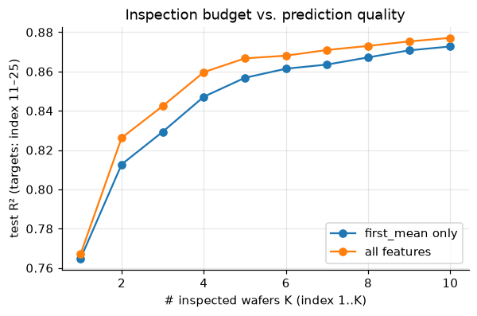

*그림 15. 검사 매수 $K$ (가로, 1–10)에 따른 테스트 $R^2$ (세로, 타깃은 11–25번). 파란 선은 `first_mean` 만, 주황 선은 특성 전부를 쓴 모형이에요.*

```text
천장 (실제 로트 평균으로 예측): test R² = 0.905
```

| $K$ | 1 | 2 | 3 | 4 | 5 | 6 | 7 | 8 | 9 | 10 |
|---|---|---|---|---|---|---|---|---|---|---|
| first_mean only | 0.7648 | 0.8127 | 0.8293 | 0.8471 | 0.8568 | 0.8614 | 0.8635 | 0.8672 | 0.8707 | 0.8727 |
| all features | 0.7671 | 0.8262 | 0.8424 | 0.8596 | 0.8667 | 0.8680 | 0.8709 | 0.8730 | 0.8753 | 0.8771 |

- 두 곡선 모두 $K=1$ 에서 4까지 가파르게 오르고, 5 이후로는 완만해요. 주황 선이 모든 $K$ 에서 파란 선 위에 있어요.
- 1장만 검사해도 $R^2\approx0.77$, 5장이면 0.86 안팎이에요. 그 뒤로는 5장을 더 검사해도 0.01–0.02 정도만 늘어요.

#### 해석

- **수확체감이 뚜렷해요.** 위의 랜덤효과 계산처럼 $K$ 장 평균의 잡음은 $\sigma_w^2/K$ 로 줄어들고, 한 장 더 검사할 때의 이득은 빠르게 작아져요.
- **두 곡선의 간격**: $K=1$ 에서는 0.7648 대 0.7671로 거의 같아요. `first_std` 가 상수 0이라 쓸모가 없고, 불량률도 한 장에서만 계산되니까요. $K=2$ 에서는 0.8127 대 0.8262로 벌어져요. 두 장만 있어도 "한 장이 튀었는지"를 `first_std` 가 알려 줄 수 있어서라고 볼 수 있어요. $K=10$ 에서는 0.8727 대 0.8771로 다시 좁혀져요. $K$ 가 커지면 `first_mean` 자체가 로트 수준을 정확히 추정해서, 다른 특성이 보정할 몫이 줄어들어요.
- **왜 0.87 근처에서 멈추나**: 특성이 `wafer_index` 를 빼면 모두 로트 수준이라 같은 로트 안 웨이퍼끼리의 차이는 설명할 수 없어요. 천장 0.905가 그 한계이고, $K=10$ 의 0.8771은 이미 꽤 가까워요. 남은 간격은 앞 $K$ 장으로 로트 평균을 추정할 때의 오차와, 앞 웨이퍼에 흔적이 없는 돌발 불량(3-6)에서 와요.
- **검사 비용과의 교환(과제 3)**: 웨이퍼 1장 검사 비용을 $c$, 예측 오차 비용을 $\alpha$ 라 하면 총비용은 $C(K)=cK+\alpha\cdot15\cdot\text{MSE}(K)$ 이고, $\text{MSE}(K)=(1-R^2(K))\,v_{\text{te}}$ 예요. 한 장을 더 검사하는 게 이득인 조건은 $15\alpha\big(\text{MSE}(K)-\text{MSE}(K+1)\big) > c$ 예요. 이상화된 모형처럼 이득이 $K$ 에 따라 단조롭게 줄면 최적 $K$ 는 이 부등식이 처음 깨지는 지점이고, $c/\alpha$ 가 클수록 작아져요. 하지만 실제 표의 증가분은 단조롭지 않아요 (all features: $K=5\to6$ 에서 0.8667 → 0.8680, $K=6\to7$ 에서 0.8680 → 0.8709). 그래서 $C(K)$ 를 $K=1,\dots,10$ 에서 모두 계산해 최솟값을 고르는 게 안전해요.

> 💡 **핵심**: 로트 수준 정보만으로 얻을 수 있는 성능에는 **어떤 모형으로도 넘을 수 없는 천장**이 있어요. 더 좋은 모형(예: 딥러닝)보다 **새로운 정보**(그 웨이퍼 자체에서 나온 측정값)가 필요한 지점이 어디인지 이렇게 계산할 수 있어요.

**생각해 볼 질문**

1. 같은 입력(앞 $K$ 장의 요약 + 제품 정보)으로 큰 신경망을 학습하면 테스트 $R^2$ 0.905를 넘을 수 있을까요?

<details><summary>답</summary>

입력이 로트 수준뿐이면 넘을 수 없어요. 신경망도 같은 로트의 타깃 웨이퍼에 같은 값을 예측할 수밖에 없고, 위 명제에 따라 RSS가 SSW 아래로 내려가지 않아요. 웨이퍼 번호를 넣으면 이론상 아주 조금 넘을 여지가 있지만, 번호 효과가 미미해서 실질적인 차이는 없어요. 신경망이 줄일 수 있는 건 천장과 현재 성능(약 0.87) 사이의 간격뿐이에요.

</details>

2. 3-4에서 $K=5$ 의 M2 테스트 $R^2$ 는 0.8650인데, 이 표의 $K=5$ (all features)는 0.8667이에요. 왜 다를까요?

<details><summary>답</summary>

타깃이 달라요. 3-4는 웨이퍼 6–25번(로트당 20장), 3-8은 11–25번(15장)을 예측해요. 테스트 로트는 같아도 타깃 집합과 그 분산 $v_{\text{te}}$ 가 달라서, 3-4의 ⚠️처럼 $R^2$ 를 직접 비교할 수 없어요.

</details>

## PART 4. 사례 ② 웨이퍼 맵 공간 회귀 — 기저함수 · 과적합 · 릿지 (90분: 20분 · 60분: 12분)

2-9에서 반지름 구간별 불량률을 그려 보니 `Center` 는 중심, `Edge-Ring` 은 가장자리, `Donut` 은 중간 반지름에서 불량률이 높았어요. PART 4에서는 이 공간적 모양을 **매끄러운 함수** $p(r)$, $p(x,y)$ 로 추정해요. 관측 단위가 웨이퍼에서 **다이**로 바뀌고, 타깃은 다이의 불량 여부(0 또는 1)예요. 1-7에서 장난감 예제로 본 기저함수 확장 · 과적합 · 릿지를 실제 데이터에서 다시 다루는데, 이번에는 테스트 오차가 아니라 **교차검증**으로 모형을 골라요.

| 절 | 내용 | 새로 나오는 개념 | 90분 진행 | 60분 진행 |
|---|---|---|---|---|
| 4-1 | 선형확률모형 | 0/1 타깃의 최소제곱 = 조건부 확률의 사영 | 다룸 | 다룸 |
| 4-2 | 1.8억 개 다이의 반경 프로파일 | 요약통계량 · 스트리밍 회귀 · 직교 기저 | 다룸 ((심화) 셀 제외) | 건너뜀 |
| 4-3 | 웨이퍼 한 장의 2차원 곡면 | 2차원 다항식 기저 · K-fold 교차검증 | 다룸 | 다룸 |
| 4-4 | 릿지 정규화 | 벌점 · 유효 자유도 | 다룸 | 다룸 |
| 4-5 | 패턴별 갤러리 | 기저의 한계 | 다룸 | 다룸 |

### 4-1. 모형

> 💻 **노트북**: 4-1은 코드 셀 없이 PART 4 첫 마크다운 셀의 앞부분(모형 정의와 한계)만 있어요.

PART 3까지는 웨이퍼의 수율처럼 연속값을 회귀했어요. 여기서는 다이 하나하나를 관측으로 보고 "이 위치에 있는 다이가 불량일 확률"을 위치의 함수로 추정해요. 타깃이 0 또는 1이라서, 최소제곱이 이 경우에 정확히 무엇을 추정하는지부터 짚고 가요.

#### 선형확률모형

정규화 좌표(2-5) $(x,y)$ 에 있는 다이의 불량 여부를 $z\in\lbrace 0,1\rbrace$ 라고 해요. 기댓값의 정의에서 바로

$$
\mathbb E[z\mid x,y]=1\cdot P(z=1\mid x,y)+0\cdot P(z=0\mid x,y)=P(z=1\mid x,y)=:p(x,y)
$$

이에요. 즉 0/1 변수의 조건부 기댓값은 조건부 확률 그 자체예요. 이 함수를 기저함수의 선형결합으로 근사하고

$$
p(x,y)\approx\beta_0+\boldsymbol\phi(x,y)^\top\mathbf w
$$

계수를 최소제곱으로 구하는 모형을 **선형확률모형**(linear probability model)이라고 해요. 기저함수로는 다항식 $\boldsymbol\phi(x,y)=\big(x^ay^b\big)_{1\le a+b\le d}$ 를 쓰고, 특성 수는 $q=\frac{(d+1)(d+2)}{2}-1$ 개예요 (4-3에서 유도해요). 4-2에서는 반지름만의 함수 $\boldsymbol\phi(r)$ 를 써요. 계수에 대해 선형이니 1-3~1-7의 이론이 그대로 적용돼요.

#### 왜 0/1 타깃의 최소제곱이 확률을 추정할까: 사영

다이의 위치를 확률변수 $X=(x,y)$ 로 보고, $p(X)=\mathbb E[z\mid X]$ 라고 써요. $\mathbb E[g(X)^2]\lt\infty$ 인 임의의 함수 $g$ 에 대해

$$
\mathbb E\big[(z-g(X))^2\big]=\mathbb E\big[(z-p(X))^2\big]+\mathbb E\big[(p(X)-g(X))^2\big]
$$

가 성립해요. 왼쪽을 $z-g=(z-p)+(p-g)$ 로 나눠 전개하면 교차항 $2\,\mathbb E[(z-p(X))(p(X)-g(X))]$ 가 남는데, 반복기댓값 법칙(tower property)으로

$$
\mathbb E\big[(z-p(X))(p(X)-g(X))\big]=\mathbb E\Big[\big(p(X)-g(X)\big)\,\mathbb E\big[z-p(X)\mid X\big]\Big]=\mathbb E\Big[\big(p(X)-g(X)\big)\cdot 0\Big]=0
$$

이기 때문이에요. ($p(X)-g(X)$ 는 $X$ 의 함수라서 조건부 기댓값 밖으로 나와요.) 결론은 두 가지예요.

- 모든 함수 중에서 제곱오차를 가장 작게 하는 예측은 $p(X)$ 예요. 즉 $p$ 는 $z$ 를 "$X$ 의 함수들의 공간"으로 $L^2$ 사영한 것이에요.
- $g$ 를 선형 형태 $\boldsymbol\psi(X)^\top\boldsymbol\theta$ ($\boldsymbol\psi=(1,\boldsymbol\phi)$) 로 제한해도 첫째 항은 $\boldsymbol\theta$ 와 무관해요. 그래서 최소제곱은 $\mathbb E[(p(X)-\boldsymbol\psi^\top\boldsymbol\theta)^2]$ 를 최소화하는 것, 곧 $p$ 를 **기저가 만드는 공간에 사영**한 것을 추정해요.

표본에서도 같은 구조가 그대로 보여요. 다이 $n$ 개의 설계행렬을 $\Psi\in\mathbb R^{n\times(q+1)}$ (첫 열 $\mathbf 1$), 참 확률 벡터를 $\mathbf p=(p(x_i,y_i))_i$ 라고 하면 $\mathbb E[\mathbf z\mid\Psi]=\mathbf p$ 이므로

$$
\mathbb E[\hat{\mathbf z}\mid\Psi]=H\,\mathbb E[\mathbf z\mid\Psi]=H\mathbf p,\qquad \mathbb E[\hat{\boldsymbol\theta}\mid\Psi]=(\Psi^\top\Psi)^{-1}\Psi^\top\mathbf p
$$

예요 ($\Psi$ 가 열 완전계수일 때, $H=\Psi(\Psi^\top\Psi)^{-1}\Psi^\top$ 는 1-4의 hat matrix). 적합값의 기댓값은 **참 확률 벡터를 열공간에 직교사영한 것**이에요 (1-4). 여기에는 $\mathbb E[z_i\mid\Psi]=p(x_i,y_i)$ 만 필요하고 다이끼리의 독립성은 필요 없어요. $\mathbf p\in\operatorname{col}(\Psi)$ 이면(기저가 참 함수를 표현할 수 있으면) $\hat{\boldsymbol\theta}$ 는 불편추정량이고, 아니면 다이 위치 분포로 가중한 의미에서의 최량 근사를 추정해요.

#### 제곱오차는 확률 예측의 올바른 기준이에요

이 소절의 $q$ 는 특성 수가 아니라 예측한 확률이에요. $z^2=z$ 를 쓰면, 어떤 위치에서 확률을 $q$ 로 예측했을 때의 기대 제곱오차는

$$
\begin{aligned}
\mathbb E\big[(z-q)^2\mid x,y\big]&=\mathbb E[z\mid x,y]-2q\,\mathbb E[z\mid x,y]+q^2=p-2pq+q^2\\
&=\underbrace{p(1-p)}_{\text{줄일 수 없음}}+\underbrace{(p-q)^2}_{\text{예측의 오차}}
\end{aligned}
$$

이에요. $q=p$ 에서만 최소가 되므로, 0/1 타깃의 제곱오차는 참 확률을 정직하게 보고할 때 가장 작아지는 **적절한 점수 규칙**(proper scoring rule)이에요. 이 값을 Brier 점수라고도 해요. 4-3, 4-4의 CV MSE는 바로 이 Brier 점수를 추정한 것이에요. 다이끼리 독립이라면 검증 다이의 $z$ 는 예측값 $q$ 와 독립이라서, CV MSE는 기댓값으로 평균 $p(1-p)$ 아래로 내려갈 수 없어요. (불량이 공간적으로 뭉쳐 있으면 이웃 다이가 정보를 주므로 이 하한이 성립하지 않을 수 있어요. 4-3의 ⚠️에서 다시 봐요.)

#### 한계 1: 예측이 $[0,1]$ 을 벗어날 수 있어요

$\beta_0+\boldsymbol\phi^\top\mathbf w$ 에는 범위 제약이 없어요. 특히 다항식은 데이터가 적은 경계에서 크게 흔들리고(1-7), 불량률이 0이나 1에 가까운 곳에서는 직선 · 곡면이 쉽게 넘어가요. 실제로 4-2에서 $\hat p(0)>1$, 4-3에서 $\hat p<0$ 이 나와요. 확률로 쓰려면 $[0,1]$ 로 자르는 땜질이 필요하고, 그림도 그렇게 그려요.

#### 한계 2: 이분산

$z^2=z$ 이므로

$$
\operatorname{Var}(z\mid x,y)=\mathbb E[z^2\mid x,y]-p^2=p-p^2=p(1-p)
$$

예요. 분산이 위치마다 달라요(이분산, heteroscedasticity). $p=1/2$ 에서 최대 $1/4$ 이고 $p$ 가 0이나 1에 가까우면 작아요. 결과는 이래요.

- 위에서 본 대로 불편성(또는 사영으로의 수렴)은 $\mathbb E[z\mid X]$ 만으로 정해지니까 여전히 성립해요.
- 하지만 Gauss–Markov 정리의 가정 $\operatorname{Cov}(\boldsymbol\varepsilon)=\sigma^2I$ 가 깨져서 OLS는 더 이상 최량 선형 불편추정량(BLUE)이 아니에요. 가중치 $1/(p_i(1-p_i))$ 의 가중최소제곱이 더 효율적이지만 $p_i$ 를 모르니 반복해서 풀어야 해요.
- 표준오차 공식 $\sigma^2(\Psi^\top\Psi)^{-1}$ 이 틀려요. 다이끼리 독립이라면 올바른 공분산은 아래의 샌드위치 꼴이에요 (3-7의 샌드위치 추정량과 같은 구조).

$$
\operatorname{Cov}(\hat{\boldsymbol\theta}\mid\Psi)=(\Psi^\top\Psi)^{-1}\Psi^\top V\Psi(\Psi^\top\Psi)^{-1},\qquad V=\operatorname{diag}\big(p_i(1-p_i)\big)
$$

#### 다음 시간: 로지스틱 회귀

두 한계를 함께 해결하는 모형이 **로지스틱 회귀**(logistic regression)예요. 선형 예측자를 시그모이드에 넣어서 $(0,1)$ 안에 가두고, 베르누이 우도를 최대화해서 분산 구조 $p(1-p)$ 를 자연스럽게 반영해요.

$$
p(x,y)=\sigma\big(\beta_0+\boldsymbol\phi(x,y)^\top\mathbf w\big),\qquad \sigma(t)=\frac{1}{1+e^{-t}}
$$

PART 4에서는 지금까지 익힌 선형회귀 도구(정규방정식, 기저함수, 릿지, 교차검증)를 그대로 쓰려고 선형확률모형으로 진행해요. 같은 웨이퍼로 로지스틱 회귀를 해 보는 것이 과제 4예요.

> 💡 **핵심**: 0/1 타깃에 최소제곱을 쓰면 조건부 확률 $p(x,y)$ 를 기저가 만드는 공간에 사영한 것을 추정해요. 해석은 깔끔하지만 범위($[0,1]$)와 분산($p(1-p)$)은 모형이 보장하지 않아요.

**생각해 볼 질문**

**Q1.** 절편만 있는 모형($d=0$)을 0/1 타깃에 최소제곱으로 맞추면 $\hat p$ 와 학습 MSE는 각각 무엇일까요?

<details><summary>답</summary>

$\hat p=\bar z$ (불량 다이의 비율, 곧 1 − 수율)예요. 학습 MSE는 $z_i^2=z_i$ 를 쓰면 $\frac1n\sum_i(z_i-\bar z)^2=\bar z-\bar z^2=\bar z(1-\bar z)$ 예요. 4-3의 웨이퍼(수율 0.863)라면 $0.137\times0.863\approx0.118$ 로, 그림 17의 $d=0$ 값이에요.

</details>

### 4-2. 패턴별 반경 프로파일: 1.8억 개 다이에 대한 정확한 OLS

> 💻 **노트북**: 4-2의 코드 셀 2개 (① 반경 프로파일 OLS · 세 기저의 조건수 비교 · 그림 16, ② (심화) 정중앙 다이 불량률). **60분 진행에서는 4-2 전체를 건너뛰어요.** 90분 진행에서는 ② 셀을 건너뛰고, '(심화) 조건수 이야기' 문단은 출력된 조건수만 짚고 넘어가도 돼요.

2-9에서는 반지름을 10개 구간으로 나눠 구간마다 불량률을 냈어요. 이번에는 패턴별로 **매끄러운 함수** $p(r)$ 를 라벨이 있는 모든 다이(약 1.8억 개)로 최소제곱 추정해요. 설계행렬을 그대로 만들면 $1.8\times10^8$ 행 $\times$ 7열 $\times$ 8바이트(`float64`) ≈ 10GB라서 메모리에 올리기 어려워요. 그런데 OLS 해에 필요한 것은 사실 $7\times7$ 행렬 하나와 길이 7 벡터 하나뿐이에요.

#### 모형

패턴(클래스) $c$ 마다 반지름의 6차 다항식을 따로 맞춰요.

$$
p_c(r)=\sum_{k=0}^{6}\beta_{c,k}\,r^k=\boldsymbol\phi(r)^\top\boldsymbol\beta_c,\qquad \boldsymbol\phi(r)=(1,r,r^2,\dots,r^6)^\top\in\mathbb R^7
$$

여기서는 $\boldsymbol\phi$ 에 상수항이 들어 있어서, 다이 $N$ 개의 설계행렬 $\Phi\in\mathbb R^{N\times7}$ 의 첫 열이 $\mathbf 1$ 이에요. 정규방정식의 해가 유일하려면 $\Phi$ 가 열 완전계수여야 하는데, 서로 다른 반지름 값이 7개 이상이면 돼요. 6차 이하 다항식이 서로 다른 7개 점에서 0이면 영다항식이라서(방데르몽드 행렬의 가역성), 열들이 일차독립이기 때문이에요.

#### OLS 해는 두 요약량만으로 정해져요

$\hat{\boldsymbol\beta}=(\Phi^\top\Phi)^{-1}\Phi^\top\mathbf z$ 에서 데이터가 들어가는 곳은 $\Phi^\top\Phi\ (7\times7)$ 와 $\Phi^\top\mathbf z\ (7)$ 뿐이에요. 가우시안 선형모형 $\mathbf z\sim\mathcal N(\Phi\boldsymbol\beta,\sigma^2I_N)$ 에서는 로그우도가

$$
\log L(\boldsymbol\beta,\sigma^2)=-\frac N2\log(2\pi\sigma^2)-\frac{1}{2\sigma^2}\Big(\mathbf z^\top\mathbf z-2\boldsymbol\beta^\top\Phi^\top\mathbf z+\boldsymbol\beta^\top\Phi^\top\Phi\,\boldsymbol\beta\Big)
$$

라서 관측 $\mathbf z$ 에는 $(\mathbf z^\top\mathbf z,\ \Phi^\top\mathbf z)$ 를 통해서만 의존해요 ($\Phi^\top\Phi$ 는 설계에서 정해지는 알려진 값이에요). 피셔–네이만 분해정리(factorization theorem)에 의해 $(\mathbf z^\top\mathbf z,\ \Phi^\top\mathbf z)$ 가 **충분통계량**이에요. 계수 $\hat{\boldsymbol\beta}$ 를 구하는 데는 $\Phi^\top\Phi$ 와 $\Phi^\top\mathbf z$ 두 개면 되고, $\mathbf z^\top\mathbf z$ 는 잔차제곱합(그리고 $\sigma^2$ 의 추정)을 구할 때만 더 필요해요. 우리 $z$ 는 0/1이라 가우시안 모형은 아니지만, OLS 해와 잔차제곱합 $\mathrm{RSS}=\mathbf z^\top\mathbf z-2\hat{\boldsymbol\beta}^\top\Phi^\top\mathbf z+\hat{\boldsymbol\beta}^\top\Phi^\top\Phi\hat{\boldsymbol\beta}$ 는 똑같이 이 요약량의 함수예요. 게다가 $z_i^2=z_i$ 라서 $\mathbf z^\top\mathbf z=\mathbf 1^\top\mathbf z=[\Phi^\top\mathbf z]_0$ 이니 따로 셀 필요도 없어요.

#### 같은 위치의 다이를 묶기

다이의 반지름은 맵 크기 $(H,W)$ 와 픽셀 위치 $(i,j)$ 로만 정해져요. 그래서 $\boldsymbol\phi$ 가 같은 다이들을 **묶음**(bin) $b$ 로 모을 수 있어요. 노트북에서 묶음은 "맵 크기 · 픽셀"이에요. 묶음 $b$ 의 특성을 $\boldsymbol\phi_b$, 다이 수를 $n_b$ (노트북의 $D_{\text{pixel}}$, 그 위치가 다이인 웨이퍼 수), 불량 수를 $Z_b$ (노트북의 $Z_{\text{pixel}}$) 라고 해요.

소속을 나타내는 행렬 $A\in\lbrace 0,1\rbrace^{N\times B}$ ($A_{ib}=1$ 이면 다이 $i$ 가 묶음 $b$ 소속) 와 묶음별 특성 행렬 $\Phi_B\in\mathbb R^{B\times7}$ 를 쓰면 $\Phi=A\Phi_B$ 예요. 각 다이는 묶음 하나에만 속하니까 $A$ 의 열들은 서로 직교하고 $A^\top A=\operatorname{diag}(n_b)$, $A^\top\mathbf z=(Z_b)_b$ 예요. 따라서

$$
\begin{aligned}
\Phi^\top\Phi&=\Phi_B^\top A^\top A\,\Phi_B=\Phi_B^\top\operatorname{diag}(n_b)\,\Phi_B=\sum_b n_b\,\boldsymbol\phi_b\boldsymbol\phi_b^\top\\
\Phi^\top\mathbf z&=\Phi_B^\top A^\top\mathbf z=\sum_b Z_b\,\boldsymbol\phi_b
\end{aligned}
$$

예요. 180,254,089개의 다이가 묶음별 개수 $(n_b, Z_b)$ 로 줄어들고, 그래도 해는 **근사가 아니라 정확히** 같아요.

같은 사실을 다른 각도에서 보면, 다이 단위 OLS는 **묶음별 불량률을 다이 수로 가중한 최소제곱**과 같아요 (불량률 $\bar z_b=Z_b/n_b$, 가중치 $n_b$). 2-8의 분산분석처럼 제곱합을 묶음 안 · 묶음 사이로 나누면

$$
\sum_{i=1}^{N}\big(z_i-\boldsymbol\phi_i^\top\boldsymbol\beta\big)^2=\underbrace{\sum_b\sum_{i\in b}(z_i-\bar z_b)^2}_{\boldsymbol\beta\text{ 와 무관}}+\sum_b n_b\big(\bar z_b-\boldsymbol\phi_b^\top\boldsymbol\beta\big)^2
$$

이에요 (교차항은 $\sum_{i\in b}(z_i-\bar z_b)=0$ 이라서 사라져요). 그래서 두 문제의 최소점이 같아요.

#### 스트리밍 · 맵리듀스 회귀

요약량은 **더하기로 합칠 수 있어요**. 데이터를 덩어리 $C_1,\dots,C_M$ 으로 나누면

$$
\Phi^\top\Phi=\sum_{m=1}^{M}\Phi_{C_m}^\top\Phi_{C_m},\qquad \Phi^\top\mathbf z=\sum_{m=1}^{M}\Phi_{C_m}^\top\mathbf z_{C_m}
$$

이라서, 덩어리마다 $7\times7$ 과 $7$ 짜리 부분합만 계산해서 더하면 돼요 (map: 부분합 계산, reduce: 더하기). 메모리는 $N$ 과 무관하게 $O(p^2)$ 이고, 데이터를 한 번만 읽으면 되며, 덩어리끼리 병렬로 계산할 수 있어요. 노트북에서는 덩어리가 "맵 크기 $(H,W)$ × 패턴"이에요. 개수 $n_b, Z_b$ 는 $2^{53}$ 보다 훨씬 작은 정수라서 `float64` 에서 정확히 표현돼요.

한 가지 대가가 있어요. $\Phi^\top\Phi$ 를 직접 만들면 조건수가 $\kappa(\Phi)^2$ 으로 제곱돼요 (1-3). 그래서 기저 선택이 중요해지고, 이것이 다음 (심화) 이야기예요.

#### (심화) 조건수 이야기: 단항식 · 짝수 차수 단항식 · Zernike

$(1/N)\,\Phi^\top\Phi=\sum_b (n_b/N)\,\boldsymbol\phi_b\boldsymbol\phi_b^\top$ 는 다이 반지름의 경험분포에 대한 $\mathbb E[\boldsymbol\phi(r)\boldsymbol\phi(r)^\top]$ 예요. 다이가 단위원판 위에 고르게 퍼져 있다고 이상화하면, 반지름 $r$ 이하인 영역의 넓이 비율이 $r^2$ 이므로 $r$ 의 밀도는 $2r$ 이고

$$
\frac1N\Phi^\top\Phi\ \approx\ \int_0^1\boldsymbol\phi(r)\boldsymbol\phi(r)^\top\,2r\,dr
$$

이에요. 이 근사로 세 기저의 Gram 행렬을 계산해 봐요.

**① 단항식** $\lbrace 1,r,\dots,r^6\rbrace$ (노트북이 실제로 적합하는 기저): 성분이 $\int_0^1 r^{j+k}\,2r\,dr=\frac{2}{j+k+2}$ 인 힐베르트 행렬 꼴이에요. 고차 단항식끼리는 거의 평행해요. 예를 들어 $r^5$ 와 $r^6$ 이 이루는 각의 코사인은

$$
\frac{\int_0^1 r^{11}\,2r\,dr}{\sqrt{\int_0^1 r^{10}\,2r\,dr\ \int_0^1 r^{12}\,2r\,dr}}=\frac{2/13}{\sqrt{(2/12)(2/14)}}=\frac{\sqrt{168}}{13}\approx0.997
$$

이에요. 열들이 거의 평행하면 Gram 행렬의 최소 고윳값이 0에 가까워져 조건수가 커져요.

**② 짝수 차수 단항식** $\lbrace 1,r^2,\dots,r^{12}\rbrace$: 성분이 $\int_0^1 r^{2j+2k}\,2r\,dr=\frac{1}{j+k+1}$ 이라 정확히 7차 힐베르트 행렬이에요. 노트북처럼 넓이요소 $dA$ 로 적분하면 $\pi\times$(7차 힐베르트 행렬)이고, 조건수는 약 $4.8\times10^8$ 이에요.

**③ 회전대칭 Zernike 다항식**: $s=2r^2-1$ 로 바꾸고 르장드르 다항식(Legendre polynomial) $P_k$ 를 써서

$$
R_{2k}^0(r)=P_k(2r^2-1),\qquad k=0,1,\dots,m
$$

로 정의해요. $ds=4r\,dr$ 이므로 르장드르 다항식의 직교관계 $\int_{-1}^{1}P_jP_k\,ds=\frac{2}{2k+1}\delta_{jk}$ 에서

$$
\int_0^1 R_{2j}^0(r)\,R_{2k}^0(r)\,r\,dr=\frac14\int_{-1}^{1}P_j(s)P_k(s)\,ds=\frac{\delta_{jk}}{2(2k+1)}
$$

가 나와요. 즉 Zernike 반경 다항식은 $[0,1]$ 에서 가중치 $r\,dr$ 에 대해 **직교**해요. 넓이요소 $dA=2\pi r\,dr$ 로 쓰면 노트북의 식

$$
\int_{\text{unit disk}}P_j(2r^2-1)\,P_k(2r^2-1)\,dA=2\pi\cdot\frac{\delta_{jk}}{2(2k+1)}=\frac{\pi}{2k+1}\,\delta_{jk}
$$

과 같아요. Gram 행렬이 대각행렬 $\operatorname{diag}(\pi/(2k+1))$ 이니, 조건수는 가장 큰 대각원소($k=0$)를 가장 작은 대각원소($k=m$)로 나눈 $2m+1$ 이에요. $m=6$ 이면 13이에요.

**공정한 비교는 같은 함수공간끼리 해야 해요.** $P_k$ 는 정확히 $k$ 차이고 최고차 계수가 $\frac{(2k)!}{2^k(k!)^2}>0$ 이라서, $R_{2k}^0(r)$ 은 $r^2$ 에 대한 정확히 $k$ 차 다항식이고 $r^{2k}$ 의 계수는 $\binom{2k}{k}\neq0$ 이에요. 그래서 Zernike 기저 행렬 $\Psi$ (4-1 · 4-3의 일반 설계행렬 $\Psi$ 와는 다른 행렬이에요)와 짝수 차수 단항식 행렬 $\Phi_e$ 사이에는 대각원소가 0이 아닌 상삼각행렬 $T$ 가 있어서 $\Psi=\Phi_eT$ 예요. 두 기저는 같은 공간 $\operatorname{span}\lbrace 1,r^2,\dots,r^{12}\rbrace$ 를 만들어요. 반면 노트북이 적합하는 $\lbrace 1,r,\dots,r^6\rbrace$ 은 홀수 차수가 들어간 **다른 함수공간**이라서, 이것의 조건수를 Zernike와 비교하면 공정하지 않아요.

같은 공간이면 적합 곡선도 같아요. $T$ 가 가역이므로 (가중치 행렬 $W=\operatorname{diag}(n_b)$ 를 넣어도 마찬가지로)

$$
\Psi(\Psi^\top\Psi)^{-1}\Psi^\top=\Phi_eT\big(T^\top\Phi_e^\top\Phi_eT\big)^{-1}T^\top\Phi_e^\top=\Phi_eTT^{-1}(\Phi_e^\top\Phi_e)^{-1}T^{-\top}T^\top\Phi_e^\top=\Phi_e(\Phi_e^\top\Phi_e)^{-1}\Phi_e^\top
$$

이에요. hat matrix가 같으니 적합값이 같고, 계수만 $\hat{\boldsymbol\beta}_e=T\hat{\boldsymbol\beta}_Z$ 로 바뀌어요 ($\hat{\boldsymbol\beta}_e$, $\hat{\boldsymbol\beta}_Z$ 는 각각 짝수 차수 단항식 기저와 Zernike 기저의 계수예요). 정확한 산술에서는 기저를 바꿔도 적합이 달라지지 않고, 달라지는 것은 **수치 계산의 정확도와 계수의 해석**이에요. 이 비교는 과제 2예요.

조건수가 계산 정확도에 주는 영향도 어림해 봐요. 조건수가 $\kappa$ 인 연립방정식을 후진 안정(backward stable) 알고리즘으로 풀면 해의 상대오차는 대략 $\kappa u$ 이하예요 ($u$ 는 0-2의 단위 반올림). `float64` ($u\approx1.1\times10^{-16}$) 에서 $\kappa\approx10^9$ 이면 $\kappa u\approx10^{-7}$ 이라 괜찮지만, `float32` ($u\approx6.0\times10^{-8}$) 였다면 $\kappa u\gg1$ 이라 계수에 믿을 만한 자릿수가 남지 않아요. 노트북이 닫힌 해 계산에 `F64 = torch.float64` 를 쓰는 이유예요.

#### 코드 읽기

<details><summary>📝 셀 전체 코드 (줄별 주석)</summary>

```python
# ── 1. 설정과 두 가지 반경 기저 ──────────────────────────────────
# DEG_R: 반지름 다항식의 차수(6 → 계수 7개), N_FINE: 그림의 점(경험적 불량률)을 낼 반지름 구간 수(폭 0.025)
DEG_R, N_FINE = 6, 40

def radial_basis(r, d=DEG_R):
    """단항식 [1, r, r², …, r^d]"""
    # r ** 0 = 1 이라 첫 열이 절편 열이에요. dim=-1 로 쌓아서 (픽셀 수,) → (픽셀 수, d+1) = Φ_B
    return torch.stack([r ** k for k in range(d + 1)], dim=-1)

def zernike_radial(r, deg=DEG_R):
    """회전대칭 Zernike 다항식 R_{2k}^0(r) = P_k(2r² − 1), k = 0 … deg (르장드르 점화식)"""
    s = 2 * r ** 2 - 1                                  # r ∈ [0, 1] → s ∈ [-1, 1] (르장드르의 정의역)
    P = [torch.ones_like(s), s]                         # P_0 = 1, P_1 = s
    for k in range(1, deg):
        # 르장드르 점화식 (k+1)P_{k+1} = (2k+1)·s·P_k − k·P_{k−1}. r^12 같은 거듭제곱을 직접 빼지 않아 안정해요.
        P.append(((2 * k + 1) * s * P[k] - k * P[k - 1]) / (k + 1))
    # deg = 0 이어도 맞도록 앞의 deg+1 개만 잘라요. 결과 모양 (픽셀 수, deg+1)
    return torch.stack(P[: deg + 1], dim=-1)

# ── 2. 누적할 요약량(충분통계량) 초기화 ───────────────────────────
# 패턴 c 마다 ΦᵀΦ (7×7) 와 Φᵀz (7) 만 모으면 OLS 해가 정확히 나와요. 개수의 합이라 F64 로 정확히 표현돼요.
XtX = {c: torch.zeros(DEG_R + 1, DEG_R + 1, dtype=F64) for c in CLASSES}
Xtz = {c: torch.zeros(DEG_R + 1, dtype=F64) for c in CLASSES}
fine_D = {c: torch.zeros(N_FINE, dtype=F64) for c in CLASSES}      # 확인용: 촘촘한 반지름 구간별 다이 수
fine_Z = {c: torch.zeros(N_FINE, dtype=F64) for c in CLASSES}      #          … 불량 수
G_zern = torch.zeros(DEG_R + 1, DEG_R + 1, dtype=F64)              # Gram 행렬 (조건수 비교용): Zernike 기저
G_even = torch.zeros(DEG_R + 1, DEG_R + 1, dtype=F64)              #                           짝수 차수 단항식 [1, r², …, r¹²]
LABELS = df["label"].to_numpy()                     # 웨이퍼 번호 → 라벨 문자열 배열 (df 번호로 바로 인덱싱)

# ── 3. 맵 크기별 · 패턴별로 묶어서 요약량 누적 (map 단계 + `+=` reduce 단계) ──
t0 = time.time()
labeled = df[df["label"] != "unlabeled"]           # 라벨 있는 웨이퍼만 써요
# groupby(...).indices: {(H, W): labeled 안에서의 위치 배열}. 같은 크기의 맵끼리 한 번에 처리해요.
for (H, W), pos in labeled.groupby(["H", "W"]).indices.items():
    idx = labeled.index.to_numpy()[pos]             # labeled 안의 위치 → 원래 df 의 웨이퍼 번호
    maps = stack_maps(idx)                          # (m, H, W) uint8, 값 0: 웨이퍼 밖, 1: 정상, 2: 불량
    xg_, yg_ = normalized_grid(H, W)                # (H, W) 정규화 좌표 (2-5), 중심 0 · 반지름 1
    r = torch.sqrt(xg_**2 + yg_**2).reshape(-1)                     # 픽셀별 반지름
    # 픽셀 = 묶음(bin) b. 반지름이 같은 다이는 φ 가 같으니 행렬 크기가 다이 수가 아니라 픽셀 수(H·W)예요.
    Phi, Psi = radial_basis(r), zernike_radial(r)                    # (픽셀 수, 7)
    # 40개 촘촘한 구간 번호 0 … 39. r ≥ 1 인 가장자리 픽셀은 clamp 로 마지막 구간에 넣어요.
    fbin = (r.clamp(max=1 - 1e-9) * N_FINE).long()
    # 패턴과 무관하게, 이 크기의 라벨 있는 맵 전체에서 픽셀별 "다이인 웨이퍼 수" n_b. (H·W,) float64
    D_all = (maps > 0).sum(0).reshape(-1).to(F64)
    # Ψᵀ diag(n_b) Ψ = Σ_b n_b ψ_b ψ_bᵀ. D_all[:, None] * Psi 는 브로드캐스팅으로 행 b 에 n_b 를 곱해요
    # (픽셀 수 × 픽셀 수 대각행렬을 만들지 않아요).
    G_zern += Psi.T @ (D_all[:, None] * Psi)
    # 같은 함수공간 span{1, r², …, r¹²} 의 단항식 기저 Φ_e 로도 Gram 행렬을 만들어 공정하게 비교해요.
    Pe = torch.stack([r ** (2 * k) for k in range(DEG_R + 1)], dim=-1)
    G_even += Pe.T @ (D_all[:, None] * Pe)
    labs = LABELS[idx]                              # 이 크기 맵들의 라벨 (m,)
    for c in set(labs):                             # 이 크기에 실제로 있는 패턴만 돌아요
        sel = maps[torch.from_numpy(labs == c)]     # 불리언 마스크로 패턴 c 의 맵만 고름 (m_c, H, W)
        D = (sel > 0).sum(0).reshape(-1).to(F64)        # 픽셀별: 다이인 웨이퍼 수
        Zc = (sel == 2).sum(0).reshape(-1).to(F64)      # 픽셀별: 불량인 웨이퍼 수
        XtX[c] += Phi.T @ (D[:, None] * Phi)        # ΦᵀΦ += Φ_Bᵀ diag(n_b) Φ_B = Σ_b n_b φ_b φ_bᵀ
        Xtz[c] += Phi.T @ Zc                        # Φᵀz += Σ_b Z_b φ_b
        # 픽셀별 개수를 40개 반지름 구간으로 다시 합산해요 (weights 를 주면 개수 대신 가중치 합).
        # minlength 로 빈 구간이 있어도 길이를 항상 N_FINE 으로 맞춰요.
        fine_D[c] += torch.bincount(fbin, weights=D, minlength=N_FINE)
        fine_Z[c] += torch.bincount(fbin, weights=Zc, minlength=N_FINE)

# ── 4. 7×7 정규방정식 풀기와 조건수 비교 ──────────────────────────
# ΦᵀΦ β = Φᵀz 를 LU(부분 피벗)로 풀어요. Φ 를 만들지 않으니 QR · lstsq 대신 정규방정식을 직접 풀어요.
beta_r = {c: torch.linalg.solve(XtX[c], Xtz[c]) for c in CLASSES}
n_obs = {c: XtX[c][0, 0].item() for c in CLASSES}                  # [ΦᵀΦ]₀₀ = Σ 1 = 다이 수
G_mono = sum(XtX.values())                          # 9개 패턴을 합친 단항식 Gram 행렬 = D_all 과 같은 다이들
print(f"{time.time() - t0:.1f}초, 전체 다이 수 = {sum(n_obs.values()):,.0f}")   # :,.0f → 천 단위 쉼표, 정수 표시
# torch.linalg.cond 의 기본값은 2-노름 조건수 σ_max/σ_min (대칭 양정치면 고윳값의 비).
# 이론값: 짝수 단항식 ≈ 4.8e8 (힐베르트 행렬), Zernike = 2·DEG_R + 1 = 13 (균등분포 가정 시).
print(f"κ(ΦᵀΦ): [1, r, …, r⁶] {torch.linalg.cond(G_mono).item():.2e}   |   같은 공간 비교: [1, r², …, r¹²] "
      f"{torch.linalg.cond(G_even).item():.2e}  vs  Zernike {torch.linalg.cond(G_zern).item():.1f}  (균등분포면 {2 * DEG_R + 1})")

# ── 5. 그림 16: 40개 구간의 경험적 불량률 vs 6차 OLS 곡선 ────────────
rg = torch.linspace(0, 1, 200, dtype=F64)           # 곡선을 그릴 반지름 격자
r_fine = (torch.arange(N_FINE, dtype=F64) + 0.5) / N_FINE          # 40개 구간의 가운데 반지름
fig, axes = plt.subplots(3, 3, figsize=(12, 8), sharex=True)       # 패턴 9개 → 3×3, 가로축 공유
# axes.flat 으로 3×3 축을 1차원으로 훑고, enumerate 의 i 는 색 번호(C0, C1, …)로 써요.
for ax, (i, c) in zip(axes.flat, enumerate(CLASSES)):
    # 점: 구간별 불량률 Z/D (40개 계단 함수 기저의 OLS 적합값과 같아요). clamp_min(1) 은 빈 구간의 0 나누기 방지.
    ax.plot(r_fine.numpy(), (fine_Z[c] / fine_D[c].clamp_min(1)).numpy(), "o", ms=3, color="k", label=f"empirical rate ({N_FINE} bins)")
    # 곡선: p̂_c(r) = φ(r)ᵀ β̂_c. (200, 7) @ (7,) → (200,)
    ax.plot(rg.numpy(), (radial_basis(rg) @ beta_r[c]).numpy(), color=f"C{i}", lw=2, label=f"OLS, degree {DEG_R}")
    ax.set_title(f"{c}  ({n_obs[c] / 1e6:.1f}M dies)", fontsize=10)   # 제목에 그 패턴의 다이 수(백만 단위)
    ax.set_ylim(bottom=0)                           # 세로축 아래만 0 으로 고정, 위는 패널마다 자동
for ax in axes[-1]:                                 # 맨 아래 줄 패널에만 x 축 이름
    ax.set_xlabel("r")
axes[0, 0].legend(fontsize=7)
plt.suptitle(r"Radial defect probability $\hat p(r)$ fitted on all labeled dies", y=1.0)
plt.tight_layout()
plt.show()
```

</details>

```python
DEG_R, N_FINE = 6, 40

def radial_basis(r, d=DEG_R):
    """단항식 [1, r, r², …, r^d]"""
    return torch.stack([r ** k for k in range(d + 1)], dim=-1)

def zernike_radial(r, deg=DEG_R):
    """회전대칭 Zernike 다항식 R_{2k}^0(r) = P_k(2r² − 1), k = 0 … deg (르장드르 점화식)"""
    s = 2 * r ** 2 - 1
    P = [torch.ones_like(s), s]
    for k in range(1, deg):
        P.append(((2 * k + 1) * s * P[k] - k * P[k - 1]) / (k + 1))
    return torch.stack(P[: deg + 1], dim=-1)
```

- `radial_basis` 는 $\boldsymbol\phi(r)=(1,r,\dots,r^6)$ 을 마지막 축에 쌓아서 (픽셀 수, 7) 모양의 텐서를 돌려줘요.
- `zernike_radial` 은 르장드르 점화식 $(k+1)P_{k+1}(s)=(2k+1)\,s\,P_k(s)-k\,P_{k-1}(s)$ 로 $P_0=1,\ P_1=s$ 에서 시작해 $P_6$ 까지 만들어요. 점화식으로 계산하면 $r^{12}$ 같은 거듭제곱을 직접 더하고 빼지 않아서 수치적으로도 안정해요.
- `N_FINE = 40` 은 그림의 점(경험적 불량률)을 낼 구간 수예요. 폭이 0.025인 촘촘한 구간이에요.

```python
labeled = df[df["label"] != "unlabeled"]
for (H, W), pos in labeled.groupby(["H", "W"]).indices.items():
    idx = labeled.index.to_numpy()[pos]
    maps = stack_maps(idx)
    xg_, yg_ = normalized_grid(H, W)
    r = torch.sqrt(xg_**2 + yg_**2).reshape(-1)                     # 픽셀별 반지름
    Phi, Psi = radial_basis(r), zernike_radial(r)                    # (픽셀 수, 7)
    fbin = (r.clamp(max=1 - 1e-9) * N_FINE).long()
    D_all = (maps > 0).sum(0).reshape(-1).to(F64)
    G_zern += Psi.T @ (D_all[:, None] * Psi)
    Pe = torch.stack([r ** (2 * k) for k in range(DEG_R + 1)], dim=-1)
    G_even += Pe.T @ (D_all[:, None] * Pe)
    labs = LABELS[idx]
    for c in set(labs):
        sel = maps[torch.from_numpy(labs == c)]
        D = (sel > 0).sum(0).reshape(-1).to(F64)        # 픽셀별: 다이인 웨이퍼 수
        Zc = (sel == 2).sum(0).reshape(-1).to(F64)      # 픽셀별: 불량인 웨이퍼 수
        XtX[c] += Phi.T @ (D[:, None] * Phi)
        Xtz[c] += Phi.T @ Zc
        fine_D[c] += torch.bincount(fbin, weights=D, minlength=N_FINE)
        fine_Z[c] += torch.bincount(fbin, weights=Zc, minlength=N_FINE)
```

- 바깥 루프는 2-5와 같은 방식이에요. 같은 크기의 맵끼리 묶어 `stack_maps` 로 $(m,H,W)$ 텐서를 만들어요. `groupby(...).indices` 는 `labeled` 안에서의 위치를 주므로 `labeled.index.to_numpy()[pos]` 로 원래 `df` 의 번호로 바꿔요.
- `r` 은 이 맵 크기의 픽셀별 반지름이고, `Phi` 는 그 픽셀들의 묶음별 특성 행렬 $\Phi_B$ 예요. 다이 수와 무관하게 크기가 (픽셀 수, 7)이에요.
- `(sel > 0).sum(0)` 은 웨이퍼 축으로 더해서 픽셀마다 "다이인 웨이퍼 수" $n_b$ 를, `(sel == 2).sum(0)` 은 "불량인 웨이퍼 수" $Z_b$ 를 만들어요 (맵 값 0: 웨이퍼 밖, 1: 정상, 2: 불량).
- `Phi.T @ (D[:, None] * Phi)` 가 $\Phi_B^\top\operatorname{diag}(n_b)\Phi_B=\sum_b n_b\boldsymbol\phi_b\boldsymbol\phi_b^\top$ 이에요. `D[:, None] * Phi` 는 브로드캐스팅으로 행 $b$ 에 $n_b$ 를 곱하는 것이라, (픽셀 수) × (픽셀 수) 크기의 대각행렬을 만들지 않아요. `Phi.T @ Zc` 가 $\sum_b Z_b\boldsymbol\phi_b$ 예요. `+=` 가 맵리듀스의 reduce 단계예요.
- `torch.bincount(fbin, weights=D, minlength=N_FINE)` 은 픽셀별 개수를 40개 반지름 구간으로 다시 더해요. `fbin` 계산의 `clamp(max=1 - 1e-9)` 는 $r\ge1$ 인 가장자리 픽셀을 마지막 구간에 넣어요 (2-5와 같은 처리).
- `G_zern`, `G_even` 은 조건수 비교용 Gram 행렬이에요. `D_all` 은 패턴과 상관없이 이 크기의 라벨 있는 맵 전체에서 센 다이 수라서, 패턴별 `XtX[c]` 를 모두 더한 `G_mono` 와 같은 다이들에 대한 Gram 행렬이에요.

```python
beta_r = {c: torch.linalg.solve(XtX[c], Xtz[c]) for c in CLASSES}
n_obs = {c: XtX[c][0, 0].item() for c in CLASSES}                  # [ΦᵀΦ]₀₀ = Σ 1 = 다이 수
G_mono = sum(XtX.values())
```

- `torch.linalg.solve` 는 부분 피벗 LU 분해로 $7\times7$ 정규방정식 $\Phi^\top\Phi\boldsymbol\beta=\Phi^\top\mathbf z$ 를 풀어요. 1-3에서는 조건수 때문에 QR · `lstsq` 를 권했지만, 여기서는 $\Phi$ 를 만들지 않으니 정규방정식을 직접 풀어요. 요약량만으로 회귀할 때의 대가예요 (덩어리별 QR 분해를 합치는 스트리밍 QR도 있지만 $7\times7$ 문제에는 필요 없어요).
- $\phi_0=1$ 이므로 $[\Phi^\top\Phi]_{00}=\sum_b n_b$ 는 다이 수예요. 그래서 `n_obs` 를 따로 세지 않아요.
- 출력의 `torch.linalg.cond` 는 기본값이 2-노름 조건수 $\sigma_{\max}/\sigma_{\min}$ 이에요. 대칭 양정치인 Gram 행렬에서는 최대 · 최소 고윳값의 비와 같아요.

#### 결과

```text
0.9초, 전체 다이 수 = 180,254,089
κ(ΦᵀΦ): [1, r, …, r⁶] 1.52e+09   |   같은 공간 비교: [1, r², …, r¹²] 1.35e+08  vs  Zernike 11.0  (균등분포면 13)
```

- 1.8억 개 다이에 대한 9개 패턴의 정확한 OLS가 0.9초에 끝나요. 실제로 하는 일은 픽셀별 개수 세기와 작은 행렬 곱뿐이에요.
- 같은 함수공간에서 짝수 차수 단항식의 조건수는 $1.35\times10^{8}$, Zernike 기저는 11.0이에요. 직교 기저로 바꾸는 것만으로 조건수가 일곱 자릿수 줄어요. 실제 다이 배치는 균등한 연속분포가 아니라서(격자 위의 이산적인 점이고, 2-5에서 본 것처럼 $r\ge1$ 인 다이도 조금 있어요) 이론값 13, 약 $4.8\times10^8$ 과 정확히 같지는 않지만, 크기의 차수는 이론과 맞아요.
- 실제로 적합한 단항식 $\lbrace 1,\dots,r^6\rbrace$ 의 조건수는 $1.52\times10^{9}$ 예요 (9개 패턴의 `XtX[c]` 를 합친 `G_mono` 의 값이에요. 패턴별로 푸는 행렬의 조건수는 출력하지 않았어요). `float64` 라서 상대오차는 대략 $10^{-7}$ 수준으로 괜찮아요.

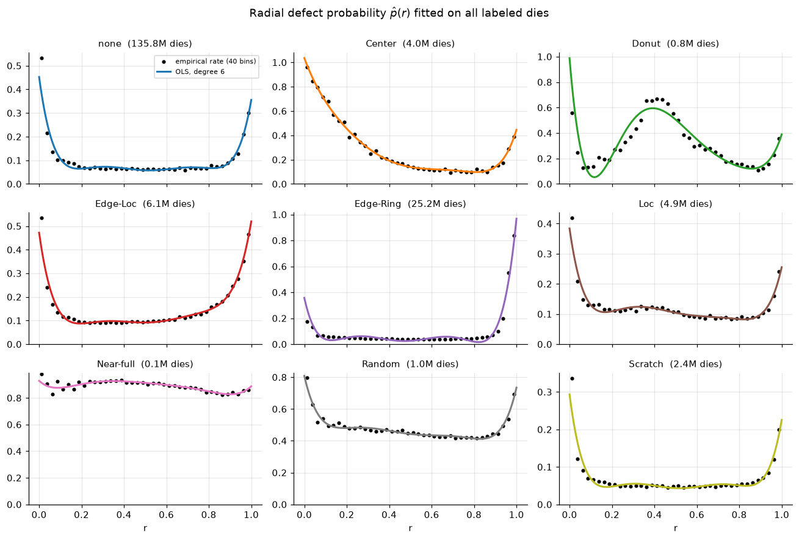

*그림 16. 라벨이 있는 모든 다이로 적합한 패턴별 반경 불량 확률. 검은 점은 40개 구간의 경험적 불량률, 색 곡선은 6차 다항식 OLS 적합이에요.*

그림 읽는 법: 패널 하나가 패턴 하나예요. 가로축은 정규화 반지름 $r$ (0: 웨이퍼 중심, 1: 가장자리), 세로축은 불량 확률이고 패널마다 세로 눈금이 달라요. 제목의 괄호는 그 패턴의 다이 수예요 (`none` 135.8M, `Edge-Ring` 25.2M, `Edge-Loc` 6.1M, `Loc` 4.9M, `Center` 4.0M, `Scratch` 2.4M, `Random` 1.0M, `Donut` 0.8M, `Near-full` 0.1M).

- `Center`: 중심에서 가장 높고 바깥으로 갈수록 줄다가 가장자리에서 다시 조금 올라가요. `Edge-Ring`: 거의 평평하다가 $r\to1$ 에서 급격히 올라가요. `Donut`: 중간 반지름에 봉우리가 있어요. `Near-full`: 모든 반지름에서 불량률이 높아요.
- `none`, `Loc`, `Edge-Loc`, `Scratch`, `Random`: 가운데는 비교적 평평하고 양 끝($r\to0$, $r\to1$)에서 올라가요.

#### 해석

- **대부분의 패턴에서 곡선이 점을 잘 따라가요.** 점 40개를 7개의 계수로 요약한 셈이에요.
- **기저의 편향**: `Donut` 은 모양이 복잡해서 6차 다항식으로는 봉우리 높이와 $r\approx0.1$ 근처의 골을 다 따라가지 못해요. `Donut` 다이가 80만 개(0.8M)나 있어도 기저가 표현할 수 없는 모양은 표현할 수 없어요. 데이터를 늘려서 줄어드는 것은 분산이지 편향이 아니에요.
- **중심 근처의 불안정**: $r\to0$ 에서 곡선이 크게 흔들려요 (`Donut` 은 $\hat p(0)\approx1$, `Center` 는 $\hat p(0)>1$). 반지름의 밀도가 $2r$ 이라 중심 근처의 다이는 아주 적고, $r=0$ 은 정의역의 끝점이라 다항식이 외삽처럼 행동해서 그 근처의 추정 분산이 커요. $\hat p$ 가 1을 넘는 것은 4-1의 선형확률모형의 한계예요.
- **홀수 차수의 함정**: $\lbrace 1,r,\dots,r^6\rbrace$ 으로 만든 $p(r)$ 은 $\beta_1\ne0$ 이면 $(x,y)$ 의 함수로 보아 원점에서 미분이 불가능한 원뿔 꼭짓점을 가져요 ($r=\sqrt{x^2+y^2}$ 자체가 그래요). 짝수 차수 $r^{2k}=(x^2+y^2)^k$ 는 $x,y$ 의 다항식이라 중심에서도 매끄러워요. Zernike 다항식은 원판 위의 $x,y$ 다항식으로 만들어진 기저라서, 회전대칭인 것($R_{2k}^0$)은 자연히 $r^2$ 의 다항식이에요.
- **정중앙의 이상치**: 정중앙($r < 0.05$)에서는 `none` 까지 포함해 모든 패턴의 불량률이 튀어요. 패턴 라벨과 무관한 데이터의 특이점이라서 아래 (심화) 셀에서 따로 확인해요.

> ⚠️ **주의**: 다이가 1.8억 개라고 모든 곳에서 추정이 정확한 것은 아니에요. 정보량은 위치별로 달라요. 중심 근처처럼 데이터가 적은 곳에서는 여전히 분산이 크고, 기저가 못 그리는 모양은 데이터가 아무리 많아도 못 그려요.

노트북의 질문 상자가 다음 단계로 이어져요. `Loc`, `Edge-Loc`, `Scratch` 처럼 **패턴 위치가 웨이퍼마다 다른** 경우, 패턴별로 평균을 내면 위치가 섞여서 지워져요. 반지름 프로파일로는 이런 패턴을 요약할 수 없어요. 그래서 4-3부터는 웨이퍼 **한 장**에 2차원 곡면 $p(x,y)$ 를 맞춰요.

#### (심화) 데이터를 의심하기: 정중앙 다이

> 💻 **노트북**: 4-2의 두 번째 코드 셀이에요. (심화) 셀이라 90분 · 60분 진행 모두 건너뛰어요.

맵 크기 $H,W$ 가 모두 홀수면 픽셀 $(H//2,\,W//2)$ 의 정규화 좌표가 정확히 $(0,0)$ 이에요 ($W$ 가 홀수면 $\lfloor W/2\rfloor=(W-1)/2$ 라서 $x=0$). 이 정중앙 다이, 바로 옆 8개 다이, 그리고 같은 맵들 전체의 불량률을 비교해요.

<details><summary>📝 셀 전체 코드 (줄별 주석)</summary>

```python
# ── 1. 세 영역의 다이 수 · 불량 수 카운터 ────────────────────────
# c_: 정중앙 한 칸, nb_: 주변 8칸, oo_: 같은 맵들(H, W 모두 홀수) 전체. 파이썬 정수로 정확히 세요.
c_die = c_bad = nb_die = nb_bad = oo_die = oo_bad = 0
# labeled 가 아니라 df 전체(라벨 없는 웨이퍼 포함)를 같은 크기 맵끼리 묶어 돌아요.
for (H, W), idx in df.groupby(["H", "W"]).indices.items():
    # H, W 가 모두 홀수일 때만 픽셀 (H//2, W//2) 의 정규화 좌표가 정확히 (0, 0) 이에요.
    if H % 2 == 0 or W % 2 == 0:
        continue
    maps = stack_maps(idx)                          # (m, H, W), 값 0: 웨이퍼 밖, 1: 정상, 2: 불량
    ci, cj = H // 2, W // 2                         # 정중앙 픽셀의 (행, 열)
    center = maps[:, ci, cj]                        # 웨이퍼별 정중앙 값 (m,)
    # 중심의 3×3 블록 → 길이 9로 펴면 가운데가 인덱스 4. 그것을 뺀 주변 8칸만 골라요. 모양 (m, 8)
    ring8 = maps[:, ci - 1:ci + 2, cj - 1:cj + 2].reshape(len(idx), 9)[:, [0, 1, 2, 3, 5, 6, 7, 8]]
    # 값 > 0 이면 다이, == 2 이면 불량 다이. .item() 으로 파이썬 정수로 바꿔 누적해요.
    c_die += (center > 0).sum().item();  c_bad += (center == 2).sum().item()
    nb_die += (ring8 > 0).sum().item();  nb_bad += (ring8 == 2).sum().item()
    oo_die += (maps > 0).sum().item();   oo_bad += (maps == 2).sum().item()

# ── 2. 불량률 비교 출력 ──────────────────────────────────────────
# :.3f → 소수 셋째 자리, :, → 천 단위 쉼표
print(f"정중앙 다이 불량률             {c_bad / c_die:.3f}   (다이 {c_die:,}개)")
print(f"주변 8개 다이 불량률           {nb_bad / nb_die:.3f}   (다이 {nb_die:,}개)")
print(f"같은 맵들(H, W 모두 홀수) 전체 {oo_bad / oo_die:.3f}   (다이 {oo_die:,}개)")
```

</details>

```python
for (H, W), idx in df.groupby(["H", "W"]).indices.items():
    if H % 2 == 0 or W % 2 == 0:
        continue
    maps = stack_maps(idx)
    ci, cj = H // 2, W // 2
    center = maps[:, ci, cj]
    ring8 = maps[:, ci - 1:ci + 2, cj - 1:cj + 2].reshape(len(idx), 9)[:, [0, 1, 2, 3, 5, 6, 7, 8]]
```

- `maps[:, ci - 1:ci + 2, cj - 1:cj + 2]` 는 중심의 $3\times3$ 블록이에요. 이것을 길이 9로 펴면 가운데 원소가 인덱스 4라서, `[0, 1, 2, 3, 5, 6, 7, 8]` 로 중심을 뺀 주변 8칸만 골라요.
- 이 셀은 `labeled` 가 아니라 `df` 전체(라벨 없는 638,507장 포함)를 돌아요. 그래서 아래의 "같은 맵들 전체" 다이 수가 4-2 적합에 쓴 라벨 있는 다이 수보다 많아요.

```text
정중앙 다이 불량률             0.579   (다이 290,683개)
주변 8개 다이 불량률           0.197   (다이 2,330,707개)
같은 맵들(H, W 모두 홀수) 전체 0.085   (다이 380,535,031개)
```

- 정중앙 다이의 불량률은 바로 옆 8개의 약 3배, 같은 맵 전체의 약 7배예요. 옆 8개도 전체의 2배가 넘어요. **중심으로 갈수록 불량률이 올라가다가 정중앙 한 칸에서 크게 튀는** 모양이에요. 2-9의 표에서도 `none` 의 첫 구간(0.0–0.1) 불량률이 0.1627로, 둘째 구간(0.0862)의 약 2배였어요.
- 우연일 가능성은 없어요. 다이가 독립이라고 하면 정중앙 불량률의 표준오차는 $\sqrt{0.579\times0.421/290{,}683}\approx0.0009$ 예요. 같은 로트의 웨이퍼끼리 닮아서(2-8) 실제 유효 표본 수는 더 작겠지만, 0.579와 0.197의 차이는 그것으로 설명할 수 있는 크기가 아니에요.
- 원인은 데이터만으로는 알 수 없어요. 측정 · 테스트 과정의 특수 위치(예: 정렬용 위치)일 수도 있고, 데이터 생성 과정의 특성일 수도 있어요.

대응 방법은 원인에 따라 달라요. 측정 인공물이라면 그 다이를 적합에서 빼고, 실제 현상이라면 정중앙 지시변수 $\mathbf 1\lbrace r=0\rbrace$ 를 설계행렬에 더해서 매끄러운 부분과 분리할 수 있어요. 어느 쪽이든 다항식 하나로 이 튀는 값까지 따라가게 두면, 그림 16의 $r\to0$ 근처처럼 주변 곡선까지 끌려 올라가요.

> 💡 **핵심**: 모형을 맞추기 전에 이런 특이점을 찾아내는 것이 데이터 분석의 중요한 부분이에요. 모형은 데이터가 이상하다고 알려 주지 않아요.

**생각해 볼 질문**

**Q1.** 그림 16의 검은 점(40개 구간의 경험적 불량률)도 회귀의 결과로 볼 수 있을까요?

<details><summary>답</summary>

네. 40개 구간의 지시함수(계단 함수)를 기저로 쓴 다이 단위 OLS의 적합값이 바로 구간별 불량률(코드의 `fine_Z[c] / fine_D[c]`)이에요. 지시 벡터들이 만드는 열공간으로 사영하면 그룹 평균이 되기 때문이에요 (2-8의 더미 회귀와 같은 원리). 즉 점은 모수 40개의 계단 함수 모형이고, 곡선은 모수 7개의 매끄러운 모형이에요.

</details>

**Q2.** 짝수 차수 단항식 $\lbrace 1,r^2,\dots,r^{12}\rbrace$ 과 Zernike 기저로 각각 적합하면 곡선이 같을까요? 같다면 직교 기저는 무엇이 좋을까요? (과제 2의 질문이에요.)

<details><summary>답</summary>

정확한 산술에서는 같아요. $\Psi=\Phi_eT$ ($T$ 가역)라 hat matrix가 같기 때문이에요. 직교 기저의 장점은 (1) Gram 행렬의 조건수가 작아(11.0 vs $1.35\times10^{8}$) 수치 오차가 작고, (2) 직교에 가까우면 계수끼리의 상관이 작아서 계수 하나하나를 해석하기 쉽고, 항을 더하거나 빼도 다른 계수가 거의 바뀌지 않는다는 거예요.

</details>

**Q3.** 다음 시간의 로지스틱 회귀도 이렇게 요약량만으로 1.8억 개 다이에 맞출 수 있을까요?

<details><summary>답</summary>

$7\times7$ 과 $7$ 짜리 요약만으로는 안 되지만, 묶음별 개수 $(n_b,Z_b)$ 만으로는 정확히 돼요. 묶음 안에서는 선형 예측자 $\eta_b=\boldsymbol\phi_b^\top\boldsymbol\beta$ 가 같으므로 로그우도가 $\sum_b\big[Z_b\eta_b-n_b\log(1+e^{\eta_b})\big]$ 로 줄어들어요 (이항 회귀). 다만 해가 닫힌 꼴이 아니라서 뉴턴법 같은 반복 계산이 필요해요.

</details>

### 4-3. 웨이퍼 한 장의 불량 확률 곡면과 차수 선택 (교차검증)

> 💻 **노트북**: 4-3의 코드 셀 2개 (① 도우미 함수 · 차수별 학습/CV MSE · 그림 17, ② 차수별 곡면 · 그림 18 · 다이 사이 평가)

2-9(와 4-2의 끝)에서 본 것처럼, `Loc`, `Edge-Loc`, `Scratch` 같이 위치가 웨이퍼마다 다른 패턴은 패턴별로 평균을 내면 위치가 섞여서 지워져요. 그래서 웨이퍼 **한 장**의 다이들만으로 2차원 곡면 $\hat p(x,y)$ 를 추정해요. 먼저 모양이 분명한 `Edge-Ring` 한 장으로 차수 선택(4-3)과 릿지(4-4)를 익히고, 4-5에서 다른 패턴에 적용해요. 데이터가 다이 600개뿐이라, 1-7에서 본 과적합이 바로 문제가 돼요.

#### 좌표와 데이터

맵의 격자 $(i,j)$ (행, 열)를 2-5의 정규화 좌표로 옮겨요. 웨이퍼 중심이 원점, 반지름이 1이에요.

$$
x=\frac{j-(W-1)/2}{W/2},\qquad y=\frac{(H-1)/2-i}{H/2}
$$

$y$ 식의 부호는 행 번호가 아래로 갈수록 커지기 때문에 위쪽을 $+y$ 로 맞추려는 거예요. 맵 값이 0이 아닌 칸이 다이이고, 다이마다 $(x_i,y_i,z_i)$ ($z_i=1$ 이면 불량)가 관측 하나예요.

#### 2차원 다항식 기저와 특성 수

총차수(total degree) $d$ 이하의 다항식 공간 $\mathcal P_d=\operatorname{span}\lbrace x^ay^b : a+b\le d\rbrace$ 를 써요. 단항식의 개수는 총차수 $k$ 인 것이 $(a,b)=(k,0),(k-1,1),\dots,(0,k)$ 의 $k+1$ 개이므로

$$
\#\lbrace(a,b)\in\mathbb Z_{\ge0}^2 : a+b\le d\rbrace=\sum_{k=0}^{d}(k+1)=\frac{(d+1)(d+2)}{2}
$$

예요 (중복조합으로 보면 $\binom{d+2}{2}$). 상수항은 절편으로 따로 두니 특성 수는

$$
q(d)=\frac{(d+1)(d+2)}{2}-1=\frac{d(d+3)}{2}
$$

예요. 노트북에 나오는 값은 $q(1)=2$, $q(2)=5$, $q(6)=27$, $q(12)=90$, $q(16)=152$ 예요. 다이 600개에 특성 152개면 관측 수 대비 모수가 꽤 많아요.

왜 $\max(a,b)\le d$ (텐서곱, $(d+1)^2$ 개)가 아니라 $a+b\le d$ 를 쓸까요? 텐서곱 공간은 회전에 대해 닫혀 있지 않아요. $d=1$ 이면 $xy$ 는 있지만 $x^2$ 은 없는데, 45° 회전하면 $xy$ 가 $(x'^2-y'^2)/2$ 가 되거든요. 반면 회전 $R$ 을 하면 $(x',y')=R(x,y)$ 의 각 성분이 $x,y$ 의 일차식이라서, 총차수 $k$ 인 단항식은 $x,y$ 의 총차수 $k$ 동차다항식이 돼요. 그래서 $f\in\mathcal P_d$ 이면 $f\circ R\in\mathcal P_d$ 예요. 열공간이 좌표축 방향과 무관하므로, 벌점 없는 최소제곱이라면 **적합한 곡면이 좌표축을 어떻게 잡든 같아요**. (4-4의 릿지는 단항식 열마다 표준화한 계수에 벌점을 주므로 이 불변성이 정확히 성립하지는 않아요.) 웨이퍼에는 특별한 방향이 없으니 자연스러운 선택이에요. 또 $(x^2+y^2)^k\in\mathcal P_{2k}$ 라서 $\mathcal P_6$ 에는 $1,r^2,r^4,r^6$ 같은 회전대칭 함수도 들어 있어요.

#### 교차검증으로 차수 고르기

다이 600개를 무작위로 크기가 같은 5개 부분집합(폴드, fold)으로 나누고, 폴드 하나를 검증용으로 빼 둔 채 나머지 4개 폴드로 학습해서 빼 둔 폴드의 제곱오차를 재요. 이것을 5개 폴드에 돌아가며 하고 평균 내는 것이 **5-fold 교차검증(cross-validation)** 이고, 여기서는 폴드를 새로 나눠 **2회 반복**해요. 노트북의 정의는 이래요.

$$
\text{CV}(d)=\frac1{2\cdot5}\sum_{m=1}^{2}\sum_{f=1}^{5}\frac{1}{|\mathcal V_{m,f}|}\sum_{i\in\mathcal V_{m,f}}\big(z_i-\hat p^{(-m,f)}_d(x_i,y_i)\big)^2
$$

$m$ 은 반복 번호이고, 반복할 때마다 폴드를 새로 무작위로 나눠요. $\mathcal V_{m,f}$ 는 $m$ 번째 반복의 $f$ 번째 검증 폴드, $\hat p^{(-m,f)}_d$ 는 그 폴드를 빼고 나머지 다이로 학습한 차수 $d$ 모형이에요. 몇 가지를 짚어 둘게요.

- $600=5\times120$ 이라 폴드 크기가 모두 $\lvert\mathcal V_{m,f}\rvert=120$ 이고 학습에는 480개를 써요. 폴드 크기가 같으므로 폴드별 MSE의 평균은 "반복마다 600개 다이 각각을 자기를 보지 않은 모형으로 예측한 제곱오차의 평균"과 같아요.
- 추정하는 것은 같은 웨이퍼에서 보지 않은 다이의 $z$ 를 예측할 때의 기대 제곱오차, 즉 4-1의 Brier 점수예요. 학습 크기가 600이 아니라 480이라서 최종 모형의 오차보다 약간 비관적이에요.
- 반복은 **폴드를 나누는 우연**에서 오는 변동을 줄여요. 새 데이터가 생기는 것은 아니에요.
- 모든 차수에서 같은 시드(반복 번호)로 폴드를 나누므로, 차수끼리 **같은 분할 위에서 짝지어 비교**해요. 차수 사이의 차이가 분할의 우연에 덜 흔들려요.
- $\hat d=\arg\min_d\text{CV}(d)$ 를 고른 뒤, 최종 곡면은 600개 전부로 다시 학습해요.

학습 MSE는 차수에 대해 절대 늘지 않아요. $\mathcal P_d\subset\mathcal P_{d+1}$ 이라 열공간이 포함관계에 있고, 더 큰 집합에서의 최솟값은 작은 집합에서의 최솟값보다 클 수 없기 때문이에요.

$$
\mathrm{RSS}_{d+1}=\min_{\mathbf v\in\operatorname{col}(\Psi_{d+1})}\lVert\mathbf z-\mathbf v\rVert^2\le\min_{\mathbf v\in\operatorname{col}(\Psi_{d})}\lVert\mathbf z-\mathbf v\rVert^2=\mathrm{RSS}_{d}
$$

그래서 차수 선택에는 학습 오차를 쓸 수 없고, 보지 않은 데이터에 대한 오차가 필요해요.

#### 코드 읽기

<details><summary>📝 셀 전체 코드 (줄별 주석)</summary>

**① 1번째 코드 셀**

```python
# ── 1. 2차원 다항식 특성 ─────────────────────────────────────────
def poly_features(x, y, d):
    """x^a y^b (1 ≤ a+b ≤ d), 총차수 순서. 상수항은 제외 (절편은 따로)"""
    # 총차수 k = 1 … d 순서로, 각 k 안에서 x^k, x^{k-1}y, …, y^k (k+1 개). 그래서 차수 d 의 특성은
    # 더 큰 차수 특성 행렬의 앞쪽 n_poly(d) 개 열과 같아요.
    cols = [x ** (k - j) * y ** j for k in range(1, d + 1) for j in range(k + 1)]
    # d = 0 이면 열이 없으니 (n, 0) 빈 텐서를 돌려줘요 → ridge_fit 이 절편만 있는 모형으로 처리해요.
    return torch.stack(cols, dim=1) if cols else torch.zeros(len(x), 0, dtype=x.dtype)

def n_poly(d):
    # 특성 수 q(d) = (d+1)(d+2)/2 − 1 = d(d+3)/2 (상수항 제외). 예: q(6) = 27, q(16) = 152
    return (d + 1) * (d + 2) // 2 - 1

# ── 2. 웨이퍼 맵 ↔ 다이별 (x, y, z) 변환 ─────────────────────────
def wafer_xyz(wm):
    """웨이퍼 맵 → 다이별 (x, y, z) 와 이미지로 되돌릴 위치 정보"""
    H, W = wm.shape
    t = torch.from_numpy(wm).long()                 # numpy uint8 → 정수 텐서
    # as_tuple=True: 다이(값 > 0)인 칸의 행 인덱스 ii, 열 인덱스 jj 를 따로 (n_die,) 텐서로 돌려줘요.
    ii, jj = torch.nonzero(t > 0, as_tuple=True)
    x = (jj.to(F64) - (W - 1) / 2) / (W / 2)        # 열 → x, 중심 0 · 반지름 1 (2-5의 정규화 좌표)
    y = ((H - 1) / 2 - ii.to(F64)) / (H / 2)        # 행은 아래로 커지므로 부호를 뒤집어 위쪽을 +y 로
    # z = 1{불량} (F64 0/1), 그리고 to_image 로 되돌릴 때 쓸 위치 정보 (ii, jj, H, W)
    return x, y, (t[ii, jj] == 2).to(F64), (ii, jj, H, W)

def to_image(values, where):
    ii, jj, H, W = where
    img = torch.full((H, W), float("nan"), dtype=F64)   # 다이가 아닌 칸은 NaN → 그림에서 흰색
    img[ii, jj] = values                            # 다이별 값을 원래 칸에 되돌려 놓아요
    return img

# ── 3. K-fold 교차검증 ───────────────────────────────────────────
def kfold_ids(n, k=5, seed=0):
    g = torch.Generator().manual_seed(seed)         # 전역 난수와 분리된 생성기 → 재현 가능한 분할
    fold = torch.empty(n, dtype=torch.long)
    # 무작위 순열 위치에 0, 1, …, k−1, 0, 1, … 을 차례로 써 넣어요 → 폴드 크기가 최대 1 차이인 무작위 분할
    fold[torch.randperm(n, generator=g)] = torch.arange(n) % k
    return fold

def cv_mse(P, z, lam=0.0, k=5, reps=2):
    total = 0.0
    for rep in range(reps):                         # 폴드를 새로 나눠 reps 번 반복 (분할의 우연을 줄여요)
        # seed=rep 이라 모든 차수 · 모든 λ 가 같은 분할 위에서 짝지어 비교돼요.
        fold = kfold_ids(len(z), k, seed=rep)
        for f in range(k):
            tr_, va_ = fold != f, fold == f         # 불리언 마스크: 학습 폴드 4개 / 검증 폴드 1개
            # 표준화의 평균 · 표준편차는 학습 폴드에서만 계산돼요 (검증 정보가 새지 않아요).
            m = ridge_fit(P[tr_], z[tr_], lam)
            total += mse(ridge_predict(m, P[va_]), z[va_]).item()   # 검증 폴드의 MSE (= Brier 점수)
    return total / (k * reps)                       # CV = (1/(k·reps)) Σ_rep Σ_f MSE_{rep,f}

# ── 4. 예시 웨이퍼 한 장 불러오기 ────────────────────────────────
EX_IDX = 810328                                     # 예시 웨이퍼 (Edge-Ring, 다이 600개)
wm_ex = df.at[EX_IDX, "waferMap"]                   # (H, W) numpy 배열, df.at 은 단일 셀 조회
print(f"웨이퍼 #{EX_IDX}: {df.at[EX_IDX, 'lot']} / {df.at[EX_IDX, 'wafer_index']}번, "
      f"label = {df.at[EX_IDX, 'label']}, 맵 {wm_ex.shape[0]}×{wm_ex.shape[1]}")
x_ex, y_ex, z_ex, where_ex = wafer_xyz(wm_ex)       # 다이 600개의 (x, y, z), 모두 (600,) float64

# ── 5. 차수 0 … 16 의 학습 MSE 와 5-fold CV MSE ─────────────────
D_MAX = 16
P_all = poly_features(x_ex, y_ex, D_MAX)            # 차수 d 의 특성 = 앞쪽 n_poly(d) 개 열
deg_list = list(range(D_MAX + 1))
# 차수마다 앞쪽 n_poly(d) 열만 잘라 CV (lam 기본값 0 → 벌점 없는 OLS)
cv_d = [cv_mse(P_all[:, :n_poly(d)], z_ex) for d in deg_list]
# 학습 MSE: 600개 전부로 적합하고 같은 600개에서 평가. d 가 커지면 열공간이 커지니 절대 늘지 않아요.
tr_d = [mse(ridge_predict(ridge_fit(P_all[:, :n_poly(d)], z_ex), P_all[:, :n_poly(d)]), z_ex).item() for d in deg_list]
d_best = deg_list[int(torch.tensor(cv_d).argmin())]   # CV MSE 가 가장 작은 차수 (argmin)
# 수율 = 정상 다이 비율 = 1 − z̄
print(f"다이 {len(z_ex)}개, 수율 {1 - z_ex.mean().item():.3f},  CV로 고른 차수 d = {d_best} (특성 {n_poly(d_best)}개)")

# ── 6. 그림 17: 차수별 학습 MSE vs CV MSE ───────────────────────
fig, ax = plt.subplots(figsize=(6.5, 3.6))
ax.plot(deg_list, tr_d, "o-", label="train MSE (all dies)")     # "o-": 원 마커 + 실선
ax.plot(deg_list, cv_d, "s-", label="5-fold CV MSE")            # "s-": 사각형 마커 + 실선
ax.axvline(d_best, color="k", ls=":", lw=1)         # CV 가 고른 차수에 세로 점선
ax.set(xlabel="polynomial degree d", ylabel="MSE", title="Model selection for one wafer")
ax.legend()
plt.show()
```

**② 2번째 코드 셀**

```python
# ── 1. 불량 확률 지도를 그리는 도우미 ─────────────────────────────
# magma_r: 밝은 노랑 = 0, 검정 = 1. 전역 colormap 을 건드리지 않도록 .copy() 해서 수정해요.
PROB_CMAP = plt.get_cmap("magma_r").copy()
PROB_CMAP.set_bad("white")                          # 웨이퍼 밖(NaN)은 흰색

def show_prob(ax, img, title):
    """추정한 불량 확률 지도 (표시할 때만 [0, 1]로 자르고, 웨이퍼 밖 NaN은 흰색)"""
    # clamp 는 NaN 을 그대로 두므로 웨이퍼 밖은 여전히 흰색이에요. vmin/vmax 로 색 범위를 [0, 1] 로 고정해서
    # 패널끼리 색을 비교할 수 있어요. interpolation="nearest": 다이 칸을 번지지 않게 네모 그대로 칠해요.
    # extent=(왼, 오, 아래, 위) = (-1, 1, -1, 1): 정규화 좌표 [-1, 1]² 위에 그려요 (origin 기본값 "upper" →
    # 0번 행이 위쪽, y 식의 부호와 맞아요).
    im = ax.imshow(img.clamp(0, 1).numpy(), cmap=PROB_CMAP, vmin=0, vmax=1, interpolation="nearest",
                   extent=(-1, 1, -1, 1))
    ax.set_aspect("equal")                          # 다이가 직사각형이어도 웨이퍼가 원으로 보여요
    ax.set_axis_off()
    ax.set_title(title, fontsize=9)
    return im                                       # colorbar 를 붙이려고 이미지 객체를 돌려줘요

# ── 2. 그림 18: 원래 맵과 차수 1, 2, d_best, 16 의 곡면 ──────────
shown = [1, 2, d_best, D_MAX]
fig, axes = plt.subplots(1, len(shown) + 1, figsize=(3.0 * (len(shown) + 1), 3.2))
show_wafer(axes[0], wm_ex, "original (Edge-Ring)")
for ax, d in zip(axes[1:], shown):
    m = ridge_fit(P_all[:, :n_poly(d)], z_ex)       # lam = 0 → 600개 전부로 OLS
    p_hat = ridge_predict(m, P_all[:, :n_poly(d)])  # 다이 위치에서의 p̂ (600,)
    # 다이별 p̂ 를 (H, W) 이미지로 되돌려 그려요. cv_d[d] 는 deg_list 가 0부터라 인덱스 = 차수예요.
    im = show_prob(ax, to_image(p_hat, where_ex), f"d = {d} ({n_poly(d)} features)\nCV MSE {cv_d[d]:.4f}")
# ax=axes: 모든 패널에서 조금씩 공간을 떼어 colorbar 하나를 붙여요. shrink: colorbar 길이 비율
fig.colorbar(im, ax=axes, shrink=0.8, label=r"$\hat p(x, y)$ (clipped to [0, 1])")
plt.show()

# ── 3. 다이가 없는 곳에서의 p̂ (과적합은 보지 않은 위치에서 드러나요) ──
# 그림은 다이 위치에서만 그려요. 다이가 없는 곳(다이 사이 · 가장자리 바깥)까지 촘촘한 격자에서 p̂ 를 계산해 보면?
# [-1, 1]² 위 201×201 격자. indexing="ij" 라 gx 는 첫 축(행)을 따라 변해요. 아래에서 점 집합으로만 쓰니
# 축 순서는 결과에 영향이 없어요.
gx, gy = torch.meshgrid(torch.linspace(-1, 1, 201, dtype=F64), torch.linspace(-1, 1, 201, dtype=F64), indexing="ij")
inside = gx**2 + gy**2 <= 1                         # 단위원판 안의 점만 고르는 (201, 201) 불리언 마스크
for d in [d_best, D_MAX]:
    m = ridge_fit(P_all[:, :n_poly(d)], z_ex)
    p_die = ridge_predict(m, P_all[:, :n_poly(d)])  # 학습한 다이 위치에서의 p̂
    # gx[inside] 는 마스크로 고른 점들의 1차원 텐서. 같은 모형(같은 μ, sd, w, b)으로 격자점에서 예측해요.
    p_grid = ridge_predict(m, poly_features(gx[inside], gy[inside], d))
    # :2d → 폭 2 정수, :5.2f → 폭 5 · 소수 둘째 자리. 범위가 [0, 1] 을 벗어나는지 숫자로 확인해요.
    print(f"d = {d:2d}: 다이 위치 p̂ ∈ [{p_die.min().item():5.2f}, {p_die.max().item():5.2f}]   "
          f"원판 전체(다이 사이 포함) p̂ ∈ [{p_grid.min().item():5.2f}, {p_grid.max().item():5.2f}]")
```

</details>

```python
def poly_features(x, y, d):
    """x^a y^b (1 ≤ a+b ≤ d), 총차수 순서. 상수항은 제외 (절편은 따로)"""
    cols = [x ** (k - j) * y ** j for k in range(1, d + 1) for j in range(k + 1)]
    return torch.stack(cols, dim=1) if cols else torch.zeros(len(x), 0, dtype=x.dtype)

def n_poly(d):
    return (d + 1) * (d + 2) // 2 - 1
```

- 리스트 컴프리헨션이 총차수 $k=1,\dots,d$ 순서로, 각 $k$ 안에서 $x^k, x^{k-1}y,\dots,y^k$ 를 만들어요. **총차수 순서**라서 차수 $d$ 의 특성은 차수 16 특성 행렬의 앞쪽 `n_poly(d)` 개 열과 같아요. 그래서 아래에서 `P_all` 을 한 번만 만들고 잘라 써요.
- `n_poly` 는 위에서 유도한 $q(d)$ 예요. $d=0$ 이면 열이 0개인 $(n,0)$ 텐서를 돌려주고, 1-7의 `ridge_fit` 이 이 경우를 절편만 있는 모형으로 처리해요.

```python
def wafer_xyz(wm):
    """웨이퍼 맵 → 다이별 (x, y, z) 와 이미지로 되돌릴 위치 정보"""
    H, W = wm.shape
    t = torch.from_numpy(wm).long()
    ii, jj = torch.nonzero(t > 0, as_tuple=True)
    x = (jj.to(F64) - (W - 1) / 2) / (W / 2)
    y = ((H - 1) / 2 - ii.to(F64)) / (H / 2)
    return x, y, (t[ii, jj] == 2).to(F64), (ii, jj, H, W)

def to_image(values, where):
    ii, jj, H, W = where
    img = torch.full((H, W), float("nan"), dtype=F64)
    img[ii, jj] = values
    return img
```

- `torch.nonzero(t > 0, as_tuple=True)` 는 다이인 칸의 (행, 열) 인덱스를 두 텐서로 돌려줘요. 그 인덱스로 위의 좌표 식을 계산하고, `(t[ii, jj] == 2)` 로 $z$ 를 만들어요.
- `to_image` 는 그 반대예요. 다이별 값을 $(H,W)$ 이미지에 되돌려 놓고, 다이가 아닌 칸은 `nan` 으로 둬요. 그림에서 `nan` 은 흰색으로 그려져요 (`PROB_CMAP.set_bad("white")`).

```python
def kfold_ids(n, k=5, seed=0):
    g = torch.Generator().manual_seed(seed)
    fold = torch.empty(n, dtype=torch.long)
    fold[torch.randperm(n, generator=g)] = torch.arange(n) % k
    return fold

def cv_mse(P, z, lam=0.0, k=5, reps=2):
    total = 0.0
    for rep in range(reps):
        fold = kfold_ids(len(z), k, seed=rep)
        for f in range(k):
            tr_, va_ = fold != f, fold == f
            m = ridge_fit(P[tr_], z[tr_], lam)
            total += mse(ridge_predict(m, P[va_]), z[va_]).item()
    return total / (k * reps)
```

- `kfold_ids`: 무작위 순열 위치에 $0,1,2,3,4,0,1,\dots$ 를 차례로 써 넣어서, 폴드 크기가 최대 1 차이로 균등한 무작위 분할을 만들어요. 따로 만든 `torch.Generator` 를 쓰므로 전역 난수 상태와 무관하게 재현돼요.
- `cv_mse` 의 `total / (k * reps)` 가 위 CV 식의 $\frac{1}{2\cdot5}\sum_m\sum_f$ 이고, `mse(...)` 가 폴드 안의 $\frac{1}{\lvert\mathcal V\rvert}\sum_{i\in\mathcal V}$ 예요. `seed=rep` 이라 모든 차수 · 모든 $\lambda$ 가 같은 분할을 써요.
- `ridge_fit(P[tr_], z[tr_], lam)` 은 1-7의 함수예요. 특성의 평균 · 표준편차를 **학습 폴드에서만** 계산하고, `ridge_predict` 가 그 값으로 검증 폴드를 표준화해요. 검증 폴드의 정보가 학습에 새지 않아요. `lam=0` 이면 `torch.linalg.lstsq` 로 OLS를 풀어요.

```python
D_MAX = 16
P_all = poly_features(x_ex, y_ex, D_MAX)            # 차수 d 의 특성 = 앞쪽 n_poly(d) 개 열
deg_list = list(range(D_MAX + 1))
cv_d = [cv_mse(P_all[:, :n_poly(d)], z_ex) for d in deg_list]
tr_d = [mse(ridge_predict(ridge_fit(P_all[:, :n_poly(d)], z_ex), P_all[:, :n_poly(d)]), z_ex).item() for d in deg_list]
d_best = deg_list[int(torch.tensor(cv_d).argmin())]
```

- 차수 0~16의 17개 모형마다 CV MSE(`cv_d`)와 600개 전부로 학습한 학습 MSE(`tr_d`)를 계산하고, CV가 가장 작은 차수를 `d_best` 로 골라요.

두 번째 셀은 차수별 곡면을 그리고, **다이가 없는 곳**에서도 $\hat p$ 를 계산해 봐요.

```python
gx, gy = torch.meshgrid(torch.linspace(-1, 1, 201, dtype=F64), torch.linspace(-1, 1, 201, dtype=F64), indexing="ij")
inside = gx**2 + gy**2 <= 1
for d in [d_best, D_MAX]:
    m = ridge_fit(P_all[:, :n_poly(d)], z_ex)
    p_die = ridge_predict(m, P_all[:, :n_poly(d)])
    p_grid = ridge_predict(m, poly_features(gx[inside], gy[inside], d))
```

- $[-1,1]^2$ 위의 $201\times201$ 격자 중 단위원판 안의 점만 골라(`inside`) 같은 모형으로 예측해요. 다이 중심 사이의 점과, 가장 바깥 다이보다 바깥에 있는 점이 들어가요. 학습 데이터가 없는 곳에서 곡면이 어떻게 행동하는지 보는 거예요.
- 그림의 `show_prob` 는 `img.clamp(0, 1)` 로 **표시할 때만** $[0,1]$ 로 잘라요. 그래서 그림만 봐서는 $\hat p$ 가 범위를 벗어났는지 알 수 없고, 범위는 출력 숫자로 확인해요.

#### 결과

```text
웨이퍼 #810328: lot47496 / 6번, label = Edge-Ring, 맵 26×30
다이 600개, 수율 0.863,  CV로 고른 차수 d = 6 (특성 27개)
```

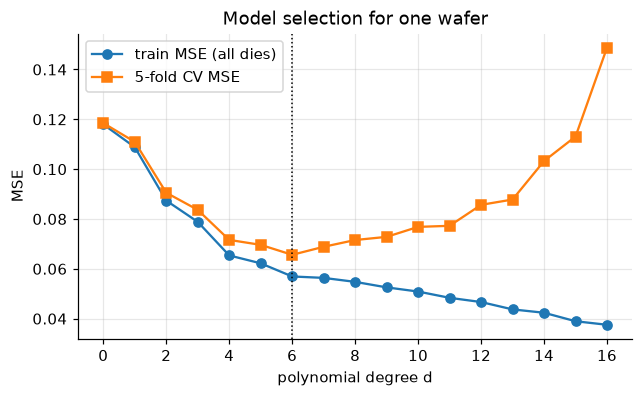

*그림 17. 예시 웨이퍼(#810328)에서 다항식 차수 d 에 따른 학습 MSE(파란 원)와 5-fold CV MSE(주황 사각형). 점선은 CV가 고른 d = 6이에요.*

- 학습 MSE는 위에서 증명한 대로 $d$ 가 커질수록 계속 줄어요. $d=0$ 의 값은 4-1의 Q1에서 구한 $\bar z(1-\bar z)$ 예요.
- CV MSE는 $d=6$ 까지 줄다가 다시 늘어나는 **U자 모양**이에요. 최솟값은 0.0656이고, 고차로 갈수록 가파르게 올라가서 $d=16$ 에서는 0.1488이 돼요. 두 곡선 사이의 간격이 $d$ 와 함께 벌어지는 것이 과적합의 신호예요.
- 이웃한 $d=5, 7$ 의 CV MSE도 최솟값과 크게 다르지 않아요. CV 곡선의 바닥이 평평하면 고른 차수 자체에도 불확실성이 있어요.

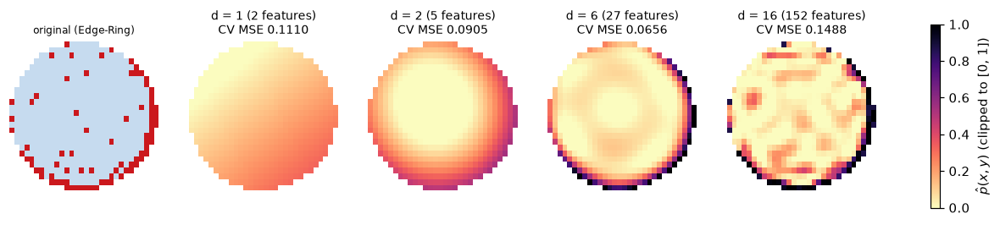

*그림 18. 왼쪽은 원래 웨이퍼 맵(빨강: 불량 다이, 하늘색: 정상 다이), 나머지는 차수 d = 1, 2, 6, 16으로 적합한 불량 확률 곡면이에요. 색은 [0, 1]로 잘라서 표시했어요.*

그림 읽는 법: 오른쪽 네 패널은 다이 위치마다 $\hat p$ 를 칠한 것이에요. 밝은 노랑이 0, 검정이 1이에요 (`magma_r` 색지도). 패널 제목에 특성 수와 CV MSE가 있어요: $d=1$ (특성 2개) 0.1110, $d=2$ (5개) 0.0905, $d=6$ (27개) 0.0656, $d=16$ (152개) 0.1488.

```text
d =  6: 다이 위치 p̂ ∈ [-0.08,  1.26]   원판 전체(다이 사이 포함) p̂ ∈ [-0.08,  1.59]
d = 16: 다이 위치 p̂ ∈ [-0.21,  1.16]   원판 전체(다이 사이 포함) p̂ ∈ [-6.04,  9.22]
```

- $d=6$ 은 다이 위치에서도 $\hat p$ 가 $[-0.08, 1.26]$ 으로 이미 $[0,1]$ 을 벗어나요 (선형확률모형의 한계). 원판 전체로 넓히면 $[-0.08, 1.59]$ 로 최댓값이 올라가지만, 아래 $d=16$ 에 비하면 변화가 작아요.
- $d=16$ 은 다이 위치에서는 $[-0.21, 1.16]$ 으로 멀쩡해 보이지만, 다이 사이 · 바깥까지 넓히면 $[-6.04, 9.22]$ 로 폭주해요.

#### 해석

- $d=1$: 기울어진 평면이라 링을 전혀 표현하지 못해요.
- $d=2$: 그릇 모양의 2차 곡면($x^2+y^2$ 같은)이라 "가장자리가 높다"는 경향은 잡지만, 가장자리 두세 줄에 몰린 **좁은 링**은 표현하지 못해요. 노트북의 설명대로 가장자리 확률은 낮게, 중심은 0 아래로 추정하는 **과소적합**(편향이 큼)이에요.
- $d=6$ (CV 최적): 가장자리 링이 매끄럽게 드러나요.
- $d=16$: 특성 152개로 다이 하나하나의 잡음까지 따라가서 곡면이 얼룩덜룩해요 (**과적합**, 분산이 큼). 그림은 다이 위치에서만 그려서 잘 안 보이지만, 데이터가 없는 다이 사이 · 바깥에서는 $\hat p$ 가 $[0,1]$ 을 크게 벗어나요. 다항식은 데이터의 경계에서 가장 크게 흔들리는데, 1-7의 1차원 예와 같은 현상이에요.
- 학습 데이터 위에서만 보면 과적합이 잘 드러나지 않아요. $d=16$ 의 다이 위치 범위 $[-0.21, 1.16]$ 은 $d=6$ 의 $[-0.08, 1.26]$ 과 비슷한 크기예요. 과적합은 **보지 않은 위치**에서 드러나고, CV는 바로 그 위치(빼 둔 다이)에서 오차를 재요.

> ⚠️ **주의**: 다이 단위의 무작위 K-fold에서는 빼 둔 다이의 바로 옆 다이가 학습에 남아요. 불량은 공간적으로 뭉쳐 있으니 이웃 정보가 새는 셈이에요. "같은 웨이퍼의 빈 곳 채우기"가 목적이면 괜찮지만, 보지 않은 영역이나 다른 웨이퍼로 일반화하는 성능을 보려면 공간 블록 단위로 폴드를 나눠야 해요. 3-3에서 로트 단위로 분할한 것과 같은 원리예요.

**생각해 볼 질문**

**Q1.** 그림 17에서 $d=16$ 의 학습 MSE는 가장 작은데 CV MSE는 가장 커요. 600개 다이에 152개 특성이면 어떤 일이 생기고 있을까요?

<details><summary>답</summary>

모수가 많을수록 학습 데이터의 잡음까지 맞출 수 있어서 학습 오차는 줄지만, 계수의 분산이 커져서 보지 않은 다이에서의 예측이 크게 흔들려요. 편향–분산 분해(1-7)에서 분산 항이 커지는 거예요. 다이 사이에서 $\hat p$ 가 $[-6.04, 9.22]$ 까지 나가는 것이 그 흔들림이에요.

</details>

**Q2.** CV 곡선의 바닥이 평평해서 이웃한 차수(예: $d=5,6,7$)의 CV MSE가 비슷할 때 어떤 차수를 고르는 게 좋을까요?

<details><summary>답</summary>

흔히 **1-표준오차 규칙**(one-standard-error rule)을 써요. 폴드별 MSE의 흩어짐으로 CV 추정값의 표준오차를 구하고, 최솟값에서 1 표준오차 안에 드는 모형 중 가장 단순한 것을 골라요. 성능 차이가 통계적으로 구별되지 않으면 분산이 작고 해석하기 쉬운 단순한 모형이 낫다는 생각이에요.

</details>

### 4-4. 릿지 정규화: 차수 대신 벌점으로 복잡도 조절

> 💻 **노트북**: 4-4의 코드 셀 1개 (λ 격자 위의 CV · 유효 자유도 · 그림 19, 20). 60분 진행에서는 1-7의 릿지 셀을 건너뛰었으므로 릿지를 여기서 처음 실제로 돌려 봐요.

차수는 거친 손잡이예요. $d$ 를 하나 올리면 특성이 $d+2$ 개씩 한꺼번에 늘어요. 릿지(ridge)는 가장 큰 모형($d=16$, 특성 152개)을 고정하고, 계수 크기에 주는 벌점 $\lambda$ 하나로 복잡도를 **연속적으로** 조절해요.

#### 수식: 릿지 해와 유효 자유도

1-7과 같은 설정이에요. 특성 행렬을 열마다 표준화한 $Z\in\mathbb R^{n\times q}$ 를 쓰므로 $\mathbf 1^\top Z=\mathbf 0^\top$ 이고, 절편 $b$ 에는 벌점을 주지 않아요.

$$
J(b,\mathbf w)=\frac1n\lVert\mathbf z-b\mathbf 1-Z\mathbf w\rVert^2+\lambda\lVert\mathbf w\rVert^2
$$

**1단계, 절편.** $\mathbf z_c=\mathbf z-\bar z\mathbf 1$ 이라 두면 $\mathbf z-b\mathbf 1-Z\mathbf w=(\mathbf z_c-Z\mathbf w)+(\bar z-b)\mathbf 1$ 이고, $\mathbf 1^\top\mathbf z_c=0$, $\mathbf 1^\top Z=\mathbf 0^\top$ 이라 교차항이 사라져서

$$
\lVert\mathbf z-b\mathbf 1-Z\mathbf w\rVert^2=\lVert\mathbf z_c-Z\mathbf w\rVert^2+n(\bar z-b)^2
$$

이에요. $\mathbf w$ 와 상관없이 $\hat b=\bar z$ 예요.

**2단계, 계수.** 남은 목적함수를 $\mathbf w$ 로 미분해서 0으로 두면

$$
-\frac2nZ^\top(\mathbf z_c-Z\mathbf w)+2\lambda\mathbf w=\mathbf 0\quad\Longrightarrow\quad(Z^\top Z+n\lambda I)\,\hat{\mathbf w}_\lambda=Z^\top\mathbf z_c
$$

예요. $\lambda>0$ 이면 $Z^\top Z+n\lambda I\succ0$ 이라 해가 유일하고, 목적함수가 강볼록이라 이 정상점이 전역 최솟점이에요. $Z$ 가 계수 부족이어도 마찬가지예요.

**3단계, SVD로 보기.** 얇은 SVD $Z=UDV^\top$ ($D=\operatorname{diag}(d_1,\dots,d_q)$, $U^\top U=V^\top V=I$) 를 써요. 여기서는 $n=600\ge q=152$ 라서 $V$ 는 $q\times q$ 직교행렬이고 $VV^\top=I$ 예요. 그러면 $Z^\top Z+n\lambda I=VD^2V^\top+n\lambda VV^\top=V(D^2+n\lambda I)V^\top$ 이므로

$$
\hat{\mathbf w}_\lambda=\sum_j\frac{d_j}{d_j^2+n\lambda}\,(\mathbf u_j^\top\mathbf z_c)\,\mathbf v_j,\qquad Z\hat{\mathbf w}_\lambda=\sum_j\mathbf u_j\,\frac{d_j^2}{d_j^2+n\lambda}\,\mathbf u_j^\top\mathbf z_c
$$

예요. OLS라면 각 방향 $\mathbf u_j$ 의 성분을 그대로 쓰는데, 릿지는 $d_j^2/(d_j^2+n\lambda)\in[0,1)$ 배로 **줄여요(shrinkage)**. 특이값이 작은 방향, 즉 특성끼리 거의 공선인 방향일수록 강하게 줄어요. 계수의 크기는

$$
\lVert\hat{\mathbf w}_\lambda\rVert^2=\sum_j\frac{d_j^2}{(d_j^2+n\lambda)^2}\,(\mathbf u_j^\top\mathbf z_c)^2
$$

이고, 각 항이 $\lambda$ 에 대해 감소하므로 $\lVert\hat{\mathbf w}_\lambda\rVert$ 는 $\lambda$ 가 커질수록 줄어요. 그림 20의 $\lVert\mathbf w\rVert$ 값이 이것이에요.

**4단계, 유효 자유도.** 적합값은 $\hat{\mathbf z}_c=S_\lambda\mathbf z_c$, $S_\lambda=Z(Z^\top Z+n\lambda I)^{-1}Z^\top=U\operatorname{diag}\big(\tfrac{d_j^2}{d_j^2+n\lambda}\big)U^\top$ 꼴의 선형 평활기예요. OLS에서 $\operatorname{tr}H=p$ 가 모형의 자유도였던 것(1-4)처럼 $\operatorname{tr}S_\lambda$ 를 유효 자유도로 정의해요.

$$
\operatorname{df}(\lambda)=\operatorname{tr}S_\lambda=\operatorname{tr}\Big(\operatorname{diag}\big(\tfrac{d_j^2}{d_j^2+n\lambda}\big)U^\top U\Big)=\sum_j\frac{d_j^2}{d_j^2+n\lambda},\qquad \frac{d}{d\lambda}\operatorname{df}(\lambda)=-\sum_j\frac{n\,d_j^2}{(d_j^2+n\lambda)^2}<0
$$

$\operatorname{df}$ 는 $\lambda$ 에 대해 순감소하고, $\lambda\to0$ 이면 $\operatorname{rank}(Z)$, $\lambda\to\infty$ 이면 0으로 가요. $\operatorname{Cov}(\mathbf z)=\sigma^2I$ 라면 절편까지 포함한 적합값 $\hat{\mathbf z}=\bar z\mathbf 1+S_\lambda\mathbf z$ ($S_\lambda\mathbf 1=\mathbf 0$ 이라서) 에 대해 $\sum_i\operatorname{Cov}(\hat z_i,z_i)/\sigma^2=1+\operatorname{tr}S_\lambda$ 이고, 1은 절편 몫이에요. 즉 df는 "적합값이 관측값에 얼마나 민감하게 반응하는가"를 재는 양이기도 해요.

**5단계, $\lambda=10^{-8}$ 에서도 df가 152가 아닌 이유.** 각 항 $d_j^2/(d_j^2+n\lambda)$ 는 $d_j^2\gg n\lambda$ 이면 거의 1, $d_j^2=n\lambda$ 이면 $1/2$, $d_j^2\ll n\lambda$ 이면 거의 0이에요. $n\lambda=600\times10^{-8}=6\times10^{-6}$ 이고, 표준화한 열의 제곱합이 $n-1=599$ 라서 $d_j^2$ 의 평균은 599예요. 그런데도 df가 152보다 꽤 작다면, $d_j^2$ 가 평균보다 $10^8$ 배 가까이 작은 방향이 여럿 있다는 뜻이에요. $[-1,1]$ 에서 $x^{16}$ 과 $x^{14}$ 처럼 고차 단항식끼리 거의 공선이기 때문이에요.

#### 코드 읽기

<details><summary>📝 셀 전체 코드 (줄별 주석)</summary>

```python
# ── 1. λ 격자 위의 5-fold CV (d = 16, 특성 152개 고정) ─────────────
# 10^-8 … 10^3 를 로그 간격으로 23개 → 이웃한 값이 10^0.5 배씩 차이 나요 (λ 는 곱셈 척도의 손잡이).
lam_grid = torch.logspace(-8, 3, 23, dtype=F64)
# 4-3 과 같은 cv_mse · 같은 시드 → 차수 선택과 같은 폴드에서 비교해요. .item() 으로 파이썬 float 로 넘겨요.
cv_l = [cv_mse(P_all, z_ex, lam=l.item()) for l in lam_grid]
lam_star = lam_grid[int(torch.tensor(cv_l).argmin())].item()   # CV MSE 가 가장 작은 λ

# ── 2. 유효 자유도 df(λ) = Σ_j d_j² / (d_j² + nλ) ────────────────
# 600개 전부로 열마다 표준화한 Z (ridge_fit 내부와 같은 방식, std 는 n−1 로 나눔). (600, 152)
Z_ex = (P_all - P_all.mean(0)) / P_all.std(0)
# svdvals: 특이벡터 없이 특이값만 계산 (min(n, q) = 152개, 내림차순). 제곱하면 d_j² = ZᵀZ 의 고윳값
sv2 = torch.linalg.svdvals(Z_ex) ** 2
# len(z_ex) = n. 각 항 d_j²/(d_j² + nλ) ∈ [0, 1) 이 방향 j 의 축소 비율이고, 그 합이 tr S_λ 예요.
dof = [(sv2 / (sv2 + len(z_ex) * l)).sum().item() for l in lam_grid]
print(f"CV로 고른 λ = {lam_star:.1e},  유효 자유도 df(λ) = {(sv2 / (sv2 + len(z_ex) * lam_star)).sum().item():.1f} (특성 {P_all.shape[1]}개)")
# 가장 작은 λ 에서도 df < 152: d_j² 가 nλ = 6e-6 보다 작은, 거의 공선인 방향이 여럿 있어요.
# matrix_rank 는 기본 허용오차(σ_max · max(n, q) · eps)로 센 수치 계수예요.
print(f"λ = 1e-8 에서도 df = {dof[0]:.1f}  (rank(Z) = {torch.linalg.matrix_rank(Z_ex).item()})")
print(f"CV MSE: 차수 선택 최적 {min(cv_d):.4f}  vs  릿지 최적 {min(cv_l):.4f}")

# ── 3. 그림 19: CV MSE(왼쪽 축)와 df(λ)(오른쪽 축) ──────────────
fig, ax = plt.subplots(figsize=(6.5, 3.6))
ax.semilogx(lam_grid.numpy(), cv_l, "s-", color="C1", label="5-fold CV MSE")   # 가로축만 로그 척도
ax.axvline(lam_star, color="k", ls=":", lw=1)       # CV 가 고른 λ
ax.set(xlabel=r"$\lambda$", ylabel="CV MSE", title=f"Ridge, d = {D_MAX}")
ax2 = ax.twinx()                                    # 가로축을 공유하고 세로축만 오른쪽에 따로 둔 두 번째 축
ax2.semilogx(lam_grid.numpy(), dof, "--", color="C2", label=r"df($\lambda$)")
ax2.set_ylabel(r"effective dof df($\lambda$)", color="C2")
ax2.grid(False)                                     # 두 축의 격자선이 겹쳐 보이지 않게 오른쪽 축 격자는 꺼요
# 범례는 축마다 따로 생기므로, 두 축의 (선, 이름) 목록을 합쳐 범례 하나로 그려요.
h1, l1 = ax.get_legend_handles_labels()
h2, l2 = ax2.get_legend_handles_labels()
ax.legend(h1 + h2, l1 + l2, loc="upper center")
plt.show()

# ── 4. 그림 20: λ = 1e-8 (과적합) · λ* (CV 최적) · 1e2 (과소적합) 의 곡면 ──
fig, axes = plt.subplots(1, 4, figsize=(12, 3.2))
show_wafer(axes[0], wm_ex, "original")
for ax, lam in zip(axes[1:], [1e-8, lam_star, 1e2]):
    # λ > 0 이라 ridge_fit 은 (ZᵀZ + nλI) w = Zᵀ(z − z̄) 를 풀어요. 절편 b = z̄ 는 벌점 없음.
    m = ridge_fit(P_all, z_ex, lam)
    # 제목: :.0e → 지수 표기(예: 1e-08), ‖w‖ 는 표준화한 특성의 계수 크기 (λ 가 커질수록 줄어요)
    im = show_prob(ax, to_image(ridge_predict(m, P_all), where_ex), f"d = {D_MAX}, λ = {lam:.0e}\n‖w‖ = {m['w'].norm().item():.2f}")
fig.colorbar(im, ax=axes, shrink=0.8, label=r"$\hat p(x, y)$")
plt.show()
```

</details>

```python
lam_grid = torch.logspace(-8, 3, 23, dtype=F64)
cv_l = [cv_mse(P_all, z_ex, lam=l.item()) for l in lam_grid]
lam_star = lam_grid[int(torch.tensor(cv_l).argmin())].item()

Z_ex = (P_all - P_all.mean(0)) / P_all.std(0)
sv2 = torch.linalg.svdvals(Z_ex) ** 2
dof = [(sv2 / (sv2 + len(z_ex) * l)).sum().item() for l in lam_grid]
```

- `torch.logspace(-8, 3, 23)` 은 $10^{-8}$ 부터 $10^{3}$ 까지 반 자릿수($10^{0.5}$ 배) 간격의 23개 값이에요. $\lambda$ 는 곱셈 척도로 움직이는 손잡이라 로그 간격으로 훑어요.
- `cv_mse(P_all, z_ex, lam=...)` 는 4-3과 같은 함수, 같은 시드라서 **차수 선택과 같은 폴드**에서 비교해요.
- `Z_ex` 는 600개 전부로 표준화한 $Z$ 이고, `torch.linalg.svdvals` 는 특이벡터 없이 특이값만 계산해요. `dof` 가 $\operatorname{df}(\lambda)=\sum_j d_j^2/(d_j^2+n\lambda)$ 를 그대로 옮긴 것이에요 (`len(z_ex)` 가 $n$).

실제 풀이는 1-7의 `ridge_fit` 이 해요. $\lambda>0$ 일 때의 분기가 2단계의 식이에요.

```python
    mu, sd = P.mean(0), P.std(0).clamp_min(1e-12)
    Z = (P - mu) / sd
    if lam == 0:
        w = torch.linalg.lstsq(Z, (y - b).unsqueeze(1)).solution.squeeze(1)
    else:
        A = Z.T @ Z + lam * len(y) * torch.eye(P.shape[1], dtype=P.dtype)
        w = torch.linalg.solve(A, Z.T @ (y - b))
```

- `lam * len(y)` 가 $n\lambda$ 예요. 목적함수를 $\frac1n\lVert\cdot\rVert^2$ 로 정의했기 때문에, 학습 폴드(480개)와 전체(600개)에서 같은 $\lambda$ 가 같은 강도의 벌점을 뜻해요.
- `lam == 0` 이면 `torch.linalg.lstsq` (CPU 기본 드라이버는 계수 부족도 다루는 열 피벗 QR 계열)로 OLS를, 아니면 양정치 행렬 `A` 로 `torch.linalg.solve` 를 써요. 절편은 `b = y.mean()` 으로 1단계의 $\hat b=\bar z$ 예요.

#### 결과

```text
CV로 고른 λ = 1.0e+00,  유효 자유도 df(λ) = 19.2 (특성 152개)
λ = 1e-8 에서도 df = 132.3  (rank(Z) = 152)
CV MSE: 차수 선택 최적 0.0656  vs  릿지 최적 0.0661
```

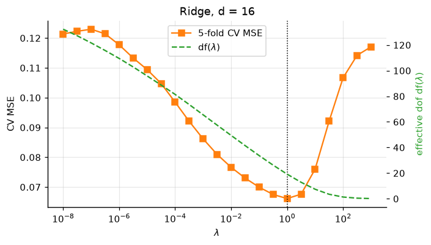

*그림 19. d = 16 다항식에 릿지를 적용했을 때 λ에 따른 5-fold CV MSE(주황, 왼쪽 축)와 유효 자유도 df(λ)(초록 점선, 오른쪽 축). 점선 세로줄은 CV가 고른 λ = 1이에요.*

그림 읽는 법: 가로축은 로그 척도의 $\lambda$ 예요. 왼쪽(작은 $\lambda$)이 복잡한 모형, 오른쪽이 단순한 모형이라 그림 17과 좌우가 반대예요.

- 초록 점선 $\operatorname{df}(\lambda)$ 는 4단계에서 증명한 대로 단조감소해요. 왼쪽 끝에서 132.3이고 $\lambda$ 가 커지면 0으로 가요.
- CV MSE는 $\lambda=1$ 에서 최소(0.0661)인 U자 모양이에요. 오른쪽 끝에서는 절편만 남는 모형(그림 17의 $d=0$)의 수준 가까이 올라가요.
- 왼쪽 끝($\lambda=10^{-8}$)의 CV MSE도 $d=16$ OLS의 CV MSE(0.1488, 그림 18)보다 눈에 띄게 낮아요. 아주 작은 $\lambda$ 도 특이값이 거의 0인 방향은 꺼 버리기 때문이에요 (5단계). $\lambda\to0$ 극한이 OLS가 되려면 $n\lambda$ 가 가장 작은 $d_j^2$ 보다도 훨씬 작아야 해요.

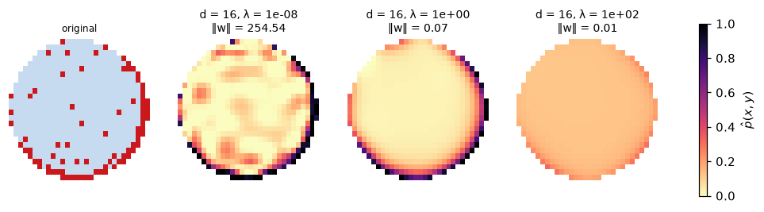

*그림 20. 왼쪽은 원래 웨이퍼 맵, 나머지는 d = 16에서 λ = 1e-8, 1, 1e2로 적합한 불량 확률 곡면과 계수 크기 ‖w‖예요.*

- $\lambda=10^{-8}$: $\lVert\mathbf w\rVert=254.54$ 로 계수가 크고, 곡면이 얼룩덜룩해요 (과적합).
- $\lambda=1$ (CV 최적): $\lVert\mathbf w\rVert=0.07$ 이고, 그림 18의 $d=6$ 곡면처럼 가장자리 링이 드러나되 안쪽은 더 매끄러워요.
- $\lambda=10^{2}$: $\lVert\mathbf w\rVert=0.01$ 로 계수가 거의 0이라 곡면이 평평해요. 남은 것은 평균 불량률($\hat b=\bar z$)뿐이에요 (과소적합).

#### 해석

- CV가 고른 $\lambda$ 에서 유효 자유도는 약 19예요. 특성은 152개인데 실제로는 차수 6 모형(특성 27개)보다도 단순한 모형처럼 행동해요. 다만 "특성 19개짜리 모형"과 같지는 않아요. 그런 모형은 19개 방향을 온전히 쓰고 나머지를 버리지만, 릿지는 152개 방향을 모두 남겨 두고 각각 $d_j^2/(d_j^2+n\lambda)$ 배로 부분적으로 줄여요. df는 그 비율의 합이에요.
- CV MSE는 차수 선택(0.0656)과 릿지(0.0661)가 거의 같아요. 릿지의 장점은 성능이 더 좋다는 게 아니라, 복잡도를 **연속적인 손잡이 하나($\lambda$)** 로 조절한다는 데 있어요. 특성에 차수 같은 자연스러운 순서가 없을 때(예: 서로 다른 공정 측정값 수십 개) 특히 유용해요.
- $\lambda$ 가 너무 작으면 $d=16$ OLS처럼 잡음을 따라가고($\lVert\mathbf w\rVert$ 가 큼), 너무 크면 계수가 모두 0으로 줄어 평균 불량률만 남아요. $\lambda=10^{-8}$ 에서도 df가 152가 아니라 132.3인 것은 5단계에서 본 고차 단항식의 공선성 때문이에요.

> 💡 **핵심**: 차수 선택은 "어떤 특성을 쓸까"를, 릿지는 "모든 특성을 얼마나 믿을까"를 정해요. 둘 다 편향–분산 균형을 맞추는 방법이고, 손잡이의 값은 교차검증으로 골라요.

> ⚠️ **주의**: $\lambda$ 값 자체에는 보편적인 의미가 없어요. 특성을 어떻게 표준화했는지, 벌점을 $n\lambda$ 로 쓰는지 $\lambda$ 로 쓰는지에 따라 같은 숫자가 다른 강도를 뜻해요. 다른 데이터나 다른 코드에 $\lambda=1$ 을 그대로 옮기지 말고, 그때마다 격자를 훑어서 골라야 해요.

**생각해 볼 질문**

**Q1.** $\lambda\to\infty$ 이면 $\hat p(x,y)$ 는 무엇이 될까요? 절편에도 벌점을 줬다면요?

<details><summary>답</summary>

$\hat{\mathbf w}_\lambda\to\mathbf 0$ 이고 절편은 벌점이 없으니 $\hat p\equiv\bar z$ (웨이퍼의 평균 불량률, 1 − 수율)예요. 절편에도 벌점을 주면 $\hat p\equiv0$ 으로 끌려가서, $\lambda$ 를 키울수록 평균 수준까지 틀리게 돼요. 그래서 절편은 벌점에서 빼요.

</details>

**Q2.** 릿지를 베이즈 관점에서 해석할 수 있을까요?

<details><summary>답</summary>

$\mathbf z_c\mid\mathbf w\sim\mathcal N(Z\mathbf w,\sigma^2I)$, 사전분포 $\mathbf w\sim\mathcal N(\mathbf 0,\tau^2I)$ 로 두면 사후분포의 로그는 $-\frac{1}{2\sigma^2}\lVert\mathbf z_c-Z\mathbf w\rVert^2-\frac{1}{2\tau^2}\lVert\mathbf w\rVert^2$ 에 상수를 더한 것이에요. 이를 최대화하는 MAP 추정량이 $n\lambda=\sigma^2/\tau^2$ 인 릿지 해예요. "계수가 0 근처일 것"이라는 사전 믿음이 벌점이에요.

</details>

### 4-5. 패턴별 공간 회귀 갤러리

> 💻 **노트북**: 4-5의 코드 셀 1개 (패턴 9개의 웨이퍼 한 장씩 · d = 12 릿지 곡면 · 그림 21)

4-3, 4-4에서 익힌 방법을 패턴마다 웨이퍼 한 장씩에 적용해서, 매끄러운 곡면이 무엇을 잡고 무엇을 놓치는지 봐요. 패턴이 잘 보이는 웨이퍼를 미리 골라 뒀어요. `GALLERY` 의 번호를 바꾸면 다른 웨이퍼로도 해 볼 수 있어요.

#### 설정

- 기저: $d=12$ 다항식, 특성 $q(12)=90$ 개.
- $\lambda$: 6개 후보 $\lbrace 10^{-3},10^{-2},10^{-1},1,10,10^{2}\rbrace$ 중에서 5-fold CV(반복 1회)로 웨이퍼마다 따로 골라요.
- 웨이퍼 한 장이 **회귀계수** $\hat{\mathbf w}\in\mathbb R^{90}$ 와 절편으로 요약돼요. 다이 수백~수천 개의 0/1 값이 숫자 91개가 되는 셈이에요.

다만 이 $\hat{\mathbf w}$ 는 웨이퍼끼리 그대로 비교할 수 없어요. $\hat w_j$ 는 표준화한 특성 $(x^ay^b-\mu_j)/s_j$ 의 계수인데, $\mu_j, s_j$ 를 웨이퍼마다 **자기 다이 배치**로 계산하니까 같은 $j$ 라도 웨이퍼마다 다른 함수의 계수예요. 게다가 $\lambda$ 가 다르면 줄어든 정도도 달라요. 패턴 분류의 특징으로 쓰려면 모든 웨이퍼에 같은 표준화 기준과 같은 $\lambda$ 를 쓰거나, 원판 위에서 직교하는 고정된 공통 기저(각도 항까지 넣은 Zernike 다항식 $R_n^m(r)\cos m\theta$, $R_n^m(r)\sin m\theta$)를 써서 계수가 항상 같은 함수와의 내적이 되게 해야 해요.

#### 코드 읽기

<details><summary>📝 셀 전체 코드 (줄별 주석)</summary>

```python
# ── 1. 패턴별로 골라 둔 웨이퍼와 설정 ─────────────────────────────
# {패턴: df 의 웨이퍼 번호}. 패턴이 잘 보이는 웨이퍼를 미리 골라 뒀어요 (번호를 바꿔 다른 웨이퍼로 해 볼 수 있어요).
GALLERY = {"none": 649384, "Center": 394506, "Donut": 279757, "Edge-Loc": 648683, "Edge-Ring": 385104,
           "Loc": 220247, "Near-full": 255069, "Random": 736832, "Scratch": 22044}
# 차수 12 → 특성 q(12) = 90개. λ 후보 6개 중 웨이퍼마다 CV 로 골라요.
D_GAL, LAMS_GAL = 12, [1e-3, 1e-2, 1e-1, 1.0, 10.0, 100.0]

# ── 2. 웨이퍼마다 λ 고르기 → 곡면 적합 → 그리기 (위: 맵, 아래: 곡면) ──
fig, axes = plt.subplots(2, len(GALLERY), figsize=(1.9 * len(GALLERY), 4.6))
for j, (c, k) in enumerate(GALLERY.items()):        # j: 열 번호, c: 패턴, k: 웨이퍼 번호
    assert df.at[k, "label"] == c                   # 골라 둔 번호의 라벨이 실제로 그 패턴인지 확인
    x_k, y_k, z_k, where_k = wafer_xyz(df.at[k, "waferMap"])   # 다이별 (x, y, z) 와 위치 정보
    P_k = poly_features(x_k, y_k, D_GAL)            # (다이 수, 90)
    # 내장 min 에 key 를 주면 argmin 이에요: CV MSE 가 가장 작은 λ. 9장 × 6 λ × 5폴드라 reps=1 로 줄였어요.
    lam_k = min(LAMS_GAL, key=lambda l: cv_mse(P_k, z_k, lam=l, reps=1))
    p_k = ridge_predict(ridge_fit(P_k, z_k, lam_k), P_k)   # 고른 λ 로 모든 다이에 다시 학습해 예측
    show_wafer(axes[0, j], df.at[k, "waferMap"], f"{c}\n#{k}")
    im = show_prob(axes[1, j], to_image(p_k, where_k), f"λ = {lam_k:.0e}")   # 제목: 고른 λ (지수 표기)
fig.colorbar(im, ax=axes[1], shrink=0.8, label=r"$\hat p$")   # 아래 줄 패널들에만 colorbar 하나
plt.suptitle("Top: wafer map · Bottom: ridge-regularized polynomial surface (d = 12)", y=1.02)
plt.show()
```

</details>

```python
GALLERY = {"none": 649384, "Center": 394506, "Donut": 279757, "Edge-Loc": 648683, "Edge-Ring": 385104,
           "Loc": 220247, "Near-full": 255069, "Random": 736832, "Scratch": 22044}
D_GAL, LAMS_GAL = 12, [1e-3, 1e-2, 1e-1, 1.0, 10.0, 100.0]
```

```python
    assert df.at[k, "label"] == c
    x_k, y_k, z_k, where_k = wafer_xyz(df.at[k, "waferMap"])
    P_k = poly_features(x_k, y_k, D_GAL)
    lam_k = min(LAMS_GAL, key=lambda l: cv_mse(P_k, z_k, lam=l, reps=1))
    p_k = ridge_predict(ridge_fit(P_k, z_k, lam_k), P_k)
```

- `assert` 는 골라 둔 번호의 라벨이 실제로 그 패턴인지 확인해요. 데이터를 다시 불러오거나 번호를 바꿨을 때의 실수를 막아요.
- `min(LAMS_GAL, key=...)` 은 파이썬 내장 `min` 에 `key` 를 줘서 CV MSE가 가장 작은 $\lambda$ 를 고르는 argmin이에요. 9장 × 6개 $\lambda$ × 5폴드를 돌려야 해서 `reps=1` 로 반복을 줄였어요.
- 최종 곡면은 고른 $\lambda$ 로 웨이퍼의 모든 다이에 다시 학습해서 그려요. 4-3의 함수를 그대로 다시 쓴 거예요.

#### 결과

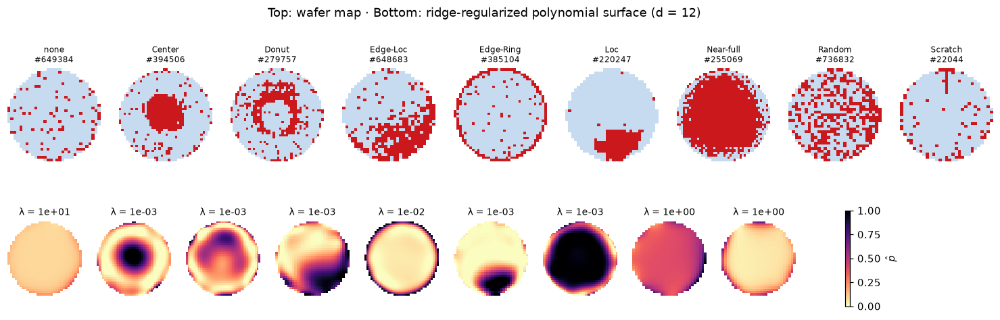

*그림 21. 위: 패턴별 웨이퍼 맵(제목은 패턴과 웨이퍼 번호). 아래: d = 12 다항식에 CV로 고른 λ로 적합한 불량 확률 곡면(색은 [0, 1]로 잘라 표시).*

그림 읽는 법: 위아래가 같은 웨이퍼예요. 아래 패널의 색은 그림 18과 같이 밝은 노랑이 0, 검정이 1이고, 제목이 CV로 고른 $\lambda$ 예요.

| 패턴 | 웨이퍼 번호 | CV로 고른 λ | 곡면이 보여 주는 것 |
|---|---|---|---|
| `none` | 649384 | 1e+01 | 거의 평평해요 |
| `Center` | 394506 | 1e-03 | 중심의 진한 원판 |
| `Donut` | 279757 | 1e-03 | 중간 반지름의 고리 (고리 진하기가 고르지 않아요) |
| `Edge-Loc` | 648683 | 1e-03 | 오른쪽 아래 가장자리의 진한 영역 |
| `Edge-Ring` | 385104 | 1e-02 | 가장자리를 따라 도는 얇은 고리 |
| `Loc` | 220247 | 1e-03 | 아래쪽의 진한 덩어리 |
| `Near-full` | 255069 | 1e-03 | 거의 전체가 진하고 가장자리만 옅어요 |
| `Random` | 736832 | 1e+00 | 전체가 중간 정도 진하기의 밋밋한 면 |
| `Scratch` | 22044 | 1e+00 | 선은 거의 지워지고 위쪽 가장자리에 작은 진한 부분만 남아요 |

#### 해석

- `Center`, `Donut`, `Edge-Ring`, `Edge-Loc`, `Loc`, `Near-full`: 작은 $\lambda$ 로 매끄러운 곡면이 패턴의 위치와 모양을 잘 잡아요. 4-2의 반경 프로파일로는 지워졌던 `Loc`, `Edge-Loc` 의 **위치**가 곡면에서는 그대로 보여요.
- `none`: CV가 큰 $\lambda$ 를 골라 곡면이 거의 평평해요. `Random` 도 비교적 큰 $\lambda$ 가 골라져 곡면이 밋밋해요. 불량이 공간적으로 독립에 가깝게 흩어져 있으면 위치로 예측할 정보가 거의 없어서, 보지 않은 다이에 대한 최선의 예측이 상수(평균 불량률)에 가까워요. "뚜렷한 공간 구조가 거의 없다"는 것을 회귀가 스스로 알려 주는 셈이에요.
- `Scratch`: 비교적 큰 $\lambda$ 가 골라져 선이 거의 지워졌어요. 가늘고 긴 선을 매끄러운 **전역 다항식(차수 12)** 으로 표현하려면 차수가 아주 높아야 하고, 그만큼 분산이 커지기 때문이에요 (**기저의 한계**). 즉 큰 $\lambda$ 가 항상 "구조가 없다"는 뜻은 아니에요. 구조가 **이 기저로 표현하기 어렵다**는 뜻일 수도 있어요. 국소적인 패턴에는 국소 기저(스플라인, 방사기저함수 등)나 데이터에서 학습하는 특징(CNN)이 필요해요.
- **선형확률모형의 범위**: 그림은 $[0,1]$ 로 잘라서 그렸어요. `Near-full` 이나 `Center` 처럼 불량이 밀집한 곳의 검정은 "1"이 아니라 "1 이상"일 수 있어요. 4-3의 웨이퍼에서도 $d=6$ 곡면이 다이 위치에서 1.26까지 올라갔어요.
- **웨이퍼 한 장의 곡면이에요**: 각 곡면은 그 웨이퍼 한 장의 불량 확률 추정이지, 패턴 전체의 대표 모양이 아니에요. 게다가 갤러리의 웨이퍼는 패턴이 잘 보이는 것으로 골라 둔 것이라 전형적인 웨이퍼보다 쉬운 예예요.

> ⚠️ **주의**: 9장 중 5장(`Center`, `Donut`, `Edge-Loc`, `Loc`, `Near-full`)에서 고른 $\lambda$ 가 후보의 가장 작은 값 $10^{-3}$ 이에요. 격자의 끝값이 골라지면 실제 최적값은 격자 밖(더 작은 쪽)에 있을 수 있어요. 이럴 때는 격자를 넓혀서 CV 곡선의 바닥이 격자 안에 들어오는지 확인해야 해요. 반대로 `none` 의 $10$ 은 위쪽 끝($10^2$)에서 한 칸 안쪽이라 큰 문제가 없어요.

> 💡 **핵심**: 웨이퍼 맵 한 장을 매끄러운 곡면 하나, 곧 계수 90개로 요약할 수 있어요. 이런 요약은 패턴 분류의 특징이 될 수 있지만, 같은 기준으로 만든 계수여야 하고, 기저가 표현하지 못하는 패턴(선, 흩어진 점)은 놓쳐요. 이 한계가 다음 시간들의 로지스틱 회귀와 CNN으로 이어져요.

**생각해 볼 질문**

**Q1.** `Random` 웨이퍼의 불량률은 높은데 CV는 왜 큰 $\lambda$ (평평한 곡면)를 골랐을까요?

<details><summary>답</summary>

CV가 재는 것은 "불량률이 높은가"가 아니라 "위치로 보지 않은 다이의 불량을 더 잘 맞힐 수 있는가"예요. 불량이 위치와 거의 무관하게 흩어져 있으면 $p(x,y)$ 가 상수에 가깝고, 곡면에 굴곡을 넣어 봐야 잡음만 따라가서 검증 오차가 늘어요. 그래서 높은 수준의 평평한 곡면이 최선이에요.

</details>

**Q2.** 모든 웨이퍼의 $\hat{\mathbf w}$ 를 분류의 특징 벡터로 쓰려면 갤러리 코드에서 무엇을 바꿔야 할까요?

<details><summary>답</summary>

(1) 표준화의 $\mu_j, s_j$ 를 웨이퍼마다 계산하지 말고 공통 기준(예: 단위원판 위의 고정된 격자)에서 한 번만 계산해 모든 웨이퍼에 써요. (2) $\lambda$ 도 하나로 고정해요. 또는 (3) 원판 위에서 직교하는 공통 기저(각도 항까지 넣은 Zernike 다항식)를 써서 계수가 항상 같은 함수와의 내적이 되게 해요. 맵 크기가 달라도 같은 기저 함수를 정규화 좌표에서 계산하면 비교할 수 있어요.

</details>

## PART 5. 정리 (90분: 5분 · 60분: 5분)

### 5-1. 개념 정리

> 💻 **노트북**: PART 5 맨 앞의 정리 표 (코드 셀 없음)

합성 데이터, 로트 수율, 웨이퍼 맵이라는 세 무대에서 같은 몇 가지 아이디어가 되풀이됐어요. 노트북의 정리 표를 한 줄씩 다시 묶어 봐요.

| 개념 | 수식 / 도구 | 이번 시간에 쓴 곳 |
|---|---|---|
| 최소제곱 · 정규방정식 | $X^\top X\hat{\boldsymbol\beta}=X^\top\mathbf y$, QR, `torch.linalg.lstsq` | 1-3, 2-7, 3-4 |
| 사영 · $R^2$ | $H^2=H$, TSS = ESS + RSS | 1-4, 2-8 (ANOVA = 더미 회귀) |
| 추론 | $\hat{\boldsymbol\beta}\sim\mathcal N(\boldsymbol\beta,\sigma^2(X^\top X)^{-1})$, 샌드위치 추정량 | 1-5, 3-7 |
| 경사하강법 | $0 < \eta < 2/\lambda_{\max}$, 수렴률 $(\kappa-1)/(\kappa+1)$, 표준화 | 1-6, 3-5 (`nn.Linear` + `DataLoader`) |
| 기저함수 · 과적합 · 릿지 | 편향–분산, $(Z^\top Z+n\lambda I)^{-1}Z^\top\mathbf y_c$, $\operatorname{df}(\lambda)$ | 1-7, 4-3, 4-4 |
| 요약 통계량 | $\Phi^\top\Phi$, $\Phi^\top\mathbf z$ 만으로 OLS (스트리밍 회귀) | 4-2 (1.8억 개 다이) |
| 모형화 | 비선형 모형의 선형화, 그룹 분할, 잔차 진단 | 2-7, 3-3, 3-6 |

1. **최소제곱 · 정규방정식**: RSS의 기울기를 0으로 두면 정규방정식이 나오고, $X$ 가 열 완전계수이면 해가 유일해요. 계산은 조건수를 제곱하지 않는 QR · `lstsq` 로 해요 (1-3에서 cond(X) = 11.0, cond(XᵀX) = 120.8).
2. **사영 · $R^2$**: 적합값은 $\mathbf y$ 를 $X$ 의 열공간에 직교사영한 것이고, 절편이 있으면 피타고라스 정리로 TSS = ESS + RSS예요. 로트 지시 변수의 열공간으로 사영하면 로트 평균이 나오므로, 2-8의 η² = 0.913은 로트 더미 회귀의 $R^2$ 예요.
3. **추론**: 가정 1–5 아래에서 $\hat{\boldsymbol\beta}$ 는 정확히 정규분포를 따르고, 표준오차 · $t$ 값 · 신뢰구간이 여기서 나와요 (1-5 몬테카를로의 95% 신뢰구간 포함 비율 0.946). 오차가 로트 안에서 상관되면 이 공식이 분산을 과소평가해서, 3-7의 샌드위치 추정량으로는 `first_std` 의 표준오차가 14.5414배가 됐어요.
4. **경사하강법**: 오차가 $(I-\eta A)^t$ 로 줄어들어서, 수렴 여부는 $\eta\lambda_{\max}$ 가, 속도는 $\kappa$ 가 정해요. 1-6에서는 표준화로 κ가 120.8에서 1.0이 됐고, 3-5에서는 특성끼리 상관이 강해 표준화 후에도 κ = 74.1이었어요. `nn.Linear` + `DataLoader` + `SGD` 루프는 딥러닝 모델의 학습 루프와 구조가 같아요.
5. **기저함수 · 과적합 · 릿지**: 특성을 비선형 함수로 바꿔도 파라미터에 대해 선형이면 같은 이론이 적용돼요. 복잡도는 차수 $d$ 나 벌점 $\lambda$ 로 조절하고 교차검증으로 골라요. 4-4에서 특성 152개 모형은 CV가 고른 λ에서 유효 자유도가 19.2로 줄었고, CV MSE는 차수 선택과 거의 같았어요 (차수 선택 0.0656, 릿지 0.0661).
6. **요약 통계량**: OLS 해는 $\Phi^\top\Phi$ 와 $\Phi^\top\mathbf z$ 만으로 정해져요. 4-2에서는 다이 180,254,089개의 설계행렬을 만들지 않고 $7\times7$ 행렬과 길이 7 벡터만 누적해서 정확한 해를 얻었어요.
7. **모형화**: 어떤 회귀 기법을 쓰느냐보다 문제를 어떻게 정식화하느냐가 결과를 더 크게 좌우해요. 2-7은 $Y=Y_0e^{-A_wD_0/N}$ 에 로그를 취해 선형화했고(영향점 5개를 빼면 $R^2$ 가 0.043에서 0.375로), 3-3은 로트 단위로 나눠 정보 누수를 막았고, 3-6은 잔차 그림으로 이분산과 두꺼운 꼬리를 찾았어요.

> 💡 **핵심**: 세 사례에서 바뀐 것은 설계행렬(관측 단위와 열을 채우는 방법)뿐이고, 푸는 방법은 같은 최소제곱이었어요.

**생각해 볼 질문**

1. 표의 내용 중 1-1의 표준 가정(선형성 · 외생성 · 등분산 · 정규성)이 **필요 없는** 것과 필요한 것을 나눠 보세요.

<details><summary>답</summary>

정규방정식, 사영과 TSS = ESS + RSS(절편 필요), 경사하강법의 수렴 조건, 릿지 해의 공식, 요약 통계량으로 푸는 OLS는 순수한 선형대수 · 최적화라서 완전 열계수(릿지는 그것도 불필요) 말고는 가정이 필요 없어요. 반면 $\mathbb E[\hat{\boldsymbol\beta}]=\boldsymbol\beta$ 는 선형성 · 외생성, $\operatorname{Cov}(\hat{\boldsymbol\beta})=\sigma^2(X^\top X)^{-1}$ 과 Gauss–Markov 정리는 등분산 · 무상관, 정확한 정규분포와 $t$ 분포는 정규성까지 필요해요. 샌드위치 추정량은 등분산 · 무상관 가정을 "군집 사이 독립"으로 완화한 거예요.

</details>

### 5-2. 이번 분석에서 드러난 선형회귀의 한계

> 💻 **노트북**: PART 5의 "이번 분석에서 드러난 선형회귀의 한계 → 다음 시간 예고" 목록

선형회귀가 어디서 잘 맞았는지만큼, 어디서 깨졌는지가 다음에 배울 모델을 정해 줘요.

#### ① 타깃이 확률 · 비율이에요: 예측이 $[0,1]$ 을 벗어나고 분산이 평균에 따라 달라요

**이번 시간의 증거**
- 3-6: 수율 예측값의 범위가 [-0.001, 1.000]이고 테스트 87,040개 중 10개가 0 미만이었어요. 잔차 대 적합값 그림(그림 14 가운데)에서 잔차의 띠가 예측값 1 근처에서 가장 좁고, 예측 수율이 0.6 쪽으로 낮아질수록 넓게 퍼져요.
- 4-2: `Center` 의 반경 프로파일은 $\hat p(0)>1$ 이에요 (그림 16).
- 4-3: 차수 6 곡면이 다이 위치에서 [-0.08, 1.26], 원판 전체에서 [-0.08, 1.59], 차수 16은 원판 전체에서 [-6.04, 9.22]였어요.

불량 여부 $z\in\lbrace 0,1\rbrace$ 는 $z^2=z$ 라서 $\mathbb E[z^2\mid\mathbf x]=p(\mathbf x)$ 이고, 따라서

$$
\operatorname{Var}(z\mid\mathbf x)=\mathbb E[z^2\mid\mathbf x]-\big(\mathbb E[z\mid\mathbf x]\big)^2=p(\mathbf x)\big(1-p(\mathbf x)\big)
$$

예요. $p$ 가 상수가 아니면 등분산 가정이 **구조적으로** 깨져요. OLS는 여전히 $L^2$ 사영을 추정하지만 Gauss–Markov의 최소분산 보장이 사라지고, 등분산을 가정한 표준오차도 틀려요. 그리고 $\beta_0+\boldsymbol\phi^\top\mathbf w$ 에는 값을 $[0,1]$ 안에 묶어 둘 장치가 없어요.

**다음 시간: 로지스틱 회귀.** 확률을 선형예측자의 시그모이드로 모형화하고, 베르누이 우도를 최대화해요.

$$
p(\mathbf x)=\sigma\big(\beta_0+\boldsymbol\phi(\mathbf x)^\top\mathbf w\big),\qquad
\sigma(t)=\frac{1}{1+e^{-t}}\in(0,1)
\quad\Longleftrightarrow\quad
\log\frac{p}{1-p}=\beta_0+\boldsymbol\phi^\top\mathbf w
$$

절편 열을 붙인 설계행렬을 $\tilde X$, 파라미터를 $\boldsymbol\theta=(\beta_0,\mathbf w)$, $t_i=\tilde{\mathbf x}_i^\top\boldsymbol\theta$ 라 하고 $\sigma'(t)=\sigma(t)\big(1-\sigma(t)\big)$ 를 쓰면

$$
\begin{aligned}
\ell(\boldsymbol\theta)&=\sum_{i=1}^{n}\Big[z_i\log\sigma(t_i)+(1-z_i)\log\big(1-\sigma(t_i)\big)\Big],\\
\frac{\partial\ell}{\partial t_i}&=z_i\big(1-\sigma(t_i)\big)-(1-z_i)\,\sigma(t_i)=z_i-p_i,
\qquad
\nabla_{\boldsymbol\theta}\,\ell=\tilde X^\top(\mathbf z-\mathbf p).
\end{aligned}
$$

정규방정식 $X^\top(\mathbf y-X\boldsymbol\beta)=\mathbf 0$ 과 똑같이 "설계행렬ᵀ × 잔차 = 0" 꼴이지만, $\mathbf p$ 가 $\boldsymbol\theta$ 의 비선형 함수라 닫힌 해가 없어요. 그래서 1-6 · 3-5의 경사하강법 루프가 그대로 주인공이 돼요.

#### ② 오차가 로트 단위로 묶여 있어요 (군집 상관)

**이번 시간의 증거**
- 2-8: 웨이퍼 수율 변동의 대부분이 로트 간 차이였어요 (η² = 0.913, $R^2_{adj}$ = 0.908).
- 3-3: 웨이퍼를 무작위로 나누면 같은 로트가 학습 · 테스트에 함께 들어가 정보 누수가 생겨서, 로트 단위로 나눴어요 (학습 17,410 로트, 테스트 4,352 로트).
- 3-7 (심화): 군집-강건 표준오차가 iid 표준오차의 `first_mean` 6.4082배, `first_std` 14.5414배였고, `first_edge` 의 $t$ 값은 −26.2077에서 −4.5946으로 줄었어요.
- 3-8: 타깃 웨이퍼의 실제 로트 평균을 알아도 test $R^2$ = 0.905가 천장이었어요. 로트 수준 특성으로는 로트 안의 차이를 설명할 수 없어요.

로트 효과를 확률변수로 두는 **랜덤 절편 모형**으로 보면 구조가 분명해져요. 3-3에서 오차를 $\varepsilon_{gi}=u_g+\xi_{gi}$ 로 나눈 것과 같은 모형이고, 기호($u_g$, $\xi_{gi}$, $\tau^2$, $\sigma_w^2$)도 3-3과 같아요. 로트 $g$ 의 웨이퍼 $i$ 에 대해

$$
y_{gi}=\mathbf x_{gi}^\top\boldsymbol\beta+u_g+\xi_{gi},\qquad
u_g\sim(0,\tau^2),\quad \xi_{gi}\sim(0,\sigma_w^2),\quad\text{모두 서로 독립}
$$

이면 $\operatorname{Cov}(\mathbf y_g)=\sigma_w^2I_m+\tau^2\mathbf 1\mathbf 1^\top$ 이고, 군집 내 상관(ICC)은 $\rho=\tau^2/(\tau^2+\sigma_w^2)$ 예요. $X$ 를 고정하고, 특성이 로트 안에서 일정하고($\mathbf x_{gi}=\mathbf x_g$) 로트 크기가 모두 $m$ 이면 $X^\top X=m\sum_g\mathbf x_g\mathbf x_g^\top$ 이고 $\hat{\boldsymbol\beta}-\boldsymbol\beta=(X^\top X)^{-1}\sum_g\mathbf x_gS_g$ ($S_g=\sum_i(u_g+\xi_{gi})$) 예요. 여기서 $\operatorname{Var}(S_g)=m\sigma_w^2+m^2\tau^2=m\sigma_{\text{tot}}^2\big(1+(m-1)\rho\big)$ ($\sigma_{\text{tot}}^2=\sigma_w^2+\tau^2$, 3-7의 $\sigma^2$) 라서

$$
\operatorname{Cov}(\hat{\boldsymbol\beta})=(X^\top X)^{-1}\Big(\sum_g\mathbf x_g\mathbf x_g^\top\operatorname{Var}(S_g)\Big)(X^\top X)^{-1}
=\big(1+(m-1)\rho\big)\,\sigma_{\text{tot}}^2\,(X^\top X)^{-1}
$$

예요. iid 공식 $\sigma_{\text{tot}}^2(X^\top X)^{-1}$ 보다 분산이 $1+(m-1)\rho$ 배 커요 (Moulton 계수). 유효 표본 크기 $Gm/\big(1+(m-1)\rho\big)$ 는 $\rho\to1$ 이면 $G$ 가 돼요. 관측이 35만 개여도 로트 수준 특성에 대한 정보는 로트 수에 가깝다는 3-7의 설명이 이 식이에요.

**대안.** 추론은 군집-강건(샌드위치) 표준오차로, 모형 자체는 로트 효과 $u_g$ 의 분산 $\tau^2$ 까지 추정하는 **혼합효과 모형**(mixed-effects model)으로 다뤄요. 0/1 타깃이면 로지스틱 회귀에 랜덤 효과를 넣은 일반화 선형 혼합모형으로 이어져요.

#### ③ 웨이퍼 맵의 공간 패턴을 고정된 전역 기저로는 다 담지 못해요

**이번 시간의 증거**
- 4-2: `Donut` 의 6차 다항식은 봉우리 높이와 $r\approx0.1$ 근처의 골을 따라가지 못했어요 (그림 16, 기저의 편향).
- 4-2: `Loc`, `Edge-Loc`, `Scratch` 는 패턴 위치가 웨이퍼마다 달라서, 패턴별 반경 평균을 내면 위치 정보가 섞여 지워져요.
- 4-5: `Scratch` 는 비교적 큰 λ가 골라져 선이 거의 지워졌어요 (그림 21). 웨이퍼마다 표준화와 λ가 달라서 $\hat{\mathbf w}\in\mathbb R^{90}$ 을 웨이퍼끼리 비교할 수도 없었어요.

다항식 $x^ay^b$ 는 원판 거의 모든 곳에서 0이 아닌 **전역** 함수라, 계수 하나를 바꾸면 곡면 전체가 바뀌어요. 폭이 좁은 선을 표현하려면 차수가 높아야 하고, 특성 수 $(d+1)(d+2)/2-1$ 은 $d^2$ 에 비례해 늘어서 분산이 커져요 (4-3의 $d=16$ 이 원판 전체에서 [-6.04, 9.22]까지 흔들린 것과 같은 현상). 또 같은 모양이 다른 위치에 생기면 계수가 완전히 달라져요.

**대안: 학습하는 특징 (CNN).** 작은 필터를 모든 위치에 같은 가중치로 적용하는 합성곱은 **국소적**이고 **평행이동에 같이 움직이는(equivariant)** 특징을 만들어요. 기저를 사람이 고르지 않고 데이터에서 학습해요. 학습은 3-5와 같은 `nn.Module` + `DataLoader` + 옵티마이저 루프로 해요. 다만 모델이 파라미터에 대해 비선형이라 손실이 더는 볼록하지 않아요.

#### 그 밖에: 제곱 손실의 민감성

2-7에서는 평균 수율 0.5 미만 제품 5개가 잔차제곱합의 90%를 차지했고, 3-6에서는 `Near-full` 웨이퍼의 평균 절대잔차가 0.7042로 `none` (0.0173)의 수십 배였어요. 제곱 손실은 큰 잔차에 제곱으로 무게를 줘서 소수의 점이 적합을 좌우해요. 모형을 바꾸기 전에 데이터부터 확인하고, 필요하면 Huber 손실 같은 강건한 손실이나 갑작스러운 대량 불량을 따로 다루는 모형을 생각해요.

**생각해 볼 질문**

1. 선형확률모형의 예측을 `clamp(0, 1)` 로 잘라 쓰면 ①의 문제가 해결될까요?

<details><summary>답</summary>

겉모양만 해결돼요. $z\in\lbrace 0,1\rbrace$ 라서 $[0,1]$ 밖의 예측을 가까운 경계로 옮기면 제곱오차는 줄기만 해요. 하지만 적합 자체는 그대로라서 이분산을 무시한 동일 가중 추정이고, 잘린 영역에서는 예측이 정확히 0이나 1이 되어 "절대 불량이 안 난다/반드시 난다"고 주장하게 돼요 (로그 손실이 무한대가 될 수 있어요). 4-3의 `show_prob` 도 **그림을 그릴 때만** 자르고, CV MSE는 자르지 않은 값으로 계산했어요.

</details>

2. 위의 식대로라면 로트 안에서 일정한 특성은 $1+(m-1)\rho\le m$ 이라, 3-7의 로트당 관측 $m=20$ 에서 표준오차 비율이 최대 $\sqrt{20}\approx4.47$ 이어야 할 것 같아요. 그런데 `first_mean` 6.4082, `first_std` 14.5414가 나왔어요. 왜일까요?

<details><summary>답</summary>

그 상한은 모든 로트의 오차 분산이 같은(등분산) 교환 가능 상관을 가정한 결과예요. 샌드위치 추정량은 로트마다 다른 분산도 반영해요. 앞 5장의 표준편차가 큰 로트(`first_std` 가 큰 로트)처럼 특성값이 극단적인 로트에서 로트 전체의 잔차 합이 크게 흔들리면, 즉 오차 분산이 특성과 함께 커지면, 비율이 $\sqrt m$ 을 넘을 수 있어요. 군집 상관과 이분산이 함께 작용한 결과예요.

</details>

3. 로지스틱 회귀도 "선형" 모형이라고 부를 수 있을까요?

<details><summary>답</summary>

로그 오즈 $\log\frac{p}{1-p}$ 가 파라미터에 대해 선형이라 일반화 선형모형(GLM)이에요. 결정 경계 $\lbrace\mathbf x: p(\mathbf x)=0.5\rbrace$ 도 특성 공간의 초평면이라 선형 분류기예요. 하지만 $\mathbb E[z\mid\mathbf x]=p$ 는 $\boldsymbol\theta$ 의 비선형 함수라 닫힌 해가 없고 반복 계산이 필요해요.

</details>

### 5-3. 과제

> 💻 **노트북**: PART 5의 "과제 (선택)" 네 문제. 노트북을 끝까지 실행한 상태에서 새 셀을 추가해 풀어요.

#### 과제 1. 타깃 변환

PART 3에서 $\operatorname{logit}(\text{yield})$ 를 회귀하고 역변환해 예측하세요. 테스트 $R^2$ · 잔차 그림을 원래 모형과 비교하세요. (수율이 0 또는 1인 웨이퍼는 어떻게 처리할까요?)

<details><summary>힌트</summary>

$\operatorname{logit}(y)=\log\frac{y}{1-y}$ 는 $(0,1)$ 을 실수 전체로 보내고, 역변환 $\sigma$ 는 예측을 항상 $(0,1)$ 안에 둬요. $y=0$ 이면 $-\infty$, $y=1$ 이면 $+\infty$ 라서 처리가 필요해요.

- **잘라 내기**: $y$ 를 $[\varepsilon,1-\varepsilon]$ 으로 잘라요. 다이 반 개에 해당하는 $\varepsilon=0.5/N$ ($N$ = 웨이퍼당 다이 수)이 자연스러운 선택이에요. 정상 다이 수 $k$ 로 $\log\frac{k+0.5}{N-k+0.5}$ 를 쓰는 경험적 로짓(empirical logit)도 같은 발상이에요.
- **제외하기**: 학습에서 빼는 것도 방법이지만, 0이나 1인 웨이퍼는 가장 극단적인 경우라(2-6에서 수율이 정확히 0인 웨이퍼가 339장) 모형이 치우칠 수 있어요. 평가는 어느 경우든 **모든 테스트 웨이퍼**로 하세요.
- 잘라 낸 값은 큰 영향점이 돼요. 예를 들어 $N=600$ 이면 $\operatorname{logit}(0.5/600)=-\log1199\approx-7.09$ 예요 (2-7에서 본 "로그 변환은 작은 값을 크게 벌려 놓는다"와 같은 현상). $\varepsilon$ 을 바꿔 가며 결과가 얼마나 민감한지 확인하세요.

```python
N = torch.exp(torch.tensor(lotdata["log_n_die"].to_numpy(), dtype=F64))   # 웨이퍼당 다이 수
eps = 0.5 / N
y_cl = torch.minimum(torch.maximum(y_lot, eps), 1 - eps)                  # [ε, 1−ε] 로 자르기
t_lot = torch.log(y_cl / (1 - y_cl))                                       # logit(yield)
fit_L = ols(D_lot[is_tr], t_lot[is_tr])
pred_L = torch.sigmoid(D_lot[is_te] @ fit_L["beta"])                       # 역변환 → (0, 1)
print(r2_score(y_te, pred_L).item())                                      # 3-4의 M2: 0.8650
```

비교할 때 한 가지를 기억하세요. 옌센 부등식 때문에 $\sigma\big(\mathbb E[\operatorname{logit}y\mid\mathbf x]\big)\ne\mathbb E[y\mid\mathbf x]$ 예요. 역변환한 예측은 조건부 평균이 아니라 (로짓 척도의 오차가 대칭이면) 조건부 중앙값에 가까워서, 잔차 그림은 좋아져도 원래 척도의 MSE · $R^2$ 는 오히려 나빠질 수 있어요. 특성 `first_mean` 도 로짓으로 바꿔 넣어 보세요.

</details>

#### 과제 2. Zernike 다항식

4-2의 반경 프로파일을 `zernike_radial` 기저로 다시 적합하고, 짝수 차수 단항식 $\lbrace 1,r^2,\dots,r^{12}\rbrace$ 기저와 $\kappa(\Phi^\top\Phi)$ 및 적합 곡선을 비교하세요. 두 기저가 만드는 함수공간이 같으면 OLS 적합값은 어떻게 될까요? 그렇다면 직교성은 무엇을 개선할까요? (도전: 각도 항 $R_n^m(r)\cos m\theta$, $R_n^m(r)\sin m\theta$ 까지 넣어 4-3을 반복해 보세요.)

<details><summary>힌트</summary>

$R_{2k}^0(r)=P_k(2r^2-1)$ 은 $r^2$ 에 대한 $k$ 차 다항식이고 최고차 계수가 0이 아니에요. 그래서 Zernike 설계행렬 $\Psi$ 와 짝수 차수 단항식 설계행렬 $\Phi_e$ 사이에 $\Psi=\Phi_eT$ 인 **가역 상삼각행렬** $T$ ($7\times7$)가 있고, 두 열공간이 같아요. $\Phi_e$ 가 열 완전계수이면 $\Psi$ 도 열 완전계수예요. (서로 다른 반지름이 7개 이상이면 충분해요. $r^2$ 의 6차 이하 다항식이 서로 다른 $r^2$ 값 7곳에서 0이면 영다항식이니까요.) $(T^\top M T)^{-1}=T^{-1}M^{-1}T^{-\top}$ 을 쓰면

$$
\hat{\boldsymbol\beta}_Z=(T^\top\Phi_e^\top\Phi_eT)^{-1}T^\top\Phi_e^\top\mathbf z
=T^{-1}(\Phi_e^\top\Phi_e)^{-1}\Phi_e^\top\mathbf z=T^{-1}\hat{\boldsymbol\beta}_e
\quad\Longrightarrow\quad
\Psi\hat{\boldsymbol\beta}_Z=\Phi_eTT^{-1}\hat{\boldsymbol\beta}_e=\Phi_e\hat{\boldsymbol\beta}_e
$$

이라 **적합값(곡선)은 반올림 오차 수준에서 똑같고**, 계수만 $\hat{\boldsymbol\beta}_e=T\hat{\boldsymbol\beta}_Z$ 로 바뀌어요. hat matrix는 열공간에만 의존하니까요 (1-4). 직교성이 개선하는 것은 세 가지예요.

- **조건수 · 수치 안정성**: 4-2 출력에서 $\kappa$ 가 짝수 차수 단항식 1.35e+08, Zernike 11.0이었어요. 상대오차 ≲ κu (0-2)라서 Zernike는 `float32` 로도 풀 수 있어요.
- **계수의 해석**: 다이가 원판에 고르게(연속적으로) 퍼져 있다고 보면 $\Psi^\top\Psi$ 는 대각행렬 $\operatorname{diag}(\pi/(2k+1))$ 에 비례해요 (4-2의 (심화) 식). 실제 다이 배치에서도 $\kappa$ = 11.0으로 그 이상적인 값 13과 비슷한 크기예요. Gram 행렬이 대각에 가까울수록 계수끼리의 상관이 작고, 차수를 하나 올려도 낮은 차수 계수가 거의 바뀌지 않아요. 정확히 대각이면 각 계수는 원판 위의 한 "모드"(평균 수준, 중심 대 가장자리, …)에 대한 사영 $\langle\boldsymbol\psi_k,\mathbf z\rangle/\lVert\boldsymbol\psi_k\rVert^2$ 이 돼요.
- **비교 가능성**: 공통의 직교 기저라 웨이퍼끼리 계수를 비교할 수 있어요 (4-5에서 지적한 문제).

구현은 `XtX`, `Xtz` 처럼 패턴별 누적용 딕셔너리를 두 기저에 하나씩 만들어 두고, 4-2 셀의 패턴별 루프(`for c in set(labs):`) 안에서 `Psi.T @ (D[:, None] * Psi)`, `Psi.T @ Zc` 와 `Pe.T @ (D[:, None] * Pe)`, `Pe.T @ Zc` 를 더하면 돼요 (`Psi`, `Pe` 는 바깥 루프에서 이미 계산돼 있어요). 적합 곡선은 `zernike_radial(rg) @ beta_Z` 처럼 그려요. 참고로 4-2가 적합한 $\lbrace 1,r,\dots,r^6\rbrace$ 은 다른 함수공간이에요. $r^2=x^2+y^2$ 의 다항식은 $(x,y)$ 의 다항식이라 원판 전체에서 매끄럽지만, $r$ 의 홀수 거듭제곱은 원점에서 매끄럽지 않아요 ($r$ 자체는 원뿔 모양이에요).

도전 과제: $\theta$ 는 `torch.atan2(y, x)` 로 구해요. 일반적인 반경 다항식은

$$
R_n^m(r)=\sum_{k=0}^{(n-m)/2}\frac{(-1)^k\,(n-k)!}{k!\,\big(\tfrac{n+m}{2}-k\big)!\,\big(\tfrac{n-m}{2}-k\big)!}\,r^{n-2k}\qquad(n-m\ \text{은 0 이상의 짝수})
$$

예요. $r^m\cos m\theta=\operatorname{Re}(x+iy)^m$ 이라 $R_n^m(r)\cos m\theta$ 는 $x,y$ 의 $n$ 차 다항식이고, $n\le d$ 인 Zernike 함수 전체는 정확히 총차수 $d$ 이하 다항식 공간의 기저예요. 그래서 상수 함수($n=m=0$)를 빼고(절편이 따로 있으니까요) **릿지 없이** 적합하면 4-3의 `poly_features` 와 같은 적합값이 나와요. 릿지를 쓰면 벌점 $\lVert\mathbf w\rVert^2$ 이 기저에 따라 달라서 결과도 달라져요.

</details>

#### 과제 3. 검사 비용 최적화

3-8에서는 테스트 로트와 타깃(11–25번)이 $K$ 와 관계없이 같아서 $\text{MSE}(K)=(1-R^2(K))\cdot\widehat{\operatorname{Var}}(y_{\text{test}})$ 로 바로 구할 수 있어요. 웨이퍼 1장 검사 비용 $c$ 와 예측 오차 비용 $\alpha$ 로 총비용 $C(K)=cK+\alpha\cdot15\cdot\text{MSE}(K)$ 를 정의하고, 이를 최소화하는 $K$ 를 $c/\alpha$ 의 함수로 구하세요.

<details><summary>힌트</summary>

`r2_score` 의 분모는 테스트 평균 기준 TSS이고 MSE는 $n_{te}$ 로 나눈 평균이라, $V$ 는 $n_{te}$ 로 나눈 분산이어야 등식이 정확해요.

$$
\begin{aligned}
\text{MSE}(K)&=\frac{\text{RSS}(K)}{n_{te}}=\big(1-R^2(K)\big)\frac{\text{TSS}}{n_{te}}=\big(1-R^2(K)\big)V,\qquad V=\frac{1}{n_{te}}\sum_{i\in\text{test}}(y_i-\bar y_{te})^2,\\
C(K)&=cK+15\alpha V\big(1-R^2(K)\big)=15\alpha V\Big[\,tK-R^2(K)\Big]+15\alpha V,\qquad t=\frac{c}{15\alpha V}.
\end{aligned}
$$

즉 $C(K)$ 를 최소화하는 것은 $R^2(K)-tK$ 를 최대화하는 것과 같아요. 후보 두 개 $K < K'$ 를 비교하면

$$
C(K') < C(K)\iff\frac{c}{\alpha} < 15\,\frac{\text{MSE}(K)-\text{MSE}(K')}{K'-K}=15V\,\frac{R^2(K')-R^2(K)}{K'-K}
$$

이에요. 전환점은 "검사 한 장을 더 할 때 줄어드는 MSE"의 15배예요. 전체 최적해는 점 $(K,R^2(K))$ 들의 **위쪽 볼록 껍질(upper concave hull)** 의 꼭짓점 중에서 나오고, $t$ 가 껍질의 변 기울기를 지날 때마다 다음 꼭짓점으로 옮겨 가요. 3-8의 `all features` 행으로 계산하면

| $K$ | 1 | 2 | 3 | 4 | 5 | 6 | 7 | 8 | 9 | 10 |
|---|---|---|---|---|---|---|---|---|---|---|
| $R^2(K)$ | 0.7671 | 0.8262 | 0.8424 | 0.8596 | 0.8667 | 0.8680 | 0.8709 | 0.8730 | 0.8753 | 0.8771 |
| $R^2(K)-R^2(K-1)$ | | 0.0591 | 0.0162 | 0.0172 | 0.0071 | 0.0013 | 0.0029 | 0.0021 | 0.0023 | 0.0018 |

증가폭이 단조감소하지 않아서(0.0162 < 0.0172, 0.0013 < 0.0029) $K=3,6,7,8$ 은 껍질 위에 있지 않아요. 껍질의 꼭짓점은 $K=1,2,4,5,9,10$, 변의 기울기는 0.0591, 0.0167, 0.0071, 0.00215, 0.0018이라

| $t=c/(15\alpha V)$ 의 범위 | 최적 $K$ |
|---|---|
| $t > 0.0591$ | 1 |
| $0.0167 < t < 0.0591$ | 2 |
| $0.0071 < t < 0.0167$ | 4 |
| $0.00215 < t < 0.0071$ | 5 |
| $0.0018 < t < 0.00215$ | 9 |
| $t < 0.0018$ | 10 |

이에요. $V$ 는 출력에 없으니 3-8 셀을 실행한 뒤 `y_K[te_K].var(correction=0)` 으로 구해서 $c/\alpha$ 의 경계 $15V\times(\text{기울기})$ 로 바꾸세요. 루프가 끝난 뒤 남은 `y_K`, `te_K` 는 $K=10$ 의 것이지만, 테스트 로트와 타깃이 $K$ 와 무관하니 그대로 써도 돼요.

주의할 점이 세 가지 있어요. (1) $K\ge5$ 구간의 결론은 불안정해요. $K=7,8$ 은 $K=5$ 와 $K=9$ 를 잇는 변보다 각각 약 0.0001, 0.00015만큼 아래에 있는데, 이는 4자리 반올림(값마다 ±0.00005)과 같은 크기라서 출력만으로는 이 둘이 껍질 위에 있는지 판단할 수 없어요. 증가폭(0.001–0.003)도 작아서, 테스트 로트를 바꿔도 같은 순서가 나올지는 확인해 봐야 해요 (3-5에서는 `seed` 만 바꿔도 테스트 $R^2$ 가 0.84–0.86 사이에서 움직였어요). 출력으로 확실히 말할 수 있는 건, $t$ 가 약 0.002보다 크면 최적 $K$ 가 1, 2, 4, 5 중 하나라는 것까지예요. 그보다 작을 때 5 다음 어디로 옮겨 가는지(7, 8, 9 중)는 반올림 수준의 차이로 정해져요. (2) $K=0$ (검사 없이 학습 평균으로 예측, $R^2\approx0$)도 후보에 넣으면 $t$ 가 약 0.7671보다 클 때 $K=0$ 이 최적이에요. (3) 실제 공정이라면 오차 비용을 $25-K$ 장 모두에 매기는 게 자연스러워요. 그러면 타깃 집합이 $K$ 마다 달라져서 3-8의 표만으로는 계산할 수 없고, 다시 적합해야 해요.

</details>

#### 과제 4. 선형확률모형 → 로지스틱 회귀

4-3의 웨이퍼에서 `nn.Linear` + `nn.BCEWithLogitsLoss` 로 $\hat p(x,y)=\sigma(\beta_0+\boldsymbol\phi^\top\mathbf w)$ 를 학습하고, 선형확률모형과 비교하세요.

<details><summary>힌트</summary>

`BCEWithLogitsLoss` 는 확률이 아니라 **로짓** $t=\beta_0+\boldsymbol\phi^\top\mathbf w$ 를 입력받아요. $\log\sigma(t)=-\log(1+e^{-t})$, $\log(1-\sigma(t))=-\log(1+e^{t})$ 를 대입하면 관측 하나의 손실은

$$
-\Big[z\log\sigma(t)+(1-z)\log\big(1-\sigma(t)\big)\Big]=\log\big(1+e^{t}\big)-zt
$$

이고, 이를 평균한 것이 **베르누이 음의 로그우도를 $n$ 으로 나눈 것**이에요. 시그모이드와 로그를 따로 계산하지 않고 이 형태로 한 번에 계산해서 수치적으로 안정해요. $t$ 에 대한 2계 도함수가 $\sigma(t)(1-\sigma(t)) > 0$ 이고 $t$ 가 파라미터의 아핀 함수라서, 전체 헤시안 $\frac1n\tilde X^\top W\tilde X$ ($W=\operatorname{diag}(p_i(1-p_i))$)는 양의 준정치예요. 즉 손실이 **볼록**해서, 학습률이 적당하면 경사하강법이 국소 최솟점에 갇히지 않고 전역 최솟점으로 가요.

단, 최솟점이 없을 수 있어요. 어떤 초평면이 불량 · 정상 다이를 완벽히 가르면(분리, separation) $\lVert\boldsymbol\theta\rVert\to\infty$ 로 갈수록 손실이 계속 줄어요. 다이 수(600개)에 비해 특성이 많을수록(차수 6이면 27개, 차수 16이면 152개) 이런 분리가 일어나기 쉬우니, 릿지처럼 가중치에 L2 벌점을 더하고 λ는 4-4처럼 교차검증으로 고르세요.

```python
P6 = poly_features(x_ex, y_ex, d_best)                     # 4-3 웨이퍼, CV로 고른 차수 (d = 6)
Zs = ((P6 - P6.mean(0)) / P6.std(0)).float()                # ridge_fit 과 같은 표준화, float32
zt = z_ex.float().unsqueeze(1)
torch.manual_seed(0)
clf = nn.Linear(Zs.shape[1], 1)
opt = torch.optim.Adam(clf.parameters(), lr=0.05)
bce = nn.BCEWithLogitsLoss()
lam = 1e-3
for step in range(2000):
    loss = bce(clf(Zs), zt) + lam * clf.weight.pow(2).sum()   # 절편은 벌점 없음 (ridge_fit 과 같은 규칙)
    opt.zero_grad(); loss.backward(); opt.step()
with torch.no_grad():
    p_logit = torch.sigmoid(clf(Zs)).squeeze(1).double()
p_lpm = ridge_predict(ridge_fit(P6, z_ex), P6)              # 선형확률모형 (4-3)
```

`torch.optim.Adam` 은 기울기와 기울기 제곱의 이동평균으로 파라미터마다 보폭을 조절하는 경사하강법의 변형이에요. 1-6 · 3-5의 `torch.optim.SGD` 를 써도 되지만, 그때는 학습률과 반복 횟수를 다시 맞춰야 할 수 있어요.

비교 기준: 예측 범위(로지스틱은 항상 $(0,1)$), 제곱오차(Brier 점수, 4-3의 CV MSE와 같은 척도)와 로그 손실을 교차검증으로 비교하고, `show_prob(ax, to_image(p_logit, where_ex), ...)` 로 두 곡면을 나란히 그려 보세요. 가장자리 링처럼 확률이 0과 1 근처에 몰린 곳에서 차이가 커요.

</details>

### 5-4. 참고 자료

- M.-J. Wu, J.-S. R. Jang, J.-L. Chen, "Wafer Map Failure Pattern Recognition and Similarity Ranking for Large-Scale Data Sets," *IEEE Trans. Semiconductor Manufacturing*, 28(1), 2015.
- WM-811K (LSWMD) on Kaggle: https://www.kaggle.com/datasets/qingyi/wm811k-wafer-map
- T. Hastie, R. Tibshirani, J. Friedman, *The Elements of Statistical Learning*, 2nd ed., Ch. 3 (Linear Methods for Regression).
- C. M. Bishop, *Pattern Recognition and Machine Learning*, Ch. 3 (Linear Models for Regression).
- B. T. Murphy, "Cost-size optima of monolithic integrated circuits," *Proc. IEEE*, 52(12), 1964. (수율 모형)
- PyTorch 문서: [`torch.linalg`](https://pytorch.org/docs/stable/linalg.html), [`torch.nn.Linear`](https://pytorch.org/docs/stable/generated/torch.nn.Linear.html), [`torch.utils.data`](https://pytorch.org/docs/stable/data.html)

---

## 부록. 수업 준비 체크리스트

### 수업 전

- [ ] Colab 배지로 노트북을 열고 처음부터 끝까지 한 번 실행해 보기 (다운로드가 되는지, 각 셀이 얼마나 걸리는지 확인)
- [ ] 다운로드가 막힐 때를 대비해 Kaggle 압축 파일(약 149MB)을 Google Drive에 올려 두기 (0-3의 두 번째 방법)
- [ ] 학생들에게 Colab 링크를 공유하고, 고친 내용을 남기려면 **파일 → Drive에 사본 저장**을 하라고 안내하기
- [ ] 런타임 유형은 CPU로 충분해요 (GPU가 있으면 3-5의 학습에만 써요)

### 수업 시작 직후

- [ ] 0-1 → 0-2 → 0-3을 바로 실행 (다운로드는 Colab에서 약 1분, 압축 149MB → `LSWMD.pkl` 약 2.1GB)
- [ ] 다운로드가 도는 동안 PART 1 설명 시작. 데이터는 2-2에서 처음 필요해요
- [ ] 0-1 뒤 재시작 안내 문구가 나와도, 새로 설치된 패키지가 없으면 재시작하지 않아도 돼요

### 셀별 진행

건너뛴 셀에서 만든 변수는 뒤에서 쓰지 않아요. 아래 표에 없는 셀은 모두 위에서부터 순서대로 실행해요.

| 위치 | 내용 | 90분 진행 | 60분 진행 |
|---|---|---|---|
| 1-5 (심화) | 몬테카를로 확인 (그림 2) | 건너뜀 | 건너뜀 |
| 1-6 | `nn.Linear` + `DataLoader` 예제 (그림 4) | 실행 | 건너뜀 (3-5에서 설명) |
| 1-7 | 릿지 셀, $d=15$ (그림 6) | 실행 | 건너뜀 (4-4에서 설명) |
| 2-7 | Poisson 수율 모형 (그림 10) | 실행 · 설명 | 실행하고 그림과 결론만 |
| 3-7 (심화) | 군집-강건 표준오차 | 건너뜀 | 건너뜀 |
| 4-2 | 반경 프로파일 (그림 16), (심화) 조건수 문단 | 실행, 조건수 문단은 생략하고 출력된 조건수만 짚기 | 건너뜀 |
| 4-2 (심화) | 정중앙 다이 확인 | 건너뜀 | 건너뜀 |

### 실행 시간과 메모리

- 이 문서의 출력을 만든 실행(CPU)에서 찍힌 시간: 2-2 불러오기 1.7초, 2-5 특징 계산 2.6초, 3-5 학습 3.8초, 4-2 누적 0.9초. Colab에서는 더 걸릴 수 있어요.
- 반복 적합이 많은 셀은 3-8($K$ 10개 × 모형 2개), 4-3(차수 17개 × 적합 10번), 4-4(λ 23개 × 적합 10번), 4-5(웨이퍼 9장 × λ 6개 × 폴드 5개)예요. 시간이 출력되지 않으니 수업 전 실행에서 확인해 두세요.
- 원본 데이터는 메모리에서 약 3GB예요. 8GB 이상을 권장해요.

### 자주 나오는 질문

- **"`Note: you may need to restart the kernel ...` 이 떴어요."** `%pip` 이 항상 출력하는 안내예요. 새로 설치된 패키지가 있을 때만 재시작하세요 (0-1).
- **"`pd.read_pickle` 로 열었더니 `No module named 'pandas.indexes'` 오류가 나요."** 옛 pandas 형식이라 그래요. 2-2의 `WaferUnpickler` 를 쓰세요.
- **"결과 숫자가 문서와 마지막 자리에서 달라요."** 라이브러리 버전과 하드웨어 차이예요. 특히 GPU에서 한 3-5의 `float32` 학습은 조금씩 달라질 수 있어요.
- **"테스트 $R^2$ 가 학습 $R^2$ 보다 높아요. 과적합의 반대인가요?"** 아니에요. 어떤 로트가 테스트에 뽑혔는지에 따른 우연이에요. `seed` 를 1–5로 바꾸면 0.84–0.86 사이에서 바뀌고, 대부분 학습 $R^2$ 보다 작아요 (3-5).
- **"절편의 $t$ 값이 14542.4540이에요. 이상한가요?"** 이상하지 않아요. 특성을 학습 데이터 기준으로 표준화했으니 절편은 학습 데이터의 평균 수율(0.9073)이고, 이 $t$ 값은 "평균 수율이 0인가"를 검정한 거라 원래 의미가 없어요. 관측이 348,200개라 iid 표준오차가 아주 작고, 로트 상관 때문에 실제보다 작게 나온 값이기도 해요 (3-7). 유의성과 실질적 중요성이 다르다는 점은 `wafer_index` 에서 봐요 ($\lvert t\rvert\approx5.8$ 인데 효과는 0.04%p, 3-7).
- **"웨이퍼를 그냥 무작위로 나누면 안 되나요?"** 같은 로트의 웨이퍼는 특성이 똑같고 타깃도 강하게 상관돼서, 테스트 성능이 부풀려져요 (3-3).
- **"`mat1 and mat2 must have the same dtype` 오류가 나요."** `float64` 텐서를 `float32` 인 `nn.Linear` 에 넣었기 때문이에요. 입력에 `.float()` 를 붙이세요 (0-2).
